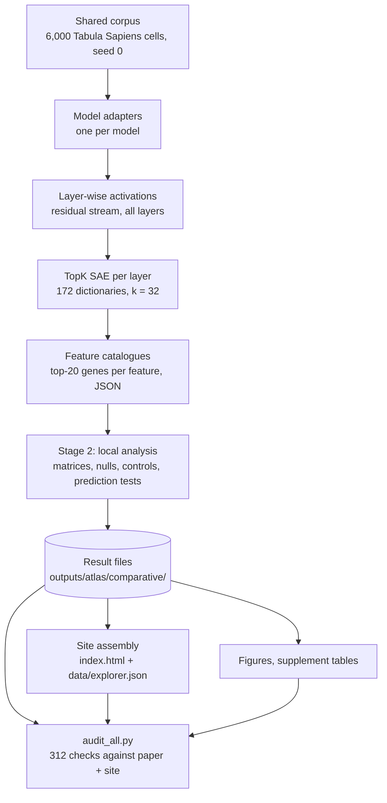

This page introduces the **Comparative SAE Atlas** — a research repository that runs ten single-cell foundation models through the same pipeline, opens each model's internal features with sparse autoencoders, and compares what the models encode. It covers the project's purpose, the ten models under study, the repository layout, the two-stage pipeline architecture, and the reproducibility engineering that makes every published number verifiable. By the end you will know what lives where, how the pieces connect, and which page to read next.

Sources: [README.md](/README.md#L1-L9)

## What This Project Is

The core question is simple to state: when ten different gene-expression foundation models read the *same cells*, do they learn the *same biology*? The project answers this by running every model on one shared corpus of 6,000 Tabula Sapiens cells, training one sparse autoencoder (SAE) per network layer — 172 dictionaries in all — annotating the resulting features with a single calibrated method, and then comparing the models on four questions: what each model encodes, what they share, which to use for a given task, and whether their features predict biology the models were never shown. The results are published as an interactive web atlas (served from `index.html` in this repository) and as 59 audited result files.


A crucial design rule shapes everything downstream: a difference between two models can only be trusted if the *data* is identical. Earlier single-model atlases were built on different corpora, so any difference between them could have been the data rather than the model. This repository's first recorded decision was therefore to give all ten models exactly one corpus, drawn with a fixed seed, plus a second disjoint held-out draw for replication tests.

Sources: [README.md](/README.md#L1-L9), [DECISIONS.md](/docs/DECISIONS.md#L6-L19)

## The Ten Models at a Glance

The comparison spans a 300-fold range of model sizes (10M to 3B parameters) and deliberately diverse designs — different input encodings, training objectives, and pretrained priors — which is what makes the comparison informative. Note the `reads a cell as` column: models differ fundamentally in how they convert a cell's gene-expression vector into tokens.

| model | params | layers | reads a cell as | objective | prior | species |
|---|---|---|---|---|---|---|
| AIDO.Cell | 10M | 8 | expression, all genes | MLM | none | human |
| scGPT | ~50M | 12 | binned expression | MLM | none | human |
| tGPT | ~120M | 8 | rank order | autoregressive | none | human |
| scFoundation | 100M | 12 | expression, read-depth aware | MAE | none | human |
| GeneCompass | 104M | 12 | rank order plus value | MLM | knowledge graph | human, mouse |
| MaxToki | 217M | 11 | rank order | autoregressive (Llama) | none | human |
| Geneformer-V2 | 316M | 18 | rank order | MLM | none | human |
| UCE | 650M | 33 | ESM2 protein tokens, sampled by expression | masked | ESM | multi-species |
| C2S-Scale | 2B | 26 | rank-ordered gene names as text | autoregressive | text (Gemma-2) | human, mouse |
| Tahoe-x1 | 3B | 32 | binned expression | MLM | none | human |

> [!TIP]
> Because the models span species (UCE, GeneCompass, C2S-Scale are multi-species), the shared human-only corpus means the atlas says nothing about the models' cross-species abilities — a deliberate trade-off of the one-corpus design, recorded in the decision log.

Sources: [README.md](/README.md#L49-L62), [DECISIONS.md](/docs/DECISIONS.md#L6-L19)

## Repository at a Glance

The repository splits cleanly into five zones: the interactive site, the frozen results, the GPU pipeline, the local analysis pipeline, and the documentation that ties them together.

```
index.html, data/            the site: a 12 MB page plus the feature maps it fetches on demand
outputs/atlas/comparative/   the 59 result files and 7 figures every number is read from
pipeline/atlas_h100/         the GPU stage: adapters, SAE, extraction, per-model analyses
pipeline/scripts/            the local stage: matrices, controls, prediction tests, assembly, audit
pipeline/atlas_template.html the site's markup; index.html is built from it
pipeline/legacy/             earlier builders, kept for provenance, used by nothing
docs/DECISIONS.md            what was decided, why, what it cost, where it lives
docs/METHODS.md              methods in brief, with pointers into the code
docs/REPRODUCE.md            how to check the numbers, rebuild the site, re-run the analysis, re-extract
docs/RESULTS.md              every result file: written by, read by, what it holds
requirements.txt             the local analysis environment (Python 3.13, NumPy 2.3.4)
```

Two things are deliberately *not* in the repository: the manuscript and supplement (shared separately — the audit needs them dropped into `outputs/atlas/comparative/`), and the 1.2 GB of per-run feature catalogues and external inputs, published as release assets and fetched by a checksummed download script. The SAE weights (~17 GB) and activations stay on the GPU host entirely.

Sources: [README.md](/README.md#L11-L35), [RESULTS.md](/docs/RESULTS.md#L1-L5)

## How the Pipeline Is Organized

The architecture is a strict two-stage design, and understanding the boundary between the stages is the key to navigating this repository. **Stage 1 (GPU)** turns model checkpoints into small JSON *feature catalogues*: each model's adapter reads the shared corpus, residual-stream activations are extracted at every layer, a TopK sparse autoencoder is trained per layer, and each layer's catalogue records the top-20 genes per feature. **Stage 2 (local, CPU-only)** needs only those catalogues — every matrix, null model, prediction test, figure, and the website itself is built downstream of them. The diagram below shows the full flow:



The two stages even run under different environments: extraction used Python 3.12 with PyTorch on an NVIDIA H100, while everything downstream runs on a laptop under Python 3.13 with NumPy 2.3.4 (pinned in `requirements.txt`). This means a reader can reproduce *all* published analyses without ever touching a GPU — the catalogues ship as release archives.

> [!TIP]
> Every script in the local stage reads and writes under a single `ATLAS_BASE` environment variable (default: your repository root, set via `export ATLAS_BASE=$(pwd)`). If a script can't find its data, this variable is the first thing to check.

Sources: [atlas_h100/README.md](/pipeline/atlas_h100/README.md#L1-L22), [scripts/README.md](/pipeline/scripts/README.md#L1-L5), [METHODS.md](/docs/METHODS.md#L85-L89), [REPRODUCE.md](/docs/REPRODUCE.md#L8-L17)

## Core Concepts for New Readers

Five terms recur on every page of this documentation. The table below defines each in one sentence, in the order you are likely to meet them.

| Concept | What it means here |
|---|---|
| **Feature (SAE feature)** | One direction in a sparse autoencoder's dictionary; a feature's identity is the ranked list of genes that most activate it (top 20 kept per catalogue) |
| **Feature catalogue** | The per-layer JSON file listing every feature's genes — the atomic artifact the whole local stage consumes |
| **Annotator** | The procedure that maps a feature's genes to a named biological concept; a *permissive* version (top-5 genes, five databases) failed a random-gene null, so every cross-model claim uses the *calibrated* version (top-10 genes, curated pathway, ≥3 overlap) |
| **Null model** | A synthetic control (random genes, degree-matched genes, cell shuffles, rewired graphs) that every claim must beat — the failed and passed controls are reported side by side |
| **Held-out corpus** | A second cell draw (seed 1, 5,581 cells) sharing no cells with the corpus, used to test whether findings replicate on data the pipeline never touched |

Sources: [METHODS.md](/docs/METHODS.md#L21-L56), [DECISIONS.md](/docs/DECISIONS.md#L61-L80)

## What the Atlas Found (Headlines)

The findings section of the README is unusual in scientific code repositories: it reports the controls that *failed* alongside those that passed, and every number is audited against the result file that produced it. Four headlines summarize the story:

- **A naive "universal core" is an artifact.** The permissive annotator suggests 1,977 concepts shared by all ten models — but *random* genes share 3,570 under the same construction (z = −24.2). The claim does not survive its null.
- **A calibrated backbone is real, but modest.** Under the calibrated annotator, 96 concepts are shared by at least 8 of 10 models — 27.5× the uniform random-gene null — and they replicate on the disjoint held-out draw. Yet a no-model dictionary built purely from gene-gene co-expression recovers 73–95 of those same 96 concepts: the backbone is mostly the co-expression structure of the data, not something the models add.
- **Known regulation is recovered by only 4 of 10 models** (UCE 10.2×, Tahoe-x1 9.4×, C2S-Scale 5.5×, Geneformer-V2 2.5× over a degree-matched null against TRRUST), and co-expression from the same cells does about as well.
- **No new biology, and the reason is the evidence:** only 98 of 4,272 predicted pairs were never co-mentioned in literature, and the resources cannot confirm links about understudied genes.

The detailed claims — and equally important, the **retracted** ones — are catalogued in [Key Findings and Retracted Claims](4-key-findings-and-retracted-claims).

Sources: [README.md](/README.md#L64-L118)

## Why Everything Is Audited

The repository's most distinctive feature is its reproducibility engineering. The published catalogues are the *second* run: three faults in the first release (a position cap that let some models see 32 cells while others saw 6,000, filler genes in top-gene lists, and an unseeded SAE) were discovered and the entire extraction was corrected and re-run, with the changes documented as decision 16 in the log. Three mechanisms keep the current numbers honest:

1. **The audit** — `audit_all.py` runs six modules performing 312 checks that re-derive every number in the paper, supplement, figures, and website from the result files, and reports whether it is safe to submit.
2. **Checksummed archives** — the 1.2 GB of per-run outputs ship as release assets with SHA-256 checksums, downloaded and verified by `fetch_runs.sh`.
3. **The decision log** — `docs/DECISIONS.md` records every methodological choice in order: what was decided, why, what it cost, and where it lives in the code.

Sources: [README.md](/README.md#L27-L45), [REPRODUCE.md](/docs/REPRODUCE.md#L47-L77), [DECISIONS.md](/docs/DECISIONS.md#L1-L4)

## Getting Started Path

The fastest meaningful interaction with this repository requires no GPU and no large downloads — install five pinned packages, drop in the manuscript files, and run the audit:

```bash
pip install -r requirements.txt
export ATLAS_BASE=$(pwd)
cp /path/to/MANUSCRIPT.md /path/to/SUPPLEMENTARY.md outputs/atlas/comparative/
python pipeline/scripts/audit_all.py      # 312 checks: paper, supplement, figures, site
python pipeline/scripts/inject_atlas.py   # rebuilds index.html from the result files
```

If you prefer to explore before running anything, open the live atlas directly — it is a static page with the feature maps fetched on demand, servable locally with `python -m http.server`.

Sources: [README.md](/README.md#L37-L45), [REPRODUCE.md](/docs/REPRODUCE.md#L19-L45)

## Where to Go Next

This repository's documentation follows the reading order below. As a beginner, take the top path first — the conceptual pages require no code reading — then descend into the Deep Dive sections when you want implementation detail:

| Step | Page | What you'll learn |
|---|---|---|
| 1 | [Quick Start](2-quick-start) | Hands-on setup and first commands |
| 2 | [Ten Foundation Models Compared](3-ten-foundation-models-compared) | Each model's design and how the adapters normalize them |
| 3 | [Key Findings and Retracted Claims](4-key-findings-and-retracted-claims) | Every claim, including the ones the nulls killed |
| 4 | [Architecture Overview](5-architecture-overview) | The two-stage pipeline in implementation detail |
| 5 | [Null Models Behind Every Claim](10-null-models-behind-every-claim) | The statistical controls methodology |
| 6 | [Audit System and Manuscript Checks](18-audit-system-and-manuscript-checks) | How the 312-check audit works |
