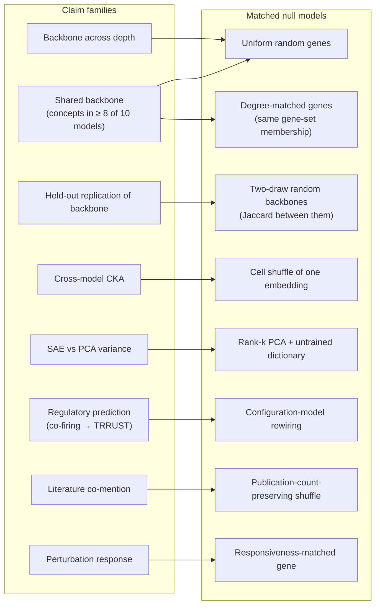

Every quantitative claim in the atlas-comparison repository is paired with a null model constructed to produce that same claim by chance. This page documents the null family as an engineering system: the design principle that matches each null to the confound it excludes, the six distinct null implementations, the shared empirical-p convention, and the audit trail of what the nulls retracted versus what survived. This is the statistical core of the project — the layer that decides which claims a reviewer can act on and which are artefacts of database overlap, gene popularity, or study bias.

Sources: [docs/METHODS.md](docs/METHODS.md#L48-L55), [docs/DECISIONS.md](docs/DECISIONS.md#L85-L107), [pipeline/scripts/README.md](pipeline/scripts/README.md#L20-L40)

## The Design Principle: Nulls Matched to the Claim

The repository's rule, stated in the decision log, is that **each result is stated against a null built to produce the same result by chance**. This is a stronger requirement than a generic permutation test. A generic null ("shuffle everything") answers only "is the number above zero?" — it cannot distinguish a genuine signal from a structural bias. The nulls here are *matched*: each one preserves every property of the data except the property the claim depends on. If a claim is about concepts shared across ten models, the null asks whether random genes annotate at the same rate. If a claim is about co-firing genes predicting regulatory edges, the null asks whether a degree-preserving rewiring of the co-firing graph recovers edges just as well — so gene abundance and study bias survive intact in the null and cannot explain the effect.

This matching discipline also inverts the usual role of a null: here, nulls were used **as calibration instruments during design**, not only as tests after the fact. The calibrated annotator was produced by a grid search (`recalibrate.py`, `recalibrate2.py`) over database, set size, minimum overlap and odds ratio, with the stopping criterion being the random-gene null itself — the search continued until random genes annotate roughly 3 % of features versus roughly 9 % for real ones. The chosen configuration was then frozen on the discovery corpus before the held-out corpus was ever touched.

Sources: [docs/DECISIONS.md](docs/DECISIONS.md#L85-L107), [docs/DECISIONS.md](docs/DECISIONS.md#L69-L83), [pipeline/scripts/README.md](pipeline/scripts/README.md#L20-L40)

## The Annotation Nulls: From Retraction to the Calibrated Backbone

Three nulls attack the annotation claims, forming a deliberate escalation ladder from weakest to strongest. The **random-gene null** ([random_null.py](pipeline/scripts/random_null.py)) replaces every feature's top-5 genes with genes drawn uniformly from the 16,205-gene background and runs the identical permissive annotator (hypergeometric overlap ≥ 2, BH < 0.05, five databases) over the same per-model feature counts. Under this null, random genes annotate almost as often as real ones — and, decisively, the all-layer "universal core" of ~1,977 concepts shared by all ten models is *below* the random-gene core of 3,570 (z = −24.2). At the mid layer the naive core of 365 real concepts sits under a 582-concept random core. The script also computes two refinements: a deduplicated-core null (Jaccard ≥ 0.5 merging, to rule out ontology redundancy inflating counts) and a **held-out-style null** — the Jaccard overlap of two *independent* random-gene cores — which calibrates the "reproducibility" claim directly: the observed held-out core Jaccard of 0.50 is compared against a two-random-draw baseline of 0.51.

The **all-layer null** ([alllayer_null.py](pipeline/scripts/alllayer_null.py)) closes the reviewer-critical gap that the mid-layer null left: the retracted headline was an all-layer union, so the null must union per-layer concepts over every layer per model, intersect across the ten models, and compare against a random-gene null built the same way (random genes drawn per layer at each layer's real feature count). Because the null repeats the annotator per layer per permutation, the implementation swaps the per-feature Python loop for a sparse gene × term incidence matrix and a matrix product — roughly a 50× speedup with an annotator provably identical to `random_null.py`'s. It runs only 20 permutations, a budget set by cost.

The **degree-matched null** ([degree_null.py](pipeline/scripts/degree_null.py)) is the strongest test in the ladder. Instead of uniform draws, each real top-gene is replaced by a random gene from the *same degree bin* — the same gene-set membership degree across curated GO/Reactome/KEGG — computed over a background sorted with stable ordering, degree-0 genes in their own bin, and the rest split into 40 quantile bins. This controls for gene popularity: high-degree genes are "hittable" by chance under any uniform null, so if the calibrated backbone still beats *this* null, it is not a gene-abundance artefact. It evaluates the calibrated annotator (top-10, ≥ 3 in a set ≤ 200 genes, no PPI) at sharing tiers ≥ 7/8/9/10 of 10 models with 250 permutations per tier, reporting the uniform null alongside for contrast.

| Null | Script | Permutations | Scope | Verdict |
|---|---|---|---|---|
| Uniform random-gene | `random_null.py` | 100 | Mid layer, permissive annotator | Retracts the naive core |
| All-layer union | `alllayer_null.py` | 20 | Per-layer counts preserved, permissive annotator | Retracts the all-layer core |
| Degree-matched | `degree_null.py` | 250 | Calibrated annotator, 40 degree bins, tiers ≥ 7/8/9/10 | Backbone survives |
| Two-draw held-out | `stats_final.py`, `random_null.py` | 150 | Jaccard between independent backbones | Replication survives |

The final link in the chain is [stats_final.py](pipeline/scripts/stats_final.py), which re-runs the backbone claim at publication grade: 250 permutations of the uniform null against the calibrated backbone at the mid layer, plus a 150-draw held-out replication null where random-gene backbones are built on *both* the discovery and held-out draws and their Jaccard is compared to the observed one. What survives this ladder is a backbone of 96 concepts at the ≥ 8-of-10 tier — 27.5× the uniform null and 51.2× the degree-matched null — and held-out replication at Jaccard 0.52 against a null of 0.035. The two-annotator story these nulls forced is covered in depth in [Calibrated versus Permissive Annotation](9-calibrated-versus-permissive-annotation).

Sources: [pipeline/scripts/random_null.py](pipeline/scripts/random_null.py#L1-L8), [pipeline/scripts/random_null.py](pipeline/scripts/random_null.py#L115-L131), [pipeline/scripts/alllayer_null.py](pipeline/scripts/alllayer_null.py#L1-L7), [pipeline/scripts/alllayer_null.py](pipeline/scripts/alllayer_null.py#L42-L84), [pipeline/scripts/degree_null.py](pipeline/scripts/degree_null.py#L1-L9), [pipeline/scripts/degree_null.py](pipeline/scripts/degree_null.py#L39-L47), [pipeline/scripts/stats_final.py](pipeline/scripts/stats_final.py#L1-L7), [docs/DECISIONS.md](docs/DECISIONS.md#L109-L125)

## The Geometry Nulls: Cell Shuffle and the Matched-Sparsity Baseline

[cka_svd_null.py](pipeline/atlas_h100/cka_svd_null.py) applies the same rigour to the annotation-free survivors — the results that need no gene lists at all. For **linear CKA** between every one of the 45 model pairs (not a hand-picked subset, the docstring notes), the null is a **cell shuffle**: cells of one embedding are permuted, destroying the cell-to-cell correspondence while leaving each embedding's internal geometry intact. Twenty shuffles per pair give the shuffled-CKA baseline; a real similarity is meaningful only above this floor. The implementation is minimal by design — the CKA itself is eight lines (centering, then the squared norm of the cross-Gram matrix normalised by the two self-Gram norms).

For the **SAE-versus-PCA** claim, the script answers the sharpest possible objection: is the SAE's variance-explained edge just *overcompleteness*? Three quantities are compared at matched sparsity k = 32: the top-32 SVD subspace (analytic, deterministic), the trained SAE, and an **untrained random TopK dictionary of identical shape** (same d, same d_sae, same k, torch seed 0, encoded on the first 20,000 activation rows). The two baselines need no permutations — "none needed" in the null table — because they are deterministic or exact. This framing is what retired a prior claim that "about 100 % of SAE features are invisible to the top SVD axes": that is equally true of random directions at this dimensionality, a property of the dimension rather than the features. The claim that survives is the matched-sparsity one — the SAE beats top-32 PCA in all ten models. The CKA/SVD machinery itself is documented in [Cross-Model Geometry: CKA and SVD](12-cross-model-geometry-cka-and-svd).

Sources: [pipeline/atlas_h100/cka_svd_null.py](pipeline/atlas_h100/cka_svd_null.py#L1-L8), [pipeline/atlas_h100/cka_svd_null.py](pipeline/atlas_h100/cka_svd_null.py#L35-L51), [pipeline/atlas_h100/cka_svd_null.py](pipeline/atlas_h100/cka_svd_null.py#L53-L85), [docs/DECISIONS.md](docs/DECISIONS.md#L109-L125)

## The Prediction Null: The Configuration Model

The held-out regulatory test (see [Held-Out Regulatory Prediction Test](11-held-out-regulatory-prediction-test) for the full protocol) rests on one null: the **configuration model**. Each model's co-firing graph — genes as nodes, an edge where two genes co-occur in ≥ 5 SAE features — is rewired while preserving **every gene's degree exactly**. The implementation in [hypothesis_trrust2.py](pipeline/scripts/hypothesis_trrust2.py) is a two-column stub-matching shuffle: degrees are split into stub arrays, shuffled, and re-paired, dropping self-loops and duplicates, with edges encoded as packed 64-bit integers for set operations. Because the rewired graph retains abundance and study bias by construction — a gene that co-fires with everyone still co-fires with everyone in the null — neither can produce the observed TRRUST enrichment. TRRUST itself is genuinely held out: the calibrated annotator saw only curated pathway sets, never interaction databases, so no pipeline step touched the truth.

The script is a three-stage design worth noting as a pattern. Stage (A) **validates the null**: an analytic configuration-model expectation ([hypothesis_trrust.py](pipeline/scripts/hypothesis_trrust.py#L98-L100), `E[edge] ≈ 1 − exp(−dₐd_b/2m)`) is checked against 500 real degree-preserving permutations per model, and the reported p-values come from those permutations, not the analytic formula. Stage (B) applies the same independent-per-model null to the **cross-model corroboration curve** — precision as the number of models predicting a pair rises — and the equal-budget re-scoring. Stage (C) emits the hypothesis list from pairs absent from TRRUST, STRING, and every curated pathway, with precision estimated from stage (B). One design subtlety is stored explicitly in the output: the curve rewires *all ten graphs per draw* but runs a fifth as many permutations (100), because the per-model count (500) had been mis-attributed to it in the manuscript until the field `n_perm_curve` was recorded.

Sources: [pipeline/scripts/hypothesis_trrust.py](pipeline/scripts/hypothesis_trrust.py#L1-L19), [pipeline/scripts/hypothesis_trrust.py](pipeline/scripts/hypothesis_trtrust.py#L39-L46), [pipeline/scripts/hypothesis_trrust2.py](pipeline/scripts/hypothesis_trrust2.py#L1-L12), [pipeline/scripts/hypothesis_trrust2.py](pipeline/scripts/hypothesis_trrust2.py#L60-L69), [pipeline/scripts/hypothesis_trrust2.py](pipeline/scripts/hypothesis_trrust2.py#L94-L108), [pipeline/scripts/hypothesis_trrust2.py](pipeline/scripts/hypothesis_trrust2.py#L164-L172)

## The Evidence Nulls: Literature Shuffle and Responsiveness Matching

Two further kinds of evidence each carry a null engineered for their specific confound. For **literature co-mention** ([hypothesis_pubmed.py](pipeline/scripts/hypothesis_pubmed.py)), the risk is trivially circular: heavily studied genes are co-mentioned with everyone. The null is a **publication-count-preserving shuffle** of the gene→paper bipartite graph — each gene keeps its paper count exactly, papers are reassigned at random via paper-side stub matching, and the observed mega-paper cap (papers annotating > 60 genes are skipped, exactly as in the observed data, applied for a like-for-like comparison) is honoured in the null too. Without that cap, 96 % of all pairs would be "co-mentioned" and the measure would say nothing.

For **perturbation evidence** ([hypothesis_perturb.py](pipeline/scripts/hypothesis_perturb.py)), two confounds are handled at exactly two layers. The read-out is the *within-row percentile* of gene B's response among all genes when A is knocked down — immune to how globally disruptive perturbation A is (essential genes move everything, but ranks do not care). The null replaces B with a random gene **matched on its own responsiveness** (mean |X| across all perturbations, 20 quantile bins) — so a gene that reacts to everything cannot score by reactivity alone. Row effects fall to the ranking; column effects fall to the matching. The same construction is re-run per corroboration subset (≥ k models), each subset getting its own responsiveness-matched null rather than inheriting the full-set null.

> [!TIP]
> The null in `hypothesis_pubmed.py` contains a subtle reproducibility fix: papers are indexed in **sorted PMID order**, not set-iteration order, because Python randomises string hashing across processes — under the same seed, set-iteration indexing permuted the null differently in every run, giving z = 40.5 on one run and 36.6 on the next. The conclusion never moved, but as the comment puts it, "a number nobody can reproduce is not a number we can report." Any null implementation that iterates an unordered Python collection should apply the same discipline.

Sources: [pipeline/scripts/hypothesis_pubmed.py](pipeline/scripts/hypothesis_pubmed.py#L1-L18), [pipeline/scripts/hypothesis_pubmed.py](pipeline/scripts/hypothesis_pubmed.py#L85-L120), [pipeline/scripts/hypothesis_perturb.py](pipeline/scripts/hypothesis_perturb.py#L1-L17), [pipeline/scripts/hypothesis_perturb.py](pipeline/scripts/hypothesis_perturb.py#L60-L94), [pipeline/scripts/hypothesis_perturb.py](pipeline/scripts/hypothesis_perturb.py#L111-L134), [docs/DECISIONS.md](docs/DECISIONS.md#L187-L205)

## The Statistical Convention: Empirical p and Permutation Budgets

Every permutation null in the repository reports the same convention: **p_emp = (number of null draws at or above the observed value + 1) / (N + 1)**. The add-one correction in the numerator guarantees p is never zero, and the one in the denominator guarantees p is never one — at the cost of a floor: with N permutations the smallest reportable p is 1/(N + 1), and most of the significant results sit exactly at that floor (e.g. p = 0.004 at N = 250). Permutation counts differ by computational cost and are stated wherever a number derived from them appears; alongside each p, the scripts emit the null mean, standard deviation, z-score, and a fold-change over the null, so every reported enrichment is auditable against its own null distribution. All draws use `np.random.default_rng(0)` seeded identically.

Two results deliberately sit near the threshold instead of at the floor and are reported as **marginal**: MaxToki under equal-budget re-scoring (p = 0.04) and the corroboration gain in one robustness variant (p = 0.055). Declaring these marginal rather than significant is part of the same discipline — the Poisson whiskers on the prediction figure exist for the same reason: 60 and 79 recovered edges do not support a ranking between 10.2× and 9.4×.

| Claim | Null | Permutations |
|---|---|---|
| Shared backbone (≥ 8 of 10 models) | Uniform random genes; degree-matched random genes | 250 each |
| Backbone across depth | Uniform random genes at each of five depths | 250 |
| Held-out replication of the backbone | Random-gene backbones on both draws, Jaccard between them | 150 |
| Naive core (retracted) | Uniform random genes, mid layer and all-layer union | 100; 20 |
| CKA between models | Shuffle the cells of one embedding | Per pair (20 shuffles) |
| SAE against PCA | Top-k PCA at the same k; untrained random dictionary | None needed |
| Held-out regulatory recovery per model | Configuration model: rewire the co-firing graph, every gene's degree exact | 500 |
| Corroboration curve, equal-budget re-scoring | The same, all ten graphs per draw | 100 |
| Robustness, literature, perturbation, publication strata | As above; publication-count-preserving shuffle; responsiveness-matched gene | 200 |

Sources: [docs/METHODS.md](docs/METHODS.md#L48-L55), [docs/DECISIONS.md](docs/DECISIONS.md#L85-L107), [pipeline/scripts/degree_null.py](pipeline/scripts/degree_null.py#L130-L140), [pipeline/scripts/hypothesis_trrust2.py](pipeline/scripts/hypothesis_trrust2.py#L94-L108)

## What the Nulls Retracted, and What Survived

The nulls are not decoration — four published claims were retracted by them, and the scripts and result files are deliberately kept so the negatives are reproducible. Beyond the universal core and the SVD-invisibility claim covered above, the **annotation rate itself** was retired as an interpretability score: random genes annotate almost as often under the permissive annotator, so only the calibrated rate is usable. And the **"new biology" shortlist** — genes topping unannotated features in at least five models — was tested against a size-matched feature-subset null ([novel_null.py](pipeline/scripts/novel_null.py), 200 permutations: draw the same number of features uniformly from *all* features per model and count genes reaching the threshold) plus a degree-matched label permutation ([novel_calibrated.py](pipeline/scripts/novel_calibrated.py)). Against these, the shortlist turned out to be a *deficit*, not an excess: 0 of 207 candidates survive. Consensus across models tracks database coverage; it does not fill database gaps.

What survived is the positive result set: the 96-concept calibrated backbone (27.5× uniform, 51.2× degree-matched null), CKA above its cell-shuffle floor for every one of 45 pairs (worst pair 43×), the SAE beating top-32 PCA in all ten models, and four of ten models predicting held-out TRRUST edges above their configuration-model nulls. The complete narrative of wins and losses lives in [Key Findings and Retracted Claims](4-key-findings-and-retracted-claims); the reviewer-round controls that extend this null suite (size-weighted nulls, seed CIs, bootstrap CIs on the n = 10 correlations) are catalogued in [Reviewer Robustness Analyses](16-reviewer-robustness-analyses), and the audit scripts that check every published number against the result file that produced it in [Audit System and Manuscript Checks](18-audit-system-and-manuscript-checks).

> [!TIP]
> Notice the asymmetry in how results are archived: retracted claims keep their null scripts and output JSONs alongside the survivors. When reading `outputs/atlas/comparative/`, treat a `*_null.json` file as the interpretive key for its sibling result files — a result file without its null is, by this project's standard, an uninterpretable number.

Sources: [docs/DECISIONS.md](docs/DECISIONS.md#L109-L125), [pipeline/scripts/novel_null.py](pipeline/scripts/novel_null.py#L1-L10), [pipeline/scripts/novel_null.py](pipeline/scripts/novel_null.py#L107-L126), [docs/DECISIONS.md](docs/DECISIONS.md#L127-L150)

## Where to Go Next

The nulls form one leg of the statistical methodology triad. Continue with [Calibrated versus Permissive Annotation](9-calibrated-versus-permissive-annotation) for how the null-driven annotator grid search works, [Held-Out Regulatory Prediction Test](11-held-out-regulatory-prediction-test) for the full prediction protocol the configuration model supports, and [Cross-Model Geometry: CKA and SVD](12-cross-model-geometry-cka-and-svd) for the annotation-free comparisons. To see how the permutation budgets and p-values are enforced at publication time, proceed to [Audit System and Manuscript Checks](18-audit-system-and-manuscript-checks); for how the null verdicts reshaped the project's headline claims, read [Key Findings and Retracted Claims](4-key-findings-and-retracted-claims).