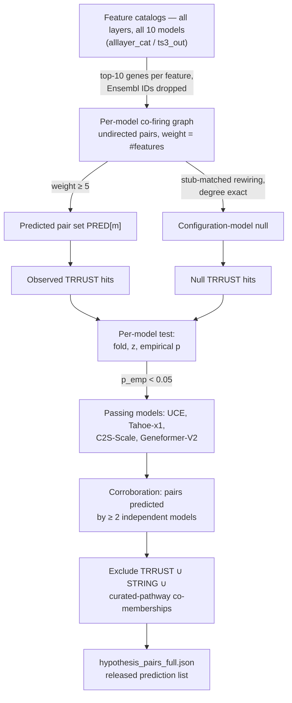
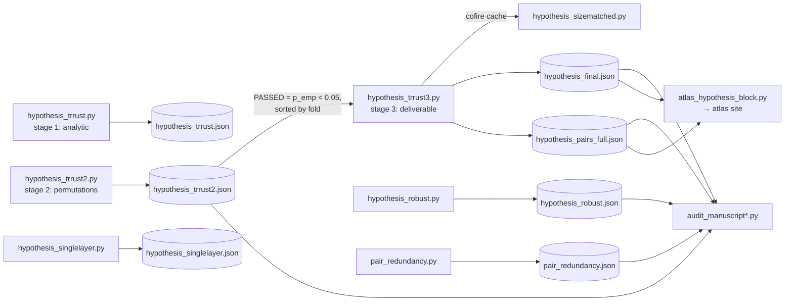

This page documents the repository's central falsifiability claim: that TopK SAE features, learned without any regulatory database, recover transcription-factor → target edges from TRRUST — a database that no step of the pipeline ever consulted. It covers the isolation argument that makes TRRUST "held out," the co-firing graph construction that turns features into predictions, the degree-preserving configuration-model null, the three-stage validation pipeline, the published results, the equal-budget correction for dictionary-size confounds, and the robustness variants that guard the conclusion.

**Positioning in the catalog**: this page is the payoff of the statistical methodology track — [Null Models Behind Every Claim](10-null-models-behind-every-claim) establishes the null discipline this test applies, and the results feed the interactive site's hypothesis block ([Site Assembly from Result Files](22-site-assembly-from-result-files)) and the manuscript audits ([Audit System and Manuscript Checks](18-audit-system-and-manuscript-checks)).

## What Is Held Out, and Why It Is Genuine

The test's validity rests on one structural fact: the **calibrated annotator** — the only annotator whose results enter cross-model claims — accepts just curated pathway sets (GO_BP, Reactome, KEGG, each ≤200 genes, at least 3 of a feature's top-10 genes in one set), explicitly excluding interaction databases. TRRUST is therefore never seen by annotation. The co-firing statistic itself consumes no annotation at all: it reads only each feature's ranked `top_genes` list. Two independent layers isolate TRRUST from every step that produces a prediction. The design was also fixed before evaluation — the calibrated annotator's grid search ran on the discovery corpus before any held-out evaluation.

Sources: [METHODS.md](docs/METHODS.md#L34-L48), [METHODS.md](docs/METHODS.md#L64-L72), [DECISIONS.md](docs/DECISIONS.md#L70-L96)

The scripts enforce the complement of this isolation when emitting the final hypothesis list: pairs are excluded not only from TRRUST (`TRUTH`) but from every pair a curated pathway co-membership could have "seen" (`SEEN`, built from the same ≤200-gene GO/Reactome/KEGG sets the calibrated annotator uses) and from all STRING edges. A released pair is therefore absent from every database the pipeline touched — the strongest novelty claim the data can support.

Sources: [hypothesis_trrust.py](pipeline/scripts/hypothesis_trrust.py#L31-L46), [hypothesis_trrust2.py](pipeline/scripts/hypothesis_trrust2.py#L26-L36)

> [!TIP]
> The held-out status of TRRUST is **conditional on the annotator's database whitelist**. The `SEEN` exclusion set in the prediction scripts is rebuilt from the exact gene-set files the calibrated annotator consumed — if STRING or any regulatory database were ever added to annotation, both the "never seen" premise and the novelty of the released list would collapse simultaneously. This coupling is why `audit_manuscript_derived.py` checks the prediction result files against the annotator configuration.

One terminological disambiguation: "held out" in this page means the **database** was withheld. A separate, earlier control holds out **cells** — re-extracting all ten models on a seed-1 Tabula Sapiens draw with the 419 cells shared with the seed-0 corpus removed, to replicate the calibrated backbone (`make_heldout_disjoint.py`, `run_heldout_fixed.sh`, 5,581 cells). That experiment belongs to the backbone replication story and is covered in [Concept Matrices and Backbone Detection](13-concept-matrices-and-backbone-detection).

Sources: [make_heldout_disjoint.py](pipeline/atlas_h100/make_heldout_disjoint.py#L1-L33), [run_heldout_fixed.sh](pipeline/atlas_h100/run_heldout_fixed.sh#L1-L24), [METHODS.md](docs/METHODS.md#L7-L11)

## From SAE Features to a Predicted Regulatory Graph

Per model, the construction pools features over **all layers** (8–33 per model), takes each feature's top-10 genes, drops Ensembl-ID artifacts (`ENSG*` prefixes), and emits every within-feature pair as an undirected, lexicographically-sorted edge. A pair's **weight** is the number of distinct features containing both genes; a pair is *predicted* when weight ≥ 5. The top-10 cutoff matches the calibrated annotator's gene budget deliberately, so the prediction and the annotation read the same feature definition.

Sources: [hypothesis_trrust.py](pipeline/scripts/hypothesis_trrust.py#L53-L74), [hypothesis_trrust2.py](pipeline/scripts/hypothesis_trrust2.py#L47-L58), [METHODS.md](docs/METHODS.md#L64-L67)

Two implementation details matter at scale. First, genes are interned into integer indices and each edge is bit-packed as `a * (1<<21) + b` with `a < b`, so the entire per-model graph collapses to a sorted `int64` array and truth membership testing is a vectorized `np.isin` against the packed TRRUST key array. Second, the co-firing graphs are computed once and pickled to a shared cache (`.cofire_cache.pkl`), which the downstream stages and the size-matched re-scoring reuse.

Sources: [hypothesis_trrust.py](pipeline/scripts/hypothesis_trrust.py#L53-L74), [hypothesis_trrust3.py](pipeline/scripts/hypothesis_trrust3.py#L55-L71), [hypothesis_sizematched.py](pipeline/scripts/hypothesis_sizematched.py#L42-L46)

The diagram's left branch is the observed pipeline; the right branch is the null that must be beaten. Both branches share the graph topology except for edge placement — this is the design that makes the comparison interpretable, as the next section explains.

Sources: [hypothesis_trrust2.py](pipeline/scripts/hypothesis_trrust2.py#L104-L160)

## The Configuration-Model Null

The null is a **configuration model**: each gene keeps its *exact* co-firing degree while edges are rewired at random. Mechanically, all edge stubs (one per endpoint) are concatenated, shuffled, re-paired two-by-two, and self-loops and duplicates are dropped. Because a well-studied or highly-expressed gene that co-fires with many partners still co-fires with exactly that many partners under the null, neither gene abundance nor study bias can manufacture enrichment — the only thing the null destroys is *which* partners a gene co-fires with.

Sources: [hypothesis_trrust2.py](pipeline/scripts/hypothesis_trrust2.py#L61-L70), [DECISIONS.md](docs/DECISIONS.md#L83-L84)

Stage 1 additionally computes an analytic expectation — a Chung-Lu-style sum `Σ(1 − exp(−d_a·d_b / 2m))` over reachable TRRUST edges — giving fold values without waiting on permutations. Stage 2 then validates that analytic shortcut against 500 real rewirings per model, reporting the null mean ± sd, a z-score, and the empirical p-value with the repository-wide convention `p = (#{null ≥ obs} + 1) / (N + 1)`.

Sources: [hypothesis_trrust.py](pipeline/scripts/hypothesis_trrust.py#L81-L86), [hypothesis_trrust2.py](pipeline/scripts/hypothesis_trrust2.py#L104-L121), [DECISIONS.md](docs/DECISIONS.md#L85-L88)

## Three-Stage Validation Pipeline

The test evolved across three scripts, each writing its own result file and each answering a distinct question. Stage 2 reads nothing from stage 1; stage 3 is the only stage that consumes a predecessor's output — the passing-model list from stage 2.

| Stage | Script | Question answered | Null and permutations | Output artifact |
|---|---|---|---|---|
| 1 | `hypothesis_trrust.py` | Do co-firing pairs recover TRRUST edges at all, at confidence W ∈ {1,2,3,5,10}? | Analytic configuration-model expectation | `hypothesis_trrust.json` |
| 2 | `hypothesis_trrust2.py` | Does the analytic null survive 500 real rewirings? Does multi-model agreement raise precision? | Degree-preserving rewiring: per-model 500; all-ten-graph corroboration curve 100 (a fifth as many, stored explicitly) | `hypothesis_trrust2.json` |
| 3 | `hypothesis_trrust3.py` | Which multi-model pairs are in *no* database, and which models validate the generator? | Same null restricted to passing models, 200 rewirings | `hypothesis_final.json`, `hypothesis_pairs_full.json` |

Sources: [hypothesis_trrust.py](pipeline/scripts/hypothesis_trrust.py#L3-L24), [hypothesis_trrust2.py](pipeline/scripts/hypothesis_trrust2.py#L3-L14), [hypothesis_trrust3.py](pipeline/scripts/hypothesis_trrust3.py#L3-L5), [RESULTS.md](docs/RESULTS.md#L36-L41)

Stage 3 makes three changes beyond restriction. It flags **paralog families** with a naming rule — two symbols sharing a stem of ≥3 characters with suffixes ≤3 characters each (ACTB/ACTG2, S100A11/S100A4, HLA-A/HLA-B) — deliberately erring toward over-dropping (CDC42/CDC37 count as one family), the safe direction for a candidate list. It fixes degenerate reporting when a null permutation produces zero hits (fold printed as `inf*` with the zero-count stored). And it applies the release threshold **K = 2**: a pair enters the hypothesis list only when two *independently validated* models predict it.

Sources: [hypothesis_trrust3.py](pipeline/scripts/hypothesis_trrust3.py#L73-L118), [hypothesis_trrust3.py](pipeline/scripts/hypothesis_trrust3.py#L120-L146), [hypothesis_robust.py](pipeline/scripts/hypothesis_robust.py#L36-L47)

## Results: Four of Ten Models Pass

With the corrected feature catalogs, four of the ten models produce co-firing graphs that recover TRRUST edges significantly above their own degree-matched nulls:

| Model | Fold over null | Status |
|---|---|---|
| UCE | 10.2× | passes |
| Tahoe-x1 | 9.4× | passes |
| C2S-Scale | 5.5× | passes |
| Geneformer-V2 | 2.5× | passes |
| scGPT | 11.9× on superseded catalogs → 1.7×, p = 0.27 on corrected | retracted |
| remaining six | not significant at p < 0.05 | fail |

Sources: [DECISIONS.md](docs/DECISIONS.md#L148-L172)

The scGPT entry is the test's most instructive negative: its apparent 11.9× enrichment was an artifact of catalogues trained on roughly 420 cells (the [extraction fault documented separately](21-extraction-faults-and-corrected-re-run)); on corrected catalogs the signal vanishes (1.7×, p = 0.27). The manuscript reports both numbers, which is precisely the kind of claim the audit system verifies against result files.

Cross-model corroboration is the second headline result: pairs predicted by **two** models independently are enriched **15.3×** over the configuration null versus **5.0×** for single-model pairs (2,000 rewirings via `agreement_curve.py`), a precision of 0.23%. Agreement beyond two models adds nothing. The 100-rewiring corroboration curve inside `hypothesis_trrust2.json` yields 11.5× for the ≥2 tier — a noisier estimate, retained and explained rather than silently replaced.

Sources: [DECISIONS.md](docs/DECISIONS.md#L166-L172), [RESULTS.md](docs/RESULTS.md#L28-L28)

> [!TIP]
> The corroboration curve is computed over **all ten models**, never the four that passed — the four were *selected* on TRRUST, and re-scoring the selected subset against the same database would be circular. The selected-four numbers (5.4×, 15.4×) appear only as a direction check, and the selected set is read programmatically from `hypothesis_trrust2.json` (`p_emp < 0.05`) rather than typed in, so the selection criterion cannot drift from what was tested.

Because 60 and 79 recovered edges are too few to license fine-grained ranking, the figures add Poisson whiskers: the manuscript explicitly declines to claim UCE's 10.2× beats Tahoe-x1's 9.4×.

Sources: [DECISIONS.md](docs/DECISIONS.md#L184-L186)

## Capacity versus Quality: The Equal-Budget Re-Scoring

The per-model fold table has a structural confound the null cannot fix: how many pairs a model can *offer* is set by its dictionary width (4 × d_model) and layer count, spanning four orders of magnitude — AIDO.Cell contributes 2 predicted pairs, C2S-Scale 147,728 — and hit counts correlate with graph size at r = +0.90. Each model's fold is compared to a null built from its own graph, so the ratio is nominally protected, but a reader sees a league table and cannot distinguish capability from capacity.

Sources: [hypothesis_sizematched.py](pipeline/scripts/hypothesis_sizematched.py#L3-L27)

The correction gives every model the **same prediction budget** — N = 50,707, the smallest graph among the passing models — under two regimes: `top-N` (the N highest-weight pairs, what a practitioner with a fixed budget would take) and `rand-N` (N random pairs, 20 draws, isolating size alone). All four passing models remain significant at equal budget:

| Model | Full-size fold | Equal-budget (50,707 pairs, top-N) |
|---|---|---|
| UCE | 10.2× | 11.8× |
| Tahoe-x1 | 9.4× | 11.0× |
| C2S-Scale | 5.5× | 8.4× |
| Geneformer-V2 | 2.5× | 2.4× |

Sources: [hypothesis_sizematched.py](pipeline/scripts/hypothesis_sizematched.py#L72-L115), [DECISIONS.md](docs/DECISIONS.md#L174-L178)

Two reporting rules follow. Models whose graphs are smaller than the budget are recorded as **untestable at that budget** — not as failures — the distinction the manuscript previously elided for AIDO.Cell. And only the equal-budget version licenses a claim about *quality*; both versions are persisted (`ranking_full_size`, `ranking_size_matched`, `ranking_preserved`, plus a Spearman rank correlation between the two rankings).

Sources: [hypothesis_sizematched.py](pipeline/scripts/hypothesis_sizematched.py#L89-L124), [DECISIONS.md](docs/DECISIONS.md#L174-L178)

## Robustness Variants

Five controlled perturbations ask whether the enrichment survives when plausible artifacts are removed. All use the same configuration-model null restricted to passing models:

| Variant | Mechanism | Artifact it rules out |
|---|---|---|
| R1 — no same-family pairs | Naming-rule paralog pairs (shared stem ≥3 chars, short suffixes) dropped | Enrichment carried by gene families rather than regulation |
| R2 — firing features only | Only features with `activation_frequency` above the per-model median | Near-zero-expression genes clustering together |
| R3 — stricter evidence | Per-pair bar raised from ≥5 to ≥10 features | Result resting on weak recurrence |
| R2+R1 | Both combined | Interaction of the two artifacts |
| Deduplicated support (`pair_redundancy.py`) | Features in the same co-activation community at the same layer vote once | Near-duplicate feature blocks satisfying W ≥ 5 by themselves |

Sources: [hypothesis_robust.py](pipeline/scripts/hypothesis_robust.py#L3-L14), [hypothesis_robust.py](pipeline/scripts/hypothesis_robust.py#L100-L110)

The near-duplicate check deserves its own scrutiny because the atlas shows that most models contain a block of near-copy features (a known consequence of dictionary oversizing, documented in [TopK Sparse Autoencoder Training](7-topk-sparse-autoencoder-training) and decision 3). For every model, `pair_redundancy.py` measures how much faster community features fire than the rest, what share of each predicted pair's support comes from community members, whether block-carried pairs hit TRRUST at a different rate, and what survives deduplication. Its conclusion — that the prediction result does not rest on the block — is what Table S12 reports. A sixth variant, `hypothesis_singlelayer.py`, rebuilds the co-firing graph from a single layer to test whether the result requires pooling across depth. Two auxiliary results sit near the significance threshold and are reported as marginal rather than clean: MaxToki at equal budget (p = 0.04) and one corroboration gain in a robustness variant (p = 0.055).

Sources: [pair_redundancy.py](pipeline/scripts/pair_redundancy.py#L3-L18), [pair_redundancy.py](pipeline/scripts/pair_redundancy.py#L56-L80), [DECISIONS.md](docs/DECISIONS.md#L37-L39), [DECISIONS.md](docs/DECISIONS.md#L85-L88), [RESULTS.md](docs/RESULTS.md#L37-L38)

## Result Files and Downstream Consumption

The test's artifacts are nine JSON files in `outputs/atlas/comparative/`, each with a declared writer and consumers:

| File | Writer | Consumed by | Holds |
|---|---|---|---|
| `hypothesis_trrust.json` | stage 1 | — (exploratory) | Per-model analytic folds over the W grid |
| `hypothesis_trrust2.json` | stage 2 | stage 3, size-matched, audits, figures | Per-model permutation results; all-ten corroboration curve |
| `hypothesis_final.json` | stage 3 | site assembly, supplement tables, Fig 5, audits | Validated models + released prediction list |
| `hypothesis_pairs_full.json` | stage 3, then literature enrichment in place | site, supplement, robustness checks | All released pairs with models, weight, co-mentions, family flag |
| `hypothesis_robust.json` | `hypothesis_robust.py` | audits, supplement | The five robustness variants |
| `hypothesis_sizematched.json` | `hypothesis_sizematched.py` | audits, Fig 5 | Equal-budget re-scoring and both rankings |
| `pair_redundancy.json` | `pair_redundancy.py` | audits, supplement | Near-duplicate-block decomposition (Table S12) |
| `agreement_curve.json` | `agreement_curve.py` | site hypothesis block | 2,000-rewiring precision at ≥1 and ≥2 models |
| `hypothesis_singlelayer.json` | `hypothesis_singlelayer.py` | audits | Single-layer control |

Sources: [RESULTS.md](docs/RESULTS.md#L28-L41), [RESULTS.md](docs/RESULTS.md#L63-L63)

Nothing downstream reads these files casually: the manuscript, supplement, and site data blocks are built from result files and nothing else, with `audit_all.py` and its manuscript checks enforcing the linkage — the full data flow is mapped in [Result Files and Data Flow Map](17-result-files-and-data-flow-map). The released list itself (4,485 pairs) then feeds the two independent corroboration channels — literature co-mention and Perturb-seq responsiveness — which are covered in [Literature and Perturbation Evidence](14-literature-and-perturbation-evidence).

Sources: [RESULTS.md](docs/RESULTS.md#L3-L6), [RESULTS.md](docs/RESULTS.md#L31-L33)

## Where This Sits, and Where to Go Next

Within the methodology track, this test is the constructive endpoint: [Null Models Behind Every Claim](10-null-models-behind-every-claim) defines the null vocabulary (degree matching, permutation floors, marginal-result reporting) this page applies; the feature catalogs it consumes are produced by the GPU stage described in [Model Adapter Contract](6-model-adapter-contract) and [TopK Sparse Autoencoder Training](7-topk-sparse-autoencoder-training), with the cell-level held-out draw in [Shared Corpus and Held-Out Draw](8-shared-corpus-and-held-out-draw). Reading next: [Cross-Model Geometry: CKA and SVD](12-cross-model-geometry-cka-and-svd) continues the annotation-free methodology, and [Audit System and Manuscript Checks](18-audit-system-and-manuscript-checks) shows how every number quoted here is machine-checked against its result file.