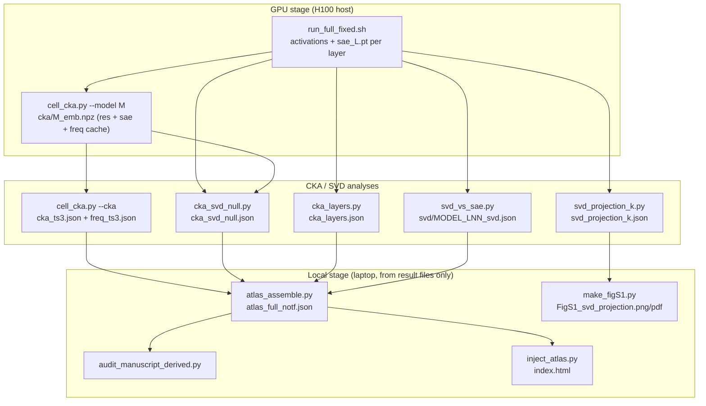

This page documents the **annotation-free** layer of the atlas: every comparison that asks what a model's representation *looks like geometrically*, without consulting a single gene set. It covers two method families — **linear CKA** between per-cell embeddings (cross-model and within-model, each against a cell-shuffle null) and **SVD/PCA tests** that determine whether the TopK SAE dictionaries find structure that low-rank subspace methods cannot reach. Everything here runs on the shared 6,000-cell corpus described in [Shared Corpus and Held-Out Draw](8-shared-corpus-and-held-out-draw), and every number is backed by a null in the spirit of [Null Models Behind Every Claim](10-null-models-behind-every-claim).

Sources: [METHODS.md](docs/METHODS.md#L59-L67), [cell_cka.py](pipeline/atlas_h100/cell_cka.py#L1-L9), [cka_svd_null.py](pipeline/atlas_h100/cka_svd_null.py#L1-L8)

## Why Geometry Without Annotation

The annotation-based backbone (page 13) had to survive a random-gene null first, because gene-set databases are large and overlapping enough to annotate noise. Geometry sidesteps that fragility entirely: it compares **distributions of cell embeddings** directly, using statistics that are invariant to each model's dimensionality and rotation. The page answers two questions that the annotated analyses cannot: do different architectures place the *same cells* in the same relative arrangement, and is the SAE's sparse dictionary genuinely something a rank-32 PCA cannot represent — or just an artifact of overcompleteness?

The repo's own verdict, recorded in the decision log, is that both questions now have defensible answers: every cross-model CKA pair sits far above its shuffle floor (worst pair 43×), and the SAE beats top-32 PCA in all ten models — but a seductive earlier claim ("≈100% of SAE features are invisible to SVD") was **retracted** because random directions fail the same test at this dimensionality.

Sources: [DECISIONS.md](docs/DECISIONS.md#L96-L109), [DECISIONS.md](docs/DECISIONS.md#L110-L128), [METHODS.md](docs/METHODS.md#L48-L57)

## The Embedding Substrate: One Corpus, Cached Per-Cell Vectors

`cell_cka.py` is the producer of everything geometric. For each model it re-runs the forward pass (no SAE required for the residual side), takes the seed-0 subsample of **2,000 cells shared by all models**, and mean-pools each layer's residual stream over the cell's own gene tokens into a `[n_cells, d_model]` embedding. Crucially it caches both spaces — the raw **residual** (`res_<i>`) and the **SAE-feature** space (`sae_<i>`, mean-encoded activations) — into `cka/{model}_emb.npz`, so a crash mid-run or a new analysis never re-pays the forward pass. Per-position GPU accumulation uses `index_add_` rather than CPU scatter, and a per-model batch cap (`C2S: 2`, `UCE: 8`, `MaxToki: 8`) protects a shared 80 GB GPU from OOM on large LM heads.

The same cache also stores per-feature **firing frequency** vectors (`freq_<i>`), exported separately as `freq_ts3.json` for the annotated-vs-unannotated checks downstream.

Sources: [cell_cka.py](pipeline/atlas_h100/cell_cka.py#L20-L90), [RESULTS.md](docs/RESULTS.md#L17-L17)

## Cross-Model CKA at Matched Depth

The pairing statistic is **linear CKA** on mean-centered embeddings:

```
CKA(X, Y) = ||YᵀX||² / (||XᵀX|| · ||YᵀY|| + ε)
```

Because both Gram matrices are `d × d` regardless of each model's `d_model` (256 to 2,560+), the statistic is directly comparable across architectures — that is the entire reason CKA was chosen over Procrustes or plain correlation. The builder phase (`cell_cka.py --cka`) loads every cached `_emb.npz`, forms the 10×10 matrix at each of the five **relative depths** (0/25/50/75/100%), in *both* residual and SAE space, and writes `cka_ts3.json` with a `layer_at_depth` map so readers know exactly which absolute layer each depth slot corresponds to.

> [!TIP]
> The depth-to-block mapping is the one genuinely subtle indexing decision here. For a five-layer (depth-matched) run, cache key `res_<r>` *is* relative depth `r`. But an `--all-layers` run saves every block, so relative depth `r` must be read at block `depth_matched(n_layers)[r]` — reading key `r` directly would silently compare blocks 0–4. This exact mislabeling shipped once: the site's CKA heatmap originally called blocks 0–4 "0–100% depth" until the fix (decision 16); the paper's CKA numbers were computed from a different file and were always correct.

`depth_matched(n)` itself is three lines: pick `round(f · (n−1))` for f ∈ {0, 0.25, 0.5, 0.75, 1.0}, deduplicate (small models can collapse slots), sort — the agreed spec that removes the layer confound between an 8-layer and a 33-layer model.

Sources: [cell_cka.py](pipeline/atlas_h100/cell_cka.py#L93-L130), [layers.py](pipeline/atlas_h100/common/layers.py#L1-L19), [DECISIONS.md](docs/DECISIONS.md#L262-L296), [METHODS.md](docs/METHODS.md#L31-L36)

## Within-Model Depth Structure: the Layer×Layer Matrix

A companion script, `cka_layers.py`, turns CKA inward: for each model it loads the saved position-level activations from every layer (`layer_XX_activations.npy`, memory-mapped, position-aligned because they came from one forward pass), subsamples 30,000 shared positions, and produces an `[n_layers × n_layers]` CKA matrix per model in `cka_layers.json`. Unlike the cross-model analysis this is descriptive — no null — but it is diagnostic: **block structure** means stages where the representation is stable, and the sharpest adjacent-layer drop (the minimum consecutive CKA) marks where the model reorganizes. The script prints that sharpest transition per model directly to stdout.

Sources: [cka_layers.py](pipeline/atlas_h100/cka_layers.py#L1-L6), [cka_layers.py](pipeline/atlas_h100/cka_layers.py#L40-L52), [RESULTS.md](docs/RESULTS.md#L15-L15)

## The Nulls: Cell Shuffle and the Random Dictionary

`cka_svd_null.py` is the rigor pass that the geometry claims must survive. **Part (A)** asks whether cross-model CKA is meaningful or just what any two 2,000-cell embeddings give: for each of all 45 model pairs (the ten-model list, explicitly "not a hand-picked four"), it computes the real CKA at mid-depth, then recomputes it 20 times with the rows of one embedding permuted — a permutation that destroys cell-to-cell correspondence while preserving each embedding's marginal structure. **Part (B)** asks whether the SAE's variance-explained edge is real or mere overcompleteness, comparing at matched sparsity `k = 32`: top-32 SVD variance, the *trained* SAE's stored `var_explained`, and an **untrained random-init TopK dictionary** of identical shape (seed 0) encoding and decoding 20,000 positions.

| Claim | Null / control | Permutations | Outcome |
|---|---|---|---|
| Cross-model CKA is cell-aligned | shuffle rows of one embedding (per pair) | 20 draws each | every pair above floor; worst pair **43×** |
| SAE beats PCA | top-k SVD at the same k; untrained random dictionary | "none needed" | SAE > top-32 PCA in **all ten** models, +0.02 (tGPT) to +0.55 (Geneformer-V2) |

Both blocks land in one `cka_svd_null.json`, which `audit_manuscript_derived.py` re-checks against the manuscript. The decision log formalizes this as its per-claim null table: CKA gets the cell shuffle; SAE-vs-PCA needs no permutation count because its comparator *is* the null.

Sources: [cka_svd_null.py](pipeline/atlas_h100/cka_svd_null.py#L17-L49), [cka_svd_null.py](pipeline/atlas_h100/cka_svd_null.py#L51-L81), [DECISIONS.md](docs/DECISIONS.md#L74-L95), [RESULTS.md](docs/RESULTS.md#L16-L16)

## The SVD Side: Three Escalating Tests of the SAE

The SVD analyses form a deliberate escalation, each closing the loophole of the previous one:

1. **Alignment (`svd_vs_sae.py`)** — SVD of the centered residual on a 150k-position subsample; each SAE decoder direction (unit-norm column of `W_dec`) is called *novel* if its max |cos| against the top SVD axes is < 0.7. This reproduces the prior literature's "X% invisible" framing.
2. **Random-dictionary control (`cka_svd_null.py` part B)** — an untrained dictionary of the same shape provides the "what would a random direction do" counterfactual, exposing test 1's flaw.
3. **Capacity-matched projection sweep (`svd_projection_k.py`)** — written for reviewer R2-Major-2: for every k ∈ {1…256}, the mean projected energy `||B_k v||²` of each SAE direction onto the top-k PCA subspace, plotted against the **isotropic random baseline k/d** (a random unit direction has exactly k/d energy in any k-dimensional subspace). Rising above k/d at every k means SAE directions preferentially concentrate on high-variance axes; the curve reaching 1 as k → d means SVD *can* span them given enough axes.

Implementation note on scaling: test 3 estimates the top-k basis via the `d × d` covariance **eigendecomposition** (`np.linalg.eigh`) rather than full SVD, avoiding the tall `U` factor — on 100,000 rows of a 2,560-dimensional residual this is the difference between feasible and not. `make_figS1.py` renders the result as supplementary Fig S1, whose own title states the conclusion: *"SAE directions are reachable by SVD given enough axes, not invisible to it"* — the SAE's edge is sparse allocation at fixed k.

| Test | Output | Consumer |
|---|---|---|
| `svd_vs_sae.py` (per model, mid layer) | `svd/{model}_L{NN}_svd.json` — pct_novel, mean_maxcos, svd_var_at_k, sae_var | atlas assembly |
| `svd_projection_k.py` (all ten models) | `svd_projection_k.json` — sae_proj, k/d baseline, svd_var_at_k per k | `make_figS1.py` → Fig S1 |

> [!TIP]
> Docstring drift is a real hazard when reading these files: `cell_cka.py`'s docstring still says "between the seven models" and "7x7-per-depth", while its `MODELS` constant and the null script carry all ten (45 pairs). Trust the `MODELS` list and the null script's `ALL`/`PAIRS` constants — the seven-model wording is a relic of the original 3-tissue run before the catalogues were extended.

Sources: [svd_vs_sae.py](pipeline/atlas_h100/svd_vs_sae.py#L16-L59), [svd_projection_k.py](pipeline/atlas_h100/svd_projection_k.py#L1-L14), [svd_projection_k.py](pipeline/atlas_h100/svd_projection_k.py#L21-L60), [make_figS1.py](pipeline/scripts/make_figS1.py#L1-L4), [DECISIONS.md](docs/DECISIONS.md#L96-L109), [RESULTS.md](docs/RESULTS.md#L67-L67)

## Geometry the Data Already Has: the Raw-Expression Anchor

The sharpest finding in this family is a deflationary one. `raw_expression_baseline.py` computes linear CKA between the **2,000-HVG raw expression matrix** (log1p CP10k, no model) and every layer of every model's residual stream, each against a 20-draw cell-shuffle floor. The models' geometry agrees with the raw data's (CKA 0.18–0.63), and PCA-50 of the raw expression decodes tissue (0.94) and cell type (0.83–0.85) about as well as the models' middle layers. The decision log's reading: this is **geometry the data already has** — the models largely preserve an arrangement that a plain PCA recovers, rather than inventing a new one. The full decodability side of this comparison belongs to [Co-Expression Baseline Comparisons](15-co-expression-baseline-comparisons); here it matters as the anchor that keeps CKA claims honest.

Sources: [raw_expression_baseline.py](pipeline/atlas_h100/raw_expression_baseline.py#L1-L11), [raw_expression_baseline.py](pipeline/atlas_h100/raw_expression_baseline.py#L53-L76), [DECISIONS.md](docs/DECISIONS.md#L110-L128)

## Result Artifacts and Data Flow

The following concept diagram shows how one GPU extraction feeds both null families and where each result file lands:



The published file inventory for this page, from the result-files map:

| File | KB | Written by | Read by | Holds |
|---|---|---|---|---|
| `cka_ts3.json` | 6 | `cell_cka.py` | `atlas_assemble.py` | 10×10 residual + SAE-space CKA at five relative depths, `layer_at_depth` map |
| `cka_layers.json` | 26 | `cka_layers.py` | `atlas_assemble.py` | per-model layer×layer CKA matrix |
| `cka_svd_null.json` | 5 | `cka_svd_null.py` | `atlas_hypothesis_block.py`, `audit_manuscript_derived.py` | cell-shuffle null per pair; random-dictionary null for the SVD comparison |
| `svd/{model}_L*.json` | 10 files | `svd_vs_sae.py` | assembly | pct_novel, mean/median maxcos, svd_var_at_k, sae_var per mid layer |
| `svd_projection_k.json` | 9 | `svd_projection_k.py` | `make_figS1.py` | projection curves and k/d baselines, k = 1…256 |

Everything the site and manuscript use flows through `atlas_assemble.py` into `atlas_full_notf.json` — the geometry blocks are embedded there like every other panel, and the audit re-derives them from these files and nothing else.

Sources: [RESULTS.md](docs/RESULTS.md#L10-L17), [RESULTS.md](docs/RESULTS.md#L67-L67), [cell_cka.py](pipeline/atlas_h100/cell_cka.py#L100-L130)

## Running It Yourself

These are GPU-stage analyses except for the plotting. After the standard corpus build ([Quick Start](2-quick-start), [Model Adapter Contract](6-model-adapter-contract)), the documented sequence is:

```bash
cd pipeline/atlas_h100
bash run_downstream_fixed.sh          # cell embeddings, CKA, probes, SVD, explorer
# then svd_vs_sae.py (mid layer of each model); copy outputs to
# outputs/atlas/comparative/svd/  and  outputs/atlas/comparative/gsea_annot.json
```

`svd_projection_k.py`, `cka_svd_null.py` and `cka_layers.py` read only saved artifacts — feature catalogs, `sae_L{NN}.pt` checkpoints, memory-mapped activations, cached embeddings — and root themselves via `ATLAS_OUT` (the corrected re-run used `ATLAS_OUT=out_fixed`; see [Extraction Faults and Corrected Re-Run](21-extraction-faults-and-corrected-re-run)). On the laptop side, `make_figS1.py` needs only `ATLAS_BASE` and `outputs/atlas/comparative/svd_projection_k.json`, and `audit_all.py` re-derives every published geometry number from the shipped result files — no GPU required.

Sources: [REPRODUCE.md](docs/REPRODUCE.md#L107-L127), [svd_projection_k.py](pipeline/atlas_h100/svd_projection_k.py#L10-L14), [cka_svd_null.py](pipeline/atlas_h100/cka_svd_null.py#L17-L22), [make_figS1.py](pipeline/scripts/make_figS1.py#L8-L10)

## Where to Go Next

Geometry is the *pre-condition* for the annotated analyses, not their replacement. Continue with:

- [Null Models Behind Every Claim](10-null-models-behind-every-claim) — the general null taxonomy this page's cell-shuffle and random-dictionary tests instantiate
- [Concept Matrices and Backbone Detection](13-concept-matrices-and-backbone-detection) — what the annotation layer finds once geometry has established the models are comparable
- [Co-Expression Baseline Comparisons](15-co-expression-baseline-comparisons) — the full treatment of the raw-expression and co-expression anchors
- [Result Files and Data Flow Map](17-result-files-and-data-flow-map) — every file touched here, with producers and consumers
- [Audit System and Manuscript Checks](18-audit-system-and-manuscript-checks) — how `audit_manuscript_derived.py` re-derives these numbers
