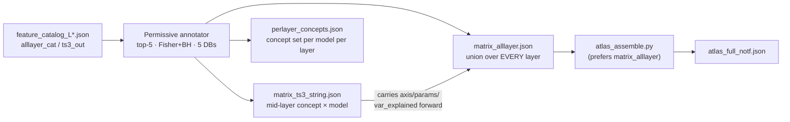
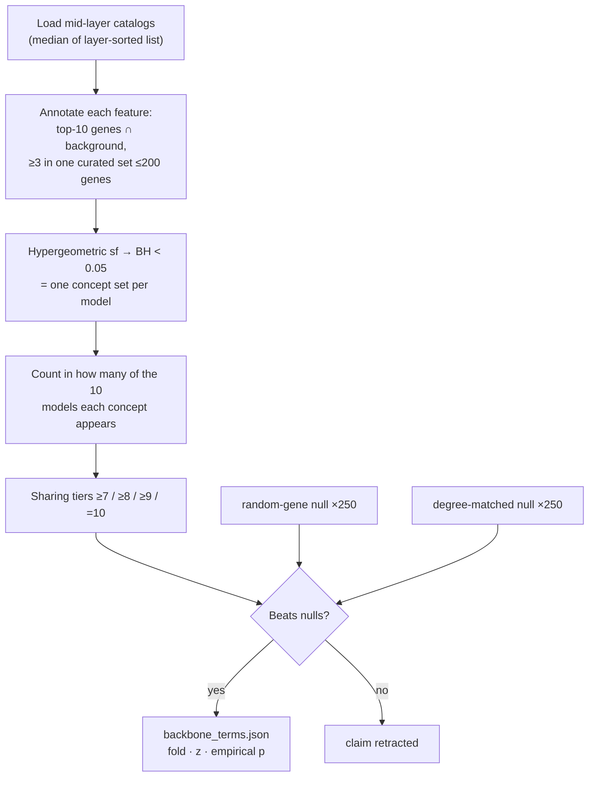

This page covers the **local analysis stage** that runs after GPU extraction completes: pure-CPU scripts that turn SAE feature catalogs into concept matrices — a concept × model view of what each foundation model encodes — and then detect the *backbone*: the set of biological concepts shared across models, validated against nulls. The deeper statistical philosophy behind the annotators and nulls lives in [Calibrated versus Permissive Annotation](9-calibrated-versus-permissive-annotation) and [Null Models Behind Every Claim](10-null-models-behind-every-claim); here we walk the concrete implementation.

Sources: [RESULTS.md](/docs/RESULTS.md#L48-L50), [METHODS.md](/docs/METHODS.md#L38-L46)

## Inputs and the Shared Annotator Core

Every script in this stage consumes the same two inputs. The first is per-layer **feature catalogs** (`feature_catalog_L*.json`), one per model-layer, each holding per-feature `top_genes` lists (the catalog keeps the top 20 genes ranked by mean activation), the alive-feature count `n_alive`, dictionary width `d_sae`, and the layer index. The second is the **gene-set library**: GO_BP, Reactome and KEGG sets (Enrichr via gseapy), TRRUST edges, STRING v12 PPIs (score ≥ 700), and a 16,205-gene background.

Sources: [METHODS.md](/docs/METHODS.md#L23-L28), [METHODS.md](/docs/METHODS.md#L38-L42)

Two annotators dominate everything downstream, and the scripts in this stage implement them with a common skeleton: build a gene → term inverted index, count overlaps between each feature's top genes and each candidate term, then test with a one-sided statistic and Benjamini-Hochberg correction at α = 0.05.

| | Permissive annotator | Calibrated annotator |
|---|---|---|
| Top genes used | 5 | 10 |
| Minimum overlap | ≥ 2 | ≥ 3 |
| Statistic | Fisher exact (greater) | Hypergeometric survival |
| Databases | GO_BP, Reactome, KEGG, **STRING, TRRUST** | GO_BP, Reactome, KEGG only (**no PPI/TF sets**) |
| Set-size filter | 5–500 genes | 5–200 genes (curated sets) |
| Output per feature | list of qualifying terms | set of qualifying terms |
| Implementations | `alllayer_matrix.py`, `alllayer_concepts.py`, `topn_sweep.py` | `recalibrate_final.py`, `degree_null.py`, `depth_backbone.py` |

A recurring catalog-resolution rule appears in nearly every script: prefer the all-layers directory (`outputs/atlas/alllayer_cat/<model>/`) and fall back to the depth-matched five-layer run (`outputs/atlas/ts3_out/<model>/`) if the all-layer catalogs are absent. The "mid layer" is always the **median element** of the layer-sorted catalog list, so models with different depths (8–33 layers) compare at a consistent relative position.

Sources: [recalibrate_final.py](/pipeline/scripts/recalibrate_final.py#L59-L64), [alllayer_matrix.py](/pipeline/scripts/alllayer_matrix.py#L73-L77), [METHODS.md](/docs/METHODS.md#L32-L36)

## Building the Concept Matrices

The stage produces three matrix artifacts with distinct scopes, all derived from the permissive annotator:

`alllayer_matrix.py` answers "what is a model's *full* concept repertoire across depth?" It runs the identical top-5 Fisher+BH annotator on **every** layer, then unions the per-layer term sets. Its output schema is deliberately compatible with the mid-layer matrix: `term_count` maps each term to total feature-hits summed across layers (the keys *are* the all-layer concept set), `annot_rate` back-solves `n_annot` from the **mean** of per-layer rates (keeping `n_feat` at the mid-layer `d_sae` so totals don't balloon), and axis/params/var-explained fields are copied from the mid matrix for continuity. It also writes `perlayer_concepts.json`, the full per-model, per-layer concept sets.

Sources: [alllayer_matrix.py](/pipeline/scripts/alllayer_matrix.py#L2-L10), [alllayer_matrix.py](/pipeline/scripts/alllayer_matrix.py#L86-L110), [RESULTS.md](/docs/RESULTS.md#L48-L50)

`alllayer_concepts.py` is the depth-parity variant: it annotates only the **five depth-matched layers** (0/25/50/75/100% of depth), selecting them by index with `round(x·(len−1)/4)` whenever a model has more than six catalogs, and reports per-layer counts, mid-layer counts, and the union. Finally, `atlas_assemble.py` — the assembler for the site's embedded data — **prefers `matrix_alllayer.json` over the mid-layer matrix** when present, deriving coverage, the universality spectrum (concepts by how many models encode them), and the universal core from the chosen matrix.

Sources: [alllayer_concepts.py](/pipeline/scripts/alllayer_concepts.py#L1-L6), [alllayer_concepts.py](/pipeline/scripts/alllayer_concepts.py#L68-L83), [atlas_assemble.py](/pipeline/scripts/atlas_assemble.py#L63-L98)

> [!TIP]
> `alllayer_matrix.py` unions term *keys* across layers but keeps `feat_terms` (per-feature term assignments) from the mid matrix only — firing-rate and richness statistics stay per-feature-at-mid-layer while coverage becomes depth-wide. Reading the docstring before the schema prevents a common misreading of `n_feat`/`n_annot` in this file.

## Detecting the Shared Backbone

Backbone detection runs exclusively under the **calibrated annotator** at the mid layer. The chain that converged on it is recorded as three result files: `recalibrate.json` and `recalibrate2.json` (two grid searches over annotator settings against the random-gene null), then `recalibrate_final.py`, which computes the honest universality picture — per-model concept sets, the shared-by-k spectrum for k = 1…10, the all-10 core identities, and the ≥8-of-10 backbone, each compared to a random-gene null spectrum (30 permutations).

Sources: [recalibrate_final.py](/pipeline/scripts/recalibrate_final.py#L1-L4), [recalibrate_final.py](/pipeline/scripts/recalibrate_final.py#L17), [recalibrate_final.py](/pipeline/scripts/recalibrate_final.py#L68-L93), [RESULTS.md](/docs/RESULTS.md#L60-L62)

Two robustness scripts harden the result. `recalibrate_robust.py` sweeps five calibrated configurations (varying top-N, overlap minimum, max set size, and an odds-ratio floor) × four sharing thresholds (≥7/8/9/10), reporting real-vs-null fold per cell — showing the backbone is not an argmax over one lucky configuration — and additionally classifies every ≥8 backbone concept as **housekeeping** (translation, splicing, proteasome, OXPHOS, cell cycle, … matched by keyword) versus **specific** (immune, signalling, tissue). `backbone_terms.py` then fixes a presentation bug: the site's `shared_ge8_terms` list had been truncated to 40 entries when written, so a page titled "78 shared concepts" could only display 40; this script recomputes and stores *every* backbone concept at each tier with its source database, deliberately running **no null itself** — folds and p-values come from `stats_final.py` / `degree_null.py`, which share the same annotator.

Sources: [recalibrate_robust.py](/pipeline/scripts/recalibrate_robust.py#L1-L7), [recalibrate_robust.py](/pipeline/scripts/recalibrate_robust.py#L84-L91), [backbone_terms.py](/pipeline/scripts/backbone_terms.py#L2-L10), [backbone_terms.py](/pipeline/scripts/backbone_terms.py#L74-L80)

A separate composition analysis (`paper_draft/analysis/backbone_composition/`) classes the ~96 backbone concepts by the genes behind each match — protein synthesis, other housekeeping, or specific — grouped into biological programmes. The composition and housekeeping split together temper the headline: most of the backbone is ubiquitous cellular machinery, which is exactly why the nulls matter.

Sources: [RESULTS.md](/docs/RESULTS.md#L11), [recalibrate_robust.py](/pipeline/scripts/recalibrate_robust.py#L122-L130)

## Nulls and Depth Robustness for the Backbone

Every backbone claim is paired with a null in `outputs/atlas/comparative/`:

| Null | Script | Permutations | What it controls for | Result file |
|---|---|---|---|---|
| Uniform random-gene (tiers) | `stats_final.py` | 250 | chance annotation of random top-10 lists | `stats_final.json` |
| **Degree-matched** random-gene | `degree_null.py` | 250 | gene "popularity" (gene-set membership degree, 40 quantile bins) | `degree_null.json` |
| Random-gene configuration sweep | `recalibrate_robust.py` | 20 per config | annotator-parameter luck | `recalibrate_robust.json` |
| All-layer core null | `alllayer_null.py` | 20 (arg) | the retracted all-layer union claim | `alllayer_null.json` |
| Backbone × depth null | `depth_backbone.py` → `depth_backbone_fast.py` | 20 → 250 | mid-layer artefact accusation | `depth_backbone.json` |

Sources: [stats_final.py](/pipeline/scripts/stats_final.py#L1-L7), [stats_final.py](/pipeline/scripts/stats_final.py#L24), [degree_null.py](/pipeline/scripts/degree_null.py#L1-L8), [RESULTS.md](/docs/RESULTS.md#L20)

The degree-matched null is the strongest of these: instead of drawing uniformly from the background, each real top-gene is replaced by a random gene in the **same membership-degree bin**, so high-degree genes that are trivially "hittable" cannot inflate the backbone. If the calibrated backbone still beats this null, it is not a gene-abundance artifact.

Sources: [degree_null.py](/pipeline/scripts/degree_null.py#L39-L47), [METHODS.md](/docs/METHODS.md#L48-L55)

Two historical claims about the concept matrices were retracted by nulls from this stage, and the scripts keep the evidence: `random_null.py` showed the naive mid-layer "shared by all ten models" core does not survive random-gene annotation, and `alllayer_null.py` targeted the retracted headline of "~2,000 concepts shared by all ten models" — an **all-layer union** built by intersecting per-model unions across every layer. That script mirrors the real procedure exactly on the null side: random genes are annotated per layer with each model's per-layer feature counts, unioned per model, then intersected across all ten models, yielding a z-score and fold-over-null for the real core.

Sources: [alllayer_null.py](/pipeline/scripts/alllayer_null.py#L1-L8), [alllayer_null.py](/pipeline/scripts/alllayer_null.py#L110-L133), [RESULTS.md](/docs/RESULTS.md#L58)

`depth_backbone.py` pre-empts the reviewer question "is the ~78-concept ≥8/10 backbone a mid-layer artefact?" by recomputing backbone tiers at five depth fractions (layer chosen by index `round(f·(n−1))`), with `ge8_terms` membership tracked per depth and Jaccard stability computed against the mid-layer backbone. Its replacement, `depth_backbone_fast.py`, raises the null to 250 permutations and adds a safeguard worth studying: it first reproduces the stored run's observed counts exactly and **refuses to write the output file if any count differs** — the speedup must provably change nothing about the science.

Sources: [depth_backbone.py](/pipeline/scripts/depth_backbone.py#L1-L7), [depth_backbone.py](/pipeline/scripts/depth_backbone.py#L107-L115), [depth_backbone_fast.py](/pipeline/scripts/depth_backbone_fast.py#L1-L13), [depth_backbone_fast.py](/pipeline/scripts/depth_backbone_fast.py#L100-L140)

Finally, two sensitivity sweeps close the loop on annotator choices: `topn_sweep.py` re-annotates every mid layer at top-5/10/15/20 genes, recording annotation rate, distinct concept count, and median odds ratio, while `kegg_robust.json` re-runs the backbone with GO_BP and Reactome only.

Sources: [topn_sweep.py](/pipeline/scripts/topn_sweep.py#L1-L5), [RESULTS.md](/docs/RESULTS.md#L47), [RESULTS.md](/docs/RESULTS.md#L69)

## The Sparse Annotator: One Optimization, Adopted Everywhere

Permutation testing is the computational bottleneck — 250 permutations × 10 models × thousands of features — and the naive per-feature Python loop with `fisher_exact`/`hypergeom` calls per candidate term dominated runtime. The stage's shared fix is a **sparse incidence-matrix product**: build a genes × terms CSR matrix `M` from the gene-set library, encode each batch of features as a features × genes matrix `F`, then compute `F @ M` once — overlap counts for every feature-term pair materialize in a single sparse multiplication (~50× faster than the loop, verified to produce identical sets). The same trick underlies `alllayer_null.py` and `depth_backbone_fast.py`, and the latter adds one more optimization: sorting catalogs by the layer index parsed from the *filename* instead of opening each ~file to read its `"layer"` field, avoiding ~700 MB of JSON parsing before any real work.

Sources: [alllayer_null.py](/pipeline/scripts/alllayer_null.py#L42-L55), [alllayer_null.py](/pipeline/scripts/alllayer_null.py#L63-L84), [depth_backbone_fast.py](/pipeline/scripts/depth_backbone_fast.py#L56-L78)

> [!TIP]
> When porting these scripts, preserve the equality guard pattern from `depth_backbone_fast.py`: any performance rewrite of a statistical pipeline should first *reproduce stored observed values* and abort on mismatch. This repo's credibility argument ("nulls must be reported properly") extends to its own refactors.

## Where These Artifacts Flow

The matrices and backbone files are consumed downstream by the site assembler, figure makers, supplement tables, and the audit system: `matrix_alllayer.json` feeds `atlas_assemble.py` plus the controls scripts; `backbone_terms.json` feeds the atlas hypothesis block and figure generation; `depth_backbone.json`, `recalibrate_robust.json` and `alllayer_null.json` are checked by `audit_manuscript_core.py`, `audit_supplement.py` and `audit_manuscript_derived.py`, which assert manuscript numbers match these files. The backbone's strongest external validation — replication on the held-out corpus under the calibrated annotator (passes, unlike the permissive core) — is detailed in [Held-Out Regulatory Prediction Test](11-held-out-regulatory-prediction-test).

Sources: [RESULTS.md](/docs/RESULTS.md#L12), [RESULTS.md](/docs/RESULTS.md#L22), [RESULTS.md](/docs/RESULTS.md#L35-L36), [RESULTS.md](/docs/RESULTS.md#L48-L48)

Suggested next steps in the catalog: see how the two annotators were chosen and why, in [Calibrated versus Permissive Annotation](9-calibrated-versus-permissive-annotation); how the null machinery generalizes beyond the backbone, in [Null Models Behind Every Claim](10-null-models-behind-every-claim); and how every result file connects to the manuscript, in [Result Files and Data Flow Map](17-result-files-and-data-flow-map).