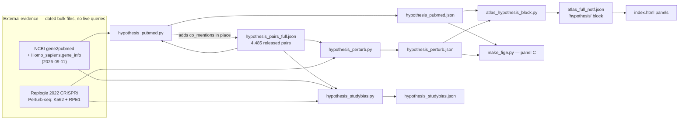
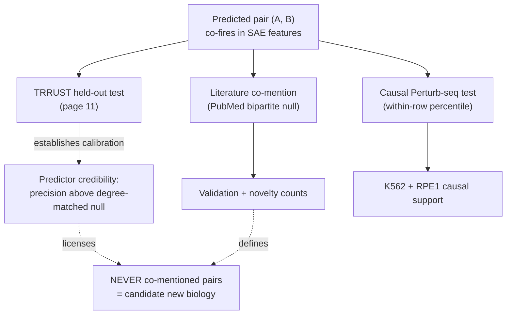

This page documents the stage of the comparative-atlas pipeline that tests the released gene-pair predictions against evidence the models never saw during annotation: published literature and causal perturbation data. Where the held-out TRRUST test (see [Held-Out Regulatory Prediction Test](11-held-out-regulatory-prediction-test)) establishes that the predictor is *calibrated*, this stage asks two strictly independent questions of the same prediction list — do the pairs show up in the literature more than chance, and does perturbing one gene actually move the other? It also governs the *novelty* claim: which confident pairs have never been co-mentioned anywhere, and therefore constitute genuine candidate discoveries.

Sources: [hypothesis_pubmed.py](pipeline/scripts/hypothesis_pubmed.py#L1-L19), [hypothesis_perturb.py](pipeline/scripts/hypothesis_perturb.py#L1-L18)

## Position in the Evidence Chain

Everything on this page consumes one artifact: `hypothesis_pairs_full.json`, the 4,485-pair released prediction list produced by `hypothesis_trrust3.py` (the final stage of the TRRUST chain). Three analysis scripts read that list, each against a different external dataset, and write compact JSON results into `outputs/atlas/comparative/`. Those result files then feed two consumers: `atlas_hypothesis_block.py`, which regenerates the site's prediction panels, and `make_fig5.py`, which renders panel C ("Independent evidence") of the manuscript figure. The diagram below traces this flow; the dashed edge marks the one *in-place mutation* in the chain — the PubMed script writes co-mention counts back into the released pair list.

The repository's result-file map confirms this wiring precisely: `hypothesis_pairs_full.json` is written by `hypothesis_trrust3.py` and then `hypothesis_pubmed.py`, and is read by the site assembler, the supplement tables, the study-bias coverage check and the perturbation script; `hypothesis_perturb.json` and `hypothesis_pubmed.json` are consumed by `atlas_hypothesis_block.py`, `make_supp_tables.py`, `make_fig5.py` and the manuscript audits.

Sources: [RESULTS.md](docs/RESULTS.md#L37-L46), [atlas_hypothesis_block.py](pipeline/scripts/atlas_hypothesis_block.py#L24-L26), [make_fig5.py](pipeline/scripts/make_fig5.py#L19-L23)

## Independent Evidence I: Literature Co-Mention

### Data and identifier mapping

The literature test runs on NCBI's `gene2pubmed` bulk file together with `Homo_sapiens.gene_info.gz`, deliberately chosen over live PubMed queries so the analysis is reproducible from a *dated* file rather than from a moving API. Symbols are first mapped to NCBI GeneIDs — current symbols plus synonyms, so older literature referencing a gene's former name is not silently dropped — and only pairs whose genes both map are testable. The script builds a gene→papers adjacency, reports how many gene–paper links it recovered and the median papers per gene, then counts the observed co-mentions for every predicted pair.

Sources: [hypothesis_pubmed.py](pipeline/scripts/hypothesis_pubmed.py#L2-L3), [hypothesis_pubmed.py](pipeline/scripts/hypothesis_pubmed.py#L37-L65)

### The publication-count-preserving null

The question is not "are these pairs co-mentioned?" — famous gene pairs always are — but "are they co-mentioned more than chance *given how much each gene has been studied*?" The null answers this by construction: each gene keeps its publication count **exactly**, and the papers are reassigned at random via a degree-preserving shuffle of the gene→paper bipartite graph (stub matching on the paper side fixes paper sizes too). A pair therefore cannot score merely because both of its genes are heavily studied — the exact confound a naive enrichment test would absorb. The permutation loop recounts co-mentions per pair for `NPERM` (default 200) shuffles and reports fold, z and the empirical p-value `(count + 1) / (N + 1)`.

Sources: [hypothesis_pubmed.py](pipeline/scripts/hypothesis_pubmed.py#L7-L11), [hypothesis_pubmed.py](pipeline/scripts/hypothesis_pubmed.py#L84-L100)

> [!TIP]
> The null is made bitwise-reproducible by numbering papers in **sorted PMID order** rather than Python set-iteration order. Set iteration randomises string hashing per process, which silently permuted the null under a fixed seed: the same data produced z = 40.5 on one run and 36.6 on the next. The in-code comment records the team's standard verbatim: *"a number nobody can reproduce is not a number we can report."* Any new null you add to this pipeline must pass the same test — run it twice, in fresh processes, before trusting it.

### The mega-paper cap

Papers annotating more than 60 genes are excluded from the co-mention count, and the *observed* statistic is recomputed under the same cap for a like-for-like comparison. The rationale is documented at the point of use: without the cap, a handful of proteomic and GWAS papers annotate thousands of genes at once and almost every pair becomes nominally co-mentioned. Importantly, the uncapped figure is **stored in the result JSON rather than discarded** — it is part of the reported result, not a printed-and-forgotten diagnostic. The block below summarises what `hypothesis_pubmed.json` exposes:

| Field group | Contents | Why it exists |
|---|---|---|
| `source`, `null`, `n_perm`, `mega_paper_cap` | provenance of data, null design, permutation count, cap threshold | audit and reproduction |
| `n_pairs_testable`, `observed_pairs_comentioned`, `observed_total_comentions` | coverage of the pair list and observed signal | headline validation numbers |
| `null_pairs_comentioned_mean` / `null_sd`, `fold`, `z`, `p_emp` | null distribution and the three reported statistics | comparison against chance |
| `observed_pairs_comentioned_uncapped`, `observed_pct_comentioned_uncapped` | the same counts with no 60-gene cap | kept deliberately as part of the result |
| `n_never_comentioned`, `n_never_but_both_studied`, `never_*` lists | novelty counts and candidate lists (150 / 60 item caps) | the discovery output |

Sources: [hypothesis_pubmed.py](pipeline/scripts/hypothesis_pubmed.py#L131-L147), [hypothesis_pubmed.py](pipeline/scripts/hypothesis_pubmed.py#L138-L152)

## Independent Evidence II: Causal Perturbation Evidence

### Read-out and null design

The perturbation test is, in the words of its own header, "the only test here that is neither a database nor the literature": if a model places genes A and B in the same feature, knocking A down should move B. The data is Replogle et al. 2022 genome-wide CRISPRi pseudobulk — K562 with 11,258 perturbations × 8,248 measured genes, and RPE1 as a replication cell line — loaded as normalised expression changes relative to controls, with multi-construct perturbations of the same gene averaged into one row. The read-out is deliberately rank-based: for an ordered pair (A perturbed, B measured), the statistic is the percentile of |ΔB| *within row A* — among all measured genes, how strongly did B respond? Because it is a within-row rank, the statistic is immune to how globally disruptive perturbation A is (essential genes move everything). A pair counts as a hit when B lands in the top 5% most-moved genes (`TOPQ = 0.05`).

Sources: [hypothesis_perturb.py](pipeline/scripts/hypothesis_perturb.py#L2-L18), [hypothesis_perturb.py](pipeline/scripts/hypothesis_perturb.py#L30-L31)

The null handles the two confound axes symmetrically — row effects by ranking, column effects by matching: the measured gene B is replaced by a random gene matched on its own *responsiveness* (its mean |Δ| across all perturbations, binned into 20 quantiles), so a gene cannot score merely by being reactive to everything. Both observed and null statistics are reported as top-5% hit rates, yielding `top5pct_fold`, `z_top5` and `p_top5` per cell line. The two nulls on this page eliminate complementary confounds, which is exactly why the pipeline runs both:

| Design decision | Literature co-mention | Perturb-seq response |
|---|---|---|
| Held fixed per draw | each gene's paper count; paper sizes (≤ 60 genes) | perturbation row A's response profile (within-row rank) |
| Randomised | paper→gene assignment on the bipartite graph | measured gene B → responsiveness-matched replacement (20 bins) |
| Confound eliminated | both genes being heavily studied | B reactive to every perturbation; A globally disruptive |
| Headline statistic | co-mentioned pairs vs null mean (fold, z, p_emp) | top-5% hit rate vs null rate (fold, z, p_emp) |

Sources: [hypothesis_perturb.py](pipeline/scripts/hypothesis_perturb.py#L13-L15), [hypothesis_perturb.py](pipeline/scripts/hypothesis_perturb.py#L48-L76), [METHODS.md](docs/METHODS.md#L67-L70)

### Does model agreement raise the causal hit rate?

Beyond the aggregate test, the script repeats the analysis conditioned on the number of models that predicted each pair (`by_n_models`), testing whether agreement raises the causal hit rate as it does for TRRUST. Crucially, each k-models subset gets its **own** responsiveness-matched null built from its own genes — not a reuse of the global null — so each fold is internally valid. Subsets with fewer than 30 pairs are skipped rather than reported.

Sources: [hypothesis_perturb.py](pipeline/scripts/hypothesis_perturb.py#L16), [hypothesis_perturb.py](pipeline/scripts/hypothesis_perturb.py#L106-L137)

### The study-bias stratum analysis

The released pair list over-represents well-studied genes, so the pipeline asks whether that is a property of the models or of the filter. The motivation numbers are stated in the script header: the models feature 4,003 genes with fewer than 5 papers, but the pair list at W ≥ 5 retains only 141 of them (3.5%, against 16.8% of well-studied genes). Direct causal validation of understudied genes is blocked — 752 of the 793 protein-coding understudied genes the models feature are absent from the Replogle screen entirely (0.4% of the perturbed set, against 9.9% of all protein-coding genes). The strongest answerable question is therefore: *among testable pairs, does the causal signal decline as the responding gene becomes less studied?* To avoid pre-filtering low-abundance genes, the co-firing threshold drops from ≥ 5 to ≥ 2 features with a ≥ 2-model bar, and every pair carries its responding gene's publication count. Results are stratified as unmapped / <25 / 25–49 / 50–99 / 100–399 / ≥400 papers, each stratum against its own matched null; a flat profile licenses extrapolation to genes no external resource covers, a declining profile does not.

Sources: [hypothesis_studybias.py](pipeline/scripts/hypothesis_studybias.py#L4-L15), [hypothesis_studybias.py](pipeline/scripts/hypothesis_studybias.py#L35-L36), [hypothesis_studybias.py](pipeline/scripts/hypothesis_studybias.py#L164-L168)

## Novelty: From Calibration to a Candidate List

The novelty half of `hypothesis_pubmed.py` is the payoff of the whole evidence chain, and its justification is worth reading carefully: among pairs the models predict confidently, those **never** co-mentioned anywhere are the candidates for genuinely unexplored biology — and this claim "is only meaningful because (1) and the TRRUST test establish that the predictor is calibrated: an uncorroborated pair from a validated predictor is a lead, whereas the same list from an unvalidated one is noise." The candidate lists are sorted by confidence (models, then weight), and a stricter `never_but_both_studied` subset keeps only pairs where both genes have ≥ 20 papers each — studied genes that have simply never been put together.

The released list itself is one flat JSON: 4,485 pairs, each with `[gene A, gene B, n_models, models, weight]` at generation time, augmented in place by the PubMed run with `co_mentions` and per-gene `papers` counts, and by the site assembler with a `same_family` flag. The concept relationships above are the mental model to keep: novelty is a *conditional* claim, downstream of both the calibration test and the literature scan.

Sources: [hypothesis_pubmed.py](pipeline/scripts/hypothesis_pubmed.py#L13-L16), [hypothesis_pubmed.py](pipeline/scripts/hypothesis_pubmed.py#L156-L168), [data/hypothesis_pairs_full.json](data/hypothesis_pairs_full.json#L1), [RESULTS.md](docs/RESULTS.md#L38)

## Robustness of the Prediction Result

Each headline statistic on this page is bracketed by a variant that tries to break it. The variants re-use the same configuration-model null throughout and are summarised here; the reviewer-facing deep dive lives in [Reviewer Robustness Analyses](16-reviewer-robustness-analyses), and the TRRUST stages they modify belong to [Held-Out Regulatory Prediction Test](11-held-out-regulatory-prediction-test).

| Variant | Script | What it changes | Guards against |
|---|---|---|---|
| R1 no same-family pairs | `hypothesis_robust.py` | drops stem-suffix paralog pairs (ACTB/ACTG2, S100A11/S100A4) | result carried by gene families, not regulation |
| R2 firing features only | `hypothesis_robust.py` | keeps features above per-model median `activation_frequency` | near-zero-expression genes clustering together |
| R3 stricter evidence | `hypothesis_robust.py` | per-pair bar raised from ≥ 5 to ≥ 10 features | threshold choice driving the effect |
| R2+R1 combined | `hypothesis_robust.py` | both filters at once | interaction of the two artefacts |
| Equal budget | `hypothesis_sizematched.py` | every model scored on the same N = 50,707 top-weight pairs, plus rand-N draws | Fig 5A being a ranking of dictionary size, not quality |
| Single layer | `hypothesis_singlelayer.py` | co-firing graph from the mid-layer catalogue only, W ∈ {2, 5} | cross-layer aggregation inflating the result |
| Publication strata | `hypothesis_studybias.py` | perturbation test split by responding gene's fame | predictions working only for well-studied genes |

Two engineering details in this tier repay attention. First, the size-matched variant exists because graph sizes span four orders of magnitude (AIDO.Cell 2 pairs, C2S-Scale 147,728) and hit counts correlate with graph size at r = +0.90; models whose graphs are smaller than the budget are reported as *untestable*, not as failures. Second, the single-layer script is an act of provenance repair: the manuscript's "6.1× within a single layer" had been produced by a throwaway `/tmp` script that no longer existed, so this script was recovered from the session log and the two thresholds it silently used are now computed and stored explicitly.

Sources: [hypothesis_robust.py](pipeline/scripts/hypothesis_robust.py#L2-L10), [hypothesis_sizematched.py](pipeline/scripts/hypothesis_sizematched.py#L2-L14), [hypothesis_singlelayer.py](pipeline/scripts/hypothesis_singlelayer.py#L2-L16), [METHODS.md](docs/METHODS.md#L62-L65)

## From Result Files to Site and Figure

The site never reads the analysis scripts' stdout — it reads a **derived block** regenerated from the canonical JSONs. `atlas_hypothesis_block.py` assembles the `hypothesis` key of `atlas_full_notf.json` from six result files, including the `independent` sub-block (literature and perturbation summaries), the full `pairs_all` matrix of every released pair with its `co_mentions` and `same_family` flag, and a `novelty` panel with example pairs. It edits only that one key, so re-running an analysis and re-injecting is sufficient to keep the public site true.

> [!TIP]
> The script exists because of a real incident: the site block was once hand-assembled, and after the literature null was made reproducible the page kept serving the old z = 40.48 while the manuscript said 34.7 — "the same class of drift the manuscript audit exists to catch, on the public half of the project." Note the two safety rails a maintainer should preserve: `--check` mode reports drift without writing (and exits non-zero, CI-friendly), and `diffs()` prints every changed leaf path so a rebuild says *what* moved, not just that it ran.

Two display guardrails in the assembly deserve emphasis for anyone extending the panels. When the corroboration null produced zero edges at some k, the stored fold would be astronomically meaningless, so `curve[k]["fold"]` is set to `None` rather than rendered — the figure prints "null = 0" instead of a number like "1.5e9×" that would be "the most confident claim on the page". And Figure 5 panel C places the three independent-evidence fold bars — literature co-mention, K562 and RPE1 perturbation — side by side against their own matched nulls, annotated "all p = 0.005", which is the empirical-p floor 1/(N+1) at NPERM = 200 described in the decision log's permutation policy.

Sources: [atlas_hypothesis_block.py](pipeline/scripts/atlas_hypothesis_block.py#L2-L11), [atlas_hypothesis_block.py](pipeline/scripts/atlas_hypothesis_block.py#L54-L71), [atlas_hypothesis_block.py](pipeline/scripts/atlas_hypothesis_block.py#L85-L112), [make_fig5.py](pipeline/scripts/make_fig5.py#L92-L114), [DECISIONS.md](docs/DECISIONS.md#L85-L102)

## Reproducing This Stage

All scripts resolve their base directory through the `ATLAS_BASE` environment variable (with a developer-specific default), so the stage runs anywhere the inputs are unpacked. Order matters: the TRRUST chain must run first because it produces both the released pair list and the five-model `PASSED` selection that the robustness and study-bias scripts consume; the PubMed run must precede the site-block rebuild because it annotates the pair list in place. The external inputs themselves are versioned release archives, not repository files — `gene2pubmed.gz` and the Replogle `.h5ad` files are fetched per the release procedure.

| Command | Key inputs (relative to `ATLAS_BASE`) | Output |
|---|---|---|
| `python scripts/hypothesis_trrust3.py [NPERM]` | feature catalogues (`alllayer_cat/` or `ts3_out/`), `genesets/` truth sets | `hypothesis_final.json`, `hypothesis_pairs_full.json` |
| `python scripts/hypothesis_pubmed.py [NPERM]` | `outputs/atlas/pubmed/{gene2pubmed.gz, Homo_sapiens.gene_info.gz}` | `hypothesis_pubmed.json` + pairs file annotated in place |
| `python scripts/hypothesis_perturb.py [NPERM]` | `outputs/atlas/perturb/{K562_gwps_normalized_bulk_01.h5ad, rpe1_normalized_bulk_01.h5ad}` | `hypothesis_perturb.json` |
| `python scripts/hypothesis_studybias.py [NPERM]` | perturb + pubmed inputs + feature catalogues | `hypothesis_studybias.json` |
| `python scripts/atlas_hypothesis_block.py [--check]` | the `hypothesis_*.json` result files | drift report, or rewritten `atlas_full_notf.json` |
| `python scripts/make_fig5.py` | five hypothesis result JSONs | `figures/Fig5_hypothesis.png` |

Sources: [hypothesis_pubmed.py](pipeline/scripts/hypothesis_pubmed.py#L22-L29), [hypothesis_perturb.py](pipeline/scripts/hypothesis_perturb.py#L140-L145), [RESULTS.md](docs/RESULTS.md#L74-L78)

Permutation counts follow the project-wide policy recorded in the decision log: 500 rewirings for the per-model TRRUST test, 100 for the corroboration curve, and 200 for the robustness variants, literature, perturbation and publication-strata analyses; with N permutations the smallest attainable p is 1/(N+1), which is where most significant results sit. Once the stage is reproduced, the natural continuation is to see how much of this signal survives without any model at all in [Co-Expression Baseline Comparisons](15-co-expression-baseline-comparisons), then how the results are policed in [Audit System and Manuscript Checks](18-audit-system-and-manuscript-checks) and rendered into the public panels in [Site Assembly from Result Files](22-site-assembly-from-result-files).
