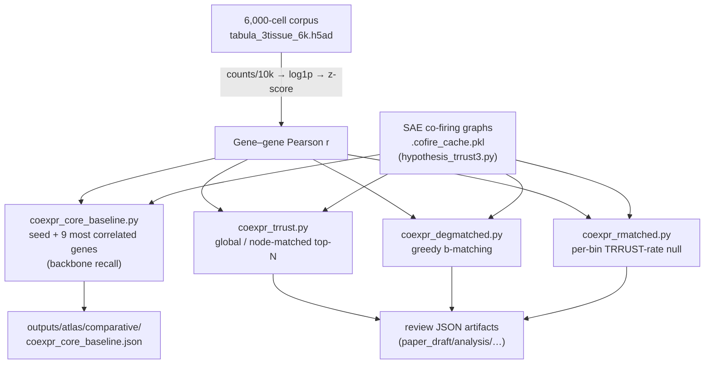

Every headline claim in this repository — the ≥8/10 shared concept backbone and the held-out TRRUST predictions from SAE co-firing graphs — has a paired no-model control: *what would the same statistic recover from gene–gene co-expression alone, computed on exactly the same cells?* This page documents that baseline subsystem: the backbone-level dictionary baseline (`coexpr_core_baseline.py`), the TRRUST-level comparison family (`coexpr_trrust.py`, `coexpr_degmatched.py`, `coexpr_rmatched.py`), the cell-level geometry counterpart (`raw_expression_baseline.py`), and the reviewer-hardening scripts in `review_10_coexpr/`. It sits in the **Local Analysis Stage** between literature evidence and the reviewer robustness suite, and it depends on the concepts from [Null Models Behind Every Claim](10-null-models-behind-every-claim) and [Held-Out Regulatory Prediction Test](11-held-out-regulatory-prediction-test).

Sources: [coexpr_core_baseline.py](pipeline/scripts/coexpr_core_baseline.py#L1-L16), [coexpr_trrust.py](paper_draft/analysis/coexpression_baseline/coexpr_trrust.py#L2-L23)

## Why a No-Model Baseline Belongs Next to Every Claim

The repository enforces a strict discipline: a model earns credit only for signal that raw expression cannot produce. Co-expression is the natural adversary — neighboring genes in the same cell type correlate strongly, so top-correlated gene pairs or gene neighborhoods will trivially cluster into "concepts." The baselines therefore replicate the model pipeline's *read-out* (the calibrated annotator, the configuration-model null, the pair-key encoding) while swapping only the *data source* (Pearson correlation of log-normalized counts instead of SAE feature co-firing). All four baselines draw from the same 6,000-cell corpus (`tabula_3tissue_6k.h5ad`) and compare against the same ten-model co-firing cache, so every comparison is dimension-matched by construction.

Sources: [coexpr_core_baseline.py](pipeline/scripts/coexpr_core_baseline.py#L30-L35), [coexpr_trrust.py](paper_draft/analysis/coexpression_baseline/coexpr_trrust.py#L8-L15), [coexpr_degmatched.py](paper_draft/analysis/coexpression_baseline/coexpr_degmatched.py#L3-L15)

## Baseline One: Backbone Recovery Without a Model

`coexpr_core_baseline.py` asks the backbone question directly: does a dictionary built from gene–gene co-expression alone, with no model, recover the 78-concept backbone (the `>=8` tier of `backbone_terms.json`)? Each synthetic "feature" is a **seed gene plus its 9 most correlated genes** — Pearson correlation over the same 6,000 cells, on log1p CP10k-normalized counts, restricted to genes detected in ≥10 cells. The script then runs the *exact* calibrated annotator used by `stats_final.py`: top-10 genes per feature, requiring ≥3 genes in a curated GO/KEGG/Reactome set of ≤200 genes, hypergeometric test with Benjamini–Hochberg correction at α=0.05. Because the annotator code (constants `ALPHA=0.05, TOP=10, AMIN=3, MX=200`, the `bh()` and `annotate()` functions) is a line-for-line reuse, the only experimental variable is where the gene groups come from.

The script constructs two adversarial dictionaries per model and scores them alongside the real one. The **seed-matched** variant keeps each model's gene *choice* — one feature per live mid-layer feature, seeded with that feature's top gene — but replaces the model's grouping with co-expression neighbors. The **model-free** variant keeps only the count: the same number of features per model, seeded with genes drawn uniformly from detected genes. For each variant it records per-model backbone recall, and for each family of ten dictionaries it computes the ≥8/10 core (`K_CORE=8`) with size, overlap with the backbone, and **Jaccard similarity**. Results land in `outputs/atlas/comparative/coexpr_core_baseline.json` (72 KB, registered in `RESULTS.md` as "how much of the backbone needs no model"), including a per-backbone-term coverage counter across the seed-matched dictionaries.

> [!TIP]
> The annotator in this script is deliberately *not* reimplemented loosely — the docstring states "identical to stats_final.py", and the same `ALPHA/TOP/AMIN/MX` constants and hypergeometric+BH logic appear verbatim. This is what makes the comparison annotator-controlled: any difference in concept recovery is attributable to the dictionary source, never to a scoring discrepancy.

Sources: [coexpr_core_baseline.py](pipeline/scripts/coexpr_core_baseline.py#L1-L16), [coexpr_core_baseline.py](pipeline/scripts/coexpr_core_baseline.py#L33-L73), [coexpr_core_baseline.py](pipeline/scripts/coexpr_core_baseline.py#L93-L121), [coexpr_core_baseline.py](pipeline/scripts/coexpr_core_baseline.py#L126-L156), [RESULTS.md](docs/RESULTS.md#L18)

## Baseline Two: Co-Expression Against TRRUST Under the Same Ruler

`coexpr_trrust.py` addresses gap "G1": do top co-expressed gene pairs recover held-out TRRUST edges as well as the SAE co-firing graphs, under the same configuration-model null? The script imports the repo's entire measurement apparatus — the docstring calls this the "same ruler" — with each element traced to its origin: co-firing graphs are the repo's own W≥5 graphs read from `.cofire_cache.pkl` (written by `hypothesis_trrust3.py`, sizes asserted equal to `hypothesis_sizematched.json:graph_sizes`); truth is TRRUST undirected with self-pairs dropped; pair keys pack unordered gene pairs as `i*2^21+j` int64 over the ten-model co-firing union; the null is `config_shuffle` copied **verbatim** from `hypothesis_trrust2.py:60-69` (degree-preserving stub matching, self-loops and duplicates removed); and the read-out is `p = (#null ≥ obs + 1)/(NPERM + 1)` with `fold = obs / null mean`.

Co-expression itself is computed three ways ("kinds") and the script supports selecting them: **pearson** (main), **spearman** (per-gene ranking with average ties), and **withincomp** (log-normalized values centered within each cell-type compartment, i.e. pooled within-compartment Pearson — controlling for the dominant compartment effect). Normalization is counts-per-10k over *all* genes, log1p, then restriction to the gene universe U (the co-firing union ∩ genes expressed in ≥10 cells); the 18,250-gene correlation matrix is built in row blocks of 512 in float32 with a 20,000-bin histogram over r to avoid materializing all pairs. Three matched comparisons are scored per kind: **(i) global top-N** at each model's published graph size and at the equal budget, **(ii) node-matched** — same genes, same N as each model's co-firing graph within U, with shared-pair counts and a Fisher exact test of cofire-vs-coexpr hit rates — and **(iii) overlap analyses** that split each co-firing graph by whether its pairs fall in the global top 1%/5% co-expressed, re-scoring each slice against a **masked null** (truth restricted to the same low-co-expression TRRUST edges), so the question becomes whether co-firing hits survive when co-expression is denied as an explanation.

> [!TIP]
> Every pair in this subsystem is keyed as `min(i,j)*2^21 + max(i,j)` — an unordered pair compressed into one int64. This makes TRRUST membership testing a single `np.isin` over sorted int64 arrays and lets the configuration null operate on packed keys without ever building Python pair objects. Any new baseline you add must reuse this encoding to stay comparable.

Sources: [coexpr_trrust.py](paper_draft/analysis/coexpression_baseline/coexpr_trrust.py#L7-L23), [coexpr_trrust.py](paper_draft/analysis/coexpression_baseline/coexpr_trrust.py#L74-L96), [coexpr_trrust.py](paper_draft/analysis/coexpression_baseline/coexpr_trrust.py#L177-L208), [coexpr_trrust.py](paper_draft/analysis/coexpression_baseline/coexpr_trrust.py#L273-L334), [coexpr_trrust.py](paper_draft/analysis/coexpression_baseline/coexpr_trrust.py#L335-L345)

## Baseline Three: Degree-Matched Graphs — the Strictest Like-for-Like

Global top-N comparisons can favor either side through size or degree effects, so `coexpr_degmatched.py` builds the strictest control: for each model, a co-expression graph on the **same genes** with **(nearly) the same degree sequence** and the **same number of pairs** as its co-firing graph. The mechanism is **greedy b-matching**: walk that gene set's candidate pairs in decreasing Pearson r and accept a pair only if both endpoints still have unused degree, where each gene's capacity equals its co-firing degree. Practically, a histogram over r (bins of 1e-4) selects a threshold yielding ~40× the target edge count (`CAND_MULT=40`); the greedy pass then runs, and if capacities remain unfilled, additional rounds re-correlate only among genes with free degree, descending below the first threshold (up to 12 rounds) — exact, because a pair touching a saturated gene can never be accepted later.

Each degree-matched graph and its co-firing twin are scored against TRRUST with 200 configuration-model rewirings under the shared read-out, and the script reports the pair overlap between the two graphs plus a Fisher exact test on their hit counts. Diagnostics in the output include the fill share (how many of the co-firing graph's edge slots co-expression could fill), the degree L1 unfilled share, and the minimum/median r of accepted pairs — so a reader can verify the baseline graph is genuinely high-quality co-expression, not a degenerate fallback.

Sources: [coexpr_degmatched.py](paper_draft/analysis/coexpression_baseline/coexpr_degmatched.py#L1-L15), [coexpr_degmatched.py](paper_draft/analysis/coexpression_baseline/coexpr_degmatched.py#L101-L170), [coexpr_degmatched.py](paper_draft/analysis/coexpression_baseline/coexpr_degmatched.py#L131-L143)

## Baseline Four: The r-Matched Null

`coexpr_rmatched.py` inverts the question: instead of matching a baseline graph to the model, it asks how many TRRUST hits any graph would get **from its pairs' co-expression level alone**. All U pairs are binned by Pearson r (0.01-wide bins); within each bin the empirical TRRUST rate is `q_b = TRRUST edges in bin / all pairs in bin`. For any graph, the expected hit count from co-expression alone is `Σ q_{bin(r)}` over its pairs, and the null distribution is `Σ_b Binomial(n_b, q_b)` drawn 10,000 times with a fixed seed. This null **preserves each pair's co-expression level but not gene degree** — the exact complement of the configuration model, which preserves degree but destroys co-expression. It is applied to each model's co-firing graph within U, to its slice outside the top 5% co-expressed pairs, and, as a sanity check, to a co-expression top-N graph itself.

The two nulls form a 2×2 decomposition of "trivial" signal:

| Null | Preserves | Destroys | Question answered |
|---|---|---|---|
| Configuration model (`config_shuffle`) | Gene degree sequence | Pair-level co-expression | Are hits beyond what hub genes alone predict? |
| r-matched binomial sum (`coexpr_rmatched.py`) | Pair-level co-expression | Gene degree | Are hits beyond what correlation strength alone predicts? |
| Cell-shuffle floor (`raw_expression_baseline.py`) | Expression marginals | Cell-to-cell correspondence | Does geometry beat row-permuted expression? |

Sources: [coexpr_rmatched.py](paper_draft/analysis/coexpression_baseline/coexpr_rmatched.py#L2-L14), [coexpr_rmatched.py](paper_draft/analysis/coexpression_baseline/coexpr_rmatched.py#L82-L98), [raw_expression_baseline.py](pipeline/atlas_h100/raw_expression_baseline.py#L70-L91)

## The Cell-Level Counterpart: Raw Expression Geometry

The co-expression baselines above target the *gene-pair* claims; `raw_expression_baseline.py` (GPU-side, under `pipeline/atlas_h100/`) is the analogous control for *cell-level geometry* results — CKA and tissue/cell-type decoding. Using the same 2,000-cell seed-0 subsample that `cell_cka.py` and `nonlinearity.py` use, it builds two raw representations with no model: PCA-50 of log1p CP10k over 2,000 Seurat-flavor highly variable genes, and the 2,000 HVGs themselves. It runs the same 5-fold stratified-CV probes (logistic and MLP, balanced accuracy) used for model embeddings, then computes **linear CKA between the raw HVG matrix and every layer of every model's residual stream**, with a floor from 20 cell-shuffle permutations. Its output, `raw_expression_baseline.json`, is registered in `RESULTS.md` alongside the co-expression backbone file — one artifact family, two levels of analysis.

Sources: [raw_expression_baseline.py](pipeline/atlas_h100/raw_expression_baseline.py#L2-L14), [raw_expression_baseline.py](pipeline/atlas_h100/raw_expression_baseline.py#L31-L45), [raw_expression_baseline.py](pipeline/atlas_h100/raw_expression_baseline.py#L60-L95), [RESULTS.md](docs/RESULTS.md#L59)

## Reviewer Hardening: The `review_10_coexpr` Suite

When the co-expression comparison itself came under hostile review, the `review_10_coexpr/` folder re-derived it under harsher conditions. `review_heavy.py` re-implements the shared ruler line-for-line (the baseline scripts run top-level code and cannot be imported) in a `Ruler` class, then executes three parts:

| Part | Test | Design |
|---|---|---|
| **P1** | Independent recount at 6,000 cells | Global top-8,631 and top-41,952 by direct threshold-and-sort (no histogram); degree-matched graphs for the five passing models; a **leave-one-hub-out paired test** with an exact binomial test on discordant hits (which genes carry hits only one graph finds) |
| **P2** | Cell-prefix test | Co-expression recomputed on exactly the first K cells each model's SAE saw (from `prefix_estimate.json`: Tahoe-x1/Geneformer-V2 264, scGPT 424, UCE 496, C2S-Scale 984), with genes below a prefix detection floor zeroed; global, node-matched and degree-matched variants |
| **P3** | Unrestricted gene universe | All named (non-ENSG) genes with count > 0 in ≥10 of 6,000 cells — removing the co-firing union, itself a model-derived filter, from the gene universe |

`prefix_estimate.py` derives those cell counts from the extraction cap (500,000 gene positions, batches of 8, tokens per cell = min(#genes with count>0, per-model cap)); note the corrected `cells_seen()` simply returns the full cell count with the comment that per-cell sampling reads every cell and the position cap no longer applies — an example of the repo's retraction discipline. The comparison parameters themselves are no longer hard-coded: `_fixed_params.py` reads `PASSED` (models with per-model TRRUST p<0.05, strongest first), `BUDGET` (equal-budget edge count) and `GRAPH_SIZE` directly from the corrected result files. The folder also carries spot checks (`same_cells_check.py`, `salivary_check.py`, `residual_hits_prefix.py`, `lead_without_family.py`); the broader reviewer suite is covered in [Reviewer Robustness Analyses](16-reviewer-robustness-analyses).

Sources: [review_heavy.py](paper_draft/analysis/review_10_coexpr/review_heavy.py#L2-L22), [review_heavy.py](paper_draft/analysis/review_10_coexpr/review_heavy.py#L90-L103), [review_heavy.py](paper_draft/analysis/review_10_coexpr/review_heavy.py#L184-L190), [prefix_estimate.py](paper_draft/analysis/review_10_coexpr/prefix_estimate.py#L1-L29), [_fixed_params.py](paper_draft/analysis/_fixed_params.py#L1-L13)

## Artifact Map

| Artifact | Producer | Consumer / role |
|---|---|---|
| `outputs/atlas/comparative/coexpr_core_baseline.json` (72 KB) | `coexpr_core_baseline.py` | Registered in `RESULTS.md`; the backbone-without-model verdict |
| `out_alllayers/baselines/raw_expression_baseline.json` | `raw_expression_baseline.py` (GPU side, copied back) | Cell-level geometry floor for CKA and decoding claims |
| `coexpr_trrust.json` | `coexpr_trrust.py` | Per-kind co-expression vs co-firing, node-matched and masked-null slices |
| `coexpr_degmatched.json` | `coexpr_degmatched.py` | Degree-matched verdict with Fisher tests |
| `coexpr_rmatched.json` | `coexpr_rmatched.py` | Per-bin TRRUST rates and r-level-only expectations |
| `review_heavy.json`, `prefix_estimate.json` | `review_10_coexpr/` | Post-review recomputation under P1–P3 conditions |

The analysis-folder JSONs are written next to their scripts and incremental (each model/kind dumps as it completes), a pattern that matters for multi-hour correlation jobs.

Sources: [coexpr_trrust.py](paper_draft/analysis/coexpression_baseline/coexpr_trrust.py#L284-L384), [coexpr_degmatched.py](paper_draft/analysis/coexpression_baseline/coexpr_degmatched.py#L131-L174), [coexpr_rmatched.py](paper_draft/analysis/coexpression_baseline/coexpr_rmatched.py#L89-L104), [RESULTS.md](docs/RESULTS.md#L18-L19)

## Where to Go Next

The baselines here consume the calibrated annotator defined in [Calibrated versus Permissive Annotation](9-calibrated-versus-permissive-annotation) and the configuration-model null formalized in [Null Models Behind Every Claim](10-null-models-behind-every-claim); the co-firing graphs they benchmark come from [Held-Out Regulatory Prediction Test](11-held-out-regulatory-prediction-test). For how these checks were extended into the full reviewer response — including family-mask and input-encoding follow-ups — continue to [Reviewer Robustness Analyses](16-reviewer-robustness-analyses), and for where every output file flows next, see [Result Files and Data Flow Map](17-result-files-and-data-flow-map).
