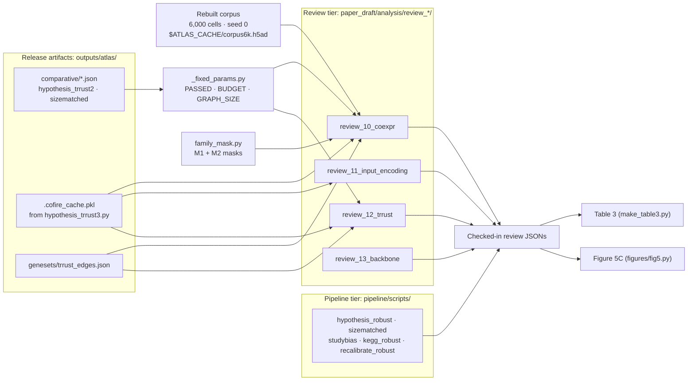
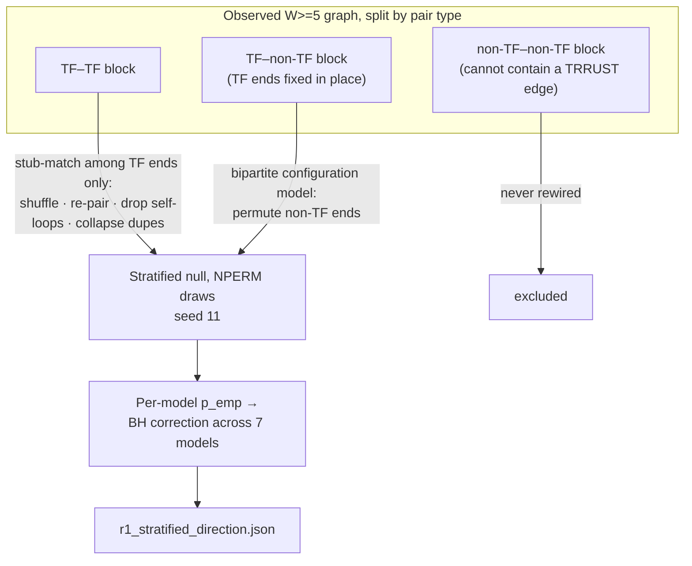
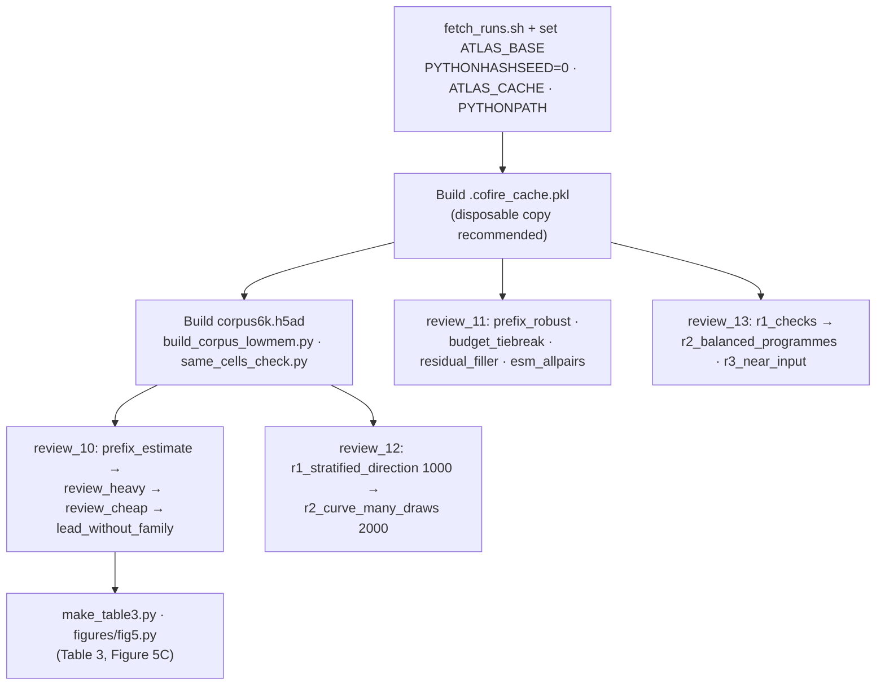

This page documents the repository's dedicated post-hoc verification layer: four numbered "hostile review" modules (`review_10_coexpr/` through `review_13_backbone/`) under `paper_draft/analysis/`, plus the pre-emptive robustness controls they sit alongside in `pipeline/scripts/`. Each module re-attacks one published claim family — the co-expression baseline, input-encoding artifacts, the TRRUST regulatory-direction test, and the backbone-composition contrast — using independently re-derived numbers, upgraded statistics, and re-implemented nulls. Understanding this layer requires familiarity with the co-firing graphs, the configuration-model null, and the calibrated annotation pipeline covered in [Null Models Behind Every Claim](10-null-models-behind-every-claim) and [Co-Expression Baseline Comparisons](15-co-expression-baseline-comparisons).

Sources: [README.md](paper_draft/analysis/README.md#L1-L16), [review_cheap.py](paper_draft/analysis/review_10_coexpr/review_cheap.py#L1-L18)

## Two-Tier Robustness Architecture

The robustness apparatus is split deliberately. The **pipeline tier** (`pipeline/scripts/*robust*.py`, `hypothesis_sizematched.py`, `hypothesis_studybias.py`) runs during analysis and writes results into the release directory `outputs/atlas/comparative/`, so its conclusions are part of the shipped artifact. The **review tier** (`paper_draft/analysis/review_*/`) runs *afterward*: it reads the release outputs (including the shared `.cofire_cache.pkl` graph cache built by `hypothesis_trrust3.py`), treats the published numbers as claims to be attacked, and writes small checked-in JSONs next to its own scripts. Two shared modules bind the review tier together: `_fixed_params.py` derives the passing-model list, equal-size budget, and per-model graph sizes from the *corrected* runs-v2 outputs (never hard-coded from the superseded run), and `family_mask.py` centralizes the M1/M2 gene-family exclusion rules consumed by both `lead_without_family.py` and `trrust_robustness/s03b_family_masked.py`.

Sources: [README.md](paper_draft/analysis/README.md#L57-L91), [_fixed_params.py](paper_draft/analysis/_fixed_params.py#L1-L13), [family_mask.py](paper_draft/analysis/family_mask.py#L7-L19)

The diagram's key structural fact: review modules are *consumers* of release outputs, never producers of release claims — except through two sanctioned sinks. `make_table3.py` assembles Table 3 from the unmasked comparison JSONs (`hypothesis_trrust2.json`, `r1_stratified_direction.json`, `coexpr_trrust.json`, `coexpr_degmatched.json`, `review_cheap.json`), and Figure 5C additionally consumes `lead_without_family.json`. Everything else in the review tier is evidence that stays outside the manuscript tables.

Sources: [README.md](paper_draft/analysis/README.md#L93-L110), [README.md](paper_draft/analysis/README.md#L1-L16)

## The Hostile-Review Protocol

`review_cheap.py` establishes the protocol in six numbered checks. Check (1) re-derives roughly thirty numbers quoted in the analysis notes directly from the checked-in baseline JSONs, comparing each against a hard-coded expected value annotated with its source line (e.g. `("global top-4149 Pearson fold", 75.0, ..., "10:212")`), accepting matches within a 0.6% relative tolerance and printing any mismatch. The full check battery is gated on detecting the published run (`"8631" in pe["global"]`), so it silently skips rather than false-fails on corrected-run data. This converts prose claims into mechanically falsifiable assertions.

Sources: [review_cheap.py](paper_draft/analysis/review_10_coexpr/review_cheap.py#L31-L76)

Check (2) performs the protocol's most important statistical upgrade. The published baseline compared co-firing against degree-matched co-expression graphs with a two-sided **Fisher test that treats the two graphs as independent samples** — but the graphs share pairs and shared pairs can both hit. The review conditions on *discordant* hits: among pairs found by only one graph, hits in the co-firing graph follow a binomial with success probability `n_cofire_only / (n_cofire_only + n_coexpr_only)` under equal precision, tested exactly. The Fisher p-value is still reported alongside for comparison. Checks (3)–(6) complete the battery: the pre-declared main kind (Pearson) re-scored at each passing model's *own* graph size with pooled leave-Tahoe-out binomial tests; a Monte Carlo spread of the Tahoe configuration null (5 seeds × 200 rewirings, versus the notes' single 3.93× and the published 4.44×); the TF–TF base rate computed *inside each model's node set* rather than the union-wide 22.6%; and enumeration of TRRUST edges touching the salivary-gene set used in the pair-quality check.

Sources: [review_cheap.py](paper_draft/analysis/review_10_coexpr/review_cheap.py#L78-L126), [review_cheap.py](paper_draft/analysis/review_10_coexpr/review_cheap.py#L128-L187)

A second protocol constraint shapes every review module: the baseline scripts run top-level code and cannot be imported, so their measurement functions are **re-implemented line for line** and then verified. `review_heavy.py` defines a `Ruler` class carrying the gene indexing, sorted truth keys (`i * 2^21 + j` after symbol uppercasing), and the stub-matching `config_shuffle` null copied verbatim from `hypothesis_trrust2.py`, and its docstring states the graphs were verified identical to the repo's cached pickle. `budget_tiebreak.py` goes further and asserts graph identity at runtime (`assert raw_alpha == pub`). Duplication here is a deliberate verification strategy, not an accident.

> [!TIP]
> When you see re-implemented "ruler" logic in this repo, check for the verification anchor: either an `assert` against the cached graph (`budget_tiebreak.py`) or an explicit identity statement in the docstring (`r1_stratified_direction.py`). A re-implementation without one is a red flag for silent divergence between the review and the published number.

Sources: [review_heavy.py](paper_draft/analysis/review_10_coexpr/review_heavy.py#L42-L73), [budget_tiebreak.py](paper_draft/analysis/review_11_input_encoding/budget_tiebreak.py#L73-L78)

## Review 10: Co-Expression Baseline Re-Examination

The corpus-dependent half of the module, `review_heavy.py`, runs three parts. **P1** is an independent recount at 6,000 cells using a direct threshold-and-sort (no histogram binning) for the global top-N graphs, plus degree-matched graphs rebuilt with greedy b-matching that *retain the hit lists* — enabling leave-one-hub-out paired tests and asking which genes carry hits only one graph finds. **P2** is the cell-prefix test: since the extraction capped positions per batch, `prefix_estimate.py` reconstructs how many corpus cells each model's SAE actually saw (Tahoe-x1 and Geneformer-V2 at 264 cells, scGPT 424, UCE 496, C2S-Scale 984 — with the corrected per-cell-sampling extraction now reading every cell, making the cap moot), then recomputes co-expression on exactly those first K cells. **P3** removes a circularity: the published gene universe was the *co-firing union*, itself a model-derived filter, so the review rescoring against an unrestricted universe of all named genes expressed in ≥10 of 6,000 cells.

Sources: [review_heavy.py](paper_draft/analysis/review_10_coexpr/review_heavy.py#L1-L17), [prefix_estimate.py](paper_draft/analysis/review_10_coexpr/prefix_estimate.py#L1-L44), [review_heavy.py](paper_draft/analysis/review_10_coexpr/review_heavy.py#L120-L168)

The synthesis script `lead_without_family.py` asks whether each model's degree-matched lead survives the two family masks — M1 (pairs sharing at least two leading symbol characters) and M2 (both genes in one curated DNA-binding-domain class) — applied via the shared `family_mask.py` helpers. The checked-in results show the answer is heterogeneous, which is precisely the value of running the check per model:

| Model | Cofire-only / Coexpr-only hits | p (unmasked) | After M1+M2 masking | p (masked) | Reading |
|---|---|---|---|---|---|
| UCE | 51 / 40 | 0.294 | 21 / 39 | 0.027 | lead was family-pair padding; co-expression leads after masking |
| Tahoe | 62 / 36 | 0.011 | 53 / 34 | 0.053 | lead weakens to borderline (the Figure 5C headline case) |
| C2S | 77 / 46 | 0.007 | 43 / 45 | 0.915 | lead fully explained by family pairs |
| Geneformer | 12 / 38 | 0.00031 | 12 / 35 | 0.001 | co-expression leads both before and after masking |

Sources: [lead_without_family.py](paper_draft/analysis/review_10_coexpr/lead_without_family.py#L1-L43), [lead_without_family.json](paper_draft/analysis/review_10_coexpr/lead_without_family.json#L1-L45), [README.md](paper_draft/analysis/README.md#L102-L110)

## Review 11: Input-Encoding Artifact Checks

This module stress-tests the lexical-artifact analysis — whether same-gene-prefix co-occurrence in SAE features reflects encoding artifacts — under harsher conditions. `prefix_robust.py` first lists, per model, which 3-letter prefixes compose *all* same-prefix within-feature pairs (purely descriptive), then re-tests the "same prefix, different HGNC group" excess after excluding the 20 prefixes with the most such pairs summed over all ten models. The exclusion set is chosen once, data-driven, before any testing — an anti-circularity discipline — and the surviving metric uses the same slot-permutation null as the published notes. `esm_allpairs.py` fixes a sampling-noise issue in the ESM2-cosine metric: `lexical.py` computed the observed mean cosine on a random 10,000-pair subsample, so the review recomputes it on *all* within-feature clean-list pairs and re-zs against the stored null SD — explicitly documented as conservative, since the stored SD still includes subsample noise.

Sources: [prefix_robust.py](paper_draft/analysis/review_11_input_encoding/prefix_robust.py#L1-L22), [esm_allpairs.py](paper_draft/analysis/review_11_input_encoding/esm_allpairs.py#L1-L10), [esm_allpairs.py](paper_draft/analysis/review_11_input_encoding/esm_allpairs.py#L27-L41)

Two checks target graph-construction fragility. `budget_tiebreak.py` quantifies how much the top-8,631 hit count depends on tie-breaking at the cutoff weight: pairs tied at the weight boundary enter or leave the budget depending on dict order versus alphabetical order, so the script reports hits under both orders, under 1,000 random tie orders, and the tie-free expectation (`hits_above + hits_at_cutoff × slots_left / n_at_cutoff`) per model. `residual_filler.py` defines filler genes mechanically — a gene whose appearances in detected tie-tail slots are ≥50% of its top-20 appearances *and* ≥20 in count — then recomputes the prefix signal on a "clean minus F" list with every filler gene blanked, a strictly stronger filter than the published clean lists, and additionally reports what share of the published top-8,631 pairs touch a filler gene.

Sources: [budget_tiebreak.py](paper_draft/analysis/review_11_input_encoding/budget_tiebreak.py#L1-L12), [budget_tiebreak.py](paper_draft/analysis/review_11_input_encoding/budget_tiebreak.py#L42-L62), [residual_filler.py](paper_draft/analysis/review_11_input_encoding/residual_filler.py#L1-L11), [residual_filler.py](paper_draft/analysis/review_11_input_encoding/residual_filler.py#L51-L84)

## Review 12: TRRUST Null Design — Finding and Fixing a Bias

This module documents the review process catching a genuine methodological flaw. `r1_stratified_direction.py` shows that `s03_hub_direction.py` compared the observed TF→non-TF hit count against a stub-matching null of the *whole* graph — but the observed graphs contain far more TF–TF pairs than their nulls (UCE: 738 observed versus 95.5 in the null), which leaves the null *more* TF–non-TF pairs to hit than the model actually had. The direction test was therefore biased against models (and the TF–TF test in their favor). The fix is a **block-stratified configuration null** that rewires each pair-type block separately so every gene keeps its exact numbers of TF and non-TF partners.

Sources: [r1_stratified_direction.py](paper_draft/analysis/review_12_trrust/r1_stratified_direction.py#L1-L23)

The script also reports a precision-matched version of the plain test (hits per TF–non-TF pair, observed versus null) so the old and new read-outs remain comparable, and it runs the stratified null with 1,000 draws (default 200, passed as `argv[1]`). The companion check `r2_curve_many_draws.py` addresses the *fold* estimate instead: note 12's ≥2-model fold of 14.06× (all ten) and 17.53× (five passing) on a single 100-draw stream sat far from the published 20.8×–28.43×, and the note called the fold "noisy" without quantifying it. Running the identical null for 2,000 draws (seed 2024), the script reports the null-precision mean with its Monte Carlo standard error, an approximate 95% CI for the fold, the fold's spread across independent blocks of 100 and 200 draws (what each prior run actually sampled), and — robust to all null choices — the null-free precision ratio at ≥2 models over ≥1 model.

> [!TIP]
> The block-stratified pattern generalizes: whenever a directional or type-conditional statistic is tested against a whole-graph null, check whether the null reallocates the *conditioning structure* (here, each gene's TF/non-TF partner counts). If it does not, the null is testing a different question than the observed statistic answers.

Sources: [r1_stratified_direction.py](paper_draft/analysis/review_12_trrust/r1_stratified_direction.py#L46-L106), [r2_curve_many_draws.py](paper_draft/analysis/review_12_trrust/r2_curve_many_draws.py#L1-L68)

## Review 13: Backbone Composition Sensitivity

`r1_checks.py` runs five hostile probes (a–e) against the backbone-composition analysis, all reusing `bb_common.py` and the s2 annotator caches so every number stays on the same ruler as the published notes. Probe (a) counts singleton programme classes under the primary clustering rule (`hit_weighted|complete|J>=0.3`); probe (b) reports the programme count across all 30 clustering rules, including the primary rule's rank; probe (c) replaces pooled raw hit counts with a **model-balanced** classification — each contributing model gets total weight 1, so feature-rich models like C2S and tGPT cannot dominate the gene-content fractions; probe (d) decomposes the published "all 7 of 7 agree: 127 concepts at 0% depth versus 15 at mid" contrast, recounting it excluding protein-synthesis and excluding MaxToki (the model that loses the translation block after input); probe (e) states an arithmetic floor: with 7 non-embedding models among 10, any ≥8-of-10 concept *must* include at least one of the three embedding-layer models, so "every deep concept has one or two embedding models" is half forced by combinatorics — only the 1-versus-2 split and "none has all three" are informative.

Sources: [r1_checks.py](paper_draft/analysis/review_13_backbone/r1_checks.py#L1-L13), [r1_checks.py](paper_draft/analysis/review_13_backbone/r1_checks.py#L19-L82)

The follow-ups push the two most consequential probes further. `r2_balanced_programmes.py` re-runs the primary programme clustering with model-balanced hit weights (each model's per-concept hit counts normalized to sum 1 before pooling — necessary because tGPT/C2S give the most hits for 78 of 78 concepts), sweeping complete/average/single linkage at J≥0.3 and J≥0.5. `r3_near_input_no_maxtoki.py` repeats the near-input excess count among only the six block-output models with MaxToki removed, at ≥5-of-6 and 6-of-6 thresholds per depth slice, observed counts only. Together these convert a single published clustering into a sensitivity surface, and they expose which parts of the depth narrative are structural (arithmetic floor) versus empirical (MaxToki's translation block).

Sources: [r2_balanced_programmes.py](paper_draft/analysis/review_13_backbone/r2_balanced_programmes.py#L1-L40), [r3_near_input_no_maxtoki.py](paper_draft/analysis/review_13_backbone/r3_near_input_no_maxtoki.py#L1-L23)

## Pipeline-Level Robustness Controls

The review tier did not appear from nothing — the pipeline already contains pre-emptive robustness analyses whose outputs live in the release itself, and which the review modules treat as claims to re-verify. `hypothesis_robust.py` perturbs the held-out TRRUST result three ways: R1 drops same-family paralog pairs, R2 keeps only features firing above the per-model median activation frequency (removing the near-zero-expression clustering artifact), and R3 raises the per-pair evidence bar from ≥5 to ≥10 features. Its `same_family` helper carries a cautionary docstring: the earlier regex-based rule "matched none of those three examples from its own docstring," so the replacement stem rule errs toward over-dropping — the safe direction for a negative control. `hypothesis_sizematched.py` separates capability from capacity: predicted-pair counts span four orders of magnitude (AIDO.Cell 2 pairs, C2S-Scale 147,728) and hit counts correlate with graph size at r = +0.90, so every model is re-scored at the *same* top-N budget, with a rand-N arm isolating pure size, and sub-budget models marked untestable rather than failed.

Sources: [hypothesis_robust.py](pipeline/scripts/hypothesis_robust.py#L1-L54), [hypothesis_sizematched.py](pipeline/scripts/hypothesis_sizematched.py#L1-L20)

| Script | Concern attacked | Method | Output |
|---|---|---|---|
| `hypothesis_robust.py` | family paralogs, dead features, weak evidence | R1/R2/R3 variants on same config null | `hypothesis_robust.json` |
| `hypothesis_sizematched.py` | dictionary size masquerading as quality | equal top-N budget + rand-N null | `hypothesis_sizematched.json` |
| `hypothesis_studybias.py` | result driven by well-studied genes | precision profile across PubMed-count strata; Replogle-screen coverage audit | `hypothesis_studybias.json` |
| `recalibrate_robust.py` | rescued backbone = one lucky config | sweep calibrated annotators × ≥7/8/9/10 thresholds; housekeeping-vs-specific split | `recalibrate_robust.json` |
| `kegg_robust.py` | KEGG licensing dependence | recompute backbone with KEGG dropped from {GO_BP, KEGG, Reactome} | `kegg_robust.json` |

Sources: [hypothesis_robust.py](pipeline/scripts/hypothesis_robust.py#L32-L54), [hypothesis_studybias.py](pipeline/scripts/hypothesis_studybias.py#L1-L18), [recalibrate_robust.py](pipeline/scripts/recalibrate_robust.py#L1-L4), [kegg_robust.py](pipeline/scripts/kegg_robust.py#L1-L5)

`hypothesis_studybias.py` deserves emphasis as the deepest of these: the pair list retains only 141 of 4,003 understudied genes (3.5%, against 16.8% of well-studied genes), so the "no new biology" conclusion could be a filter property. Causal validation is blocked — 752 of the 793 featured understudied protein-coding genes are absent from the Replogle screen entirely — so the script asks the strongest answerable question: among *testable* pairs, does the causal signal decline as the responding gene's publication count drops? A flat profile licenses extrapolation to unstudied genes; a declining profile refutes it. It relaxes the co-firing threshold from ≥5 to ≥2 so low-abundance genes are not pre-filtered, and annotates every pair with the responding gene's publication count.

Sources: [hypothesis_studybias.py](pipeline/scripts/hypothesis_studybias.py#L1-L18), [hypothesis_studybias.py](pipeline/scripts/hypothesis_studybias.py#L20-L45)

## Reproducing the Review Checks

All review modules run from the repository root after `bash pipeline/scripts/fetch_runs.sh`, with `ATLAS_BASE` pointing at the unpacked releases, `PYTHONHASHSEED=0`, and `PYTHONPATH` including `paper_draft/analysis` so `_fixed_params` imports resolve. Corpus-dependent scripts take the rebuilt 6,000-cell corpus path as `argv[1]`; null-heavy scripts take permutation counts as trailing arguments (e.g. `r1_stratified_direction.py 1000`, `r2_curve_many_draws.py 2000`). The `.cofire_cache.pkl` dependency is generated by `pipeline/scripts/hypothesis_trrust3.py` — the README warns to build it in a disposable copy, since that generator also rewrites the candidate list and summary.

| Variable | Input |
|---|---|
| `ATLAS_BASE` | repository root with release archives unpacked |
| `ATLAS_CACHE` | working cache (corpus, TRRUST TSV, HGNC, scGPT vocab, AIDO gene index) |
| `PYTHONPATH` | must include `paper_draft/analysis` for `_fixed_params` |
| `TRRUST_RAW` / `HGNC_PATH` / `SCGPT_VOCAB` / `AIDO_GENE_INDEX` | external reference inputs with cache defaults |

Sources: [README.md](paper_draft/analysis/README.md#L57-L91), [README.md](paper_draft/analysis/README.md#L93-L101)

## Where This Fits

The review tier is the adversarial complement to the constructive pages upstream: [Co-Expression Baseline Comparisons](15-co-expression-baseline-comparisons) defines the ruler these scripts re-implement, [Literature and Perturbation Evidence](14-literature-and-perturbation-evidence) defines the TRRUST/perturbation read-outs that `hypothesis_robust.py` and `hypothesis_studybias.py` perturb, and [Concept Matrices and Backbone Detection](13-concept-matrices-and-backbone-detection) defines the annotation machinery `review_13_backbone` re-sweeps. Downstream, the checked-in review JSONs are consumed by the Table 3 generator and audited alongside everything else in [Audit System and Manuscript Checks](18-audit-system-and-manuscript-checks); the corrected-run context that makes `_fixed_params.py` necessary is documented in [Extraction Faults and Corrected Re-Run](21-extraction-faults-and-corrected-re-run).
