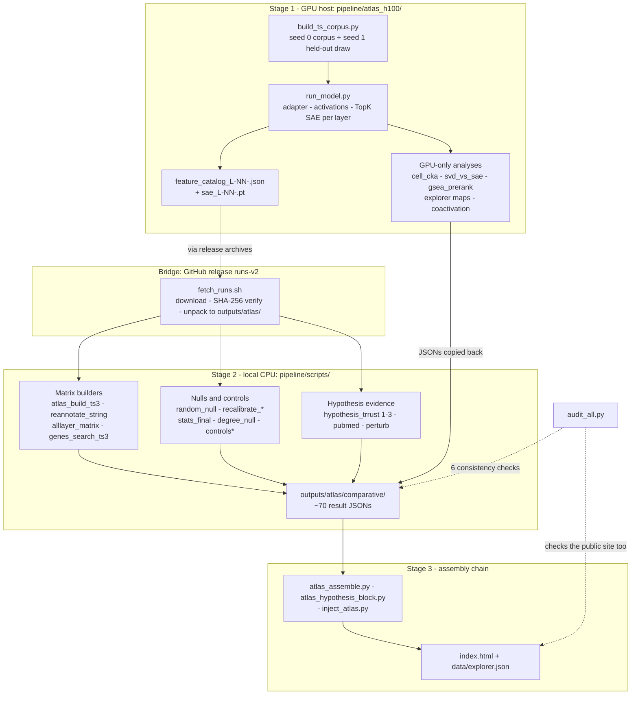
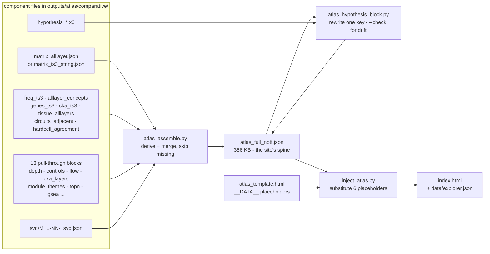

This page maps how data physically moves through the atlas-comparison repository: which files exist, which script writes each one, which scripts read it, and how ~70 component JSONs in a single directory become the manuscript numbers, the figures, and the public site. The repository enforces one architectural invariant — everything published is derived from `outputs/atlas/comparative/` and nothing else — and this page shows both the flow that populates that directory and the machinery that keeps it true. The canonical file-side reference is `docs/RESULTS.md`, and this page walks it from the data-flow side.

Sources: [RESULTS.md](docs/RESULTS.md#L1-L3), [scripts/README.md](pipeline/scripts/README.md#L1-L5)

## The Single Data Root and the ATLAS_BASE Contract

Every local script locates its inputs and outputs through one environment variable rather than hard-coded paths: `ATLAS_BASE` points at a data root under which `outputs/atlas/comparative/` lives. The scripts carry the authors' local path only as a default fallback (`/Users/annaantipova/Desktop/biomech`), and the reproduction guide instructs you to override it with the repository checkout itself (`export ATLAS_BASE=$(pwd)`). This one-line contract is what makes the entire analysis stage portable — any machine that sets `ATLAS_BASE` can run every script unchanged.

The documentation is deliberately mirrored in two views. `pipeline/scripts/README.md` is the **script-side map** ("what does this script do"), while `docs/RESULTS.md` is the **file-side map** ("who writes this file, who reads it, what it holds") — the two cover the same ground from opposite directions. For this page the file side is authoritative: it inventories every JSON in the comparative directory with its KB size, writer, and readers.

Sources: [scripts/README.md](pipeline/scripts/README.md#L1-L5), [RESULTS.md](docs/RESULTS.md#L3), [REPRODUCE.md](docs/REPRODUCE.md#L12-L13), [atlas_assemble.py](pipeline/scripts/atlas_assemble.py#L12)

## Three Stages: GPU Extraction, Catalogue Handoff, Local Analysis

The flow crosses a hardware and environment boundary once, and the **feature catalogue JSON is the serialization boundary**. On the H100 host, `build_ts_corpus.py` produces the shared corpus (seed 0) and the held-out draw (seed 1); `run_model.py` then runs each model end-to-end — adapter → activations → TopK SAE per layer — and `build_catalog()` writes one catalogue per layer (`out_fixed/<M>/feature_catalog_L<NN>.json`, top-20 genes per feature) plus the SAE weights (`sae_L<NN>.pt`). The GPU folder also hosts the analyses that *cannot* run without activations or weights — CKA between models, SVD-versus-SAE comparisons, rank-based GSEA annotation, co-activation graphs, and the explorer feature maps — and each of these emits a result file that is later copied back into the comparative directory.

> [!TIP]
> The decision that "everything that only needs the catalogues runs locally" is what makes the whole project reproducible on a laptop: the ~17 GB of SAE weights and the raw activations never leave the GPU pod, and are not archived at all. The catalogue JSON — feature IDs, top genes, firing statistics — is a sufficient sufficient statistic for every published downstream claim.

The handoff between stages is the GitHub release: `fetch_runs.sh` downloads the per-run archives (`runs-ts3_out`, `runs-alllayer_cat`, `runs-heldout_cat`, `runs-seeds`, `inputs-genesets`), verifies each against `SHA256SUMS`, and unpacks them into `outputs/atlas/` so the local scripts can re-run with `ATLAS_BASE` pointing at the repository root. Extraction ran under Python 3.12 / PyTorch / NumPy 1.26 on the H100; local analysis runs under Python 3.13 / NumPy 2.3.4 — the catalogue files are the interface that lets two different environments cooperate without either seeing the other's dependencies.

Sources: [atlas_h100/README.md](pipeline/atlas_h100/README.md#L1-L7), [atlas_h100/README.md](pipeline/atlas_h100/README.md#L60-L65), [atlas_h100/README.md](pipeline/atlas_h100/README.md#L73-L74), [atlas_h100/README.md](pipeline/atlas_h100/README.md#L84-L88), [fetch_runs.sh](pipeline/scripts/fetch_runs.sh#L17-L27), [REPRODUCE.md](docs/REPRODUCE.md#L12-L13)

## The Result File Inventory

`docs/RESULTS.md` records every file with the discipline of a ledger: size in KB, the script that writes it, the scripts that read it, and one sentence on what it holds. Reading the "written by" column across all entries reveals exactly **three provenance classes**, and it is worth internalizing them because they tell you where a number comes from:

| Provenance class | Example files | Written by | Typical consumers |
|---|---|---|---|
| Local analysis scripts | `matrix_alllayer.json` (19.2 MB), `matrix_ts3_string.json` (16.9 MB), `recalibrate_final.json`, `controls.json`, `hypothesis_final.json`, `hypothesis_pairs_full.json` (569 KB, all 4,485 released pairs) | `alllayer_matrix.py`, `reannotate_string.py`, `recalibrate_*.py`, `hypothesis_trrust3.py`, … | `atlas_assemble.py`, audits, figure/table builders |
| GPU-side, copied back | `cka_ts3.json`, `freq_ts3.json` (22.4 MB), `gsea_annot.json`, `nonlinearity_alllayers.json`, `raw_expression_baseline.json`, `explorer_slim_*.json`, `svd/<M>_L<NN>_svd.json` | `cell_cka.py`, `gsea_prerank.py`, `svd_vs_sae.py`, `build_explorer_slim.py` (all in `atlas_h100/`) | `atlas_assemble.py`, `inject_atlas.py`, figure scripts |
| Assembled artifacts | `atlas_full_notf.json` (356 KB) — and transitively `index.html`, `data/explorer.json` | `atlas_assemble.py`, then `atlas_hypothesis_block.py` (rewrites one key), `inject_atlas.py` | the site, downstream controls (`controls4.py`), audits |

The table is also honest about its own topology: rows with an empty "read by" column are endpoints — nulls and grids like `random_null.json`, `heldout.json` (the permissive replication that *fails*), or `depth_ts3.json` — kept because audits or history reference them, while the header notes that files no script reads were deliberately left out of the repository. The `figures/` subdirectory carries the seven manuscript figures plus `.sources.json`, a hash-stamped manifest of each plotting script's inputs.

Sources: [RESULTS.md](docs/RESULTS.md#L5-L69), [RESULTS.md](docs/RESULTS.md#L71-L77), [scripts/README.md](pipeline/scripts/README.md#L9-L18), [scripts/README.md](pipeline/scripts/README.md#L42-L55)

## The Assembly Chain: Component Files to Site Payload

Three scripts in `pipeline/scripts/` turn the component JSONs into the published page, each with a narrow contract. Understanding this chain answers the question "if I re-run analysis X, what must I re-run to update the site?"

**`atlas_assemble.py`** builds `atlas_full_notf.json`, the one file the site embeds. It chooses a spine — `matrix_alllayer.json` if present, falling back to `matrix_ts3_string.json`, asserting if neither exists — then derives the coverage, universality, similarity (Jaccard), lineage, and firing blocks itself, and finally loops over a declarative list of **thirteen pull-through blocks** (depth, tissue_layers, cka, cka_layers, nonlinearity, module_themes, flow, celltype, topn, gsea, controls, depth_calibrated, findings), copying each verbatim if its file exists and printing a skip notice if not. The SVD block is merged incrementally: it starts from the previous atlas JSON and updates per-model entries from `svd/<M>_L<NN>_svd.json` globs, which is how a tenth model gets added without re-deriving the other nine.

> [!TIP]
> Missing input files never crash the assembler — a missing file means the corresponding block is absent from the output, not a failed run. This fault-tolerance pattern means partial regenerations produce a coherent (if incomplete) atlas, and the skip notices in stdout are the audit trail for what did not make it in.

**`atlas_hypothesis_block.py`** exists because of a documented drift incident: the site's prediction panels were once assembled by hand, and when the literature null was made reproducible the page kept serving an old z = 40.48 while the manuscript said 34.7. The script now derives the entire `hypothesis` block from six canonical files (`hypothesis_trrust2`, `hypothesis_final`, `hypothesis_robust`, `hypothesis_sizematched`, `hypothesis_pubmed`, `hypothesis_perturb`) and edits only that key of `atlas_full_notf.json`. Its `--check` mode recomputes without writing and reports drift, which turns the public site into just another auditable artifact.

**`inject_atlas.py`** performs the final substitution: it reads `atlas_template.html` — editable markup whose data blocks are empty `<script id="…-data" type="application/json">` placeholders — and injects six files: `modules_alllayers.json`, `genes_ts3.json`, `atlas_full_notf.json`, `sae_health.json`, `programme_table.json`, and the explorer maps. It produces three builds: a LIGHT variant embedding the capped `explorer_slim_light.json` (5.4 MB), a FULL local variant, and the published `index.html`, which carries only a stub and fetches the heavy maps from `data/explorer.json` on first explorer use — cutting the served page to roughly a fifth of the naive size.

Sources: [atlas_assemble.py](pipeline/scripts/atlas_assemble.py#L2-L8), [atlas_assemble.py](pipeline/scripts/atlas_assemble.py#L64-L70), [atlas_assemble.py](pipeline/scripts/atlas_assemble.py#L281-L301), [atlas_assemble.py](pipeline/scripts/atlas_assemble.py#L303-L318), [atlas_hypothesis_block.py](pipeline/scripts/atlas_hypothesis_block.py#L2-L12), [atlas_hypothesis_block.py](pipeline/scripts/atlas_hypothesis_block.py#L29-L31), [inject_atlas.py](pipeline/scripts/inject_atlas.py#L22-L32), [inject_atlas.py](pipeline/scripts/inject_atlas.py#L42-L56), [inject_atlas.py](pipeline/scripts/inject_atlas.py#L81-L86)

| Chain stage | Inputs (count) | Output | Failure behavior |
|---|---|---|---|
| `atlas_assemble.py` | spine (1, asserted) + derived inputs (~7, optional) + pull-through list (13, optional) + previous atlas for SVD merge | `atlas_full_notf.json` | missing optional file → block skipped with notice; missing spine → assert |
| `atlas_hypothesis_block.py` | 6 hypothesis files + current `atlas_full_notf.json` | rewritten `hypothesis` key | `--check` mode reports drift without writing |
| `inject_atlas.py` | 6 data blocks + template | `index.html`, `data/explorer.json`, 2 local builds | hard dependency: `atlas_full_notf.json` must exist |

## Drift Control: One Invariant, Six Checks

The inventory's contract — "the manuscript, the supplement and the site's data blocks are built from these files and nothing else" — is enforced, not aspirational. `audit_all.py` runs six modules covering the three drift surfaces the project has actually been bitten by: text versus results (a fold range left at 166× where the source said 166.7), supplement versus results (tables keeping stale permutation counts), and figures versus results (a figure shipping four days of replaced numbers). The sixth check is precisely the site: `atlas_hypothesis_block.py --check` against `atlas_full_notf.json`. The command's exit code is framed as a submission gate — all six passing means it is safe to submit, and the failure instruction is architectural in spirit: *"Fix the source of the disagreement, not the check."* The figure checks close their own loop by hashing inputs: `audit_figures.py` stamps `.sources.json` with the hashes of each plotting script's inputs, so a figure can be verified against the data it was drawn from. The design principle behind all of this is the same one this page documents: a claim is true if, and only if, it can be re-derived from the result files — [Audit System and Manuscript Checks](18-audit-system-and-manuscript-checks) covers the check internals.

Sources: [RESULTS.md](docs/RESULTS.md#L3), [audit_all.py](pipeline/scripts/audit_all.py#L4-L8), [audit_all.py](pipeline/scripts/audit_all.py#L19-L26), [audit_all.py](pipeline/scripts/audit_all.py#L44-L48), [RESULTS.md](docs/RESULTS.md#L71-L73)

## Reproducing the Map on Your Machine

The minimal path touches every layer of the flow without downloading anything: clone the repository, `pip install -r requirements.txt`, `export ATLAS_BASE=$(pwd)`, drop the manuscript files next to the results, and run `python pipeline/scripts/audit_all.py` — the result files ship in the repository, so all 312 checks re-derive every published number from them locally. Rebuilding the site from the same files is one more command (`python pipeline/scripts/inject_atlas.py`, which writes `index.html` and `data/explorer.json`), served with any static file server. To go further and *re-run* the analyses rather than check them, `bash pipeline/scripts/fetch_runs.sh` materializes the per-run catalogues into `outputs/atlas/` first; what those archives contain, their sizes, and the checksum scheme are covered in [Release Archives and Checksummed Fetching](19-release-archives-and-checksummed-fetching), and why the catalogues were re-extracted (the v1 positional-sampling fault) is the story of [Extraction Faults and Corrected Re-Run](21-extraction-faults-and-corrected-re-run).

Sources: [REPRODUCE.md](docs/REPRODUCE.md#L19-L34), [fetch_runs.sh](pipeline/scripts/fetch_runs.sh#L1-L9), [atlas_h100/README.md](pipeline/atlas_h100/README.md#L48-L58)

## Where to Go Next

The natural continuation of this page follows the flow's terminus and its enforcement. [Audit System and Manuscript Checks](18-audit-system-and-manuscript-checks) details the six verification modules summarized above; [Release Archives and Checksummed Fetching](19-release-archives-and-checksummed-fetching) unpacks the bridge between the GPU host and your checkout; [Site Assembly from Result Files](22-site-assembly-from-result-files) goes deeper into `inject_atlas.py` and the template placeholder mechanics; and [Layer Explorer Feature Maps](23-layer-explorer-feature-maps) explains what the lazily-fetched 50 MB `explorer_slim_full.json` actually renders.
