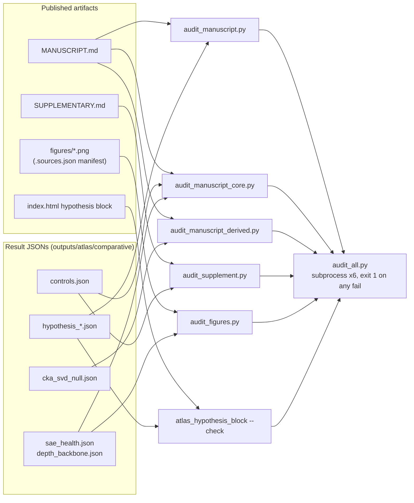
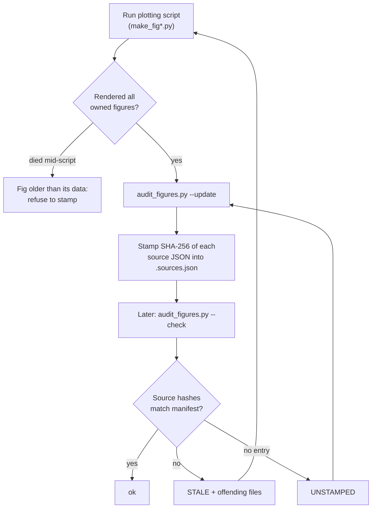

This page documents the six-module consistency audit that gates every release of the atlas comparison: an orchestrator (`audit_all.py`) that dispatches manuscript, supplement, figure, and site checks against the result JSONs each artifact claims to describe. The suite exists because this project repeatedly observed the same failure mode — prose, tables, and figures silently diverging from the data that produced them — and each module encodes a specific incident. We cover the architecture, the shared numeric-matching primitive, the distinction between verbatim and derived claims, and the content-hash stamping protocol that closes the figure gap.

## Three Surfaces That Drift

The system design starts from a partition of failure surfaces rather than a list of bugs. The orchestrator's docstring names exactly three things that "can drift apart, and each has bitten this project": the text versus the results (a fold range left at 166× where the source said 166.7), the supplement versus the results (Table S8 kept 20-permutation folds after the move to 250, and Table S2 printed unfiltered totals under a "5–500 genes" heading), and the figures versus the results (Fig S2 shipped for four days showing numbers that had been replaced). The manuscript auditor's own docstring adds the epistemological motivation: it was written "after three separate bugs in one session, each of which looked like a result rather than a mistake — a null taken from the wrong population, unmapped gene symbols folded into 'zero publications', and an Ensembl filter applied after truncation instead of before." The design conclusion is stated outright: reasoning about whether a number is right is what failed each time, so the audit instead re-reads every number from its source file.

This gives the audit system its shape: one check per artifact type, all reading from the single directory of result files (`outputs/atlas/comparative/`) documented in [Result Files and Data Flow Map](17-result-files-and-data-flow-map).

Sources: [audit_all.py](/pipeline/scripts/audit_all.py#L2-L10), [audit_manuscript.py](/pipeline/scripts/audit_manuscript.py#L2-L11), [README.md](/pipeline/scripts/README.md#L75-L85)

## Orchestrator: `audit_all.py`

`audit_all.py` is a 50-line subprocess dispatcher. It resolves its own directory, declares the six checks as `(label, script)` pairs, runs each with `capture_output=True`, and prints one `PASS`/`FAIL` line per module using the module's **last stdout line** as the summary — so `96/96 numbers verified against source` or `all 7 figures match the data they were drawn from` becomes the aggregate report. On failure it reprints only the diagnostic lines from the failing modules, filtered by a keyword list (`MISMATCH`, `STALE`, `MISSING`, `UNSTAMPED`, `no such sentence`, `needs a look`) — a deliberate triage view that suppresses the passing rows. Any nonzero child exit code propagates as exit code 1, which the docstring frames as the actual output: a plain statement of "whether it is safe to submit."

The six registered checks divide by artifact and by claim type:

| # | Check module | Scope | Artifact audited |
|---|---|---|---|
| 1 | `audit_manuscript.py` | Results 3.4–3.5, Discussion, Limitations | `MANUSCRIPT.md` |
| 2 | `audit_manuscript_core.py` | Results 3.1–3.3 and Methods | `MANUSCRIPT.md` |
| 3 | `audit_manuscript_derived.py` | Numbers derived, not read off a result | `MANUSCRIPT.md` |
| 4 | `audit_supplement.py` | Hand-written tables vs data, code, environment | `SUPPLEMENTARY.md` |
| 5 | `audit_figures.py` | Rendered figures vs source hashes | `figures/*.png` |
| 6 | `atlas_hypothesis_block.py --check` | Public site vs same results | `index.html` data block |

The one design subtlety: check 6 is not an `audit_*` file at all. The site-assembly script `atlas_hypothesis_block.py` (see [Site Assembly from Result Files](22-site-assembly-from-result-files)) ships a `--check` mode that reports drift between the embedded prediction block and the hypothesis files, and the orchestrator simply invokes it as a sixth subprocess — reusing the generator's own logic as its auditor rather than duplicating it.

Sources: [audit_all.py](/pipeline/scripts/audit_all.py#L18-L49), [README.md](/pipeline/scripts/README.md#L60-L62)

## The `check()` Primitive: Matching Text-Implied Precision

All three manuscript auditors share one comparison function, and its contract is documented in `audit_manuscript.py`'s docstring: matching is **numeric, not textual**. Each check is a regex over the whitespace-flattened manuscript with exactly one capture group holding the number, e.g. `rf"{re.escape(disp)} {N}×"` for a per-model fold claim. The function then derives the tolerance from the text itself: it counts how many decimals the sentence shows and applies `tol = 0.5 * 10**(-dec)`, so a manuscript that writes "13.3" is compared to a source value of 13.29 within ±0.05 — rounding is not reported as an error, but a genuine divergence is.

The primitive absorbs the manuscript's typographic conventions so they never produce false alarms:

| Convention in text | Handling in `check()` |
|---|---|
| Thousands separators (`4,111`) | Stripped before parsing |
| Unicode minus (`−`) | Normalized to ASCII `-` |
| En/em-dash ranges (`166–284×`) | Range endpoints checked as two separate captures; `audit_manuscript_core.py` defines `D = r"[-–—]"` explicitly |
| Spelled-out counts ("two of the five models") | `WORDS` dict maps `one`…`ten`; capture group `[A-Za-z]+` |
| Prose precision ("about one in every 480") | Optional `tol_rel` widens tolerance relative to the expected value (`tol_rel=0.02` for a two-significant-figure claim) |
| Computed forms (`100 × precision`, `1/(N+1)` p-value floor) | Expected value is an expression over source fields, not a stored copy |

Every row lands in a `rows` list as `(claim, source, "expected vs got", status, ok)`. The report prints a fixed-width table and the tally line (`{passed}/{total} numbers verified against source`), then lists failures under a `needs a look:` heading.

The single most consequential rule lives in the final comment block: **a check that could not find its sentence did not run at all, which is worse than a mismatch** — rewording a sentence would otherwise switch its check off in silence. So `re.search` returning `None` records a `"no such sentence"` failure, and *any* failed row exits 1. This makes the audit failure-closed against prose edits, not just numeric edits.

> [!TIP]
> When extending the suite, resist the temptation to make missing sentences a warning. The "no such sentence = fail" rule is what prevents the audit from decaying into a checklist of assertions that pass vacuously — the exact anti-pattern that let the 28.4× artefact survive (see next section).

Sources: [audit_manuscript.py](/pipeline/scripts/audit_manuscript.py#L46-L66), [audit_manuscript.py](/pipeline/scripts/audit_manuscript.py#L249-L263), [audit_manuscript_core.py](/pipeline/scripts/audit_manuscript_core.py#L47-L65), [audit_manuscript_derived.py](/pipeline/scripts/audit_manuscript_derived.py#L43-L63)

## Verbatim Claims: `audit_manuscript.py` and `audit_manuscript_core.py`

The two verbatim auditors split the manuscript by section provenance. `audit_manuscript.py` covers Results 3.4–3.5, Discussion, and Limitations — the sections built from the hypothesis-testing campaign — and loads `hypothesis_trrust2.json`, `hypothesis_final.json`, `hypothesis_robust.json`, `hypothesis_pubmed.json`, `hypothesis_perturb.json`, and `hypothesis_studybias.json` up front, then navigates them with a `dig(d, *path)` helper that returns `default=None` for any missing path. `audit_manuscript_core.py` covers Results 3.1–3.3 and Methods — the sections "whose numbers predate today's work" — reading `controls.json`, `alllayer_null.json`, `depth_backbone.json`, `kegg_robust.json`, and `sae_health.json`; its `dig` additionally accepts integer list indices, and it replaces the two-capture range idiom with the en-dash-aware `D` pattern.

Three structurally interesting claim families show how far the pattern is pushed:

- **Range endpoints as paired checks.** A manuscript sentence like "five variants give a↔b×" produces two checks (`robustness min`, `robustness max`), where each expected value is `min()`/`max()` *recomputed from the result file's list* — the text is audited against derived extrema even inside the verbatim module.
- **Permutation counts read from each test's own file.** A dedicated block checks every `N = ...` in Methods against the producing file's `n_perm` field, with the comment explaining why: the text said 200 for tests that actually ran 500 and 100, and "a script default that changes shows up here rather than in a reviewer's recomputation of the p-value floor."
- **Boolean invariants as rows.** `audit_manuscript_core.py` appends raw `rows.append(...)` entries for non-numeric claims — e.g., that the CKA-vs-floor ratio exceeds tenfold for every pair, that the SAE is ahead of PCA in all ten models, and that a negative random-dictionary variance holds across the board.

One cross-artifact leak is intentional: two checks in `audit_manuscript.py` leave the manuscript — one parses `SUPPLEMENTARY.md`'s Table S11 code block and counts its keyword rows against a "full list of N strings" claim, and another reads `atlas_full_notf.json`'s `depth` map to verify the Intro's "a transformer of N–M layers" range is exactly the min/max across the ten models.

Sources: [audit_manuscript.py](/pipeline/scripts/audit_manuscript.py#L32-L33), [audit_manuscript.py](/pipeline/scripts/audit_manuscript.py#L101-L110), [audit_manuscript.py](/pipeline/scripts/audit_manuscript.py#L163-L179), [audit_manuscript_core.py](/pipeline/scripts/audit_manuscript_core.py#L1-L9), [audit_manuscript_core.py](/pipeline/scripts/audit_manuscript_core.py#L136-L157), [audit_manuscript.py](/pipeline/scripts/audit_manuscript.py#L207-L214)

## Derived Claims: Recompute, Don't Compare

`audit_manuscript_derived.py` closes a coverage hole the other two modules cannot see. Its docstring reports that a coverage measurement over the Results and Discussion found **33 numbers that do not appear verbatim in any JSON**: minima and medians over a list, ratios of two stored figures, a correlation across models, a reciprocal. Nothing verified those, "so a stale one would have survived every re-run — which is exactly how the 28.4× selection artefact lasted as long as it did."

The module's answer is a strict rule stated in its header: each check **recomputes the quantity from the stored primitives instead of comparing it to a second stored copy of itself**, because "a copy can go stale in step with the text, a recomputation cannot." The recomputed quantities include:

| Derived claim | Recomputation from primitives |
|---|---|
| r(graph size, hits) across models | `np.corrcoef` over `per_model[m]["n_pairs"]` vs `["hits"]` for all ten models |
| CKA span, median, shuffle floor, min ratio | `min`/`max`/`np.median`/`real/shuf` over the 45-entry `cka_null` pair list |
| Corroboration gain (ge2/ge1) | `curve["2"]["fold"] / curve["1"]["fold"]` from `hypothesis_trrust2.json` |
| "About one correct edge in every N pairs" | `n_pairs / hits`, with `tol_rel=0.02` for the word "about" |
| Backbone specific % | `100 * triviality["specific"] / triviality["n_ge8"]` |
| Dedup arithmetic consistency | `max(\|hits_block_carried + hits_rest − hits_dedup\|) <= 2` across models |

Two claims in this family expose a hazard worth naming. The corroboration-gain check deliberately reads the all-ten curve from `hypothesis_trrust2.json` and *not* the five-model version in `hypothesis_final.json` (5.3×/28.4×), because the manuscript reports the five-model figure only as a direction check — "reading the gain off that file would silently restate the selected numbers as the headline." And the Fig 4 caption check verifies a *bound*, not a value: the caption states "every pair exceeds its floor >N-fold," so the check requires the recomputed minimum ratio to fall in `[N, N+10)`. The comment records that the caption read ">10-fold" for weeks while the text said fortyfold — an inconsistency invisible to value-equality checks.

Where a derived number had no primitives to recompute from at all, the fix was upstream, not in the auditor: the two affected figures are now *written by their producing scripts* (`hypothesis_pubmed`'s uncapped co-mention rate; `study_bias_coverage.py`), so the audit can read them like verbatim values.

Sources: [audit_manuscript_derived.py](/pipeline/scripts/audit_manuscript_derived.py#L2-L13), [audit_manuscript_derived.py](/pipeline/scripts/audit_manuscript_derived.py#L74-L81), [audit_manuscript_derived.py](/pipeline/scripts/audit_manuscript_derived.py#L100-L104), [audit_manuscript_derived.py](/pipeline/scripts/audit_manuscript_derived.py#L120-L136), [audit_manuscript_derived.py](/pipeline/scripts/audit_manuscript_derived.py#L216-L238)

## Supplement: Generated or Verified, Nothing Else

`audit_supplement.py` enforces a binary property over the supplementary tables: **every number is either generated or verified**. The motivating incidents are in the docstring — Table S3 contradicted itself on dead-feature fractions, Table S5 kept a fold range the main text had corrected, Table S2's heading lied about its filter — and the structural fix split the supplement in two:

- **Generated tables** (S2, S3, S5, S8, S9, S10 — the report line says exactly this) are regenerated from the result JSONs by `make_supp_tables.py` and "cannot drift." That script's docstring records the trigger: S8 still carried 20-permutation folds after the manuscript moved to 250, and S9/S10 — including the paper's actual deliverable, the released prediction list — "had never been written at all." S2's generator now emits *both* filter columns (5–500 and 5–200) because the permissive annotator admits 5–500 gene sets while the calibrated one admits 5–200, with a parenthetical confession of the earlier mislabeling preserved in the output.
- **Hand-written tables** (S1, S4, S6, S7) are audited by `audit_supplement.py`, which parses each `## Table S…` section and re-derives every cell from a different authority than the prose.

The four verified tables each check against a distinct ground truth, which is the table's design lesson:

| Table | Verified against | Mechanism |
|---|---|---|
| S1 per-model spec | `sae_health.json` + `controls.json:svd_null` | Row regex → layers, `d_sae = 4 × d_model` arithmetic, variance explained; plus a coverage check that all models appear |
| S4 annotator parameters | **The source code itself** | Regex-extracts `ALPHA, TOP, AMIN, MX = ...` from `degree_null.py` and compares to the table cells; asserts "no PPI" in the databases column |
| S6 software environment | **The running interpreter** | Compares live `platform.python_version`, `numpy.__version__`, `scipy.__version__`, `h5py.__version__` to the table's local column |
| S7 SAE vs PCA at k=32 | `controls.json:svd_null` | Per-model PCA/SAE/gap with tolerance `5e-4`; coverage check over all models |

Two finer checks extend the same principle to captions: the Fig S2 caption's fold range and permutation count are compared against `depth_backbone.json`, and the supplementary figure list is asserted to be in order "1,2" — a cheap guard against reordering that would silently orphan in-text references.

Sources: [audit_supplement.py](/pipeline/scripts/audit_supplement.py#L2-L16), [audit_supplement.py](/pipeline/scripts/audit_supplement.py#L42-L77), [audit_supplement.py](/pipeline/scripts/audit_supplement.py#L79-L113), [audit_supplement.py](/pipeline/scripts/audit_supplement.py#L115-L140), [make_supp_tables.py](/pipeline/scripts/make_supp_tables.py#L2-L9), [make_supp_tables.py](/pipeline/scripts/make_supp_tables.py#L44-L60)

## Figures: Staleness by Content Hash

`audit_figures.py` addresses the surface the manuscript audit is structurally blind to: a rendered PNG carries no link to the JSON it was drawn from. The docstring gives the incident — Fig S2 shipped for four days showing superseded folds with a "N=20 perms" legend — and the design principle: staleness is detected **by content, not by timestamp**, so "a figure re-rendered with no change to its data is not stale, and a figure whose data changed is, whatever the file dates say."

The mechanism has three parts. First, a static registry (`FIGURES`) maps each of the five plotting scripts (`make_figures.py`, `make_fig14.py`, `make_fig5.py`, `make_figS1.py`, `make_figS2.py`) to the figures it owns — seven PNGs total. Second, `sources_of()` scans each script's source for `json.load(open(...))` calls and extracts the `.json` filenames, so a newly added plotting script "is picked up automatically" if it loads data conventionally. Third, each source file's SHA-256 (first 16 hex chars) is recorded in a manifest, `figures/.sources.json`, whenever figures are stamped.

The lifecycle runs through two modes. In `--check` mode, the current hashes are compared to the manifest and each figure receives one of four statuses: `MISSING` (never rendered), `UNSTAMPED` (no manifest entry — run `--update` after rendering), `STALE` (some source hash changed since render, with the offending filenames listed), or `ok`. In `--update` mode, the stamp is *earned*, not granted: before writing the manifest, the script refuses if any figure is missing **or has an mtime older than the newest of its sources** — "a figure older than a source it is drawn from was not re-rendered, whatever the person stamping believes." The motivating failure is preserved in the comment: `make_fig14.py` once died on a typo *after* writing Fig 4 and *before* Fig 1, and a `--update` run immediately afterward certified the un-rendered Fig 1 as current.

> [!TIP]
> The mtime guard on `--update` is the subtle piece: stamping is a claim about *causality* ("these figures were rendered from these sources"), and file-content hashes alone cannot verify ordering. Comparing figure mtime against the max source mtime is the cheapest sufficient check that the render actually happened after the data existed in its current form.

Sources: [audit_figures.py](/pipeline/scripts/audit_figures.py#L2-L17), [audit_figures.py](/pipeline/scripts/audit_figures.py#L31-L57), [audit_figures.py](/pipeline/scripts/audit_figures.py#L73-L98), [audit_figures.py](/pipeline/scripts/audit_figures.py#L100-L128)

## Site Drift and the Exit-Code Contract

The sixth check binds the published site to the same discipline. `atlas_hypothesis_block.py` rebuilds the prediction block embedded in `index.html` (via `inject_atlas.py` and `data/explorer.json`, covered in [Site Assembly from Result Files](22-site-assembly-from-result-files)) from the hypothesis result files; its `--check` mode reports drift between the embedded block and those files. `audit_all.py` registers it under the label "The public site against the same results," which closes the loop: manuscript, supplement, figures, and site are all audited against one shared source directory, so a result-file change that propagates to any published surface must either be re-rendered everywhere or fail the gate.

The contract binding the whole suite is uniform and strict:

| Property | Behavior |
|---|---|
| Individual module failure | Prints diagnostics, `sys.exit(1)` |
| Sentence removed/rewritten | `"no such sentence"` → treated as a failure, not a skip |
| Missing source file | `"source missing"` → failure (`check(expected=None)`) |
| Any child failure in `audit_all.py` | Aggregate exit 1; details printed for failing modules only |
| Success | Tally line, e.g. "All checks pass: text, supplement and figures agree with the results they report" |

The orchestrator closes its failure path with a policy statement that functions as the system's constitution: **"Fix the source of the disagreement, not the check."** Checks are derived from the artifacts' real provenance, so the correct response to a failure is to re-render, regenerate, or correct the number — never to loosen a pattern. Operationally, all modules resolve their data root from the `ATLAS_BASE` environment variable (defaulting to the authors' local path), so the suite runs unchanged against any checkout that has fetched the result files — the fetching mechanics are covered in [Release Archives and Checksummed Fetching](19-release-archives-and-checksummed-fetching), and the policy rationale for recording analysis decisions alongside is in [Decision Log Design](20-decision-log-design).

Sources: [audit_all.py](/pipeline/scripts/audit_all.py#L19-L26), [audit_all.py](/pipeline/scripts/audit_all.py#L37-L49), [audit_manuscript.py](/pipeline/scripts/audit_manuscript.py#L25-L29), [audit_manuscript.py](/pipeline/scripts/audit_manuscript.py#L17), [README.md](/pipeline/scripts/README.md#L3-L5)

## Where This Fits

The audit suite is the enforcement layer for the provenance chain described across the Reproducibility Engineering section: upstream, [Result Files and Data Flow Map](17-result-files-and-data-flow-map) documents every JSON these checks read; downstream, [Release Archives and Checksummed Fetching](19-release-archives-and-checksummed-fetching) covers how the GPU-extraction outputs those JSONs depend on are retrieved verifiably, [Decision Log Design](20-decision-log-design) records the methodological choices the audit numbers must reflect, and [Site Assembly from Result Files](22-site-assembly-from-result-files) explains the assembly pipeline whose `--check` mode serves as the suite's sixth module. For the statistical machinery behind the numbers being audited — nulls, permutation counts, and calibration — see [Null Models Behind Every Claim](10-null-models-behind-every-claim) and [Calibrated versus Permissive Annotation](9-calibrated-versus-permissive-annotation); the robustness variants checked in section 3.4 are documented in [Reviewer Robustness Analyses](16-reviewer-robustness-analyses).