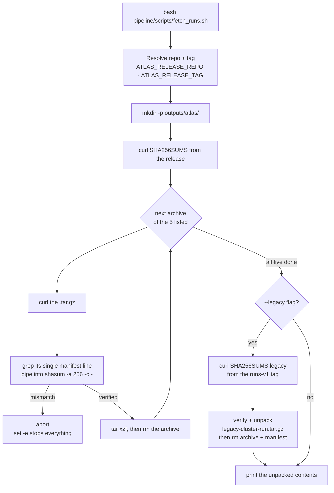

This page documents how the per-run analysis outputs and external gene-set inputs travel with this repository. The result *summaries* live in `outputs/atlas/comparative/` inside the git checkout, but the raw per-run artifacts — the feature catalogues every downstream script reads — total about 1.2 GB unpacked, so they ship as GitHub release assets instead. A single 37-line shell script, `pipeline/scripts/fetch_runs.sh`, downloads them, verifies each archive's SHA-256 digest against a manifest fetched from the same release, and unpacks everything into exactly the directory layout the local analysis stage expects. The release currently in force is `runs-v2`, the corrected extraction; the superseded `runs-v1` remains reachable through a flag.

Sources: [fetch_runs.sh](pipeline/scripts/fetch_runs.sh#L1-L9), [REPRODUCE.md](docs/REPRODUCE.md#L47-L51), [scripts/README.md](pipeline/scripts/README.md#L86-L87)

## Why the Per-Run Data Ships as Release Assets

The repository keeps two distinct data tiers deliberately separated. The small tier — the comparative result files, nulls, calibration grids and site data — is committed directly, because section 1 of the reproduce guide verifies every published number from it *without any downloads*. The large tier — per-layer feature catalogues for all ten models across three corpus draws, plus the external gene-set databases — is only needed when you want to re-run the analysis rather than check it, and at 1.2 GB unpacked it would bloat every clone. That tier therefore lives in release assets: you fetch it on demand, verify it, unpack it, and the standard scripts consume it transparently via `ATLAS_BASE`.

One boundary is worth stating precisely: the fetch covers catalogues and inputs, not model internals. The GPU extraction stage writes `feature_catalog_L<NN>.json` per layer — the files that get archived — alongside SAE weights (`sae_L<NN>.pt`, about 17 GB total) and activations, which stay on the GPU host and are deliberately not redistributed, since no published number reads them directly.

Sources: [REPRODUCE.md](docs/REPRODUCE.md#L18-L28), [REPRODUCE.md](docs/REPRODUCE.md#L49-L51), [REPRODUCE.md](docs/REPRODUCE.md#L152-L158)

## The Archive Manifest

Each archive has a defined unpack target under `outputs/atlas/`, and the reproduce guide publishes both the size and the exact SHA-256 digest of every asset. The current tag `runs-v2` holds the corrected extraction (every model reads all 6,000 cells); `runs-v1` keeps the superseded catalogues plus the legacy first cluster run, which exists *only* in v1.

| archive | MB | unpacks to | holds |
|---|---|---|---|
| `runs-ts3_out.tar.gz` | 70 | `outputs/atlas/ts3_out/` | feature catalogues on the shared corpus: five depth-matched layers for seven models, every layer for GeneCompass, scFoundation and Tahoe-x1; the permissive annotations of the seven models' five layers |
| `runs-alllayer_cat.tar.gz` | 57 | `outputs/atlas/alllayer_cat/` | every-layer catalogues for AIDO.Cell, C2S-Scale, Geneformer-V2, MaxToki, UCE, scGPT, tGPT |
| `runs-heldout_cat.tar.gz` | 23 | `outputs/atlas/heldout_cat/` | catalogues on the held-out draw (5,581 cells, none shared with the corpus), all ten models, five depth-matched layers |
| `runs-seeds.tar.gz` | 24 | `outputs/atlas/seeds/` | the SAE-seed control (three seeds, mid layer and every layer), read by `controls_import.py` |
| `inputs-genesets.tar.gz` | 101 | `outputs/atlas/genesets/` | GO_BP, KEGG, Reactome sets (Enrichr via gseapy, 2026-08-17), STRING v12 edges and aliases, TRRUST edges, the 16,205-gene background; unchanged from v1 |
| `legacy-cluster-run.tar.gz` (v1 only) | 76 | `outputs/atlas/cluster/` | the first cluster run (AIDO, UCE, tGPT, scGPT on an earlier corpus); superseded, read by no published number |

The published manifest itself is short enough to quote in full — this is the digest block your download will be checked against:

```
4dc9f0c1928fc8d0121cf01efbf1eba38dc53c675b835dfcd960324c405fd122  inputs-genesets.tar.gz
738b694e31f0502cd0e66dc72a83c8199730bde0b799e8168df4cd1c4147b4ee  runs-alllayer_cat.tar.gz
295df6e717d991984515cbc8c5ed82505dce67fcab1b1d7c3c44ec12b66bc55c  runs-heldout_cat.tar.gz
41382c8f762c3bae686f63029ec897d51061f1a26b10d87174e4542dd6e83a7c  runs-seeds.tar.gz
898c5e9471ba315e2da30792c7e226f4bc2f641b46f295d89b080d4fa933f0f1  runs-ts3_out.tar.gz
bdffaf0042bf4abc03d62dd23294cb898d5f197230281914dc783d69706e5866  legacy-cluster-run.tar.gz (v1)
```

Note the deliberate immutability signal on `inputs-genesets.tar.gz`: "unchanged from v1" means the external gene-set snapshot is pinned across the v1→v2 release boundary, so only the model catalogues changed when the extraction was corrected. The `legacy-cluster-run.tar.gz` provenance is also recorded in the legacy code's README — it is the output of a run no published number depends on.

Sources: [REPRODUCE.md](docs/REPRODUCE.md#L57-L77), [CHANGELOG.md](docs/CHANGELOG.md#L130-L135), [legacy/README.md](pipeline/legacy/README.md#L16-L25)

## Anatomy of the Fetch Script

The script is structured as a flat sequence guarded by `set -euo pipefail` — any failed download, checksum mismatch or extraction aborts the whole run immediately. Conceptually it executes the following flow:



Two implementation details carry the integrity guarantee. First, the manifest is fetched *once* before the loop begins (`curl -sSL -o SHA256SUMS "$BASE/SHA256SUMS"`), establishing the expected digests before any payload arrives. Second, verification is *streamed per file*: `grep " $f\$" SHA256SUMS | shasum -a 256 -c -` extracts exactly the manifest line ending in the archive's name and pipes it straight into `shasum`'s check mode via stdin, so the digest comparison happens against freshly downloaded bytes with no intermediate trust state. The `$` anchor in the grep pattern matters — it prevents a file named as a prefix of another from matching the wrong line.

> [!TIP]
> The verification pattern protects against truncated or corrupted transfers and against an archive that silently drifted from its published digest — it does not defend against a compromised release origin, since the manifest and the archive travel over the same channel from the same repository. Its job is reproducibility of the *bytes*, which is what the audit system downstream depends on.

Third, extraction is destructive-by-design: `tar xzf "$f" && rm "$f"` deletes each archive the moment it unpacks. The pipeline never holds both the compressed (~275 MB total) and unpacked (~1.2 GB) copies, trading re-download cost for disk — a reasonable trade given the release URL is deterministic and checksummed.

Sources: [fetch_runs.sh](pipeline/scripts/fetch_runs.sh#L10-L27), [REPRODUCE.md](docs/REPRODUCE.md#L61-L67)

## Configuration Surface and the Legacy Branch

The script exposes a deliberately minimal configuration: two environment variables and one positional flag. Path resolution is self-anchoring — `ROOT` is derived from the script's own location (`$(cd "$(dirname "$0")/../.." && pwd)`), so the destination is always `<repo-root>/outputs/atlas/` regardless of where you invoke it from.

| knob | default | effect |
|---|---|---|
| `ATLAS_RELEASE_REPO` | `Biodyn-AI/atlas-comparison` | redirect downloads to a fork's releases |
| `ATLAS_RELEASE_TAG` | `runs-v2` | pin to `runs-v1` to reproduce the superseded catalogues |
| `--legacy` (argument) | off | additionally fetch `legacy-cluster-run.tar.gz` from the hard-coded `runs-v1` tag |

The legacy branch is structurally interesting because it demonstrates *tag mixing*: the five current archives come from whatever `ATLAS_RELEASE_TAG` resolves to (v2 by default), while the legacy cluster run is always fetched from `runs-v1`, which is hard-coded as `LEGACY_TAG`. It follows the same manifest-verify-extract discipline but with a separately named manifest (`SHA256SUMS.legacy`), and it cleans up both the archive and its manifest afterward so the destination directory contains only unpacked data. This asymmetry exists because the corrected v2 extraction deliberately left the old cluster run behind: it was produced by the earlier corpus and reads into no published number, yet is preserved for provenance.

Sources: [fetch_runs.sh](pipeline/scripts/fetch_runs.sh#L11-L17), [fetch_runs.sh](pipeline/scripts/fetch_runs.sh#L28-L36), [REPRODUCE.md](docs/REPRODUCE.md#L54-L59)

## What Lands Where — and the Two Inputs You Must Fetch Yourself

After a successful run, `outputs/atlas/` contains the five unpacked directories and the script prints a final `ls` of the result so you can eyeball the layout. This lands in exactly the structure the local analysis stage expects, since every script reads and writes under `$ATLAS_BASE/outputs/atlas/` — the reproduce guide's setup step exports `ATLAS_BASE` to the repository root precisely so the fetched archives slot in without path configuration.

However, two evidence inputs are **not redistributed** at all, for licensing/practical reasons, and must be fetched from their original sources:

| input | source | lands in | consumed by |
|---|---|---|---|
| `gene2pubmed.gz`, `Homo_sapiens.gene_info.gz` | NCBI Gene FTP (ftp.ncbi.nlm.nih.gov/gene/DATA/), snapshot as of 2026-09-11 | `outputs/atlas/pubmed/` | `hypothesis_pubmed.py`, `hypothesis_studybias.py`, `study_bias_coverage.py` |
| Replogle et al. 2022 pseudobulk Perturb-seq (`K562_gwps_normalized_bulk_01.h5ad`, `rpe1_normalized_bulk_01.h5ad`) | plus.figshare.com | `outputs/atlas/perturb/` | `hypothesis_perturb.py`, `hypothesis_studybias.py`, `study_bias_coverage.py` |

This split means a full re-run of the held-out prediction tests needs the fetch script *plus* two manual downloads, whereas everything else — matrices, nulls, calibration, site assembly, figures, audits — runs purely from the fetched archives and the committed result files. The scripts that consume these inputs will fail loudly if the directories are empty, and the per-script docstrings name their own reads and writes.

Sources: [REPRODUCE.md](docs/REPRODUCE.md#L8-L13), [REPRODUCE.md](docs/REPRODUCE.md#L79-L88), [scripts/README.md](pipeline/scripts/README.md#L1-L5)

## Failure Semantics and Reproduction Discipline

Because the script runs under `set -euo pipefail`, every failure mode terminates at the exact point of fault: a failed `curl` aborts before checksum comparison, a checksum mismatch aborts before `tar`, and a failed extraction aborts before the archive is deleted. The consequence is a clean resume property — re-running the script simply re-downloads and re-verifies everything, and since archives are removed only after successful extraction, a partially failed run leaves at most one stale archive on disk with no half-unpacked state. Seeds inside the downstream scripts are fixed, so once the archives are in place, the numbers reproduce exactly.

The whole fetch step is one line in the reproduce guide's stage 2, positioned *before* the local pipeline order — the catalogue-consuming builders (`atlas_build_ts3`, `alllayer_matrix`, and everything downstream) cannot start without `ts3_out/` and `alllayer_cat/` on disk, and the seed control import reads `seeds/`. If your intent is only to verify published numbers rather than re-run anything, you do not need the archives at all: section 1 of the reproduce guide runs the full audit from the committed result files alone.

> [!TIP]
> Before trusting a re-run built on fetched archives, check the release lineage first: catalogues fetched from `runs-v1` will not reproduce v2 numbers — the entire correction history (AIDO.Cell reading only 32 cells under the old position cap, the 419 overlapping held-out cells) is a property of the tag, not the code, since the analysis scripts themselves are identical across both releases.

Sources: [fetch_runs.sh](pipeline/scripts/fetch_runs.sh#L10-L27), [REPRODUCE.md](docs/REPRODUCE.md#L47-L55), [REPRODUCE.md](docs/REPRODUCE.md#L90-L132), [CHANGELOG.md](docs/CHANGELOG.md#L130-L135)

## Where to Go Next

The fetch mechanism is one link in a three-layer reproducibility chain. To understand how the fetched catalogues flow into the result files the audit checks, read [Result Files and Data Flow Map](17-result-files-and-data-flow-map). To understand *why* `runs-v2` exists — the extraction faults that made v1 catalogues unusable — read [Extraction Faults and Corrected Re-Run](21-extraction-faults-and-corrected-re-run). For how the fixed-seed re-run discipline is recorded over time, continue to [Decision Log Design](20-decision-log-design).