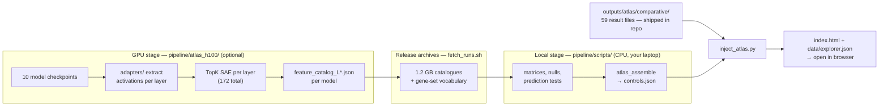
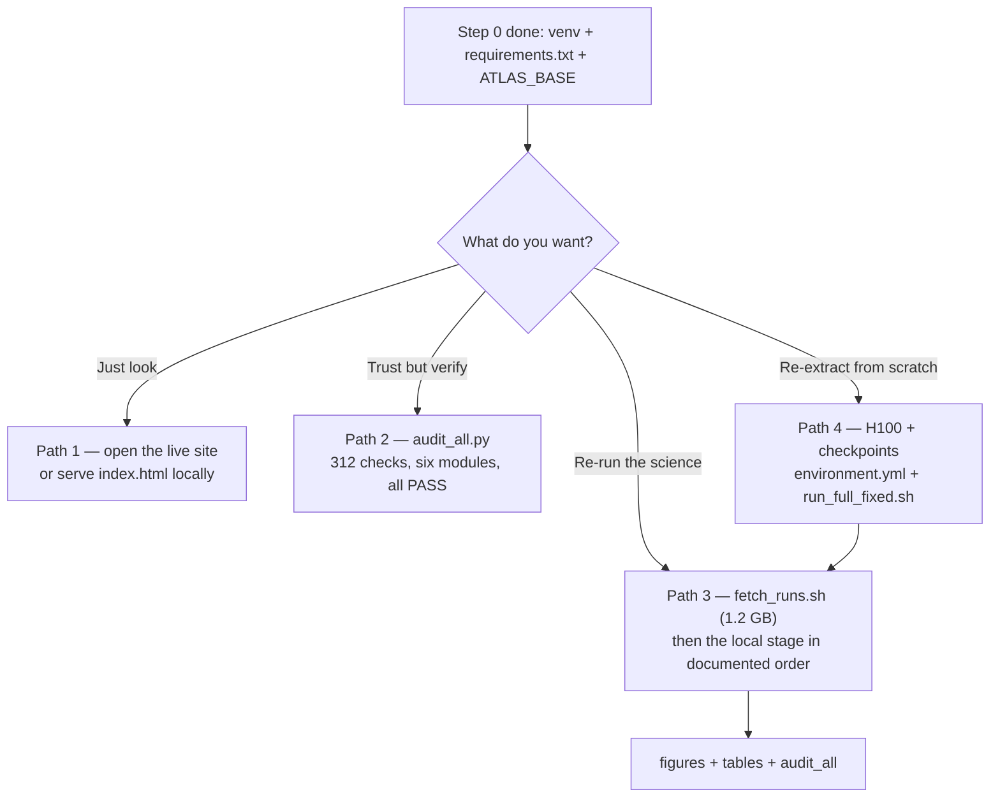

This page takes you from a fresh clone to a working, verifiable copy of the Comparative SAE Atlas on your own machine — without requiring a GPU, and in most paths without downloading anything. It covers the one-time environment setup, the shortest route to *seeing* the atlas, the audited route to *trusting* it, and the full route to *re-running* every published number. Deeper mechanics (how the SAE is trained, how the null models work, how the site is assembled) are deliberately out of scope here; each section points to the dedicated page that owns them.

The repository compares **ten single-cell foundation models** — run on the same 6,000 Tabula Sapiens cells, each opened with one sparse autoencoder per layer (172 in all) — and asks what each model encodes, what they share, and whether their features predict biology they were never shown. A live version runs at `https://avantipova.github.io/comparative-sae-atlas/`, and the same site is served from this repository's `index.html`.

Sources: [README.md](README.md#L1-L9)

## The Repository at a Glance

Before running anything, it helps to know what is already on disk. The key beginner insight: **the final result files ship with the repository**. The 59 result files and 7 figures that every published number is read from live in `outputs/atlas/comparative/` — so verifying and re-serving the site needs no download at all. Only *re-running the analysis from raw feature catalogues* requires fetching a 1.2 GB release archive.

```
.
├── index.html, data/            the site: a 12 MB page plus feature maps fetched on demand
├── outputs/atlas/comparative/   the 59 result files and 7 figures every number is read from
├── pipeline/atlas_h100/         the GPU stage: adapters, SAE, extraction, per-model analyses
├── pipeline/scripts/            the local stage: matrices, controls, prediction tests, assembly, audit
├── pipeline/atlas_template.html the site's markup; index.html is built from it
├── docs/REPRODUCE.md            how to check, rebuild, re-run, re-extract (canonical runbook)
├── docs/RESULTS.md              every result file: written by, read by, what it holds
└── requirements.txt             the local analysis environment (Python 3.13, NumPy 2.3.4)
```

Not in the repository, by design: the manuscript and supplement (the audit needs you to drop them in), the per-run feature catalogues and external inputs (1.2 GB, published as release assets fetched by `pipeline/scripts/fetch_runs.sh`), and the SAE weights and activations (about 17 GB, which stay on the GPU host).

Sources: [README.md](README.md#L11-L30), [figures/](outputs/atlas/comparative/figures)

## How the Pieces Fit Together

Every Quick Start command below touches one of three layers. The GPU stage is the only part that needs special hardware — and you can skip it entirely, because its outputs (the feature catalogues) were already published as release archives, and their *downstream* results already sit in the repository.



Sources: [README.md](README.md#L11-L24), [pipeline/atlas_h100/README.md](pipeline/atlas_h100/README.md#L1-L13), [pipeline/scripts/README.md](pipeline/scripts/README.md#L1-L5)

## Step 0: Set Up the Environment (Once)

Clone the repository, create a virtual environment, install the pinned dependencies, and set the one environment variable every script depends on:

```bash
git clone https://github.com/Biodyn-AI/atlas-comparison && cd atlas-comparison
python -m venv .venv && source .venv/bin/activate
pip install -r requirements.txt
export ATLAS_BASE=$(pwd)    # every script reads and writes under $ATLAS_BASE/outputs/atlas/
```

`ATLAS_BASE` is the single most important setting: every local script resolves its data root from it, defaulting to the authors' own path if unset — so always export it. The pins in `requirements.txt` (Python 3.13, NumPy 2.3.4, SciPy, h5py, anndata, matplotlib) are exactly the versions the published nulls, figures and audits were computed under.

> [!TIP]
> There are **two separate environments** and they must never be mixed. The local analysis runs on Python 3.13 with NumPy 2.3.4 (`requirements.txt`); the GPU extraction ran on Python 3.12 with PyTorch 2.13 and NumPy **1.26.4** (`pipeline/atlas_h100/environment.yml`). The NumPy major versions differ on purpose. If you never touch the GPU folder, only `requirements.txt` matters to you.

| | Local analysis (all you need today) | GPU extraction (optional, advanced) |
|---|---|---|
| Python | 3.13 | 3.12 |
| NumPy | 2.3.4 | 1.26.4 |
| Deep learning stack | none | PyTorch 2.13 + CUDA 13 |
| Hardware | laptop CPU | NVIDIA H100 |
| Defined by | `requirements.txt` | `pipeline/atlas_h100/environment.yml` |

Sources: [docs/REPRODUCE.md](docs/REPRODUCE.md#L6-L17), [requirements.txt](requirements.txt#L1-L18), [pipeline/atlas_h100/environment.yml](pipeline/atlas_h100/environment.yml#L1-L9), [pipeline/atlas_h100/README.md](pipeline/atlas_h100/README.md#L87-L89)

## Which Path Do You Take?

The reproduction runbook defines three stages; this page arranges them as four escalating paths, ordered by how much you want to do. Each path is self-contained — stop after any of them.



Sources: [docs/REPRODUCE.md](docs/REPRODUCE.md#L3-L4), [docs/REPRODUCE.md](docs/REPRODUCE.md#L19-L134)

## Path 1: See the Atlas (No Downloads)

Open the hosted site in a browser, or serve the repository's own copy locally with any static server:

```bash
python -m http.server 8765      # from the repository root, then open http://localhost:8765/
```

The page is a 12 MB HTML document; the heavier feature maps for the Layer Explorer are fetched on demand, so a local serve stays lightweight. This is the entire "install" for a first look — no Python execution, no audit, no data files.

Sources: [README.md](README.md#L8-L9), [README.md](README.md#L14), [docs/REPRODUCE.md](docs/REPRODUCE.md#L32-L35)

## Path 2: Verify the Published Numbers (No Downloads)

This is the repository's signature workflow: an audit that **re-derives every number** in the paper, supplement, figures and site from the result files already on disk.

```bash
cp /path/to/MANUSCRIPT.md /path/to/SUPPLEMENTARY.md outputs/atlas/comparative/
python pipeline/scripts/audit_all.py
```

Expected output: **six modules, all PASS, 312 checks**. The one prerequisite is the manuscript itself: `MANUSCRIPT.md` and `SUPPLEMENTARY.md` are not in the repository (they are shared separately), and the audit needs them dropped next to the results in `outputs/atlas/comparative/`. The audit is split into focused checkers — manuscript numbers for Results 3.1–3.3 and Methods, Results 3.4–3.5 and Discussion, derived numbers, hand-written supplementary tables, and figure-vs-input hashes — and `audit_all.py` runs them all, telling you whether the state is safe to trust.

> [!TIP]
> If you only ever run one command from this page, run `audit_all.py`. It is the machine-checked guarantee that the numbers you are reading match the result files that produced them — the same guarantee the authors used across eight reviewer passes.

Sources: [README.md](README.md#L37-L45), [docs/REPRODUCE.md](docs/REPRODUCE.md#L19-L30), [pipeline/scripts/README.md](pipeline/scripts/README.md#L84-L88)

## Path 3: Rebuild the Site from the Result Files

Still no downloads. `inject_atlas.py` embeds the data blocks from the shipped result files into the site template and writes both `index.html` and `data/explorer.json`:

```bash
python pipeline/scripts/inject_atlas.py   # writes index.html and data/explorer.json
python -m http.server 8765                # then open http://localhost:8765/
```

This is the same command that produced the committed site, so after running it you can diff your rebuilt `index.html` against the committed one — a concrete, checkable artifact. To go one step further and re-render the seven figures and generated supplementary tables, the runbook chains the figure scripts and re-stamps the figure manifest before regenerating Tables S2–S12 — the full sequence is in `[docs/REPRODUCE.md](docs/REPRODUCE.md)` step 1.

Sources: [docs/REPRODUCE.md](docs/REPRODUCE.md#L30-L45), [README.md](README.md#L44), [pipeline/scripts/README.md](pipeline/scripts/README.md#L80-L82)

## Path 4: Re-Run the Full Local Analysis

Everything so far read pre-computed results. To recompute them from the raw feature catalogues, first fetch the release archives — 1.2 GB unpacked — which the fetch script downloads, checksum-verifies, and unpacks into `outputs/atlas/`:

```bash
bash pipeline/scripts/fetch_runs.sh     # add --legacy only for the superseded first run
```

The default is `runs-v2`, the **corrected extraction** (every model reads all 6,000 cells; the earlier `runs-v1` had a position cap that let AIDO.Cell see 32 cells while tGPT saw all 6,000, plus filler genes and an unseeded SAE). Do not reach for `--legacy` unless you specifically want the superseded catalogues.

| archive | size | holds |
|---|---|---|
| `runs-ts3_out.tar.gz` | 70 MB | feature catalogues on the shared corpus: five depth-matched layers for seven models, every layer for GeneCompass, scFoundation, Tahoe-x1 |
| `runs-alllayer_cat.tar.gz` | 57 MB | every-layer catalogues for seven models (AIDO.Cell … tGPT) |
| `runs-heldout_cat.tar.gz` | 23 MB | catalogues on the independent held-out draw (5,581 cells, none shared with the corpus), all ten models |
| `runs-seeds.tar.gz` | 24 MB | the SAE-seed control (three seeds), read by `controls_import.py` |
| `inputs-genesets.tar.gz` | 101 MB | GO_BP, KEGG, Reactome sets, STRING v12 edges, TRRUST edges, the 16,205-gene background |

Two inputs are **not** redistributed and must be fetched from their own sources: NCBI `gene2pubmed.gz` and `Homo_sapiens.gene_info.gz` into `outputs/atlas/pubmed/`, and the Replogle et al. 2022 Perturb-seq files (`K562_gwps_normalized_bulk_01.h5ad`, `rpe1_normalized_bulk_01.h5ad`) into `outputs/atlas/perturb/`. Without them, the literature- and perturbation-evidence scripts cannot run.

The local stage then runs in a documented order, grouped as: build matrices → controls (the nulls) → predictions → assembly → figures → tables → final `audit_all`. Order genuinely matters — `controls.py` reads matrices that `alllayer_matrix.py` writes, and `atlas_assemble.py` and the controls iterate to a fixed point (two passes in practice). Run that phase with `PYTHONHASHSEED=0` so ties between equally ranked concepts resolve identically. Expect minutes to an hour per permutation-based script on a laptop (`controls.py` about 3 minutes); all seeds are fixed, so your numbers should reproduce exactly.

Sources: [docs/REPRODUCE.md](docs/REPRODUCE.md#L47-L59), [docs/REPRODUCE.md](docs/REPRODUCE.md#L61-L68), [docs/REPRODUCE.md](docs/REPRODUCE.md#L79-L88), [docs/REPRODUCE.md](docs/REPRODUCE.md#L90-L132), [README.md](README.md#L27-L35)

## Path 5 (Optional): Re-Extract on a GPU

Only for those who want to reproduce the extraction itself. You need the ten model checkpoints, an H100-class GPU, and the conda environment from `pipeline/atlas_h100/environment.yml`. Build the shared corpus twice (seed 0 = corpus, seed 1 = held-out draw), drop the 419 overlapping cells, then run the fixed shell scripts:

```bash
cd pipeline/atlas_h100
python build_ts_corpus.py --per-tissue 2000 --seed 0 --out external/perturb/tabula_3tissue_6k.h5ad
python build_ts_corpus.py --per-tissue 2000 --seed 1 --out external/perturb/tabula_3tissue_6k_heldout.h5ad
python make_heldout_disjoint.py          # drop the 419 cells the two draws share
bash run_full_fixed.sh                   # every layer, every model, all 6,000 cells
bash run_heldout_fixed.sh                # the held-out draw, five depth-matched layers
bash run_seeds_fixed.sh                  # the SAE-seed control
bash run_downstream_fixed.sh             # cell embeddings, CKA, probes, SVD, explorer
```

The extraction scripts are **resumable** — a model with a `DONE` marker is skipped — so interrupted runs restart cheaply. Note Tahoe-x1 needs its own virtual environment (`torch 2.6.0` with `flash-attn`), pointed at via `ATLAS_TAHOE_VENV`. The critical flag is `--per-cell 168`: every model reads all 6,000 cells and keeps at most 168 gene-token positions per cell (≈1M positions per layer), which is precisely the correction that produced `runs-v2` — omitting it silently recreates the superseded v1 behaviour. The SAE weights (~17 GB) stay on the GPU host and are never archived; only the per-layer catalogues are.

Sources: [docs/REPRODUCE.md](docs/REPRODUCE.md#L134-L158), [pipeline/atlas_h100/run_full_fixed.sh](pipeline/atlas_h100/run_full_fixed.sh#L1-L24), [pipeline/atlas_h100/environment.yml](pipeline/atlas_h100/environment.yml#L11-L37)

## Command Summary

| command | what it does | what it needs | works offline? |
|---|---|---|---|
| `python -m http.server 8765` | serves the site | nothing | yes |
| `python pipeline/scripts/audit_all.py` | 312 checks across paper, supplement, figures, site | manuscript files dropped in | yes |
| `python pipeline/scripts/inject_atlas.py` | rebuilds `index.html` + `data/explorer.json` | shipped result files | yes |
| `bash pipeline/scripts/fetch_runs.sh` | downloads, checksum-verifies, unpacks 1.2 GB of catalogues | internet | no |
| `bash pipeline/atlas_h100/run_full_fixed.sh` | all-layer SAE extraction, resumable per model | H100, ten checkpoints, GPU env | no |

Sources: [README.md](README.md#L37-L45), [docs/REPRODUCE.md](docs/REPRODUCE.md#L25-L35), [docs/REPRODUCE.md](docs/REPRODUCE.md#L53-L55), [docs/REPRODUCE.md](docs/REPRODUCE.md#L139-L150)

## Troubleshooting

| symptom | cause | fix |
|---|---|---|
| `audit_all.py` cannot start | `MANUSCRIPT.md` / `SUPPLEMENTARY.md` missing | copy both into `outputs/atlas/comparative/` |
| scripts write to, or look in, the wrong place | `ATLAS_BASE` unset (defaults to the authors' path) | `export ATLAS_BASE=$(pwd)` before running anything |
| numbers differ from the paper after re-running | you fetched `--legacy` (v1) catalogues | re-run `fetch_runs.sh` without the flag (default `runs-v2`) |
| `pip install` conflicts around NumPy 1.x | GPU environment mixed into the local venv | keep the two environments separate; local uses only `requirements.txt` |
| prediction scripts return stale pair graphs after re-fetching catalogues | cached co-firing graph | delete `outputs/atlas/comparative/.cofire_cache.pkl` |
| figure checks fail after re-rendering | figure manifest stale | `python pipeline/scripts/audit_figures.py --update` |
| `run_full_fixed.sh` fails only on Tahoe-x1 | Tahoe needs its own venv (torch 2.6 + flash-attn) | set `ATLAS_TAHOE_VENV` to a dedicated environment |

Sources: [docs/REPRODUCE.md](docs/REPRODUCE.md#L21-L23), [docs/REPRODUCE.md](docs/REPRODUCE.md#L12-L17), [docs/REPRODUCE.md](docs/REPRODUCE.md#L54-L59), [docs/REPRODUCE.md](docs/REPRODUCE.md#L119-L120), [docs/REPRODUCE.md](docs/REPRODUCE.md#L43-L45), [pipeline/atlas_h100/run_full_fixed.sh](pipeline/atlas_h100/run_full_fixed.sh#L7-L10), [pipeline/atlas_h100/environment.yml](pipeline/atlas_h100/environment.yml#L5-L6)

## What You Just Built

If you followed Path 3, you rebuilt a 12 MB interactive atlas whose analysis backbone looks like this — Figure 1 of the paper, regenerated entirely from the files already in your clone:


The audited headline behind it: the naive "universal core" of 1,977 concepts shared by all ten models does **not** survive a random-gene null (random genes score higher, z = −24.2), but a calibrated backbone of 96 concepts shared by at least 8 of 10 models is real — 27.5× a uniform null and 51.2× a degree-matched one, and it replicates on an independent draw of cells. Reading the results first, before the machinery, is the recommended order for beginners.

Sources: [README.md](README.md#L61-L73), [figures/](outputs/atlas/comparative/figures)

## Where to Go Next

Follow the catalog's natural progression, matched to what you just ran:

- **Understand the landscape**: [Overview](1-overview) → [Ten Foundation Models Compared](3-ten-foundation-models-compared) → [Key Findings and Retracted Claims](4-key-findings-and-retracted-claims) — what was tested, on what, and which claims died under their own nulls.
- **Understand what you ran in Paths 2–3**: [Result Files and Data Flow Map](17-result-files-and-data-flow-map) (what each of the 59 files holds), [Audit System and Manuscript Checks](18-audit-system-and-manuscript-checks) (how those 312 checks work), [Release Archives and Checksummed Fetching](19-release-archives-and-checksummed-fetching) (the Path 4 download in depth), [Site Assembly from Result Files](22-site-assembly-from-result-files) (what `inject_atlas.py` actually does).
- **Go deeper into the science**: [Null Models Behind Every Claim](10-null-models-behind-every-claim) for the controls stage, [Extraction Faults and Corrected Re-Run](21-extraction-faults-and-corrected-re-run) for the full v1→v2 story, and [Layer Explorer Feature Maps](23-layer-explorer-feature-maps) for the interactive part of the site.
- **Only if heading to the GPU**: [Architecture Overview](5-architecture-overview) and [Model Adapter Contract](6-model-adapter-contract) before touching `pipeline/atlas_h100/`.
