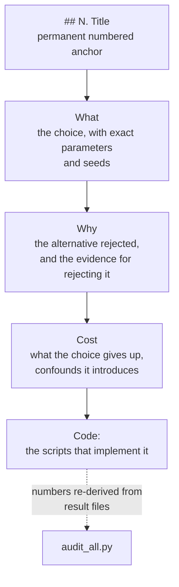
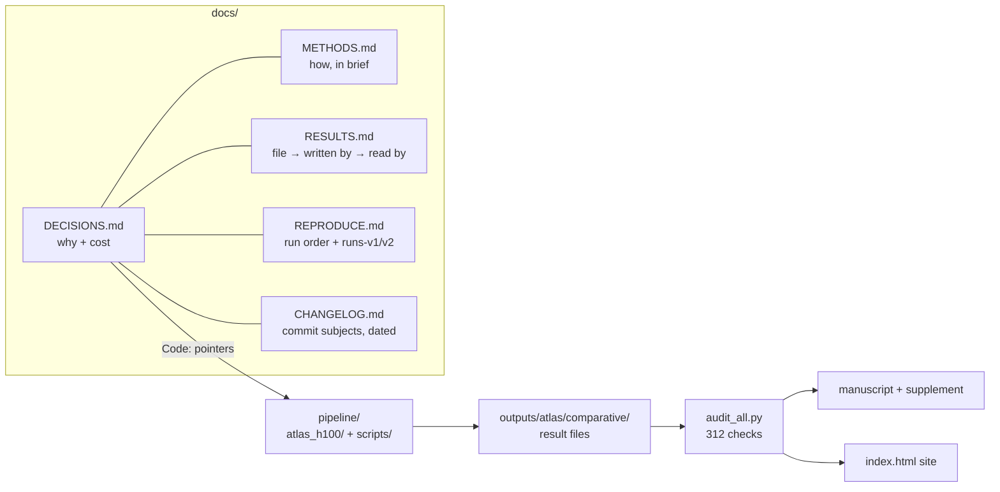

`docs/DECISIONS.md` is the rationale ledger of the atlas-comparison project: sixteen numbered entries that record, for every consequential choice in the pipeline, what was decided, why, what it cost, and where the implementation lives. This page documents the *design* of that log — its entry format, its numbering and cross-reference system, its contract with the automated audit, and its deliberate policy of preserving retractions and failures. It sits in the Reproducibility Engineering chapter between the audit machinery and the corrected re-run, because the log is the document both of those processes write into.

Sources: [DECISIONS.md](docs/DECISIONS.md#L1-L4), [README.md](README.md#L20-L24)

## The Entry Contract: Four Questions, in Work Order

The preamble defines the entire format in three lines: *"What was decided, why, what it cost, and where it lives in the code. In the order the work was done."* Every entry is therefore an anatomy of a single engineering trade-off rather than a specification. Decision 1 (one shared corpus) is the canonical example: the *what* states the protocol exactly (6,000 Tabula Sapiens cells, 2,000 per tissue, raw counts, seed 0, held-out seed 1), the *why* explains the rejected alternative (earlier single-model atlases ran on different corpora, so "any difference between them could be the data"), the *cost* names what the choice forecloses (cross-species models read on human cells only; no claim about other tissues or platforms), and a final `Code:` line pins the decision to `pipeline/atlas_h100/build_ts_corpus.py`. The chronological ordering is a deliberate choice — the log reads as a lab notebook of decisions in the sequence they were actually made, which is why late corrections (decisions 11 and 16) appear at the bottom rather than being folded back into earlier entries.

The `Cost:` field is what distinguishes this log from a changelog or an ADR collection. Decision 3 (the SAE) spends more words on costs than on configuration: it admits the hyperparameters "was not swept" (seed variance was measured instead — the permissive mid-layer core varies by 12 %), that surplus capacity "fills with near-copies of the strongest signal" in eight of ten models, and that tGPT's 21.3 % dead features are "a confound for every tGPT-specific result… not corrected for." Decisions are recorded as priced trades, not wins.

Sources: [DECISIONS.md](docs/DECISIONS.md#L6-L19), [DECISIONS.md](docs/DECISIONS.md#L36-L59)

| Field | Question answered | Example (decision 1) | Example (decision 3) |
|---|---|---|---|
| **What** | The exact choice | 6,000 cells, seed 0; held-out seed 1 | TopK, k = 32, dict 4×d_model, Adam 3e-4, 4 epochs |
| **Why** | Alternative rejected + reason | Different corpora would confound model comparison | Matches earlier atlases' bio-sae config, so features are comparable |
| **Cost** | What it gives up or risks | No cross-species or other-tissue claims | Near-copy feature blocks; tGPT dead-feature confound, uncorrected |
| **Code:** | Where it is implemented | `build_ts_corpus.py` | `common/sae.py`, `scripts/sae_health.py` |

Sources: [DECISIONS.md](docs/DECISIONS.md#L1-L4)

## The Sixteen Decisions: A Catalog

The entries are not homogeneous; the format admits structural variance wherever a table or a bullet list communicates better than prose. Decision 5 is a claim-to-null coverage matrix — a three-column table mapping every headline claim to the specific null built against it and its permutation count. Decision 16 is a bullet list of the extraction faults. The catalog below classifies all sixteen by what kind of knowledge each preserves:

| # | Entry | Kind | Cross-references |
|---|---|---|---|
| 1 | One corpus for all ten models | Design choice | — |
| 2 | Every layer, five depth-matched read-outs | Design choice + **invariant rule** | paper §3.1 |
| 3 | The SAE | Configuration + measured costs | → decision 16 |
| 4 | Two annotators, which one counts | Method selection, grid-search provenance | — |
| 5 | A null behind every claim | Claim/null/permutations matrix | — |
| 6 | What was retracted | Negative results, kept reproducible | — |
| 7 | What survived | Positive results | → decision 8 |
| 8 | Held-out prediction test | Test design + **iteration notes** | — |
| 9 | Two more evidence kinds (literature, perturbation) | Supporting evidence | — |
| 10 | Why no new biology | Negative-result analysis | — |
| 11 | Model facts corrected against papers | Late correction | ← decision 15 |
| 12 | What the site reads from data | Interface contract | — |
| 13 | Things that did not go to plan | Failure disclosure | → decision 16 |
| 14 | KEGG | Scope + licensing state | — |
| 15 | The audit | Process boundary | → decision 11 |
| 16 | The extraction was wrong; re-run (2026-10) | Major correction | ← decisions 3, 13 |

Two entry types deserve note. Decision 2 encodes an **invariant**, not just a choice: "feature counts are never summed across layers and never read as concepts coexisting in one representation, because each layer is its own space with its own dictionary." And decision 8's "Two design points that took iteration" records *process* guardrails — the corroboration curve is reported over all ten models rather than the four that passed, "because the four were selected on TRRUST and would then be re-scored against it," with the selected set "read from `hypothesis_trrust2.json` (p < 0.05), not typed in." The log thus carries anti-selection-bias rules alongside configuration facts.

Sources: [DECISIONS.md](docs/DECISIONS.md#L21-L34), [DECISIONS.md](docs/DECISIONS.md#L85-L107), [DECISIONS.md](docs/DECISIONS.md#L163-L173)

## Decision Numbers as Permanent Cross-References

The numbering is the log's addressing scheme, and the references run in both directions. Inside the document, decision 3 cites decision 16 ("decision 16 explains why it is not a position cap"), decision 7 points to decision 8 for the regulatory-prediction result, decision 13's failure list ends with "the extraction itself was wrong… decision 16," and decision 15's audit boundary invokes decision 11 as the example of a fact found outside the audit's scope. Outside the document, the top-level `README.md` closes its account of the October re-extraction with "what changed and why is in `docs/DECISIONS.md` (decision 16)," and `docs/CHANGELOG.md`'s 2026-10-11 entry records the coordinated update: "README, DECISIONS (16), METHODS, RESULTS, REPRODUCE updated."

The maintenance consequence is an **append-only discipline**: because both internal entries and external documents cite decisions by number, a new decision must be appended at the end — never inserted or renumbered. Entry 16 exists as a number precisely because decisions 3 and 13 could not predict that the extraction faults would need their own entry when they were first written.

> [!TIP]
> Treat the decision numbers as a public API. Any edit that renumbers or splits an entry breaks four internal references, the README pointer, and the changelog record simultaneously — the log is only safe to extend, in order.

Sources: [DECISIONS.md](docs/DECISIONS.md#L41), [DECISIONS.md](docs/DECISIONS.md#L145), [DECISIONS.md](docs/DECISIONS.md#L246), [DECISIONS.md](docs/DECISIONS.md#L262), [README.md](README.md#L32-L35), [CHANGELOG.md](docs/CHANGELOG.md#L134-L135)

## The Numbers Contract with the Audit

The preamble's final sentence — *"Numbers are the ones the audit checks against the result files"* — makes `DECISIONS.md` a party to the machine-verified claims pipeline. Decision 15 spells out both sides of that contract: `audit_all.py` re-derives every number in the paper, supplement, figures and site from the result file that produced it (312 checks, six modules), with figures stamped against the hashes of their inputs "so a figure older than its data fails." What the log deliberately records beyond that envelope is equally explicit: "The audit does not check prose claims, architecture facts (decision 11 was found by reading the model papers) or whether a figure is legible. Those were checked by hand, three passes."

This boundary explains why decision 11 exists at all. The three corrected model facts (MaxToki's rank-value encoding, GeneCompass's rank-plus-value input with four knowledge priors, tGPT's ~120 M parameter count) are exactly the class of claim the audit cannot reach — they describe external papers, not result files. The decision log is therefore the *ledger of last resort* for truths no script can verify: after the corrections, "everything that reads model size or the rank/non-rank split was recomputed… No conclusion changed," and the log records that re-derivation even though the audit only covers its numbers. The audit's own failure philosophy — "Fix the source of the disagreement, not the check" — is the same instinct the log embodies: documentation and data must agree, and when they disagree, the documentation entry names the source of truth.

Sources: [DECISIONS.md](docs/DECISIONS.md#L256-L262), [DECISIONS.md](docs/DECISIONS.md#L208-L223), [audit_all.py](pipeline/scripts/audit_all.py#L19-L26), [audit_all.py](pipeline/scripts/audit_all.py#L44-L46)

## Keeping Negatives, Costs, and Failures

The log's most distinctive design policy is that discarded and failed work is a first-class entry type, not deleted history. Decision 6 lists four retracted claims — the "universal core" of ~2,000 shared concepts (which fails the random-gene null at 365 real against 582 random), annotation rate as an interpretability score, the "100 % SVD-invisible" claim, and the new-biology shortlist (0 of 207 candidates survive its nulls) — and closes with the reproducibility commitment: "The scripts and result files for all four are kept so the negatives are reproducible." Decision 13, "Things that did not go to plan," discloses operational mishaps in single lines that pair failure with fix: "`controls.py` used to overwrite the shared `controls.json` and once wiped fourteen blocks… It merges now."

Costs get the same permanence. Decision 10 closes its negative result with a scope statement the project stands behind: "the atlas ranks testable links; it cannot confirm or refute a link about an unstudied gene with these resources, and neither could anything else." Decision 14 records forward-looking administrative state alongside analysis — "the copyright form is to be cleared before publication" — showing the log also tracks obligations, not just measurements. For an intermediate developer the transferable pattern is: **a decision log that only survives successes is marketing; keeping the nulls, the confounds, and the wiped files is what makes it engineering documentation.**

Sources: [DECISIONS.md](docs/DECISIONS.md#L109-L125), [DECISIONS.md](docs/DECISIONS.md#L234-L246), [DECISIONS.md](docs/DECISIONS.md#L198-L206), [DECISIONS.md](docs/DECISIONS.md#L248-L254)

## Corrections Without Erasure

Decisions 11 and 16 define how the log absorbs post-release corrections. Decision 16 is the only dated entry — "(2026-10)" — marking the epoch boundary between the two extraction generations: the position cap that let AIDO.Cell see 32 cells while tGPT saw all 6,000, the non-stable sort that padded top-gene lists with zero-activation filler, the unseeded torch RNG, UCE's cache keyed on a fixed directory, and the 419 held-out cells shared with the corpus. The entry records both the faults and the consequence: "Everything downstream of the catalogues was re-run from scratch… the backbone grew from 78 to 96 concepts… TRRUST prediction holds in four models instead of five (scGPT drops out)." Critically, the superseded state is preserved, not purged: release `runs-v2` holds the corrected catalogues while "`runs-v1` keeps the superseded ones," a split `docs/REPRODUCE.md` mirrors in its archive table and `docs/CHANGELOG.md` mirrors in its dated entries.

Each document answers a different question, and the decision log's `Code:` lines are what make the set navigable as a system: a reader starts at a decision, jumps to its implementing scripts, and from there `RESULTS.md` resolves which result file those scripts write and which audit modules read it.

Sources: [DECISIONS.md](docs/DECISIONS.md#L264-L298), [REPRODUCE.md](docs/REPRODUCE.md#L57-L59), [CHANGELOG.md](docs/CHANGELOG.md#L130-L135), [RESULTS.md](docs/RESULTS.md#L1-L3), [METHODS.md](docs/METHODS.md#L1-L4)

| Document | Question it answers | Form |
|---|---|---|
| `DECISIONS.md` | Why this, and what it cost | 16 numbered chronological entries |
| `METHODS.md` | How, in brief | Short sections with code pointers |
| `RESULTS.md` | Which file holds what | Table: file → written by → read by |
| `REPRODUCE.md` | What to run, in what order | Commands + checksummed archive table |
| `CHANGELOG.md` | What happened, when | Dated commit subjects, oldest first |

## Reading On

The decision log is the narrative layer over machinery documented elsewhere in this chapter. To see how the numbers it cites are machine-verified, continue to [Audit System and Manuscript Checks](18-audit-system-and-manuscript-checks); to walk through the faults decision 16 summarizes, see [Extraction Faults and Corrected Re-Run](21-extraction-faults-and-corrected-re-run); for the result files that the `Code:` pointers and the audit both resolve against, see [Result Files and Data Flow Map](17-result-files-and-data-flow-map). For the statistical reasoning behind decisions 4, 5 and 8, [Null Models Behind Every Claim](10-null-models-behind-every-claim) and [Held-Out Regulatory Prediction Test](11-held-out-regulatory-prediction-test) cover the methods the log only prices and records.
