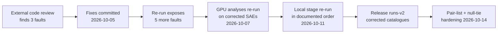
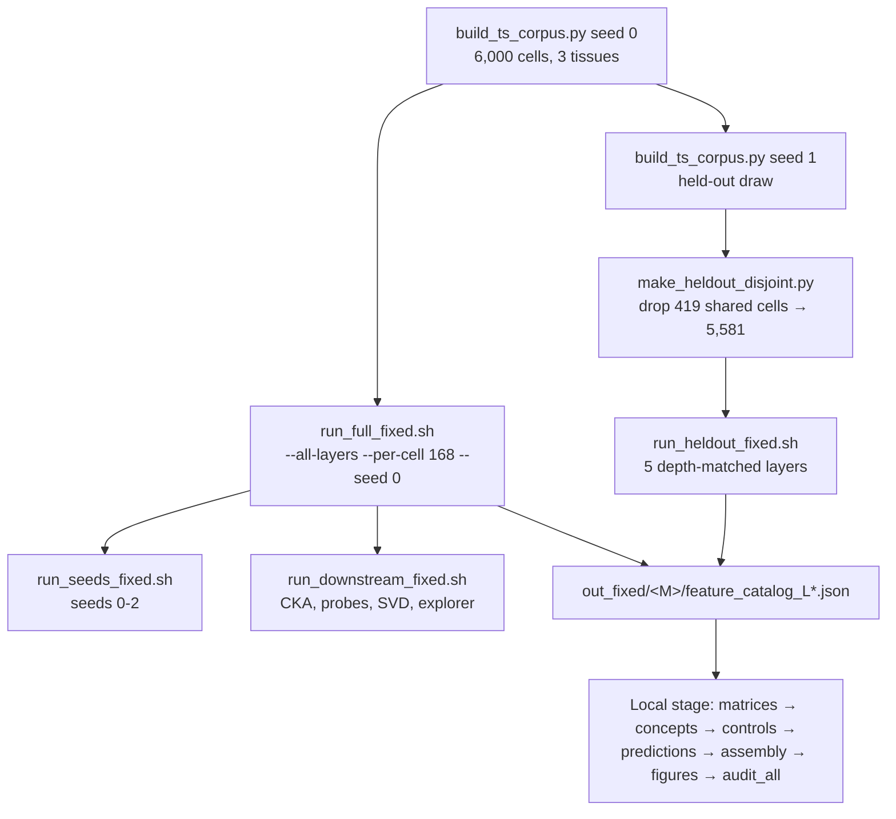

This page documents the most consequential event in the repository's history: the discovery that the first GPU feature extraction (release `runs-v1`) was internally inconsistent across models, the eight faults that were found and fixed, and the full re-run that produced `runs-v2` — the catalogues behind every published number. It is the engineering complement to the scientific retraction story told in [Key Findings and Retracted Claims](4-key-findings-and-retracted-claims); here the focus is on what was mechanically wrong in the extraction code, how each fault is now guarded in code, and the exact order in which everything was re-computed.

The authoritative narrative lives in the decision log: decision 13 lists process incidents ("things that did not go to plan") and decision 16 is the extraction itself. Per the log, an external read of the code found three faults in the first release; re-running on the fixes exposed more.

Sources: [DECISIONS.md](docs/DECISIONS.md#L234-L246), [DECISIONS.md](docs/DECISIONS.md#L264-L299), [CHANGELOG.md](docs/CHANGELOG.md#L130-L136)

## How the Faults Were Found and Contained

The faults entered through the GPU extraction stage ([Model Adapter Contract](6-model-adapter-contract), [TopK Sparse Autoencoder Training](7-topk-sparse-autoencoder-training)) and were surfaced late: the changelog's first correction commit is dated 2026-10-05, roughly three weeks after the repository's public revisions began. Three faults were found by reading the code; the remaining five appeared only when the corrected extraction was executed and downstream analyses were rebuilt. The containment strategy is visible in the changelog itself — each fault got its own fix commit, followed by staged re-runs (GPU analyses on 2026-10-07, local stage from scratch on 2026-10-11, release `runs-v2` the same day, and a pair-list correction on 2026-10-14).



Sources: [CHANGELOG.md](docs/CHANGELOG.md#L130-L136), [DECISIONS.md](docs/DECISIONS.md#L264-L266)

## The Fault Catalogue

Decision 16 enumerates the faults precisely. The unifying theme of the first group is that the ten models were not actually compared under equal conditions — the thing the whole atlas exists to guarantee ([Ten Foundation Models Compared](3-ten-foundation-models-compared)).

| # | Fault | Symptom in v1 | Fix in code |
|---|---|---|---|
| 1 | **Position cap in corpus order** | `extract()` stopped at 500,000 gene-token positions taken in corpus order. Models that read many genes per cell saw very few cells: AIDO.Cell 32, scFoundation ≈160, Geneformer-V2 and MaxToki ≈270, UCE 492; tGPT (64 tokens/cell) saw all 6,000 | `--per-cell 168`: every cell read, ≤168 positions kept per cell, seeded draw |
| 2 | **Zero-activation filler in top-gene lists** | A non-stable descending sort padded features that fire on few genes with arbitrary zero-activation genes | `kind="stable"` sort; genes with zero mean activation dropped before truncation |
| 3 | **SAE seeded NumPy but not torch** | Weight init and per-epoch shuffling were unseeded (the published seed control was unaffected — its scripts seeded torch themselves) | `torch.manual_seed(cfg.seed)` at the top of `train_sae` |
| 4 | **UCE preprocessing cache reuse** | UCE's processor skips preprocessing when output files exist; a fixed work-directory name meant every UCE run after the first silently reused 2,000 corpus cells — including the held-out UCE catalogue, which was built on corpus cells | Work dir keyed on a SHA-1 fingerprint of `obs_names` + `var_names` |
| 5 | **Held-out draw not disjoint** | The seed-1 held-out corpus shared 419 of 6,000 cells with the seed-0 training corpus | `make_heldout_disjoint.py` drops them (held-out catalogue now holds 5,581 cells) |
| 6 | **Site CKA heatmap mislabelled blocks** | The site labelled SVD/CKA blocks 0–4 as 0–100% depth; it now reads each model's depth-matched blocks (the paper's CKA numbers came from another file and were correct) | CKA matrix reads depth-matched blocks from all-layer embeddings |
| 7 | **Hand-pasted `controls.json` blocks** | Five blocks of `controls.json` were pasted in by hand from other result files, so the audit compared old text against old copies | `controls_import.py` derives all five blocks from their source files |
| 8 | **Undocumented local steps** | The `--merge` run of `alllayer_concepts.py`, the slow `depth_backbone.py`, and `depth_calibrated.py` were missing from the documented order; the cross-model set was typed in; the full pair list came from a one-off command | All three steps, the model list (read from `hypothesis_trrust2.json`), and the pair list (`hypothesis_trrust3.py`) are now scripts + `REPRODUCE.md` |

Fault 1 deserves emphasis because of its asymmetry: the corpus-order cap did not merely reduce sample size uniformly, it produced a **hidden per-model design matrix**. Any cross-model difference in the v1 catalogues conflated model behaviour with which cells each model had actually seen — the exact confound the shared-corpus decision (decision 1) was designed to eliminate.

Sources: [DECISIONS.md](docs/DECISIONS.md#L266-L288), [atlas_h100/README.md](pipeline/atlas_h100/README.md#L67-L71), [REPRODUCE.md](docs/REPRODUCE.md#L57-L59)

## Inside the Fixes

### Per-cell extraction replaces the corpus-order cap

The corrected `extract()` keeps the legacy code path deliberately — `per_cell = 0` reproduces the published v1 runs — but the corrected path (`per_cell > 0`) streams activations to disk while the model runs and samples at most `per_cell` positions per cell via a seeded `np.random.default_rng`. Two engineering details are worth noting: per-position **cell IDs are threaded through every adapter yield**, so the sampler can group positions by cell and the held-out control can later split by cell; and each layer is stored as float16 when its values fit (float32 where they exceed the range, which happens for tGPT). The run writes an `extraction.json` manifest recording positions, unique cells, `per_cell`, seed, and per-layer dtype — the audit trail that would have caught fault 1 had it existed in v1.

```python
# pipeline/atlas_h100/common/pipeline.py (corrected path)
for c in np.unique(cids):
    pos = np.flatnonzero(cids == c)
    keep.append(pos if len(pos) <= per_cell
                else np.sort(rng.choice(pos, per_cell, replace=False)))
```

Sources: [pipeline.py](pipeline/atlas_h100/common/pipeline.py#L11-L31), [pipeline.py](pipeline/atlas_h100/common/pipeline.py#L36-L48), [pipeline.py](pipeline/atlas_h100/common/pipeline.py#L81-L87)

### Stable, filler-free top-gene lists

In `build_catalog()`, the per-feature gene ranking uses `np.argsort(..., kind="stable")` for tie determinism, then masks out genes whose mean activation is zero *before* taking the top 20. A feature that fires on fewer than 20 genes now simply gets a shorter list instead of arbitrary filler — which matters downstream, because the calibrated annotator counts overlaps among a feature's top-10 genes ([Calibrated versus Permissive Annotation](9-calibrated-versus-permissive-annotation)); zero-activation filler could only dilute or spuriously pad those overlaps.

Sources: [pipeline.py](pipeline/atlas_h100/common/pipeline.py#L107-L119)

### Torch seeding and the cache fingerprint

The SAE fix is one line with a comment anchoring it to the fault: `torch.manual_seed(cfg.seed)` covers both Kaiming weight initialisation and the per-epoch `torch.randperm` shuffle. The UCE fix is structural rather than a parameter change: instead of a fixed work directory, the adapter hashes the cell and gene names actually passed in and derives `uce_work/<fingerprint>` from them, so any different corpus or subsample — main vs held-out — is guaranteed its own preprocessing cache.

Sources: [sae.py](pipeline/atlas_h100/common/sae.py#L68-L80), [uce.py](pipeline/atlas_h100/adapters/uce.py#L83-L95)

> [!TIP]
> The DONE-marker resumability in `run_full_fixed.sh` (skip any model with `$OUT/$m/DONE` present) is what made the re-run tractable: a mid-run crash on model 7 of 10 does not force re-extracting the first six. If you port these scripts, keep the marker-per-model pattern — a single global marker would forfeit that property.

### Making the held-out draw actually held out

`make_heldout_disjoint.py` addresses fault 5 with a set-difference on cell barcodes: read the seed-0 corpus backed, drop held-out cells whose `obs_names` appear in it, report the compartment composition of what remains, and write the disjoint h5ad. This is what restored the meaning of "held-out replication" ([Held-Out Regulatory Prediction Test](11-held-out-regulatory-prediction-test), [Shared Corpus and Held-Out Draw](8-shared-corpus-and-held-out-draw)): the released held-out catalogue is built on 5,581 cells, none of which any SAE was trained on.

Sources: [make_heldout_disjoint.py](pipeline/atlas_h100/make_heldout_disjoint.py#L1-L28), [REPRODUCE.md](docs/REPRODUCE.md#L63-L65)

### Deriving `controls.json` instead of pasting it

`controls_import.py` is the anti-fault-7: it maps every previously hand-pasted block to its source file — `seeds` and `seeds_alllayer` from the GPU-side seed-control JSONs, `heldout` from `heldout.json`, `random_null`/`survivor_nulls`/`stats_final`/`degree_null` as verbatim copies of their result files, and `recalibration` assembled from both recalibration grids plus the robustness sweep — and merges them into `controls.json`. The result is that the audit ([Audit System and Manuscript Checks](18-audit-system-and-manuscript-checks)) now compares freshly derived text against the sources, not a snapshot against a copy.

Sources: [controls_import.py](pipeline/scripts/controls_import.py#L1-L13), [controls_import.py](pipeline/scripts/controls_import.py#L28-L71)

## The Corrected Re-Run

The re-run is a two-stage cascade: everything downstream of the catalogues was re-run from scratch in the documented order ([Result Files and Data Flow Map](17-result-files-and-data-flow-map)), and the GPU-side analyses were re-run on the corrected SAEs first. The GPU stage builds the corpus and the disjoint held-out draw once, then runs three suites — full extraction, held-out extraction, seed control — followed by the downstream GPU analyses (CKA, probes, SVD, explorer maps). A fourth model environment exists only for Tahoe-x1 (torch 2.6.0, flash-attn 2.7.4), and scGPT loads under torch 2.13 through a vocabulary-only torchtext stand-in added during the same correction wave.



Before/after, the extraction semantics that every consumer of the catalogues inherits:

| Dimension | v1 (superseded) | v2 (published) |
|---|---|---|
| Cells seen per model | 32 (AIDO.Cell) to 6,000 (tGPT) | 6,000 for all ten models |
| Position selection | First 500,000 in corpus order | ≤168 per cell, uniform without replacement, seed 0 |
| Positions per layer | ≤500,000, unequally weighted by model | ≈1M, cells weighted equally |
| Top-gene lists | Unstable sort, zero-activation filler | Stable sort, filler dropped |
| Held-out corpus | 6,000 cells, 419 shared with corpus | 5,581 cells, disjoint |
| Archive | `runs-v1` (kept, superseded) | `runs-v2` (release) |

Sources: [REPRODUCE.md](docs/REPRODUCE.md#L139-L158), [atlas_h100/README.md](pipeline/atlas_h100/README.md#L48-L74), [run_full_fixed.sh](pipeline/atlas_h100/run_full_fixed.sh#L1-L24), [CHANGELOG.md](docs/CHANGELOG.md#L131-L133)

> [!TIP]
> One re-run hazard is documented but easy to miss: `hypothesis_trrust3.py` and `hypothesis_sizematched.py` cache co-firing graphs in `comparative/.cofire_cache.pkl`. If you swap catalogues under a fetched `runs-v2` tree — or compare against `runs-v1` via `fetch_runs.sh --legacy` — delete that cache or the local stage will silently score graphs built from the old catalogues.

## What Changed in the Published Numbers

The re-run changed conclusions, not just files — and the decision log states the deltas explicitly. The calibrated backbone grew from 78 to 96 concepts (≥8 of 10 models) and stayed far above both its nulls; held-out replication now holds on **all ten models** rather than a subset, on the genuinely disjoint draw; the TRRUST prediction test passes in four models instead of five — **scGPT drops out** (11.9x on the superseded catalogues, 1.7x with p = 0.27 on the corrected ones, as recorded in decision 8); and the literature and perturbation corroboration got slightly stronger. Post-release hardening continued on the local stage: the released pair list was rebuilt with a pairwise gene-family rule after the per-symbol pattern let 399 same-family pairs through (now 4,485 pairs), and `degree_null.py` sorts equal-degree genes stably so the degree-matched null no longer depends on platform tie order.

The result-file map reflects the new provenance: `heldout_calibrated.json` is annotated "passes, ten models, no cell shared with the corpus", `hypothesis_final.json` holds "the validated models and the released prediction list", and `hypothesis_pairs_full.json` carries the 4,485 pairs with their same-family flags. `runs-v1` remains fetchable (`fetch_runs.sh --legacy`) but is read by no published number — the superseded catalogues are kept precisely so the negative results remain reproducible, mirroring the repository's retraction philosophy.

Sources: [DECISIONS.md](docs/DECISIONS.md#L290-L295), [DECISIONS.md](docs/DECISIONS.md#L153-L161), [CHANGELOG.md](docs/CHANGELOG.md#L135-L138), [RESULTS.md](docs/RESULTS.md#L36-L38), [REPRODUCE.md](docs/REPRODUCE.md#L53-L59)

## Where This Page Leaves You

If you are auditing the extraction itself, the code anchors are `common/pipeline.py` (`extract` and `build_catalog`), `common/sae.py` (seeding), `adapters/uce.py` (cache fingerprint), `make_heldout_disjoint.py`, and the `run_*_fixed.sh` scripts. If you want to verify that the current numbers are consistent with the corrected catalogues, run `audit_all.py` per [Audit System and Manuscript Checks](18-audit-system-and-manuscript-checks). To fetch the corrected archives with checksum verification, follow [Release Archives and Checksummed Fetching](19-release-archives-and-checksummed-fetching); for how decisions like this one are recorded — including this decision's own numbering — see [Decision Log Design](20-decision-log-design). Continue with [Site Assembly from Result Files](22-site-assembly-from-result-files) to see how `runs-v2` catalogues flow into the interactive atlas.
