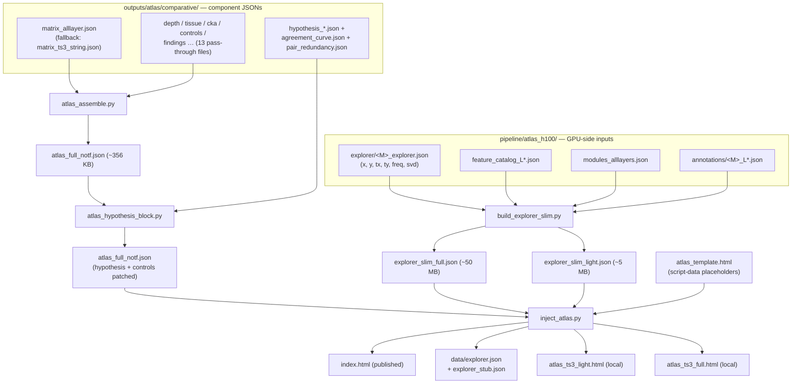

This page documents how the interactive Comparative SAE Atlas — a single self-contained HTML page with no build framework — is generated from the ~50 result files in `outputs/atlas/comparative/`. It covers the two data lines that feed the site (the concept/statistics object and the Layer-Explorer feature maps), the three build targets produced by one injector script, and the drift checks that keep the public page synchronized with the analyses behind it. The site itself is plain markup with data embedded as `<script type="application/json">` blocks, described by its own meta tags as "Sparse-autoencoder features of ten single-cell foundation models on one 6,000-cell corpus."

Sources: [atlas_template.html](pipeline/atlas_template.html#L1-L11), [RESULTS.md](docs/RESULTS.md#L3)

## The Assembly Line at a Glance

Site assembly is a four-stage chain of three local, CPU-only scripts. `atlas_assemble.py` merges component result files into one embedded object; `atlas_hypothesis_block.py` regenerates the prediction/evidence panels of that object from the hypothesis result files; `build_explorer_slim.py` (GPU side) compiles the per-feature maps into two payload sizes; and `inject_atlas.py` pushes everything into the template's placeholder slots, emitting a light build, a full build, and the published page with lazily fetched explorer data.

The scripts-README groups exactly these three under "Assemble the site": `atlas_assemble.py` "builds `atlas_full_notf.json`, the one file the site embeds, from the component results", `atlas_hypothesis_block.py` "rebuilds its prediction block from the hypothesis files; `--check` reports drift", and `inject_atlas.py` "embeds the data blocks into `../atlas_template.html` and writes `index.html` and `data/explorer.json`". Everything upstream (matrices, nulls, hypothesis tests) belongs to the pages on the Local Analysis Stage; this page starts where those results already exist as JSON.

Sources: [README.md](pipeline/scripts/README.md#L54-L62)

## Stage 1: `atlas_assemble.py` — Deriving the One Embedded Object

`atlas_assemble.py` re-derives the site's core object `atlas_full_notf.json` for **all models present in the component JSONs** — its docstring specifies it runs "after `reannotate_string.py` (8-model matrix) + the all-layers downstream (with Tahoe added)". The model roster is never hardcoded: it is filtered from a canonical `ORDER` list by whichever models the concept matrix actually contains, so a new model appears on the site purely by appearing in the data.

Sources: [atlas_assemble.py](pipeline/scripts/atlas_assemble.py#L1-L14)

Derivation versus pass-through is the script's core split. The **derived** blocks are computed from the concept matrix: coverage (features, annotation rate, concepts per source), the universality spectrum (how many models share each concept), Jaccard similarity, per-model exclusive concepts, totals, lineage (scaling correlations, a scipy dendrogram from `1 − J`, model signatures), firing-rate splits, and the inductive-axis taxonomy with per-programme category universality. The **pass-through** blocks are simply pulled from their own result files if present — and if a file is missing, the block is skipped with a log line rather than crashing, exactly as the docstring promises ("Robust to missing pieces (keeps a block absent rather than crashing)").

| derived in-script | pulled through from own file |
|---|---|
| coverage, universality, similarity, specific, totals, firing | `depth` ← depth_alllayers.json |
| lineage (scaling, dendrogram, signature) | `tissue_layers` ← tissue_alllayers.json |
| axes (taxonomy, category universality) | `cka` ← cka_ts3.json, `cka_layers` ← cka_layers.json |
| extra (economy, rare frontier, gene universality, tissue tradeoff, circuits, hardcells) | `nonlinearity`, `module_themes`, `flow`, `celltype`, `topn`, `gsea`, `controls`, `depth_calibrated`, `findings` |

Sources: [atlas_assemble.py](pipeline/scripts/atlas_assemble.py#L1-L7), [atlas_assemble.py](pipeline/scripts/atlas_assemble.py#L282-L301)

Two merge behaviors matter for reproducibility. First, the script prefers the **all-layer** concept matrix (`matrix_alllayer.json`, the union over every layer) and falls back to the depth-matched `matrix_ts3_string.json`, asserting if neither exists. Second, the SVD block is merged incrementally: it starts from the previous `atlas_full_notf.json`'s `svd` block (an older subset of models) and updates it with any per-model `svd/<M>_L*_svd.json` files, and the cross-layer `flow` block is preserved from the old file if it was not recomputed this round — so re-running the assembler on a partial analysis set degrades gracefully instead of erasing sections.

Sources: [atlas_assemble.py](pipeline/scripts/atlas_assemble.py#L55-L62), [atlas_assemble.py](pipeline/scripts/atlas_assemble.py#L303-L316), [atlas_assemble.py](pipeline/scripts/atlas_assemble.py#L318-L320)

## Stage 2: `atlas_hypothesis_block.py` — Regenerating the Panels That Once Drifted

The site's prediction, independent-evidence and novelty panels have their own builder, and its existence is an incident report. The block feeding those panels "was assembled by hand. Nothing regenerated it and nothing checked it, so when the literature null was made reproducible the page kept serving the old z = 40.48 while the manuscript said 34.7 — the same class of drift the manuscript audit exists to catch, on the public half of the project." The fix: every field of the `hypothesis` block is now derived from the canonical result files, so "re-running an analysis and re-injecting is enough to keep the site true."

Sources: [atlas_hypothesis_block.py](pipeline/scripts/atlas_hypothesis_block.py#L2-L11)

| result file | feeds on the site |
|---|---|
| `hypothesis_trrust2.json` | per-model recovery bars, recurrence curve, permutation count (500, matching what the bars are drawn from) |
| `hypothesis_final.json` | ground truth, validated models, worked examples (capped at `N_EXAMPLES = 18`) |
| `hypothesis_pairs_full.json` | `pairs_all` — **every** released pair as compact rows `[gene_a, gene_b, n_models, weight, co_mentions, same_family]`, so the page lists, filters and exports all pairs instead of fourteen examples |
| `agreement_curve.json` | the many-draw agreement estimate quoted where the 100-draw null is too sparse |
| `hypothesis_robust.json` / `hypothesis_sizematched.json` | robustness variants and the equal-budget re-scoring |
| `hypothesis_pubmed.json` / `hypothesis_perturb.json` | literature co-mention and Perturb-seq panels, novelty counts |
| `pair_redundancy.json` | the near-duplicate check behind the prediction panel's reading |
| `cka_svd_null.json`, `backbone_composition.json`, `backbone_terms.json` | controls patches: `survivor_nulls` (replacing an early four-model subset with the full ten-model null), backbone composition, and the full ≥8-sharing term list (the original page had only 40 of 78 terms) |

Sources: [atlas_hypothesis_block.py](pipeline/scripts/atlas_hypothesis_block.py#L29-L31), [atlas_hypothesis_block.py](pipeline/scripts/atlas_hypothesis_block.py#L54-L70), [atlas_hypothesis_block.py](pipeline/scripts/atlas_hypothesis_block.py#L111-L127)

The builder encodes presentation-judgment rules that raw numbers would get wrong. A fold value against a null that produced **no edge at all** is set to `null` — the comment explains that "1.5e9 rendered as '1520000000x' would be the most confident claim on it". The permutation count printed beside the per-model bars comes from `trrust2` (500 rewirings), not `hypothesis_final` (200), because "the page said 200 for a while" while drawing its bars from the other file. A `diffs()` helper yields **every changed leaf**, so a rebuild reports exactly which fields moved, and `--check` mode prints the drift and exits `1` without writing — usable as a CI-style gate.

> [!TIP]
> Run `python scripts/atlas_hypothesis_block.py --check` after any analysis re-run: a non-zero exit is the signal that the committed `atlas_full_notf.json` has drifted from the result files, and the final print tells you the required next action verbatim — "==> now run scripts/inject_atlas.py and deploy index.html".

Sources: [atlas_hypothesis_block.py](pipeline/scripts/atlas_hypothesis_block.py#L37-L43), [atlas_hypothesis_block.py](pipeline/scripts/atlas_hypothesis_block.py#L129-L136), [atlas_hypothesis_block.py](pipeline/scripts/atlas_hypothesis_block.py#L158-L166)

## Stage 3: `build_explorer_slim.py` — Two Payloads for the Feature Maps

The Layer Explorer's per-feature data comes from the GPU side, where `layer_explorer.py`, `tsne_coords.py` and `coact_embed.py` produce the coordinates and firing statistics, and `build_explorer_slim.py` compiles them into the flat format the page renders. Each feature collapses to one **`pts` row of ten numbers** — `[x*100, y*100, module, svd, geneIdx, freqKey, id, tf, tx*100, ty*100]` — where `(x, y)` are decoder-UMAP and `(tx, ty)` t-SNE coordinates. Merging happens at build time: the top gene per feature comes from the feature catalogues, module colour and TF flags from `modules_alllayers.json` (features outside the top-degree co-activation graph are left uncoloured/grey), and the per-layer annotation rate from the annotations files, with a shared per-model gene dictionary (`genes`) keeping the payload small.

Sources: [build_explorer_slim.py](pipeline/atlas_h100/build_explorer_slim.py#L1-L13), [build_explorer_slim.py](pipeline/atlas_h100/build_explorer_slim.py#L44-L63), [README.md](pipeline/atlas_h100/README.md#L31-L36)

Two sizes are emitted from the same pass: `explorer_slim_full.json` (~50 MB, **every alive feature**) for the local, no-size-limit build, and `explorer_slim_light.json` (~5.3 MB), which keeps only the top 500 features per layer ranked by firing rate for the published artifact. This size discipline is why the GPU README lists the pair as "the feature maps of the site's Layer explorer", and why the result-file map notes the full file is "served to the site as data/explorer.json".

Sources: [build_explorer_slim.py](pipeline/atlas_h100/build_explorer_slim.py#L64-L80), [RESULTS.md](docs/RESULTS.md#L26-L27)

## Stage 4: `inject_atlas.py` — Placeholders, Patches, and Three Builds

The template (`pipeline/atlas_template.html`) is the "canonical editable markup (data blocks are `__DATA__` placeholders)". The injector reads it, finds every `<script id="...-data" type="application/json">` line with a regex that captures the indentation, and replaces the placeholder with the contents of the mapped file — six slots: `modules-data`, `genes-data`, `atlas-data`, `health-data`, `programme-data`, and `explorer-data`. The slot comments document why each block exists; for example, `health-data` (dead-feature fractions) is embedded "so a model whose lead rests on the roster's weakest dictionaries (tGPT) carries that caveat next to its recommendation".

| slot id | source file | size | purpose |
|---|---|---|---|
| `atlas-data` | atlas_full_notf.json | 356 KB | everything: coverage, universality, similarity, depth, tissue, CKA, SVD, controls, hypothesis block |
| `genes-data` | genes_ts3.json | 2,769 KB | gene-search index |
| `modules-data` | modules_alllayers.json | 9,036 KB | co-activation graphs and communities |
| `health-data` | sae_health.json | 1 KB | dead-feature caveat beside model recommendations |
| `programme-data` | programme_table.json | — | programmes × models with untrained-SAE, co-expression and random-gene baselines |
| `explorer-data` | explorer_slim_*.json **or** the lazy stub | 5–50 MB | the Layer Explorer maps |

Sources: [inject_atlas.py](pipeline/scripts/inject_atlas.py#L18-L31), [RESULTS.md](docs/RESULTS.md#L10), [RESULTS.md](docs/RESULTS.md#L32), [RESULTS.md](docs/RESULTS.md#L52), [RESULTS.md](docs/RESULTS.md#L64)

One `build()` call produces each target, and the **SITE build differs in exactly one mechanism: lazy loading**. When `lazy="data/explorer.json"` is passed, the injector writes the full explorer JSON to `data/explorer.json` next to the page and embeds only a stub in the `explorer-data` slot — `{"lazy": "data/explorer.json", "models": [...], "mb": <size>}` — so "the published HTML is a fifth of the size and the maps are fetched the first time someone opens the explorer". The light and full builds instead embed their payloads inline for offline use.

| build | explorer payload | destination | role |
|---|---|---|---|
| LIGHT | explorer_slim_light.json (inline) | `atlas_ts3_light.html` | local, size-capped artifact |
| FULL | explorer_slim_full.json (inline) | `atlas_ts3_full.html` | local, no size limit |
| SITE | stub + `data/explorer.json` (lazy) | `index.html` in the repository root | the published page |

Sources: [inject_atlas.py](pipeline/scripts/inject_atlas.py#L41-L55), [inject_atlas.py](pipeline/scripts/inject_atlas.py#L78-L83)

The injector also keeps the prose honest as the model roster grows. `N_MODELS` is read from `atlas_full_notf.json` itself; two hardcoded readouts are patched (`${rows.length}/7 models` becomes a dynamic denominator, "7 models (Tahoe pending)" becomes "8 models"), and `__BUILT__` is stamped with the build date. Crucially, model-count words are rewritten only on short lines — "never touch the multi-MB data blocks, where a concept like 'seven-transmembrane' must not be mangled" — and a previously blanket word substitution was removed outright after it rewrote legitimate prose ("at least eight of the ten" → "ten of the ten"). Paths are controlled by `ATLAS_BASE` (data root), `ATLAS_REPO` (site repository, auto-detected by checking for `../atlas_template.html`), and `ATLAS_OUT` (build directory), so the chain runs outside the authors' machine.

> [!TIP]
> The lazy stub is the reason `index.html` and `data/explorer.json` must be deployed together: the page boots from a few-kilobyte stub and resolves the ~50 MB map bundle on first explorer use, so shipping the HTML without the `data/` folder silently breaks only that one feature.

Sources: [inject_atlas.py](pipeline/scripts/inject_atlas.py#L1-L4), [inject_atlas.py](pipeline/scripts/inject_atlas.py#L33-L38), [inject_atlas.py](pipeline/scripts/inject_atlas.py#L63-L75), [inject_atlas.py](pipeline/scripts/inject_atlas.py#L12-L19)

## The Re-Build Loop and the Shipped Artifacts

The full refresh sequence is short and strictly ordered, and each step names the next: re-run any analyses (component JSONs update) → `python scripts/atlas_assemble.py` (re-derive the embedded object) → `python scripts/atlas_hypothesis_block.py` (re-patch hypothesis + controls, or `--check` first) → `python scripts/inject_atlas.py` (re-emit `index.html` + `data/explorer.json`). No step reads anything outside `outputs/atlas/comparative/`, which is what makes the invariant checkable: "The manuscript, the supplement and the site's data blocks are built from these files and nothing else; `pipeline/scripts/audit_all.py` checks that."

Sources: [atlas_hypothesis_block.py](pipeline/scripts/atlas_hypothesis_block.py#L158-L166), [RESULTS.md](docs/RESULTS.md#L3), [README.md](pipeline/scripts/README.md#L84-L88)

The repository's published set is correspondingly minimal: the single-page `index.html`, `data/explorer.json` (the lazy map bundle), and `data/hypothesis_pairs_full.json` (all 4,485 released regulatory pairs with models, weight, co-mentions and the same-family flag — the complete counterpart to the compact `pairs_all` rows embedded in the atlas object). The site derives its discipline from the same philosophy as the rest of the project: the assembler's own comments record that a "new biology" analysis block was removed from the object entirely after both nulls came back negative, with the note "Do not reinstate without a null" — the public page refuses to carry a claim the result files cannot defend.

Sources: [RESULTS.md](docs/RESULTS.md#L38), [atlas_assemble.py](pipeline/scripts/atlas_assemble.py#L207-L213)

## Where to Go Next

For the complete file-side inventory that this assembly consumes — every JSON with its writer, readers and size — continue to [Result Files and Data Flow Map](17-result-files-and-data-flow-map). For how drift between prose, figures and result files is systematically caught (the audit machinery `atlas_hypothesis_block.py` mirrors), see [Audit System and Manuscript Checks](18-audit-system-and-manuscript-checks), and for why the underlying catalogues were re-extracted before the site could be rebuilt, see [Extraction Faults and Corrected Re-Run](21-extraction-faults-and-corrected-re-run). Finally, to see what the lazy-loaded `data/explorer.json` actually renders once fetched, continue to the next page, [Layer Explorer Feature Maps](23-layer-explorer-feature-maps).