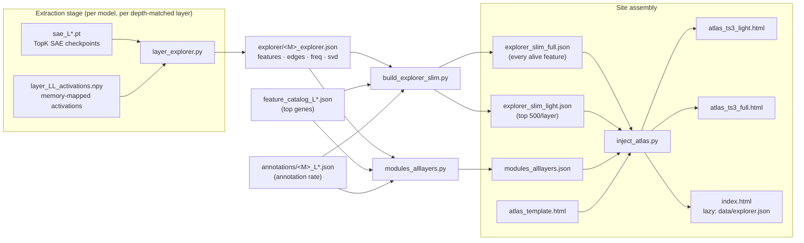
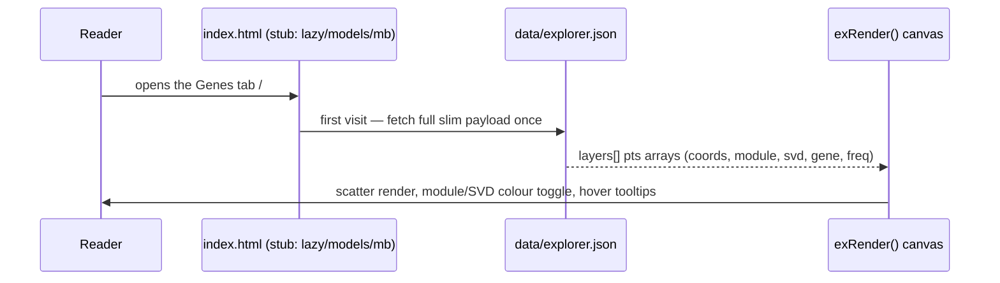

The Layer Explorer is the atlas's per-layer, per-model map of every sparse-autoencoder (SAE) feature: a 2-D scatter of decoder directions, the co-activation structure behind module colouring, SVD-alignment flags, and firing statistics — all precomputed offline into compact JSON so the browser renders tens of thousands of dots without ever loading a model. This page traces the feature map's full life cycle: GPU-side extraction (`layer_explorer.py`), module-graph construction (`modules_alllayers.py`), lossless compaction into the "pts" format (`build_explorer_slim.py`), and the three-build delivery strategy with lazy loading (`inject_atlas.py` + `atlas_template.html`).

## What Each Feature Dot Encodes

Every dot in the explorer is one SAE latent direction, and four derived signals are attached to it. **Position** is a UMAP (and a parallel t-SNE) projection of the feature's *decoder direction* — the axes carry no meaning, and the cloud is near-uniform because features are close to orthogonal. **Colour** follows a user toggle: co-activation community (grey = not in the top-degree graph) or SVD alignment. **Size/opacity** relates to firing frequency, and a **TF flag** marks features whose annotations include TRRUST transcription factors. The site's own help glossary summarizes this contract for readers: position is decoder-direction UMAP/t-SNE, and a feature is "one direction learned by a sparse autoencoder on a model's residual stream," summarised by its top decoder genes.

Sources: [layer_explorer.py](/pipeline/atlas_h100/layer_explorer.py#L1-L10), [atlas_template.html](/pipeline/atlas_template.html#L1238-L1241)

## Pipeline Architecture

The feature map is produced by a four-stage pipeline. The GPU stage reads *saved* SAE checkpoints and memory-mapped activation matrices — it never re-runs the foundation models — and emits one raw explorer JSON per model. Two sibling consumers then branch off that JSON: the module-graph builder derives per-layer co-activation communities, and the slim builder fuses coordinates, module assignments, top genes and annotation rates into the two deployment-sized files. Finally, the injector splices those files into the HTML template's `__DATA__` placeholders, producing three builds that differ only in *how* the explorer payload is shipped.

Sources: [layer_explorer.py](/pipeline/atlas_h100/layer_explorer.py#L44-L62), [build_explorer_slim.py](/pipeline/atlas_h100/build_explorer_slim.py#L6-L13), [modules_alllayers.py](/pipeline/atlas_h100/modules_alllayers.py#L1-L10), [inject_atlas.py](/pipeline/scripts/inject_atlas.py#L22-L33)

## Extraction Stage: `layer_explorer.py`

The script discovers layers by globbing `sae_L*.pt` in the model's output directory and sorts them numerically, so it automatically covers *all* depth-matched layers rather than a hand-picked subset. For each layer it loads the checkpoint's config (`d_model`, `expansion`, `k`), reconstructs the `TopKSAE`, and opens the activation matrix with `mmap_mode="r"` — the corpus never has to fit in RAM.

Sources: [layer_explorer.py](/pipeline/atlas_h100/layer_explorer.py#L58-L67)

The statistical core is a single streaming pass over the activations that accumulates three float64 tensors on the GPU: `S1` (feature sums), `S2` (the Gram matrix `Hᵀ H`), and `S0` (firing counts). From these it derives everything the map needs in O(1) extra memory: firing frequency `freq = S0/N`, the alive mask (`freq > 0`), and the full Pearson correlation matrix `cov / √(var·var)` with the diagonal zeroed. This is why edge computation scales to `d_sae`-sized dictionaries on an H100 without materialising per-pair passes.

Sources: [layer_explorer.py](/pipeline/atlas_h100/layer_explorer.py#L69-L80)

Two embeddings are computed from the same material — the column-normalised decoder weight matrix restricted to alive features (`W_dec` is stored as `[d_model, d_sae]`, so alive columns are transposed to `[n_alive, d_model]`). UMAP runs with cosine metric, `n_neighbors=15`, `min_dist=0.1`, `random_state=0`; t-SNE runs with cosine metric, PCA init, and an adaptive perplexity of `min(30, max(5, n/20))`. Both fall back to plain PCA if the library is missing, guaranteeing the map always renders.

Sources: [layer_explorer.py](/pipeline/atlas_h100/layer_explorer.py#L16-L41), [layer_explorer.py](/pipeline/atlas_h100/layer_explorer.py#L82-L87)

SVD alignment and edge mining complete the per-layer payload. For alignment, up to 120,000 activation rows are sampled, centred, decomposed, and each alive feature is flagged if its maximum absolute cosine to a top right-singular vector exceeds 0.5. For edges, each alive feature keeps its top-k correlated alive neighbours, pairs below `min_corr` are dropped, pairs are deduplicated as `(min(i,j), max(i,j))` keeping the stronger correlation, and the list is sorted descending and capped at 9,000. Coordinates from both embeddings are min-max normalised to [0, 1] before serialization.

Sources: [layer_explorer.py](/pipeline/atlas_h100/layer_explorer.py#L89-L107)

The raw output schema is `{model, layers: {L: {n_alive, dead, d_sae, n_svd_aligned, features: [{id, x, y, tx, ty, freq, svd}], edges: [[i, j, corr]]}}}` written to `explorer/<M>_explorer.json`.

Sources: [layer_explorer.py](/pipeline/atlas_h100/layer_explorer.py#L109-L122)

**Extraction parameters:**

| Flag | Default | Role |
|---|---|---|
| `--topk` | 10 | correlated neighbours retained per feature during edge mining |
| `--min-corr` | 0.15 | minimum Pearson correlation for an edge to survive |
| `--max-edges` | 9000 | per-layer cap after strength-sorted deduplication |
| `--svd-cos` | 0.5 | \|cos\| threshold for the SVD-alignment flag |
| `--sample` | 120000 | activation rows sampled for the SVD basis |
| `--batch` | 65536 | streaming batch size for the correlation accumulators |

Sources: [layer_explorer.py](/pipeline/atlas_h100/layer_explorer.py#L50-L56)

## Module Colouring: `modules_alllayers.py`

Module colouring reuses — never recomputes — the co-activation edges from the explorer JSON. Per layer, the builder constructs a `networkx` graph over the strong edges, keeps only the top-260 highest-degree nodes (the co-activating core, kept "for a legible layout"), runs greedy modularity clustering, and lays the surviving subgraph out with a seeded spring layout (`seed=7`, `k=1.6/√n`, 120 iterations). Each node carries its community id, degree, a display label (dominant annotation concept, else top gene), its top-6 decoder genes, and a TF flag derived from TRRUST source annotations; module labels themselves are the most common concept per community. Edges are re-encoded as `[nodeIndexA, nodeIndexB, weight]`, strength-sorted, and capped at 600.

Sources: [modules_alllayers.py](/pipeline/atlas_h100/modules_alllayers.py#L36-L84)

Crucially, the output deliberately matches the pre-existing `modules_ts3.json` node/edge schema (indices into nodes; x, y in 0..1), so the site's canvas renderer only gained a layer selector rather than a new code path — the same design pattern as the explorer itself: heavy geometry computed once offline, the browser only animating and hit-testing.

Sources: [modules_alllayers.py](/pipeline/atlas_h100/modules_alllayers.py#L1-L10), [modules_alllayers.py](/pipeline/atlas_h100/modules_alllayers.py#L110-L112)

## Slimming Stage: `build_explorer_slim.py`

The slim builder is a lossless-enough repackager that turns verbose per-feature objects into fixed 10-slot integer arrays (`pts`), deduplicating gene strings into a per-model shared dictionary. Positions are rescaled by ×100 and rounded to 0.1 so JSON numbers stay short; firing frequency becomes a ×1000 integer key that preserves ordering. Features absent from the top-degree module graph get `module = n_mod` and `tf = 0`, which the renderer treats as grey.

| Slot | Content | Encoding | Meaning |
|---|---|---|---|
| 0–1 | `x, y` | `round(v*100, 1)` | decoder-direction UMAP, 0–100 |
| 2 | `module` | int | co-activation community; `n_mod` = uncoloured |
| 3 | `svd` | 0/1 | aligned to a top SVD axis (cos > 0.5) |
| 4 | `geneIdx` | int | index into shared `genes` array (top decoder gene) |
| 5 | `freqKey` | int | `round(freq*1000)` — firing-rate rank key |
| 6 | `id` | int | SAE latent index (joins back to catalog/annotations) |
| 7 | `tf` | 0/1 | TRRUST transcription-factor flag |
| 8–9 | `tx, ty` | `round(v*100, 1)` | t-SNE fallback view |

Sources: [build_explorer_slim.py](/pipeline/atlas_h100/build_explorer_slim.py#L10-L11), [build_explorer_slim.py](/pipeline/atlas_h100/build_explorer_slim.py#L37-L60)

Each layer also carries a metadata block — `alive`, `dead`, `svd_aligned`, `n_mod`, `mod_labels`, and `rate` (the percentage of shown features with any annotation) — so the UI can print per-layer summary lines without extra requests. Two sizes are emitted: `explorer_slim_full.json` with every alive feature for the size-unlimited local atlas, and `explorer_slim_light.json` keeping only the top `--cap` (default 500) features per layer sorted by `freqKey`, tuned so the published artifact stays within a ≤16 MB budget.

Sources: [build_explorer_slim.py](/pipeline/atlas_h100/build_explorer_slim.py#L61-L66), [build_explorer_slim.py](/pipeline/atlas_h100/build_explorer_slim.py#L71-L75)

> [!TIP]
> The grey convention is positional: slot 2 equal to `n_mod` is not a real community — it is the sentinel meaning "this feature never made the top-degree module graph." Any consumer that colours by community id must treat `id === n_mod` as uncoloured, or unclustered features will silently inherit the last module's hue.

## Delivery: Three Builds and Lazy Loading

`inject_atlas.py` performs placeholder surgery on `atlas_template.html`: it finds `<script id="…-data" type="application/json">` blocks and replaces their contents with the corresponding result files (`modules-data`, `genes-data`, `atlas-data`, `health-data`, `programme-data`, and `explorer-data`). Because the explorer payload dominates page weight, the injector supports a **lazy mode**: instead of inlining the JSON, it writes the full payload to `data/explorer.json` beside the page and embeds a tiny stub `{lazy, models, mb}` in the `explorer-data` block — explicitly so "the published HTML is a fifth of the size and the maps are fetched the first time someone opens the explorer."

Sources: [inject_atlas.py](/pipeline/scripts/inject_atlas.py#L22-L33), [inject_atlas.py](/pipeline/scripts/inject_atlas.py#L42-L56)

The three builds differ only in the explorer strategy:

| Build | Explorer payload | Output | Intended use |
|---|---|---|---|
| LIGHT | `explorer_slim_light.json` inlined | `atlas_ts3_light.html` | size-budgeted artifact (≤16 MB) |
| FULL | `explorer_slim_full.json` inlined | `atlas_ts3_full.html` | local browsing, no size limit |
| SITE | stub + lazy `data/explorer.json` | `index.html` | the published page |

Sources: [inject_atlas.py](/pipeline/scripts/inject_atlas.py#L81-L87)

On the client, the explorer section is wired into the tab shell under the **Genes** tab (mapped via `TABMAP` and ordered after gene search and the prediction test), and `exRender()` is invoked only when that tab becomes active — the render trigger that makes the lazy fetch pay off, since users who never open the explorer never download the multi-megabyte map.

Sources: [atlas_template.html](/pipeline/atlas_template.html#L1483-L1493), [atlas_template.html](/pipeline/atlas_template.html#L1500-L1503)

Sources: [inject_atlas.py](/pipeline/scripts/inject_atlas.py#L42-L56), [atlas_template.html](/pipeline/atlas_template.html#L1500-L1503)

> [!TIP]
> The explorer's navigation entry is `#explorer` in the template nav, but the tab shell re-homes the section under the Genes tab at runtime — deep links like `#explorer` resolve through the `TABMAP` routing, so bookmarking the section anchor still opens the right tab and scrolls to the map.

## Schema Quick Reference

**Raw explorer JSON (per layer):** `n_alive` / `dead` (firing vs never-fired counts), `d_sae` (expansion × d_model), `n_svd_aligned`, `features[]` with `id, x, y, tx, ty, freq, svd` in unit coordinates, and `edges[]` as `[i, j, corr]` among alive features.

Sources: [layer_explorer.py](/pipeline/atlas_h100/layer_explorer.py#L109-L116)

**Slim JSON (per model):** a shared `genes[]` dictionary plus `layers{}` whose entries hold the metadata block and `pts` arrays; the injector's stub adds `{lazy, models, mb}` so the page can display payload size before fetching.

Sources: [build_explorer_slim.py](/pipeline/atlas_h100/build_explorer_slim.py#L61-L68), [inject_atlas.py](/pipeline/scripts/inject_atlas.py#L53-L56)

## Where to Go Next

The explorer consumes artifacts produced upstream: how the SAEs it reads were trained is covered in [TopK Sparse Autoencoder Training](7-topk-sparse-autoencoder-training), and how features acquire their top genes and concept labels is [Concept Matrices and Backbone Detection](13-concept-matrices-and-backbone-detection). The SVD-alignment flag ties into [Cross-Model Geometry: CKA and SVD](12-cross-model-geometry-cka-and-svd). For the rest of the delivery chain — placeholder injection, gene search, and the other data blocks the site embeds — continue to [Site Assembly from Result Files](22-site-assembly-from-result-files).