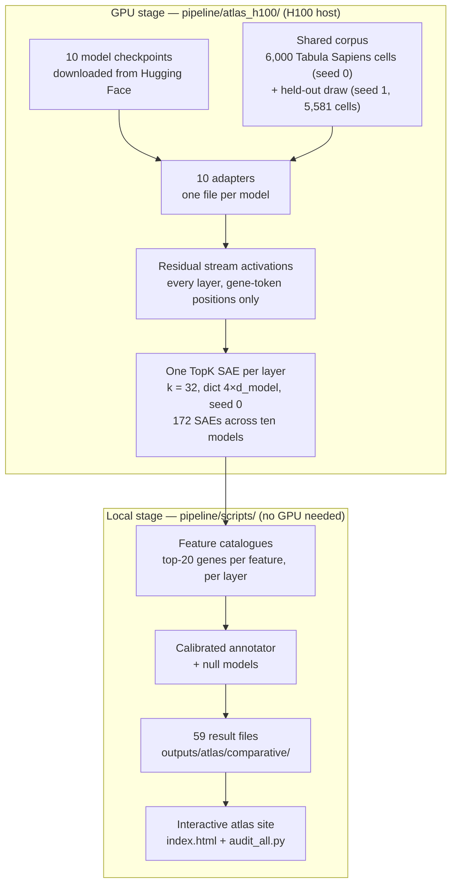

This page introduces the ten single-cell foundation models behind the Comparative SAE Atlas: who they are, how they differ, and — most importantly — what the project does to make their differences *measurable* rather than confounded. A **foundation model** here is a large neural network pretrained on millions of single-cell transcriptomes, which you can then reuse for many tasks. The core engineering idea of this repository is that all ten models are run through one identical pipeline (same cells, same sparse autoencoder, same annotator), so any difference in the output can be attributed to the model itself and not to the data it saw. This page stays at the level of the models and the comparison machinery; deeper mechanics live in the Deep Dive pages.

Sources: [README.md](README.md#L1-L6), [docs/DECISIONS.md](docs/DECISIONS.md#L5-L14)

## The Ten Models at a Glance

The ten models were chosen to span three orders of magnitude in size (10 million to 3 billion parameters) and four different ways of "reading" a cell. All ten are gene-token transformer models: they represent a cell as a sequence of gene tokens and process it with stacked transformer layers. The table below is the project's canonical registry, defined once in `pipeline/atlas_h100/configs/models.yaml` and mirrored in the manuscript's Table S1.

| model | params | d_model | layers | reads a cell as | objective | prior | species | checkpoint |
|---|---|---|---|---|---|---|---|---|
| AIDO.Cell | 10M | 256 | 8 | expression, all 19,264 genes | MLM | none | human | `genbio-ai/AIDO.Cell-10M` |
| scGPT | ~50M | 512 | 12 | binned expression | MLM | none | human | `bowang-lab/scGPT` whole-human |
| tGPT | ~120M | 1024 | 8 | rank order | autoregressive | none | human | `lixiangchun/transcriptome-gpt-1024-8-16-64` |
| scFoundation | 100M | 768 | 12 | expression, read-depth aware | MAE | none | human | `biomap-research/scFoundation` |
| GeneCompass | 104M | 768 | 12 | rank order + value | MLM (ID and value) | knowledge (GRN, family, promoter, co-expression) | human+mouse | `xCompass-AI/GeneCompass` base |
| MaxToki | 217M | 1232 | 11 | rank order (corpus-scaled) | autoregressive | none | human | `theodoris-lab/MaxToki` 217M |
| Geneformer-V2 | 316M | 1152 | 18 | rank order | MLM | none | human | `ctheodoris/Geneformer` Geneformer-V2-316M |
| UCE | 650M | 1280 | 33 | ESM2 protein tokens sampled by expression | masked | ESM | multi-species | `snap-stanford/UCE` 33-layer |
| C2S-Scale | 2B | 2304 | 26 | rank-ordered gene names as text | autoregressive | text (Gemma-2-2B) | human+mouse | `vandijklab/C2S-Scale-Gemma-2-2B` |
| Tahoe-x1 | 3B | 2560 | 32 | binned expression | MLM | none | human | `tahoebio/Tahoe-x1` 3B |

Two columns deserve a beginner's note. **d_model** is the width of the vector each token is represented by — it ranges from 256 (AIDO.Cell) to 2,560 (Tahoe-x1) and directly determines how large the per-model sparse autoencoder must be. **Layers** is the number of transformer blocks whose internal states the pipeline extracts; summed across all ten models, the pipeline trains **172 SAEs in total** (8+12+8+12+12+11+18+33+26+32).

Sources: [configs/models.yaml](pipeline/atlas_h100/configs/models.yaml#L1-L25), [README.md](README.md#L43-L57), [docs/METHODS.md](docs/METHODS.md#L12-L15)

## Three Axes of Difference

Reading the table column by column, the models differ along three conceptual axes, and each axis is a hypothesis about what information matters in a cell.

**Input encoding** — how a raw count matrix becomes tokens. Four schemes appear. *Expression* models (AIDO.Cell, scFoundation) feed continuous values, with scFoundation additionally scaling by each cell's read depth. *Binned expression* (scGPT, Tahoe-x1) discretizes values into bins. *Rank order* (tGPT, MaxToki, Geneformer-V2, GeneCompass) feeds only the ordering of genes within a cell, discarding magnitudes entirely. Two outliers go further: UCE converts genes to **ESM2 protein-language tokens** (so the model reads protein embeddings informed by protein structure), and C2S-Scale treats **ranked gene names as literal text** for a language model that started life as Gemma-2.

**Objective** — the pretraining task. *Masked language modeling* (MLM) hides some tokens and predicts them from context; *autoregressive* models predict the next token in sequence, GPT-style; *MAE* (masked autoencoder, scFoundation) reconstructs masked inputs. This distinction decides what "understanding a cell" means for each model before the atlas even starts.

**Prior** — outside knowledge carried into the weights. Seven models are tabula rasa (prior: none). GeneCompass injects a knowledge graph of regulatory networks, gene families, promoters and co-expression; UCE inherits knowledge from ESM2's protein pretraining; C2S-Scale inherits general text knowledge from Gemma-2. The atlas can therefore ask: does a prior help, hurt, or not matter?

Sources: [configs/models.yaml](pipeline/atlas_h100/configs/models.yaml#L10-L25), [docs/DECISIONS.md](docs/DECISIONS.md#L203-L218), [docs/METHODS.md](docs/METHODS.md#L12-L15)

## What Makes the Comparison Fair: One Corpus, One SAE

The comparison is only meaningful if every model processes identical inputs through identical downstream machinery. Three invariants hold for all ten models:

**One corpus.** All models read the same 6,000 Tabula Sapiens cells — 2,000 each from immune, kidney and lung tissue — drawn from cellxgene-census v1.18.0 with seed 0. A second draw with seed 1 (minus the 419 cells it accidentally shares with the corpus, leaving 5,581) serves as a fully held-out replication set. Before this project, earlier single-model atlases used different corpora (Geneformer on K562, scGPT on Tabula Sapiens), so any model difference could have been a data difference; here that confound is removed by construction.

**One sparse autoencoder configuration.** After extraction, each model's residual stream at each layer is compressed by a **TopK SAE** — a small network that learns a wider dictionary of interpretable features, keeping only the k=32 most active per token. The configuration is fixed and identical: dictionary of 4× d_model features, MSE loss, Adam at 3e-4, 4 epochs, seeded (seed 0) for both NumPy and torch. Training data is balanced identically too: every model sees at most 168 gene-token positions from *every one* of the 6,000 cells, about 1M positions per layer.

**One annotation standard.** Feature catalogues are annotated by one calibrated method (top-10 genes, ≥3 of them in one curated pathway set), fixed on the discovery corpus before the held-out corpus was ever touched — details belong to [Calibrated versus Permissive Annotation](9-calibrated-versus-permissive-annotation).

Sources: [docs/METHODS.md](docs/METHODS.md#L4-L24), [docs/DECISIONS.md](docs/DECISIONS.md#L5-L14), [docs/DECISIONS.md](docs/DECISIONS.md#L26-L41)

The flow from raw checkpoints to the numbers on the site looks like this:

Sources: [pipeline/atlas_h100/README.md](pipeline/atlas_h100/README.md#L1-L24), [pipeline/atlas_h100/README.md](pipeline/atlas_h100/README.md#L48-L66)

## The Adapter Contract: How Model Differences Are Isolated

Ten very different checkpoints (one needs `flash-attn` in its own conda environment, one needs a revived `torchtext` shim) must all emit the same data format, or nothing downstream could be shared. That is the job of the **adapter contract** in `pipeline/atlas_h100/adapters/base.py`. Each of the ten adapters implements a single method, `iter_activations(adata, batch_size)`, which per batch of cells yields three things: a dict mapping each extracted layer to a float32 array of shape `[n_positions, d_model]`, the HGNC gene symbol (upper-cased) of every position, and the global cell index of every position. Only *gene* token positions are yielded — CLS tokens, padding, and depth/special tokens are dropped inside the adapter, so downstream code never knows they existed. Everything after the adapter — SAE training, catalogues, annotation — is written model-agnostically against this one interface.

> [!TIP]
> The adapter contract is the load-bearing design decision of the whole comparison: because the interface yields `(layer → activations, gene symbols, cell ids)`, adding an eleventh model would require writing exactly one new file in `adapters/` and zero changes anywhere else. This is why "the rest of the pipeline is model-agnostic" is stated as a contract, not an aspiration.

Sources: [adapters/base.py](pipeline/atlas_h100/adapters/base.py#L1-L40), [pipeline/atlas_h100/README.md](pipeline/atlas_h100/README.md#L70-L75), [pipeline/atlas_h100/README.md](pipeline/atlas_h100/README.md#L78-L82)

A concrete example makes the pattern clear. The AIDO adapter's `load()` reads the checkpoint's config to learn how many layers it has and applies the depth-matching rule; its `iter_activations()` aligns the input matrix to the model's 19,264-gene vocabulary, runs the forward pass under `torch.no_grad()`, pulls the `hidden_states` tuple, reshapes each requested layer to `[n_positions, 256]`, and tiles the gene-symbol array to match. All ten adapters follow this load/iterate shape while hiding their wildly different preprocessing (binning, rank encoding, ESM tokenization) behind it.

Sources: [adapters/aido.py](pipeline/atlas_h100/adapters/aido.py#L1-L56)

## Comparing Different Depths: the Depth-Matched Read-Out

A subtle problem: how do you compare "the same part of the network" between an 8-layer model and a 33-layer model? Absolute layer indices are meaningless across architectures. The project's answer is **relative depth**: all layers are extracted for every model, and wherever one comparable depth per model is needed, the five layers at **0%, 25%, 50%, 75% and 100%** of network depth form the depth-matched read-out. The rule is implemented in four lines: `depth_matched(n_layers)` takes the indices `round(f × (n_layers − 1))` for those five fractions, deduplicates (small models can collapse some), and sorts them. UCE's 33 layers map to a clean 0, 8, 16, 24, 32; AIDO's 8 layers collapse to a coarser set of five (with two adjacent indices landing close together).

One discipline rule follows from this and matters for reading any result: **feature counts are never summed across layers**, and features from different layers are never read as concepts coexisting in one representation — each layer is its own representational space with its own dictionary. The per-layer story (mid-network peaks, late collapse of annotation rate) is exactly what the all-layer extraction was designed to reveal, and it feeds [Cross-Model Geometry: CKA and SVD](12-cross-model-geometry-cka-and-svd).

Sources: [common/layers.py](pipeline/atlas_h100/common/layers.py#L1-L20), [docs/METHODS.md](docs/METHODS.md#L26-L29), [docs/DECISIONS.md](docs/DECISIONS.md#L16-L24)

## What the Comparison Found

The payoff of the fair setup is a set of model-level verdicts, each audited against its result file. For a beginner, the headline is that model identity clearly matters for some tasks and clearly does not for others:

| question | verdict across the ten models | evidence |
|---|---|---|
| Do features predict unseen biology? | **Only 4 of 10 pass.** Gene pairs that co-fire recover held-out TRRUST regulatory edges above a degree-preserving null: UCE 10.2×, Tahoe-x1 9.4×, C2S-Scale 5.5×, Geneformer-V2 2.5× (p ≤ 0.005); the other six do not | `hypothesis_final.json` |
| Do models agree on a shared backbone? | A calibrated backbone of **96 concepts** is shared by ≥8 of 10 models (27.5× the uniform random-gene null), but **no concept is in all ten** | `backbone_terms.json`, `stats_final.json` |
| Does model size track concept count? | Yes, descriptively: concepts against parameters **r = 0.855** (bootstrap CI 0.68–0.984), on n = 10 models — reported as descriptive only | `controls.json` |
| Do SAE features add value over PCA? | **In all ten models**, the SAE explains more variance than the best rank-32 PCA subspace, by +0.02 (tGPT) to +0.55 (Geneformer-V2) | `svd_vs_sae` files, `cka_svd_null.json` |
| Is the shared structure just co-expression? | Largely: a model-free co-expression dictionary recovers 73–95 of the 96 backbone concepts; models' own middle layers recover 23–96 | `coexpr_core_baseline.json` |
| Is the SAE healthy in every model? | No: tGPT's dictionaries have the most dead features (21.3% on average, 58.6% at worst) — flagged as a confound for tGPT-specific results; near-duplicate feature blocks appear in every model except Geneformer-V2 and GeneCompass | `sae_health.json` |

Two cross-model findings sharpen the picture further. Agreement between independently trained models is a precision signal: gene pairs predicted by two models are 15.3× over the null versus 5.0× for pairs from one model — yet agreement beyond two adds nothing (none of the 918 pairs shared by five or more models is a known edge). And the geometry result is model-independent: linear CKA between every pair of models exceeds its cell-shuffle floor (worst pair 43×), meaning all ten models organize this corpus into recognizably similar representation spaces despite their different encodings, objectives and priors.

Sources: [README.md](README.md#L59-L120), [docs/RESULTS.md](docs/RESULTS.md#L10-L78), [docs/DECISIONS.md](docs/DECISIONS.md#L26-L41), [docs/DECISIONS.md](docs/DECISIONS.md#L219-L223)

> [!TIP]
> When reading any per-model number in this project, check whether it came from the depth-matched five layers or from all layers — the two views differ (the mid-depth slice gives 97 backbone concepts where the standard mid layer gives 96, because rounding lands one layer apart for even-depth models). The rule "never sum features across layers" exists precisely so these two views are never conflated.

Sources: [docs/DECISIONS.md](docs/DECISIONS.md#L234-L238)

## The Corrected Extraction: Why "As Extracted" Matters

One caution for interpreting every number above: the published catalogues come from a **corrected re-run** (`runs-v2`), not the first release. The first extraction had a position cap that took training positions in corpus order, so models that read every gene saw very few cells — AIDO.Cell saw 32 cells, scFoundation about 160, while tGPT (64 tokens per cell) saw all 6,000. That meant the v1 comparison was, in effect, comparing models trained on *different data* — exactly the confound the shared corpus was built to eliminate. Three further faults (arbitrary filler genes in top-gene lists, an unseeded torch SAE, a stale UCE preprocessing cache) were fixed at the same time. After the re-run, the backbone grew from 78 to 96 concepts, held-out replication now covers all ten models, and TRRUST prediction holds in four models instead of five (scGPT drops out). The full fault-by-fault account belongs to [Extraction Faults and Corrected Re-Run](21-extraction-faults-and-corrected-re-run); the takeaway for this page is simply that every number quoted here is from the run where all ten models genuinely saw the same cells with the same budget.

Sources: [docs/DECISIONS.md](docs/DECISIONS.md#L264-L299), [pipeline/atlas_h100/README.md](pipeline/atlas_h100/README.md#L48-L68), [README.md](README.md#L29-L32)

## Where to Go Next

The natural reading path from here, following the catalog:

- To see the consequences of these comparisons for scientific claims — including which headline claims failed their own nulls — read [Key Findings and Retracted Claims](4-key-findings-and-retracted-claims).
- To understand how a checkpoint becomes a feature catalogue step by step, start with the extraction stage: [Model Adapter Contract](6-model-adapter-contract), then [TopK Sparse Autoencoder Training](7-topk-sparse-autoencoder-training) and [Shared Corpus and Held-Out Draw](8-shared-corpus-and-held-out-draw).
- To go deeper on the evaluation machinery behind the table above: [Held-Out Regulatory Prediction Test](11-held-out-regulatory-prediction-test) explains the four-of-ten verdict, [Cross-Model Geometry: CKA and SVD](12-cross-model-geometry-cka-and-svd) explains the all-pairs agreement result, and [Co-Expression Baseline Comparisons](15-co-expression-baseline-comparisons) explains why the shared backbone is attributed to the data.
- To see the models side by side interactively, open the live atlas (`index.html` in the repository root), where every displayed number is read at page-load from the result files in `outputs/atlas/comparative/`.
