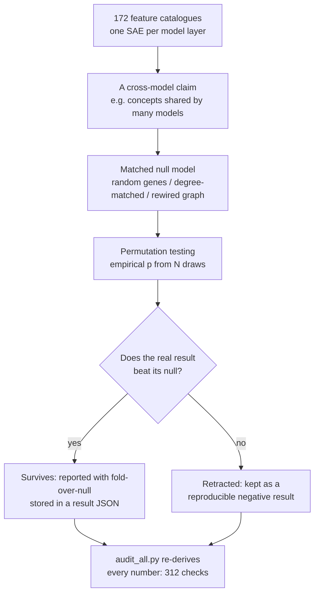
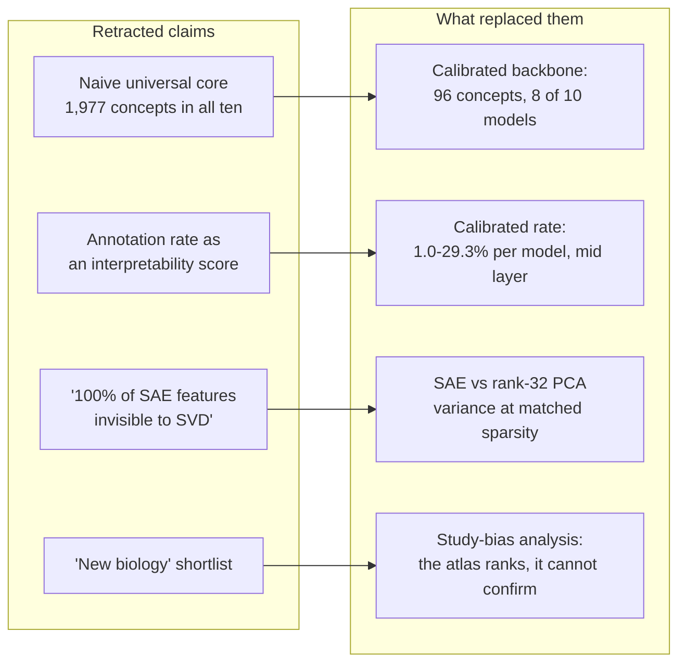

This page is the scoreboard of the comparative SAE atlas: the findings about ten single-cell foundation models that **survived** their null-model tests, and the claims that were **retracted** when those same nulls killed them. Every number below is audited against the result file that produced it, and every retracted claim is kept as a reproducible negative result rather than deleted — this repository treats a failed control with the same care as a success.

Sources: [README.md](README.md#L64-L68), [docs/DECISIONS.md](docs/DECISIONS.md#L1-L4)

## How a Claim Earns Its Place Here

The core discipline of this project is simple to state: **no claim is made unless a null model built to reproduce it by chance fails to do so**. Each result is stated against a null matched to the failure mode it guards against — random genes for annotation claims, degree-matched genes so popularity cannot win, rewired co-firing graphs so study bias cannot win, shuffled cells for geometry claims. The result is an empirical p-value, and a verdict.

Sources: [docs/DECISIONS.md](docs/DECISIONS.md#L85-L99), [docs/METHODS.md](docs/METHODS.md#L48-L55)

The permutation counts differ by computational cost and are stated wherever a derived number appears. Two statistical hygiene rules follow for beginners. First, with N permutations the smallest possible p-value is 1/(N+1), so most "significant" results in this project sit at that floor — that is expected, not suspicious. Second, results near the threshold are labelled marginal rather than promoted: MaxToki at equal budget sits at p = 0.04, and the corroboration gain in one robustness variant sits at p = 0.055.

Sources: [docs/DECISIONS.md](docs/DECISIONS.md#L101-L107)

| Claim | Null built to defeat it | Permutations |
|---|---|---|
| Shared backbone (concepts in 8+ of 10 models) | Uniform random genes; degree-matched random genes | 250 each |
| Backbone across depth | Uniform random genes at each of five depths | 250 |
| Held-out replication of backbone | Random-gene backbones on both cell draws | 150 |
| Naive core (**retracted**) | Uniform random genes, mid layer and all-layer union | 100; 20 |
| CKA between models | Shuffle the cells of one embedding | per pair |
| Held-out regulatory recovery per model | Rewire co-firing graph, keep every gene's degree | 500 |
| Literature co-mention | Publication-count-preserving shuffle | 200 |
| Perturbation support | Responsiveness-matched gene | 200 |

Sources: [docs/DECISIONS.md](docs/DECISIONS.md#L89-L99)

## What Survived: The Findings

Eight findings passed their nulls. The most important structural lesson is finding 3: much of what the models appear to contribute is already **the co-expression structure of the data**, which is why the project keeps reporting the model-free baseline next to every model result.

| # | Finding | Headline numbers | Evidence file |
|---|---|---|---|
| 1 | A calibrated backbone is real and modest | 96 concepts in 8+ of 10 models; 27.5× uniform null, 51.2× degree-matched, p < 0.004 | `backbone_terms.json` |
| 2 | The backbone replicates on unseen cells | Jaccard 0.52 vs 0.035 null, p = 0.02, all ten models | `heldout_calibrated.json` |
| 3 | Co-expression alone recovers most of the backbone | 73–95 of 96 concepts from model-free dictionaries | `coexpr_core_baseline.json` |
| 4 | Geometry agrees without any annotator | Worst CKA pair 43× above its shuffle floor; SAE beats rank-32 PCA in 10/10 models | `cka_svd_null.json` |
| 5 | Four of ten models predict held-out regulation | UCE 10.2×, Tahoe-x1 9.4×, C2S-Scale 5.5×, Geneformer-V2 2.5×, p ≤ 0.005 | `hypothesis_final.json` |
| 6 | Two-model agreement sharpens precision | 15.3× vs 5.0× for one model; precision 0.23% | `agreement_curve.json` |
| 7 | Literature and perturbation give small support | Co-mention 2.3×; perturbation 1.24× (K562), 1.33× (RPE1) | `hypothesis_pubmed.json`, `hypothesis_perturb.json` |
| 8 | No new biology — and the cause is the evidence | Only 98 of 4,272 pairs unverifiable; models feature 5,953 thinly-studied genes | `study_bias_coverage.json` |

Sources: [README.md](README.md#L69-L113), [docs/DECISIONS.md](docs/DECISIONS.md#L127-L145)

The backbone finding deserves its own unpacking because it is the project's positive centrepiece. Under the calibrated annotator (a feature's top-10 genes, at least 3 in one curated pathway of at most 200 genes), 96 concepts are shared by at least 8 of the 10 models. By the genes behind each match, 42 of them form one protein-synthesis block, 12 are other housekeeping, and 42 are specific programmes such as antigen presentation and cytokine signalling — 37 distinct programmes in all. It is present at every depth (55 to 133 concepts) and replicates on an independent cell draw sharing no cell with the corpus. **No concept is found in all ten models** — the all-ten intersection is brittle by construction, which is exactly why the naive version was retracted.

Sources: [README.md](README.md#L73-L80), [docs/DECISIONS.md](docs/DECISIONS.md#L129-L136)

The held-out prediction test is the second centrepiece. For each model, gene pairs that co-fire in the same features (recurrence in at least five features) are scored against TRRUST, a regulatory database no step of the pipeline ever touched. Four of ten models beat a null that rewires the co-firing graph while preserving every gene's degree. Two design points matter for interpreting the numbers: an equal-budget re-scoring at 50,707 pairs keeps all four passing models significant (only dictionary size, not quality, limits how many pairs a model can offer), and pairs predicted by **two models independently** jump to 15.3× over the null — while agreement among five or more models adds nothing, since none of the 918 such pairs is a known edge.

Sources: [docs/DECISIONS.md](docs/DECISIONS.md#L147-L173), [README.md](README.md#L92-L103), [pipeline/scripts/agreement_curve.py](pipeline/scripts/agreement_curve.py#L1-L14)

> [!TIP]
> Notice what finding 3 does to interpretation: when a model-free dictionary of a seed gene plus its nine most correlated genes recovers 73–95 of the 96 backbone concepts, the honest claim is not "models encode housekeeping" but "the data's co-expression structure is recoverable, and models rediscover it". Every robustness analysis in this repo runs this baseline first.

## What Was Retracted, and Why the Negatives Are Kept

Four claims failed their nulls and were retracted. The repository's convention is unusual and worth internalising: **the scripts and result files for all four are kept**, so any future reader can reproduce the retraction, not just the headline findings.

Sources: [docs/DECISIONS.md](docs/DECISIONS.md#L109-L125), [docs/RESULTS.md](docs/RESULTS.md#L35-L58)

| Retracted claim | What killed it | Decisive numbers | Kept in |
|---|---|---|---|
| Universal core of ~2,000 concepts shared by all ten | Random-gene null + held-out check | Random genes share **3,570** vs real 1,977 (z = −24.2); mid layer 365 vs 582 (z = −4.9); held-out Jaccard 0.50 vs **0.51** between two random draws | `random_null.json`, `heldout.json` |
| Annotation rate as interpretability score | Same null — random genes annotate almost as often under the permissive annotator | Calibrated rate (1.0–29.3% at mid layer) is the only usable version | `recalibrate_final.json` |
| "About 100% of SAE features invisible to top SVD axes" | True of random directions at this dimensionality — a property of the dimension, not the features | The load-bearing test is variance at matched sparsity: SAE beats top-32 PCA in all ten models, +0.02 (tGPT) to +0.55 (Geneformer-V2) | `svd_projection_k.json` |
| "New biology" shortlist (genes topping unannotated features in 5+ models) | Two nulls show it is a *deficit*, not an excess | **0 of 207** candidates survive | `novel_null.json`, `novel_calibrated.json` |

Sources: [docs/DECISIONS.md](docs/DECISIONS.md#L111-L123), [docs/RESULTS.md](docs/RESULTS.md#L35-L36)

The first retraction is the clearest teaching example. `random_null.py` re-runs the annotation on every model's mid-layer catalogue with **random background genes** in place of the real top genes, then builds the "core" the same way. If the real core were biology, it should exceed the random one; instead random genes produce a *larger* core (3,570 vs 1,977, z = −24.2), because the databases are large and overlapping. The apparent "reproducibility" of the core across two cell draws (Jaccard 0.50) was also a mirage — two independent *random* draws overlap at 0.51.

Sources: [pipeline/scripts/random_null.py](pipeline/scripts/random_null.py#L1-L9), [pipeline/scripts/random_null.py](pipeline/scripts/random_null.py#L131-L151), [docs/DECISIONS.md](docs/DECISIONS.md#L111-L113)

The fourth retraction is subtler and shows two different null designs. `novel_null.py` asks whether genes topping *unannotated* features beat an equal-size random subset of features; `novel_calibrated.py` goes further with a **degree-matched label permutation** — it permutes the annotated/unannotated label across features while keeping each gene's degree exactly constant, so popularity cannot pass and the only thing tested is whether a gene's consensus concentrates on unannotated features. Both nulls agree: the shortlist is a deficit. The mechanism, worked out in the study-bias analysis, is that consensus tracks database coverage rather than filling its gaps — only 98 of 4,272 predicted pairs were never co-mentioned, and the models feature 5,953 genes with fewer than five papers, on which the recurrence filter is 7.0× harsher.

Sources: [pipeline/scripts/novel_null.py](pipeline/scripts/novel_null.py#L1-L9), [pipeline/scripts/novel_calibrated.py](pipeline/scripts/novel_calibrated.py#L1-L13), [docs/DECISIONS.md](docs/DECISIONS.md#L120-L123), [docs/DECISIONS.md](docs/DECISIONS.md#L198-L206)

> [!TIP]
> The label-permutation null in `novel_calibrated.py` is the pattern to remember: instead of shuffling genes (which changes their popularity), it shuffles *labels* on the same features, holding every gene's degree exactly constant. Any "is this subset special?" question can be answered with this trick.

## The scGPT Lesson: Why a Verdict Changed After the Re-Run

One finding on this page changed verdict outright, and understanding why is the best introduction to the extraction faults. After the first release, an external read of the code found that `extract()` stopped after 500,000 gene-token positions in corpus order — so models reading every gene saw very few cells (AIDO.Cell saw 32, scFoundation about 160, Geneformer-V2 and MaxToki about 270, UCE 492) while tGPT saw all 6,000. Everything downstream compared models trained on different data, so all catalogues were re-extracted and every analysis re-run from scratch (release `runs-v2`; superseded `runs-v1` kept).

Sources: [docs/DECISIONS.md](docs/DECISIONS.md#L264-L296), [README.md](README.md#L32-L35)

| Quantity | Superseded catalogues (runs-v1) | Corrected catalogues (runs-v2) |
|---|---|---|
| scGPT held-out TRRUST fold | 11.9× — passed | 1.7×, p = 0.27 — **does not pass** |
| scGPT's training cells | ~420 (position cap) | All 6,000 |
| Models passing the prediction test | 5 | 4 |
| Backbone size | 78 concepts | 96 concepts, still far above nulls |
| Held-out replication | Held | Replicates on all ten models |

Sources: [docs/DECISIONS.md](docs/DECISIONS.md#L156-L161), [docs/DECISIONS.md](docs/DECISIONS.md#L290-L295)

Note the asymmetry in what changed: scGPT dropped out of the passing set, but the backbone *grew stronger* (78 → 96 concepts). This is what a well-designed null architecture buys you — when inputs are corrected, results move in whichever direction the truth lies, and the nulls tell you whether the movement matters. A related late correction touched three model-facts entries (MaxToki's input encoding, GeneCompass's rank-plus-value input, tGPT's ~120M parameter count); everything reading model size or input type was recomputed, no conclusion changed, and architecture-to-feature associations remain reported as descriptive only (n = 10 models, bootstrap CIs about ±1).

Sources: [docs/DECISIONS.md](docs/DECISIONS.md#L208-L223), [README.md](README.md#L115-L118)

## A Beginner's Glossary for the Numbers on This Page

| Term | What it means here |
|---|---|
| Null model | The same analysis with the biology removed by construction — if the real result matches it, the claim is dead |
| Fold over null | Observed value ÷ null mean; "27.5×" means the real backbone is 27.5 times larger than chance |
| z-score | (observed − null mean) ÷ null SD; z = −24.2 means the real result is 24 SDs *below* what randomness gives |
| Jaccard | Shared members ÷ total members of two sets; 0.52 vs a 0.035 null means strong overlap beyond chance |
| Empirical p | (null draws at or above observed + 1) ÷ (N + 1); smallest possible value is 1/(N+1) |
| Degree-matched | Each real gene is swapped for a random gene with the same gene-set membership count, so gene popularity cannot produce the effect |
| Configuration model | Rewire a graph randomly while preserving every node's degree — the null behind the TRRUST prediction claims |

Sources: [docs/METHODS.md](docs/METHODS.md#L48-L55), [docs/DECISIONS.md](docs/DECISIONS.md#L85-L107)

## Verify It Yourself, and Where to Go Next

Every number on this page is re-derived from its result file by `audit_all.py` (312 checks across paper, supplement, figures and site), and figures are stamped against the hashes of their inputs so a stale figure fails the audit. The audit deliberately does *not* check prose claims, architecture facts, or figure legibility — those were checked by hand over three passes, and two display-floor bugs that the audit could not catch are disclosed on the figures themselves. To run the audit you need the manuscript and supplement dropped into `outputs/atlas/comparative/`; the full procedure is on the Quick Start page.

Sources: [docs/DECISIONS.md](docs/DECISIONS.md#L256-L262), [docs/DECISIONS.md](docs/DECISIONS.md#L234-L241), [README.md](README.md#L37-L45)

Reading progression for this catalog:

- **Before this page**: [Ten Foundation Models Compared](3-ten-foundation-models-compared) — who the ten models are and how each reads a cell.
- **To understand the retraction machinery**: [Calibrated versus Permissive Annotation](9-calibrated-versus-permissive-annotation), [Null Models Behind Every Claim](10-null-models-behind-every-claim), and [Held-Out Regulatory Prediction Test](11-held-out-regulatory-prediction-test).
- **For the geometry findings**: [Cross-Model Geometry: CKA and SVD](12-cross-model-geometry-cka-and-svd).
- **For findings 7–8 in depth**: [Literature and Perturbation Evidence](14-literature-and-perturbation-evidence) and [Co-Expression Baseline Comparisons](15-co-expression-baseline-comparisons).
- **To see how the scGPT verdict reversed**: [Extraction Faults and Corrected Re-Run](21-extraction-faults-and-corrected-re-run) and [Audit System and Manuscript Checks](18-audit-system-and-manuscript-checks).
