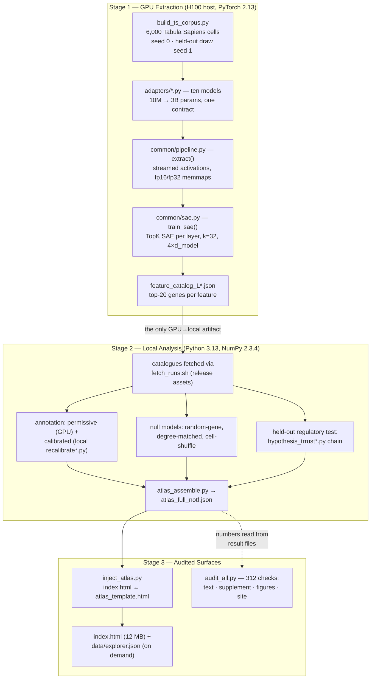

This page maps the architecture of the Comparative SAE Atlas: how ten single-cell foundation models are reduced to a comparable, auditable set of results, and where every component lives. The repository is not an application so much as a **pipeline with a strict phase boundary** — everything that needs a GPU and model weights runs on the extraction host, everything that needs only the published feature catalogues runs locally, and an audit layer closes the loop between the results and the four surfaces that cite them (manuscript, supplement, figures, website). Read this page before the stage-specific deep dives; it establishes the vocabulary and the data flow the rest of the catalog assumes.

Sources: [README.md](README.md#L1-L8), [pipeline/atlas_h100/README.md](pipeline/atlas_h100/README.md#L1-L7)

## The System in One Diagram

The architecture decomposes into three stages separated by one artifact: the **feature catalogue** (`feature_catalog_L<NN>.json`), which is the only thing that crosses the GPU/local boundary. Everything upstream of it requires model weights and activations; everything downstream requires nothing but JSON and NumPy.

The boundary is deliberate and documented: *"Everything that only needs the catalogues runs locally and is in `../scripts/`"* [pipeline/atlas_h100/README.md](pipeline/atlas_h100/README.md#L1-L7). This is the single most important architectural decision in the repository — it means reproducing all published numbers requires no GPU at all.

Sources: [README.md](README.md#L10-L25), [pipeline/atlas_h100/README.md](pipeline/atlas_h100/README.md#L9-L22), [pipeline/atlas_h100/README.md](pipeline/atlas_h100/README.md#L82-L89)

## Stage 1 — GPU Extraction: Contract-First Decoupling

The extraction stage must handle ten models that differ in everything — parameter count (10M to 3B), depth (8 to 33 layers), input representation (raw expression, binned values, rank order, even protein tokens via ESM2), and training objective (MLM, autoregressive, MAE). The architecture solves this with a **single adapter contract**: each model implements `Adapter.iter_activations(adata, batch_size)`, which yields, per batch, a dict `{layer_index: float32 array [n_positions, d_model]}`, the HGNC symbols of those positions, and their cell ids. Only gene-token positions are yielded — CLS, padding and other special tokens are dropped — so everything downstream is model-agnostic [pipeline/atlas_h100/adapters/base.py](pipeline/atlas_h100/adapters/base.py#L1-L40).

> [!TIP]
> The adapter contract also carries a subtler requirement: any adapter that preprocesses or filters cells must expose `self.processed_obs`, so downstream perturbation tests can align per-cell labels to `cell_ids` even when the adapter reorders or drops cells internally. This is why the contract lives in `base.py` rather than in each adapter — it is an interface guarantee, not a convenience.

`run_model.py` is the end-to-end orchestrator for one model: it resolves the adapter from a registry, loads the corpus, and calls `pipeline.extract()` followed by `pipeline.build_catalog()`. Mode flags (`--all-layers`, `--per-cell 168`, `--seed`) control extraction scope and determinism [pipeline/atlas_h100/run_model.py](pipeline/atlas_h100/run_model.py#L14-L86). Inside `extract()`, per-layer activations are **streamed to disk while the model runs** — raw float32 rows are written incrementally, then converted to a memory-mapped `.npy` in float16 when values fit (float32 only when a model's outliers exceed the float16 range, as tGPT's do). This is what lets all layers of a 3B model be extracted without holding tensors in memory [pipeline/atlas_h100/common/pipeline.py](pipeline/atlas_h100/common/pipeline.py#L17-L75).

The SAE that consumes these activations is a fixed, shared configuration — TopK (k=32), dictionary at 4×d_model, MSE loss with no L1 penalty, unit-normalized decoder columns, Adam at 3e-4 for 4 epochs, fully seeded. It deliberately mirrors the bio-sae schema "for join-compatibility with the prior Geneformer/scGPT atlases," which is what lets all ten models be annotated against one vocabulary and compared [pipeline/atlas_h100/common/sae.py](pipeline/atlas_h100/common/sae.py#L1-L25). Per layer, `build_catalog()` trains the SAE, saves its weights as `sae_L<NN>.pt`, and writes the catalogue: the top-20 genes per feature by mean activation, with a stable descending sort and zero-activation genes excluded so no feature list ever contains filler [pipeline/atlas_h100/common/pipeline.py](pipeline/atlas_h100/common/pipeline.py#L83-L127).

Sources: [pipeline/atlas_h100/run_model.py](pipeline/atlas_h100/run_model.py#L14-L86), [pipeline/atlas_h100/common/pipeline.py](pipeline/atlas_h100/common/pipeline.py#L17-L127), [pipeline/atlas_h100/common/sae.py](pipeline/atlas_h100/common/sae.py#L1-L25)

## The Model Registry as Configuration

The ten models are declared declaratively in one YAML file that serves as the registry for both the adapters and the paper's Table S1. Each entry records the adapter module, parameter count, depth, how the model reads a cell, its objective, external priors it carries, and its checkpoint — the "inductive axis" along which the comparison is later analyzed [pipeline/atlas_h100/configs/models.yaml](pipeline/atlas_h100/configs/models.yaml#L1-L9). Depth heterogeneity is handled by `common/layers.py`, which maps each model's layer stack onto five depth-matched read-outs (0 / 25 / 50 / 75 / 100 % of depth), so a 8-layer AIDO.Cell and a 33-layer UCE can be compared at equivalent relative positions [pipeline/atlas_h100/README.md](pipeline/atlas_h100/README.md#L9-L22).

| Model | Params | Layers | Reads a cell as | Objective | Prior |
|---|---|---|---|---|---|
| AIDO.Cell | 10M | 8 | expression, all genes | MLM | none |
| scGPT | ~50M | 12 | binned expression | MLM | none |
| tGPT | ~120M | 8 | rank order | autoregressive | none |
| scFoundation | 100M | 12 | expression, read-depth aware | MAE | none |
| GeneCompass | 104M | 12 | rank order + value | MLM | knowledge graph |
| MaxToki | 217M | 11 | rank order | autoregressive (Llama) | none |
| Geneformer-V2 | 316M | 18 | rank order | MLM | none |
| UCE | 650M | 33 | ESM2 protein tokens | masked | ESM |
| C2S-Scale | 2B | 26 | rank-ordered gene names as text | autoregressive | text (Gemma-2) |
| Tahoe-x1 | 3B | 32 | binned expression | MLM | none |

Sources: [README.md](README.md#L40-L52), [pipeline/atlas_h100/configs/models.yaml](pipeline/atlas_h100/configs/models.yaml#L11-L25)

## Stage 2 — Local Analysis: Results as the Single Source of Truth

The local stage in `pipeline/scripts/` consumes catalogues and external gene-set databases, and produces **59 result files** in `outputs/atlas/comparative/` plus seven figures. Its internal architecture is a directed data flow that `docs/RESULTS.md` documents exhaustively: every file lists its writer and its readers [docs/RESULTS.md](docs/RESULTS.md#L1-L8). Three sub-systems matter at the architecture level:

**Matrices and calibration.** Per-model feature catalogues are re-annotated into concept × model matrices (`reannotate_string.py`, `alllayer_matrix.py`), and `recalibrate*.py` scripts derive the calibrated annotator from grid searches against null models — the calibration analysis lives here precisely because it needs no GPU [docs/RESULTS.md](docs/RESULTS.md#L38-L41).

**Nulls and hypothesis tests.** Every claim is paired with a null: random-gene and degree-matched nulls for the backbone (`random_null.py`, `degree_null.py`), the cell-shuffle null for CKA (`cka_svd_null.py` on the GPU side), and a chain of `hypothesis_*.py` scripts that implement the held-out TRRUST regulatory-prediction test with progressively hardened variants (robustness, size-matching, study-bias strata) [docs/RESULTS.md](docs/RESULTS.md#L31-L37).

**Assembly.** `atlas_assemble.py` merges the component JSONs into `atlas_full_notf.json` — the 356 KB aggregate that the site embeds and the audit reads — and is written to be robust to missing pieces, keeping a block absent rather than crashing [pipeline/scripts/atlas_assemble.py](pipeline/scripts/atlas_assemble.py#L1-L16). The site itself is then rebuilt by `inject_atlas.py` from `atlas_template.html`, so `index.html` is a **build product, never edited by hand** [README.md](README.md#L10-L25).

> [!TIP]
> Note the two-environment split, which is architectural rather than incidental: extraction ran on Python 3.12 / PyTorch 2.13 / NumPy 1.26.4 on an H100, while local analysis runs on Python 3.13 / NumPy 2.3.4 (the major NumPy version differs). The repository states this explicitly so a reproducer knows they need *only* the local `requirements.txt` — the 17 GB of SAE weights and raw activations stay on the GPU host and are never archived.

Sources: [docs/RESULTS.md](docs/RESULTS.md#L1-L60), [pipeline/scripts/atlas_assemble.py](pipeline/scripts/atlas_assemble.py#L1-L16), [pipeline/atlas_h100/README.md](pipeline/atlas_h100/README.md#L82-L89)

## Stage 3 — The Audit Layer: Closing the Loop

The outermost architectural component is `audit_all.py`, which exists because three things can drift apart and each has bitten the project: text vs results, supplement vs results, and figures vs results. It runs six check modules — manuscript core, derived numbers, supplement tables, figures, and the public site — and exits non-zero on any mismatch, with the discipline stated plainly: *"Fix the source of the disagreement, not the check"* [pipeline/scripts/audit_all.py](pipeline/scripts/audit_all.py#L1-L50). Architecturally this makes the result files the **sole authority**: the manuscript, supplement, figures and site are all treated as downstream projections that must be provably consistent with them.

The same philosophy governs data acquisition. The per-run feature catalogues and external inputs (1.2 GB) are published as release assets and fetched with checksummed scripts (`fetch_runs.sh`), so the local stage never depends on the GPU host being reachable [README.md](README.md#L10-L25). A `pipeline/legacy/` directory holds superseded builders kept purely for provenance and "used by nothing" — the active pipeline never imports from it.

Sources: [pipeline/scripts/audit_all.py](pipeline/scripts/audit_all.py#L1-L50), [README.md](README.md#L10-L25)

## How a Correction Propagates

The architecture was stress-tested when three faults in the first extraction release were found — a position cap that let some models see 32 cells and others all 6,000, filler genes in top-gene lists, and an unseeded SAE. Each fault traces to a specific architectural location: the corpus-order position cap in `extract()`'s non-streaming path (fixed by the seeded `--per-cell` mode), the unstable sort in `build_catalog()` (fixed by the stable sort dropping zero-activation genes), and the SAE seed in `train_sae()`. The corrected re-run (`runs-v2`) is the source of every published number, with the change history recorded as decision 16 in `docs/DECISIONS.md` [README.md](README.md#L62-L74). This episode defines the repository's release discipline: catalogues are versioned as release archives, superseded outputs are preserved but isolated, and the audit re-verifies every surface against the new files.

Sources: [README.md](README.md#L62-L74), [pipeline/atlas_h100/README.md](pipeline/atlas_h100/README.md#L68-L80), [pipeline/atlas_h100/common/pipeline.py](pipeline/atlas_h100/common/pipeline.py#L17-L75)

## Reading Progression

This page gave you the map. The catalog's deep dives follow the data flow, and the natural order mirrors the pipeline's own stages:

1. **[Model Adapter Contract](6-model-adapter-contract)** — the `iter_activations` interface and per-model quirks in full detail, the first architectural boundary you encountered above.
2. **[TopK Sparse Autoencoder Training](7-topk-sparse-autoencoder-training)** — inside `common/sae.py`: the TopK mechanism, hyperparameters, and seeding.
3. **[Shared Corpus and Held-Out Draw](8-shared-corpus-and-held-out-draw)** — how `build_ts_corpus.py` constructs the comparison substrate both stages depend on.
4. For the statistics, continue to **[Calibrated versus Permissive Annotation](9-calibrated-versus-permissive-annotation)** and **[Null Models Behind Every Claim](10-null-models-behind-every-claim)**.
5. For the engineering guarantee that results stay trustworthy, see **[Result Files and Data Flow Map](17-result-files-and-data-flow-map)** and **[Audit System and Manuscript Checks](18-audit-system-and-manuscript-checks)**.
6. To see where the pipeline ends, **[Site Assembly from Result Files](22-site-assembly-from-result-files)** covers how `atlas_full_notf.json` becomes the interactive atlas.