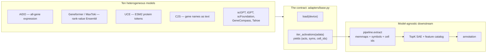
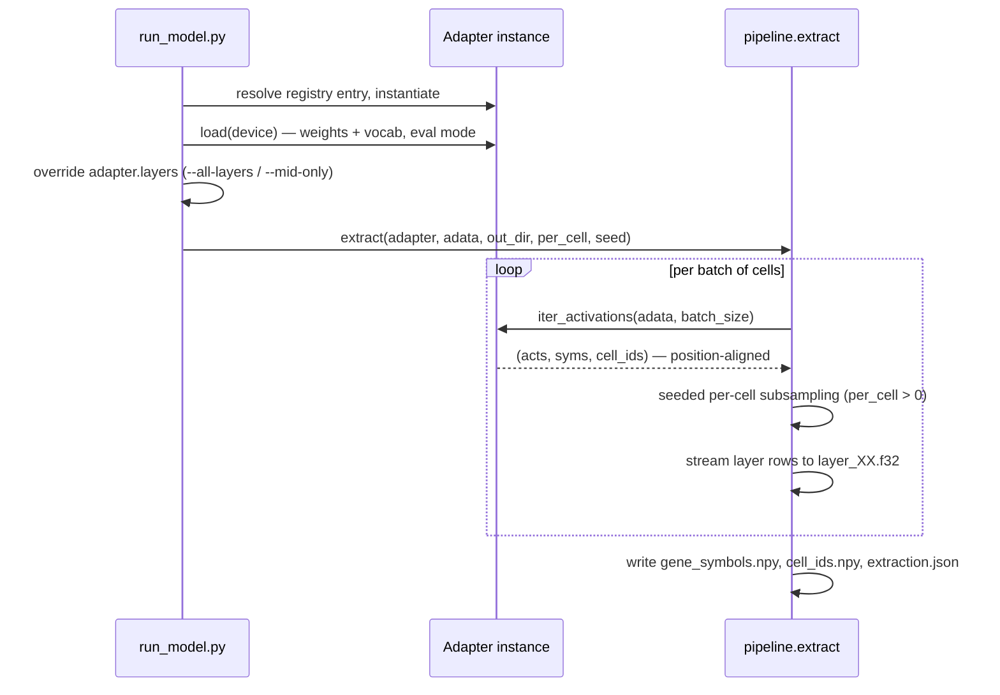
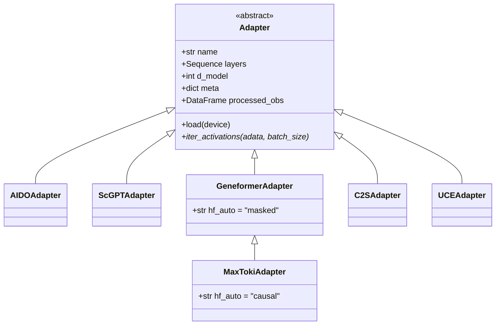

The adapter contract is the single seam that lets ten architecturally unrelated single-cell foundation models flow into one shared analysis pipeline. Every model plugs in by implementing `iter_activations`, which yields per-layer residual-stream activation rows plus the HGNC gene symbol and a global cell index for every row; everything downstream — SAE training, feature catalogs, annotation — is model-agnostic and consumes only that tuple. This page documents the contract surface, the yield protocol, the layer-selection rules, and how ten very different token universes are normalized onto it.

Sources: [base.py](pipeline/atlas_h100/adapters/base.py#L1-L7), [pipeline.py](pipeline/atlas_h100/common/pipeline.py#L1-L4), [run_model.py](pipeline/atlas_h100/run_model.py#L2-L4)

## Why the Contract Exists

The atlas compares models spanning 10M–3B parameters, 8–33 layers, and five different ways of reading a cell (rank order, rank plus value, expression value, ESM2 protein tokens, gene names as text). Any claim of *equal treatment* across such heterogeneity requires that the comparison never depend on model internals — hence a deliberately narrow interface: forward hooks on each transformer block's post-residual output, unfolded to one row per (cell, gene) token position, mirroring the bio-sae "Phase 0" extraction design this pipeline was derived from. The runner (`run_model.py`) resolves a model name to an adapter module via a registry, instantiates it, loads weights, and hands the object to the model-agnostic `pipeline.extract`/`build_catalog` pair.

Sources: [METHODS.md](docs/METHODS.md#L12-L18), [base.py](pipeline/atlas_h100/adapters/base.py#L6-L7), [models.yaml](pipeline/atlas_h100/configs/models.yaml#L1-L5), [run_model.py](pipeline/atlas_h100/run_model.py#L50-L56)

## The Contract Surface: `adapters.base.Adapter`

`Adapter` is a small abstract class whose members divide into three kinds: identity metadata consumed by downstream catalogs, configuration written by `load()`, and the one mandatory generator. The base implementations raise `NotImplementedError`, so the contract is *structural by convention* — only the yield tuple is ever checked at runtime by the consumer.

| Member | Kind | Obligation |
|---|---|---|
| `name: str` | class attribute | Display/catalog identity; becomes the `"model"` field in every `feature_catalog_L*.json` |
| `layers: Sequence[int]` | class attribute | Residual layer indices to extract; `0` = input embedding; set at load time from depth |
| `d_model: int` | class attribute | Activation row width; sizes the downstream SAE dictionary |
| `n_layers` | instance attribute (convention) | Total block count, consulted by `--all-layers` / `--mid-only` overrides |
| `load(device)` | method | Load weights + vocab in eval mode onto the device |
| `iter_activations(adata, batch_size)` | generator | The yield protocol (next section) |
| `processed_obs` | attribute, default `None` | Required for perturbation tests when the adapter preprocesses/filters cells |
| `meta: dict` | class attribute | Free-form provenance slot |

Sources: [base.py](pipeline/atlas_h100/adapters/base.py#L14-L39), [pipeline.py](pipeline/atlas_h100/common/pipeline.py#L91-L127)

## The Yield Protocol

`iter_activations` is a generator walked once by `pipeline.extract`. Per batch of cells it yields a three-element tuple whose columns are *position-aligned*: element *i* of `syms` and `cell_ids` describes the same row as row *i* of every array in `acts`.

| Element | Shape | Semantics |
|---|---|---|
| `acts` | `{layer: float32 [n_positions, d_model]}` | Post-residual hidden states, one row per gene-token position |
| `syms` | `str [n_positions]` | Uppercase HGNC symbol per position — the join key to annotation vocabularies |
| `cell_ids` | `int [n_positions]` | Global 0-based cell index in processing order |

Two invariants do the heavy lifting. First, `n_positions` is the sum of each cell's *gene-token* count — CLS, pad, depth, and other special tokens must be dropped, so a batch yields only interpretable (cell, gene) pairs. Second, `cell_ids` are global across the whole corpus pass, which is what enables downstream per-cell operations such as split-half controls and the seeded per-cell subsampling described below.

> [!TIP]
> The consumer unpacks the tuple defensively as `acts, syms, *rest` and treats a missing `cell_ids` as `None` — tolerated only in the legacy corpus-order mode (`per_cell=0`). In per-cell stream mode the missing third element is the contract's single runtime-enforced clause: extraction aborts with `ValueError: "<adapter name>: per-cell sampling needs per-position cell ids"`. When writing an adapter, always yield all three elements.

Sources: [base.py](pipeline/atlas_h100/adapters/base.py#L23-L36), [pipeline.py](pipeline/atlas_h100/common/pipeline.py#L11-L12), [pipeline.py](pipeline/atlas_h100/common/pipeline.py#L32-L57)

## Layer Selection: `layers`, `n_layers`, and Depth Matching

Each adapter sets `self.layers` inside `load()` from its configured block count via `depth_matched(n_layers)` — the agreed spec of relative depths 0 / 25 / 50 / 75 / 100 %, rounded, deduplicated (small models can collapse picks), and sorted. This removes the layer confound: a 6-layer model and a 26-layer model are read at the same *relative* depths, and UCE's 33 blocks map to `(0, 8, 16, 24, 32)`. The runner can override this at dispatch time: `--all-layers` replaces `layers` with `range(n_layers)` for the full depth profile, and `--mid-only` reduces it to the middle block — the layer the cross-model statistics are read at. The `layers` count recorded in `configs/models.yaml` is exactly what `--all-layers` extracted.

A per-model subtlety the contract absorbs: hidden-state tuple indexing differs by framework convention. AIDO indexes `hidden_states[L]` directly (embedding layer included in the tuple, then slicing off non-gene prefix positions), while the Geneformer family indexes `hidden_states[Ly + 1]` because `hidden_states[0]` is the embedding output. Downstream never sees these corrections.

Sources: [layers.py](pipeline/atlas_h100/common/layers.py#L1-L14), [run_model.py](pipeline/atlas_h100/run_model.py#L58-L65), [models.yaml](pipeline/atlas_h100/configs/models.yaml#L3-L5), [aido.py](pipeline/atlas_h100/adapters/aido.py#L49-L52), [geneformer.py](pipeline/atlas_h100/adapters/geneformer.py#L104-L109)

## The `processed_obs` Clause

Some adapters cannot pass cells through untouched: AIDO re-aligns the AnnData object against its gene ordering, others filter to in-vocab genes or subsample. Any adapter that changes which cells are processed — or their order — **must** set `self.processed_obs` to a pandas DataFrame of the cells actually processed, in yield order, so callers can recover per-cell labels aligned to `cell_ids`. This exists specifically for the CRISPRi perturbation test, which joins responses back to cell metadata; a silently misaligned join would invalidate responsiveness statistics. The pattern is uniform: AIDO assigns it from the re-aligned object's `.obs` before the batch loop, scGPT and Geneformer assign it from `adata.obs` at the top of `iter_activations`.

Sources: [base.py](pipeline/atlas_h100/adapters/base.py#L32-L38), [aido.py](pipeline/atlas_h100/adapters/aido.py#L33-L37), [scgpt.py](pipeline/atlas_h100/adapters/scgpt.py#L157-L160), [c2s.py](pipeline/atlas_h100/adapters/c2s.py#L48-L51)

## One Contract, Ten Token Universes

The registry in `run_model.py` maps model names to adapter modules; it is a superset of the canonical ten recorded in `configs/models.yaml` (entries such as scPRINT, scBERT, and a CellPLM stub exist as recipes, not atlas members). What the ten extracted models share is the contract; what differs is the definition of "one position" — and each adapter owns that translation.

| Model | d_model | Layers | Reads a cell as | Position definition (code-verified) |
|---|---|---|---|---|
| AIDO | 256 | 8 | expression, all 19,264 genes | Every HGNC gene, fixed order from `aido_genes.tsv`, `syms = np.tile(genes, batch)` |
| scGPT | 512 | 12 | binned expression | Nonzero, in-vocab genes sorted by expression, capped at `max_seq_len` 1200 |
| tGPT | 1024 | 8 | rank order | rank-order tokens |
| scFoundation | 768 | 12 | expression (read-depth aware) | — |
| GeneCompass | 768 | 12 | rank order + value | — |
| MaxToki | 1232 | 11 | rank order (corpus-scaled) | Inherits Geneformer's rank-value tokenization wholesale |
| Geneformer | 1152 | 18 | rank order | Genes with token + positive corpus median; rank key `count / gene-median`; top `max_len` 2048; empty-symbol rows filtered from the yield |
| UCE | 1280 | 33 | ESM2 protein tokens | Gene = token index inverted through the species protein-embedding order + offsets; special/chrom/CLS skipped |
| C2S | 2304 | 26 | rank-ordered gene names as text | Gene = **last subword** position of its BPE span, recovered via tokenizer offset mapping |
| Tahoe | 2560 | 32 | binned expression | — |

Geneformer's rank-value design illustrates why per-adapter care matters: it normalizes each count by the gene's corpus median, but since total-count scaling is a per-cell constant, only `count / gene_median` affects the token *order* — so the adapter reproduces ranking without replicating the full normalization. C2S is the extreme case: a Gemma-2 decoder-only LM where the "gene token" doesn't exist at all, so the adapter fabricates gene-anchored positions by attributing each gene's residual to the last subword it attended through.

The class diagram also shows the codebase's one inheritance shortcut: `MaxTokiAdapter` subclasses `GeneformerAdapter` and flips a single class attribute (`hf_auto = "causal"`, selecting `AutoModelForCausalLM` over `AutoModelForMaskedLM`) because both theodoris-lab models share the same rank-value Ensembl vocabulary — including defaulting `token_dict_dir` back to the Geneformer-V2 checkpoint.

Sources: [run_model.py](pipeline/atlas_h100/run_model.py#L14-L28), [models.yaml](pipeline/atlas_h100/configs/models.yaml#L14-L24), [aido.py](pipeline/atlas_h100/adapters/aido.py#L29-L31), [aido.py](pipeline/atlas_h100/adapters/aido.py#L51-L55), [scgpt.py](pipeline/atlas_h100/adapters/scgpt.py#L133-L155), [geneformer.py](pipeline/atlas_h100/adapters/geneformer.py#L6-L8), [geneformer.py](pipeline/atlas_h100/adapters/geneformer.py#L82-L95), [geneformer.py](pipeline/atlas_h100/adapters/geneformer.py#L112-L114), [maxtoki.py](pipeline/atlas_h100/adapters/maxtoki.py#L13-L24), [c2s.py](pipeline/atlas_h100/adapters/c2s.py#L1-L5), [c2s.py](pipeline/atlas_h100/adapters/c2s.py#L37-L74), [uce.py](pipeline/atlas_h100/adapters/uce.py#L1-L7)

## Dependency Isolation Inside Adapters

Because each adapter wraps an upstream codebase on a shared H100 host, most of their engineering effort goes into making imports and hook points *reliable* rather than reimplementing model logic — the scGPT and UCE docstrings both state the policy explicitly: wrap the upstream model and tokenization, do not reimplement. Five recurring patterns:

| Pattern | Where | Purpose |
|---|---|---|
| Module stubbing | scGPT `_stub_optional_deps` | Injects inert `sys.modules` entries for `datasets`, `wandb`, `seaborn`, `networkx`, `torch_geometric` so `scgpt.__init__` imports without pulling conflicting transitive versions; `_stub_attr` keeps dunders missing so `inspect`/torch module walks don't trip |
| Vendored shim | `adapters/_shims/torchtext/vocab.py` | A minimal `Vocab` implementing exactly the API scGPT's `GeneVocab` calls, swapped in when torchtext's C++ extension is incompatible with the host's torch |
| Standard-encoder forcing | scGPT `use_fast_transformer=False` | Loads flash-trained weights into a standard `nn.TransformerEncoder` (upstream remaps `Wqkv.` → `in_proj_`), making `.layers[L]` hookable without flash-attn |
| NestedTensor disabling | scGPT `enable_nested_tensor = False` | Stops eval-mode + padding-mask from converting layer I/O to NestedTensor, which breaks per-layer hooks |
| Content-addressed cache | UCE work dir keyed on `sha1(obs_names + var_names)` | Prevents UCE's `AnndataProcessor` from silently reusing a previous corpus's preprocessing when its output files already exist |

> [!TIP]
> The hookability traps are the subtlest part of the contract: both the flash-attention fast path and TransformerEncoder's NestedTensor optimization hide per-layer I/O from `register_forward_hook`. Any new adapter whose upstream uses such fast paths must force the standard implementation before hooks will fire — this is why scGPT's adapter is loaded with `use_fast_transformer=False` even though the checkpoint was trained with flash attention.

Sources: [scgpt.py](pipeline/atlas_h100/adapters/scgpt.py#L1-L9), [scgpt.py](pipeline/atlas_h100/adapters/scgpt.py#L29-L34), [scgpt.py](pipeline/atlas_h100/adapters/scgpt.py#L58-L72), [scgpt.py](pipeline/atlas_h100/adapters/scgpt.py#L79-L85), [scgpt.py](pipeline/atlas_h100/adapters/scgpt.py#L115-L127), [vocab.py](pipeline/atlas_h100/adapters/_shims/torchtext/vocab.py#L1-L2), [uce.py](pipeline/atlas_h100/adapters/uce.py#L77-L90)

## The Consumer Side and Output Artifacts

`pipeline.extract` is the contract's only consumer, and it responds to the tuple in one of two modes. In legacy corpus-order mode (`per_cell=0`) it buffers rows until `max_positions` is reached — a mode kept for reproducing published runs, with the documented caveat that because models emit very different token counts per cell, it caps cells unequally (AIDO contributes 32 cells, tGPT all 6,000). In per-cell stream mode (`per_cell>0`) every corpus cell is read and at most `per_cell` of its positions are kept, drawn uniformly without replacement under the run seed — equal cell weighting across models — while rows stream straight to disk so all layers of a 3B model fit in memory. Per layer it then finalizes `layer_XX_activations.npy` memmaps (float16 when `|max_abs| < 65,000`, else float32; tGPT has outliers above 150,000) plus `gene_symbols.npy`, `cell_ids.npy`, and an `extraction.json` provenance record (positions, cells, per_cell, seed, per-layer dtype and max-abs, layer list). Those files, not the adapter objects, are what the rest of the repository consumes.

Sources: [pipeline.py](pipeline/atlas_h100/common/pipeline.py#L15-L31), [pipeline.py](pipeline/atlas_h100/common/pipeline.py#L62-L88), [pipeline.py](pipeline/atlas_h100/common/pipeline.py#L75-L86)

## Adding or Verifying an Adapter

The codebase carries an explicit verification protocol. `aido.py` is annotated "VERIFIED forward path (used in our audit)"; several registry entries carry "(VERIFY on H100)" comments with expected-tweak notes, and each written-from-repo adapter ends its docstring with a concrete checklist of what to confirm on the GPU host (vocab APIs, preprocessing details, prompt prefixes). `models.yaml` adds that how each model reads a cell and what prior it carries was verified against the model papers and configs (decision log item 11), mirroring supplement Table S1.

| Step | Requirement | Where enforced |
|---|---|---|
| 1. Subclass `Adapter`; set `name`, `d_model` | Catalog identity; SAE width | [base.py](pipeline/atlas_h100/adapters/base.py#L15-L17) |
| 2. `load(device)`: weights + vocab, eval mode; set `n_layers` and `layers` | Depth-matched default via `depth_matched` | [aido.py](pipeline/atlas_h100/adapters/aido.py#L19-L31) |
| 3. Yield the 3-tuple, position-aligned | `ValueError` in stream mode if `cell_ids` missing | [pipeline.py](pipeline/atlas_h100/common/pipeline.py#L34-L36) |
| 4. Emit gene-token positions only | Drop CLS/pad/depth/special tokens | [base.py](pipeline/atlas_h100/adapters/base.py#L30) |
| 5. Uppercase HGNC symbols per row | Join key for annotation | [base.py](pipeline/atlas_h100/adapters/base.py#L27) |
| 6. Set `processed_obs` if filtering/preprocessing | Perturbation-test label alignment | [base.py](pipeline/atlas_h100/adapters/base.py#L32-L38) |
| 7. Smoke test: `--model X --smoke` (32 cells) | End-to-end sanity before full extraction | [run_model.py](pipeline/atlas_h100/run_model.py#L39) |
| 8. Record verification state in the docstring | "VERIFIED" vs "VERIFY on H100" convention | [aido.py](pipeline/atlas_h100/adapters/aido.py#L1-L3), [scgpt.py](pipeline/atlas_h100/adapters/scgpt.py#L17-L21) |

Sources: [run_model.py](pipeline/atlas_h100/run_model.py#L14-L28), [geneformer.py](pipeline/atlas_h100/adapters/geneformer.py#L10-L16), [c2s.py](pipeline/atlas_h100/adapters/c2s.py#L10-L12), [uce.py](pipeline/atlas_h100/adapters/uce.py#L14-L17), [models.yaml](pipeline/atlas_h100/configs/models.yaml#L7-L9)

## Where to Go Next

The adapter contract ends where the SAE begins: the memmaps, `gene_symbols.npy`, and `cell_ids.npy` produced here are the training inputs for a TopK dictionary per layer, covered in [TopK Sparse Autoencoder Training](7-topk-sparse-autoencoder-training). The corpus every adapter reads — and the seed-1 held-out draw — is specified in [Shared Corpus and Held-Out Draw](8-shared-corpus-and-held-out-draw). The per-cell sampling mode and its migration from the original corpus-order cap are documented in [Extraction Faults and Corrected Re-Run](21-extraction-faults-and-corrected-re-run), and the whole stage sits within the stage map in [Architecture Overview](5-architecture-overview). For how the ten models' capabilities compare once extracted, start at [Ten Foundation Models Compared](3-ten-foundation-models-compared).