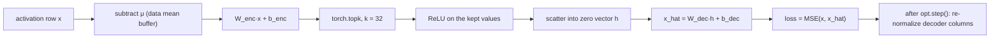

This page explains the dictionary-learning core of the GPU extraction stage: how the pipeline turns raw transformer activations into interpretable gene-level features. It covers the TopK SAE architecture, the training loop and its seeding contract, the exact outputs produced per layer, the health controls that qualify those outputs, and how to reproduce the published runs. The SAE implementation lives in one small, model-agnostic file that every one of the ten models passes through.

## Role in the Extraction Stage

The extraction pipeline is a fixed chain: adapter → per-layer activations → one TopK SAE per layer → feature catalogue → annotation. Because every model is followed by the identical dictionary learner, a "feature" means the same thing across all ten models — an active direction in a k = 32-sparse dictionary over that layer's residual stream — and every downstream comparison joins on the same vocabulary. Across the atlas this means 172 trained dictionaries (8 to 33 layers per model, 172 in all). The configuration is deliberately inherited, not invented: it matches the bio-sae contract used by the earlier Geneformer/scGPT atlases (a Gao et al. 2024 TopK variant), so new features are join-compatible with prior results. It was not swept; only seed variance was measured (see [Seeds, Health, and Known Weaknesses](#seeds-health-and-known-weaknesses)).

Sources: [run_model.py](pipeline/atlas_h100/run_model.py#L1-L9), [README.md](pipeline/atlas_h100/README.md#L9-L22), [DECISIONS.md](docs/DECISIONS.md#L21-L59)

## Dictionary Architecture: TopKSAE

`TopKSAE` is a two-layer autoencoder with a hard sparsity gate. The forward contract, stated in the module docstring and mirrored exactly in code: **encode** `h = TopK_k(W_enc(x − μ) + b_enc)` with ReLU applied to the kept top-k values scattered back into a zero vector; **decode** `x̂ = W_dec·h + b_dec`; **loss** is plain MSE — there is no L1 term, because TopK *enforces* sparsity structurally. Initialization is deterministic: Kaiming-uniform for the encoder weight, zeros for both biases, and decoder columns pre-normalized to unit length along the dictionary dimension at construction time. A `μ` buffer holds the per-dimension input mean (filled from data before training) so the model learns a centered representation without a normalization layer.

The diagram shows one activation row flowing through encode, the reconstruction, and the post-step decoder re-normalization:



Sources: [sae.py](pipeline/atlas_h100/common/sae.py#L1-L10), [sae.py](pipeline/atlas_h100/common/sae.py#L35-L65)

## The Training Loop

`train_sae(X, cfg)` receives the full activation matrix for one layer (`[n_positions, d_model]`) and trains a fresh dictionary. The procedure is: set `μ` from `X.mean(0)`; subsample without replacement down to `train_positions` (1M — the full ~1M-row layer pools fit, so nothing is dropped in practice); then run 4 epochs of Adam over shuffled mini-batches of 4,096 rows, minimizing MSE, calling `unit_norm_decoder()` after *every* optimizer step. The seeding contract is dual: NumPy's `default_rng(seed)` governs the position subsample, and `torch.manual_seed(seed)` governs weight init and the per-epoch shuffles. Because the layer arrays are memmaps, `np.asarray(A)` materializes one layer at a time — memory scales with a single layer, not the whole model.

| Hyperparameter | Default | Meaning | Set where |
|---|---|---|---|
| `k` | 32 | active features per position | `SAECfg`, models.yaml `sae` |
| `expansion` | 4 | dictionary width multiplier (`d_sae = 4 × d_model`) | `SAECfg`, models.yaml |
| `lr` | 3e-4 | Adam learning rate | `SAECfg`, models.yaml |
| `epochs` | 4 | passes over the ~1M-position pool | `SAECfg`, models.yaml |
| `batch` | 4096 | mini-batch rows | `SAECfg` |
| `train_positions` | 1,000,000 | subsample cap per layer | `SAECfg` |
| `seed` | 0 | NumPy rng **and** torch | `run_model.py --seed` → both extractors and SAE |

Sources: [sae.py](pipeline/atlas_h100/common/sae.py#L68-L89), [pipeline.py](pipeline/atlas_h100/common/pipeline.py#L97-L104), [models.yaml](pipeline/atlas_h100/configs/models.yaml#L11-L12)

## Held-Out Evaluation Statistics

After training, the loop evaluates on a 100,000-row held-out split drawn from the same layer's pool and records five numbers that travel with the checkpoint: `fvu` (fraction of variance unexplained, i.e., residual variance over input variance), `var_explained` (1 − fvu), `dead_frac` (share of features that never fire on the split), `alive` (firing feature count), and `mean_abs_decoder_cos` (mean absolute off-diagonal cosine of the normalized decoder — a dictionary-overlap diagnostic). These land in the catalogue JSON, in `sae_L{L}.pt`, and in the log line. The standalone `sae_health.py` then aggregates `dead_frac` across *every* layer of every model against a 10% threshold — an all-layer quality control written specifically because the manuscript consumed all-layer features — flagging per model the mid/mean/max dead fractions and listing "clean" models with zero dead features anywhere.

| Statistic | Computation | Interpretation |
|---|---|---|
| `fvu` / `var_explained` | residual / input variance | reconstruction quality, comparable across models |
| `dead_frac` | `(freq == 0).mean()` on held-out activations | dictionary waste; tGPT is the known outlier (21.3% mean, 58.6% worst) |
| `alive` | features with frequency > 0 | effective dictionary size |
| `mean_abs_decoder_cos` | off-diagonal \|cos\| of unit decoder columns | near-duplicate direction pressure |

Sources: [sae.py](pipeline/atlas_h100/common/sae.py#L91-L107), [pipeline.py](pipeline/atlas_h100/common/pipeline.py#L125-L126), [sae_health.py](pipeline/scripts/sae_health.py#L1-L9), [sae_health.py](pipeline/scripts/sae_health.py#L23-L44), [DECISIONS.md](docs/DECISIONS.md#L50-L59)

## From Weights to Feature Catalogue

`build_catalog()` runs the whole per-layer loop. For each layer it trains the SAE, saves `sae_L{L:02d}.pt` (state dict, config dict, stats), then encodes the *entire* layer pool with `feature_activations` (batched at 65,536 rows, float32 out). Feature semantics come from averaging: activation rows are accumulated into a per-gene mean matrix `G` (genes as rows, features as columns), and each feature's genes are ranked by that mean with a *stable* descending sort — genes with zero mean activation are dropped rather than padded in, so a feature firing on fewer than 20 genes simply gets a shorter list. The catalogue JSON records `model`, `layer`, `d_model`, `d_sae`, `k`, `n_alive`, `n_genes`, the five health stats, and the top-20 gene lists with `max_activation` and `activation_frequency` per feature.

| Artifact | Contents | Consumer |
|---|---|---|
| `layer_{L:02d}_activations.npy` | memmap, float16 (or float32 if \|a\| ≥ 65,000, e.g. tGPT) | SAE training, GPU-side analyses |
| `gene_symbols.npy` / `cell_ids.npy` | HGNC symbol per position; per-position cell id | gene ranking; cell-level splits |
| `extraction.json` | positions, cells, per_cell, seed, per-layer dtype, max_abs | provenance audit |
| `sae_L{L:02d}.pt` | weights + config + training stats (~17 GB total; stays on the GPU host, not archived) | re-training controls, explorer |
| `feature_catalog_L{L:02d}.json` | top-20 genes/feature + health stats | all local analysis, `sae_health.py`, the site |

Sources: [pipeline.py](pipeline/atlas_h100/common/pipeline.py#L91-L127), [pipeline.py](pipeline/atlas_h100/common/pipeline.py#L59-L88), [README.md](pipeline/atlas_h100/README.md#L60-L74)

## The Training Set: ≤168 Positions per Cell

What the SAE *eats* matters as much as how it trains. The corrected contract (`--per-cell 168`, seed 0) reads every one of the 6,000 corpus cells and keeps at most 168 gene-token positions per cell, drawn uniformly without replacement by the seeded rng — roughly 1M positions per layer, the dictionary's training budget. Every model therefore trains on the same cells with equal cell weighting, regardless of how many gene tokens each model reads per cell. Rows are streamed to disk while the model runs (one raw `.f32` per layer), then compacted to float16 when the observed range allows, which is how all 33 layers of a 3B model fit on one host. The superseded v1 behavior — a corpus-order cap at `max_positions` with no per-cell control — gave AIDO.Cell only 32 cells and tGPT all 6,000, so v1 compared dictionaries trained on different data.

| Aspect | v1 (superseded) | v2 (`runs-v2`, published) |
|---|---|---|
| Training-set composition | first 500,000 positions in corpus order; 32–6,000 cells depending on model | ≤168 positions × all 6,000 cells (~1M/layer), equal weight |
| Top-gene ordering | non-stable sort padded short lists with zero-activation genes | stable sort, zero-mean genes dropped |
| SAE seeding | NumPy seeded; **torch unseeded** (init + shuffles nondeterministic) | both NumPy and torch seeded |

> [!TIP]
> The v1 run seeded NumPy but not torch, so weight initialization and per-epoch shuffling varied between identical invocations; the seed-variance control escaped this only because its scripts seeded torch themselves. Any reproduction older than `runs-v2` must be retrained, not re-used — the full fault list is in [Extraction Faults and Corrected Re-Run](21-extraction-faults-and-corrected-re-run).

Sources: [pipeline.py](pipeline/atlas_h100/common/pipeline.py#L11-L58), [README.md](pipeline/atlas_h100/README.md#L60-L74), [run_full_fixed.sh](pipeline/atlas_h100/run_full_fixed.sh#L1-L24), [DECISIONS.md](docs/DECISIONS.md#L264-L289)

## Per-Model Dictionary Sizes

The dictionary width is derived, not tuned: `d_sae = expansion × d_model = 4 × d_model`, so dictionaries scale with each architecture while `k`, learning rate, epochs, and seed stay fixed. The layers column is the number of SAEs trained per model in all-layers mode; the atlas total is 172.

| Model | d_model | Layers | d_sae |
|---|---|---|---|
| AIDO | 256 | 8 | 1,024 |
| scGPT | 512 | 12 | 2,048 |
| scFoundation | 768 | 12 | 3,072 |
| GeneCompass | 768 | 12 | 3,072 |
| tGPT | 1,024 | 8 | 4,096 |
| Geneformer-V2 | 1,152 | 18 | 4,608 |
| MaxToki | 1,232 | 11 | 4,928 |
| UCE | 1,280 | 33 | 5,120 |
| C2S-Scale | 2,304 | 26 | 9,216 |
| Tahoe-x1 | 2,560 | 32 | 10,240 |

Sources: [models.yaml](pipeline/atlas_h100/configs/models.yaml#L14-L24), [sae.py](pipeline/atlas_h100/common/sae.py#L30-L32), [DECISIONS.md](docs/DECISIONS.md#L21-L34)

## Seeds, Health, and Known Weaknesses

Seed 0 is the contract everywhere: the same `--seed` value drives position sampling, corpus construction, and SAE training, so a catalogue's provenance is a single integer. Because the atlas rests on one stochastic dictionary per model-layer, `seed_variance.py` re-quantifies that risk: it reloads *saved activations* (no re-extraction), retrains the mid-layer SAE under seeds 0–2, rebuilds the top-5 catalogue, annotates, and records per-(model, seed) `n_alive`, annotation rate, and concept sets — checkpointing and resuming per pair because the shared pod OOM-cycles. The measured answer: the permissive mid-layer core varies by 12% (435–580 concepts) across seeds, the all-layer core by 4%. Two known costs are documented rather than hidden: with more dictionary slots than distinct signals, surplus features fill with near-copies of the strongest signal (every model except Geneformer-V2 and GeneCompass shows such a block), and tGPT's high dead fraction confounds tGPT-specific results. One standing rule follows from per-layer training: feature counts are never summed across layers, because each layer owns an independent dictionary space.

Sources: [seed_variance.py](pipeline/atlas_h100/seed_variance.py#L1-L12), [seed_variance.py](pipeline/atlas_h100/seed_variance.py#L91-L99), [run_model.py](pipeline/atlas_h100/run_model.py#L43-L47), [DECISIONS.md](docs/DECISIONS.md#L46-L59), [METHODS.md](docs/METHODS.md#L21-L30)

## Running It Yourself

The published catalogues come from release `runs-v2`, produced on the pod by the scripted sequence: build both corpora, then `run_full_fixed.sh` (all ten models, `--all-layers --per-cell 168 --seed 0`), then the held-out and seed sweeps, then downstream analyses. For a single model the entry point is `run_model.py`; `--smoke` runs 32 cells end-to-end in minutes, `--skip-annotate` omits the permissive annotation pass (as the fixed runs do — calibration happens locally), and `--mid-only` trains just the depth-matched middle dictionary.

```bash
# end-to-end, one model, every layer (the published configuration)
python run_model.py --model AIDO --corpus data/corpus.h5ad \
    --all-layers --per-cell 168 --seed 0 --out out_fixed --skip-annotate

# 32-cell sanity check
python run_model.py --model AIDO --smoke
```

Operational notes worth knowing before you start: the driver script is resumable (a model with a `DONE` marker is skipped; failures leave a per-model log), Tahoe-x1 must run in its own venv (torch 2.6.0, flash-attn 2.7.4) while the other nine share the main one, and the extraction environment is Python 3.12 / PyTorch 2.13 (CUDA 13) / NumPy 1.26.4 on an H100 — downstream local analysis needs only `requirements.txt`. One disambiguation: `pipeline/scripts/aido_sae.py` also trains a TopK SAE, but through a different stack (`mechaudit`, d_sae 2048, k 32, 40 epochs, TRRUST-gene residual) as a one-off audit of AIDO's layer 4 — it is not part of the atlas pipeline and its hyperparameters should not be confused with `common/sae.py`.

| Ops concern | Handling |
|---|---|
| Interrupted multi-model run | `DONE` markers; rerun `run_full_fixed.sh`, completed models skipped |
| CUDA dependency split | main venv for nine models; `ATLAS_TAHOE_VENV` for Tahoe-x1 |
| OOM on seed re-training | `seed_variance.py` checkpoints per (model, seed) and resumes |
| Missing weights in repo | `sae_*.pt` (~17 GB) and activations stay on the GPU host; catalogues ship in release archives |

Sources: [run_model.py](pipeline/atlas_h100/run_model.py#L31-L49), [run_full_fixed.sh](pipeline/atlas_h100/run_full_fixed.sh#L6-L24), [README.md](pipeline/atlas_h100/README.md#L46-L89), [aido_sae.py](pipeline/scripts/aido_sae.py#L1-L10), [aido_sae.py](pipeline/scripts/aido_sae.py#L81-L84)

## Where to Go Next

Read the stage in order: the adapter contract that feeds this SAE is [Model Adapter Contract](6-model-adapter-contract); the corpus that defines the training set is [Shared Corpus and Held-Out Draw](8-shared-corpus-and-held-out-draw). To see what the catalogues feed, continue to [Calibrated versus Permissive Annotation](9-calibrated-versus-permissive-annotation) and the robustness controls in [Reviewer Robustness Analyses](16-reviewer-robustness-analyses); the v1 faults summarized above are fully documented in [Extraction Faults and Corrected Re-Run](21-extraction-faults-and-corrected-re-run), and the per-feature maps built from these dictionaries appear in [Layer Explorer Feature Maps](23-layer-explorer-feature-maps).