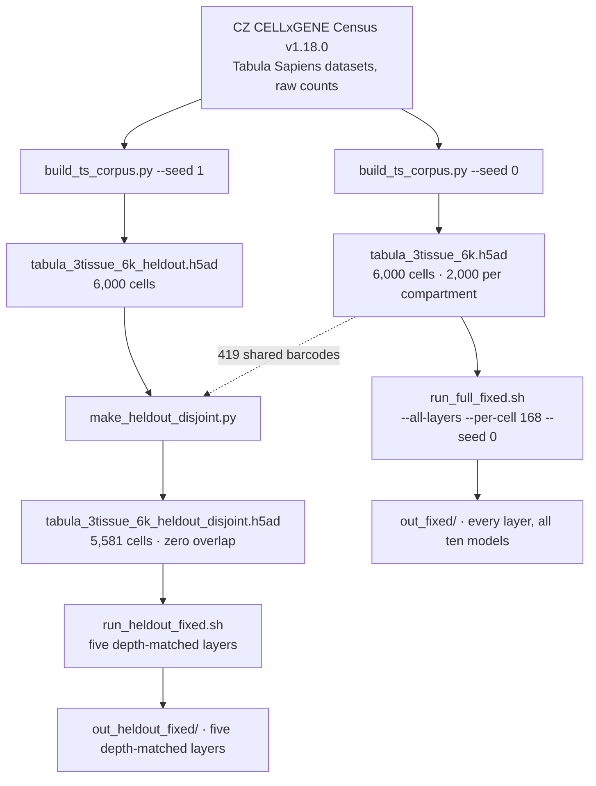

This page documents the data substrate of the GPU extraction stage: the single 6,000-cell Tabula Sapiens corpus that all ten foundation models read, how it is drawn from CZ CELLxGENE Census with a fixed seed, and the independently-drawn held-out corpus that shares zero cells with it. It sits between the adapter contract ([Model Adapter Contract](6-model-adapter-contract)) and the SAE trainer ([TopK Sparse Autoencoder Training](7-topk-sparse-autoencoder-training)): everything downstream — annotation calibration, null models, cross-model geometry — consumes exactly these two cell sets, so their construction is where comparability is won or lost.

## Why a Single Corpus Exists

The design decision is stated bluntly in the decision log: the earlier single-model atlases were built on different corpora (Geneformer on K562, scGPT on Tabula Sapiens), so any difference between them could have been the data rather than the model. With one corpus, a difference between two models is a difference between the models. The cost is equally explicit — cross-species models (UCE, GeneCompass, C2S-Scale) are read on human cells only, and the atlas says nothing about other tissues or platforms.

Sources: [DECISIONS.md](docs/DECISIONS.md#L6-L20), [METHODS.md](docs/METHODS.md#L6-L11)

The corpus is deliberately small and structured: 6,000 Tabula Sapiens cells, 2,000 each from immune, kidney and lung, raw counts, drawn from cellxgene-census v1.18.0 with seed 0. A second draw with seed 1 under the identical protocol is the held-out corpus. This is a controlled experiment substrate, not a pretraining corpus — every downstream statistical test (nulls, permutation counts, calibrated thresholds) assumes this scale.

Sources: [METHODS.md](docs/METHODS.md#L6-L11), [DECISIONS.md](docs/DECISIONS.md#L9-L20)

## Corpus Construction from CELLxGENE Census

`build_ts_corpus.py` pulls only the needed cells from the Census rather than downloading full Tabula Sapiens releases: it queries `census_info["datasets"]` for every dataset whose `collection_name` contains "Tabula Sapiens", asserts the list is non-empty, and embeds those dataset IDs into the obs value filter of every pull. The filter additionally requires `is_primary_data == True` and requests raw counts (`X_name="raw"`), with both `cell_type`/`tissue`/`tissue_general`/`assay` on the obs axis and `feature_id`/`feature_name` on the var axis.

Sources: [build_ts_corpus.py](pipeline/atlas_h100/build_ts_corpus.py#L37-L61)

Three compartments are drawn, two by tissue and one by lineage:

| Compartment | Census filter | Published size |
|---|---|---|
| kidney | `tissue_general == 'kidney'`, primary data, Tabula Sapiens datasets only | 2,000 cells |
| lung | `tissue_general == 'lung'` | 2,000 cells |
| immune | `cell_type` in an explicit 18-entry immune-lineage list (T cells, B cells, plasma, NK, macrophage, monocyte subsets, DCs, mast, neutrophil) | 2,000 cells |

Sources: [build_ts_corpus.py](pipeline/atlas_h100/build_ts_corpus.py#L14-L21), [build_ts_corpus.py](pipeline/atlas_h100/build_ts_corpus.py#L63-L68)

Seeding enters twice, and both entry points matter for the held-out story. A single `np.random.default_rng(args.seed)` drives (a) the within-compartment subsample — `rng.choice(a.n_obs, per_tissue, replace=False)` whenever a compartment yields more cells than requested — and (b) the final `rng.permutation` shuffle of the concatenated 6,000 cells. The shuffle originally served the v1 position cap ("cells shuffled so the 4M-position cap still sees all cell types"); in the corrected pipeline it remains as the reason a seed alone fully determines the cell set, making seed 0 and seed 1 genuinely independent draws from the same population.

Sources: [build_ts_corpus.py](pipeline/atlas_h100/build_ts_corpus.py#L35-L45), [build_ts_corpus.py](pipeline/atlas_h100/build_ts_corpus.py#L47-L68), [build_ts_corpus.py](pipeline/atlas_h100/build_ts_corpus.py#L83-L84)

A final adapter-compatibility step makes one h5ad serve all ten models: gene symbols are uppercased into `var_names` (with `var_names_make_unique()`), while version-stripped Ensembl IDs land in `var["ensembl_id"]`. Symbol-based adapters (AIDO, scGPT, tGPT, UCE) and Ensembl-based adapters (Geneformer, MaxToki, Tahoe) therefore read the same file without per-model reprocessing, and a sanity check verifies the matrix holds integer counts.

Sources: [build_ts_corpus.py](pipeline/atlas_h100/build_ts_corpus.py#L1-L10), [build_ts_corpus.py](pipeline/atlas_h100/build_ts_corpus.py#L70-L91)

## The Held-Out Draw: Same Protocol, Different Seed

Running the same script with `--seed 1` produces a statistically independent draw — and therefore, by collision arithmetic alone, cells that appear in both files. The measured overlap is **419 of 6,000 cells**. Because the held-out corpus exists to prove results on cells no SAE was trained on, those shared cells must be removed, which is the entire job of `make_heldout_disjoint.py`: load the main corpus's `obs_names` (cell barcodes) in backed mode, apply the boolean mask `~h.obs_names.isin(main_ids)`, print per-compartment kept counts, and write `tabula_3tissue_6k_heldout_disjoint.h5ad` — 5,581 cells with zero overlap.

Sources: [make_heldout_disjoint.py](pipeline/atlas_h100/make_heldout_disjoint.py#L1-L33), [METHODS.md](docs/METHODS.md#L8-L11)

> [!TIP]
> The 419-cell overlap is not a bug — it is the expected consequence of two independent samplings from the same Census pool. Disjointness is enforced *post hoc* by barcode identity, not by partitioning the Census upfront, which is what keeps the two draws identically distributed.

The full data flow, from Census to per-model output directories:

Sources: [README.md](pipeline/atlas_h100/README.md#L50-L58), [make_heldout_disjoint.py](pipeline/atlas_h100/make_heldout_disjoint.py#L17-L33)

`run_heldout_fixed.sh` closes the loop operationally: it checks `[ -f $CORP ] || python make_heldout_disjoint.py` before running any model, so the disjoint corpus is rebuilt if missing, and it writes to `out_heldout_fixed/` with the same resumable DONE-marker pattern as the full run.

Sources: [run_heldout_fixed.sh](pipeline/atlas_h100/run_heldout_fixed.sh#L11-L18)

## How the Corpus Reaches Every Model: Per-Cell Position Sampling

Models read very different numbers of gene tokens per cell, so "the same corpus" needs one more guarantee: the same *cells* with equal weight, regardless of tokenization. This is enforced in `common/pipeline.extract()`. When `per_cell > 0` (streaming mode), the extractor requires the adapter to yield per-position cell IDs, then for each unique cell draws `rng.choice(pos, per_cell, replace=False)` positions — uniform, without replacement, seeded once per run from `--seed`. The `--per-cell` help text in `run_model.py` states the contract: *"read every cell, keep at most this many positions per cell (seeded); 0 = the original corpus-order cap on --max-positions"*.

Sources: [pipeline.py](pipeline/atlas_h100/common/pipeline.py#L7-L24), [pipeline.py](pipeline/atlas_h100/common/pipeline.py#L25-L43), [run_model.py](pipeline/atlas_h100/run_model.py#L44-L53)

The published runs use `--per-cell 168 --seed 0`: every one of the 6,000 cells contributes at most 168 gene-token positions, about 1M positions per layer — the SAE's training budget. Activations are streamed to disk per batch as raw float32, then each layer is rewritten as an `.npy` memmap in float16 where values fit (`|a| < 65,000`) or float32 where they do not (tGPT has outliers above 150,000). Every run also persists `extraction.json` — positions, cell count, `per_cell`, seed, per-layer dtype, max absolute values — which is the provenance record that lets any downstream consumer verify *which* sampling produced a catalogue.

Sources: [README.md](pipeline/atlas_h100/README.md#L60-L65), [pipeline.py](pipeline/atlas_h100/common/pipeline.py#L54-L80)

> [!TIP]
> Before trusting any cross-model or held-out comparison, read the `extraction.json` in the run directory: it records `positions`, `cells`, `per_cell` and `seed`, so a catalogue built under the v1 corpus-order cap cannot masquerade as a v2 one.

The v1 fallback is kept deliberately for reproducibility of the superseded catalogues, and it is the clearest illustration of why the per-cell mode exists:

| Property | v1: `--max-positions 500000`, no `--per-cell` | v2 (published): `--per-cell 168 --seed 0` |
|---|---|---|
| Selection | positions taken in corpus order until the cap | uniform without replacement, per cell |
| Cell coverage | unequal across models: AIDO.Cell 32, UCE 492, scFoundation ~160, tGPT all 6,000 | all 6,000 cells for every model |
| Cell weighting | models reading many genes/cell see few cells | every cell weighted equally |
| Held-out correctness | UCE's held-out catalogue was built on corpus cells (stale preprocessing cache) | adapter cache keyed on the cells it is given |

Sources: [README.md](pipeline/atlas_h100/README.md#L67-L71), [REPRODUCE.md](docs/REPRODUCE.md#L104-L111)

## Depth-Matched Read-Out on the Held-Out Run

The two extraction runners differ in exactly one consequential flag. `run_full_fixed.sh` passes `--all-layers` (every block of every model, 8 to 33 layers), while `run_heldout_fixed.sh` omits it, so `run_model.py` keeps the adapter's default five **depth-matched** layers: the block indices at 0, 25, 50, 75 and 100 % of depth, computed as `round(f * (n_layers - 1))` and deduplicated (small models may collapse some picks). This gives the held-out comparison one comparable depth per model without the cost of a full re-extraction, at ~1/6 the SAE training volume.

Sources: [layers.py](pipeline/atlas_h100/common/layers.py#L1-L20), [run_full_fixed.sh](pipeline/atlas_h100/run_full_fixed.sh#L13-L17), [run_heldout_fixed.sh](pipeline/atlas_h100/run_heldout_fixed.sh#L13-L17)

| Aspect | `run_full_fixed.sh` | `run_heldout_fixed.sh` |
|---|---|---|
| Corpus | `tabula_3tissue_6k.h5ad` (6,000 cells) | `..._heldout_disjoint.h5ad` (5,581 cells) |
| Layers | `--all-layers` (every block, 172 layers across ten models) | default: five depth-matched layers |
| Position sampling | `--per-cell 168 --seed 0` | identical |
| Output directory | `out_fixed/` | `out_heldout_fixed/` |
| Corpus guard | not needed (seed-0 file is the input) | rebuilds disjoint corpus if the file is missing |
| Resumability | DONE marker per model | same pattern |

Sources: [run_full_fixed.sh](pipeline/atlas_h100/run_full_fixed.sh#L2-L24), [run_heldout_fixed.sh](pipeline/atlas_h100/run_heldout_fixed.sh#L2-L24), [DECISIONS.md](docs/DECISIONS.md#L22-L35)

## Provenance and Reproduction

The corpus contract is pinned in one place: `configs/models.yaml` records the corpus path (`external/perturb/tabula_3tissue_6k.h5ad`) and the extraction configuration (`per_cell: 168, seed: 0`) as a single comment-anchored block that all ten model entries share, alongside each model's layer count — the denominator for the depth-matched picks. The reproduce guide's GPU stage then spells out the exact command sequence: two `build_ts_corpus.py` invocations (seeds 0 and 1), `make_heldout_disjoint.py`, and the four runner scripts. The resulting held-out catalogues ship in the checksummed release archive `runs-heldout_cat.tar.gz` — "catalogues on the held-out draw (5,581 cells, none shared with the corpus), all ten models, five depth-matched layers" — so the held-out analysis never requires re-extraction.

Sources: [models.yaml](pipeline/atlas_h100/configs/models.yaml#L1-L13), [REPRODUCE.md](docs/REPRODUCE.md#L90-L103), [REPRODUCE.md](docs/REPRODUCE.md#L50-L60)

## Where the Held-Out Draw Is Consumed

The disjoint corpus is the control that separates "the model learned something" from "the SAE memorised its training cells": the calibrated annotator's configuration was fixed on the discovery corpus *before* the held-out corpus was touched, and the 96-concept backbone reproduced on the held-out draw — which shares no cell with the training corpus — on all ten models (Jaccard 0.52 against 0.035 for random backbones, p = 0.02). How those catalogues are turned into regulatory-prediction scores is the subject of the next methodology page; how the backbone itself is detected is covered in the local analysis stage.

Sources: [DECISIONS.md](docs/DECISIONS.md#L62-L84), [DECISIONS.md](docs/DECISIONS.md#L132-L145)

**Suggested reading order**: continue with [Calibrated versus Permissive Annotation](9-calibrated-versus-permissive-annotation) to see why annotation thresholds had to be locked before the held-out draw was used, then [Null Models Behind Every Claim](10-null-models-behind-every-claim), then [Held-Out Regulatory Prediction Test](11-held-out-regulatory-prediction-test) for the main consumer of `out_heldout_fixed/`. For the local-stage detection that the held-out draw replicates, see [Concept Matrices and Backbone Detection](13-concept-matrices-and-backbone-detection).