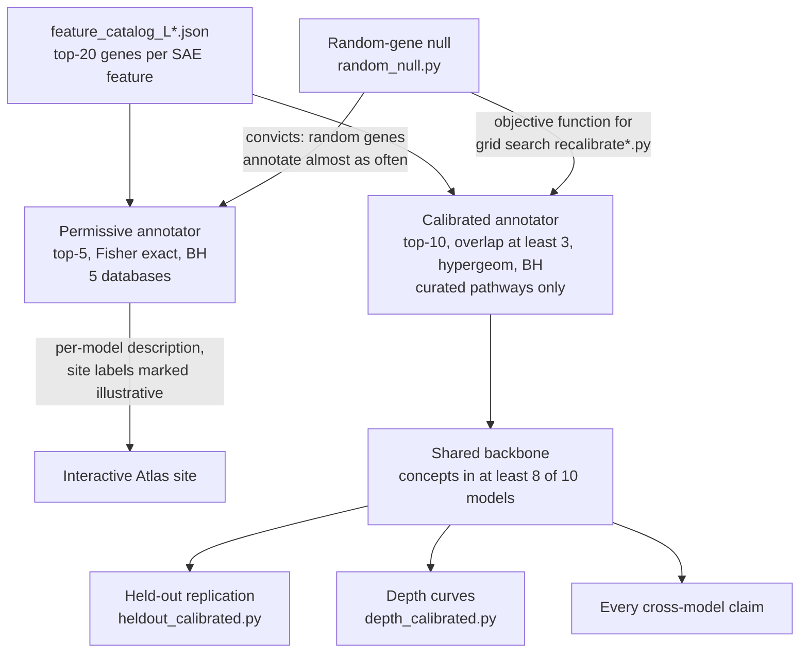
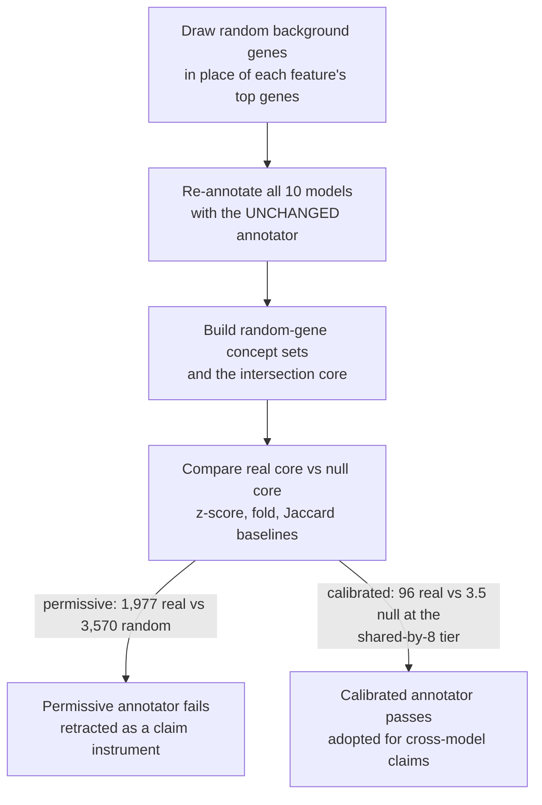
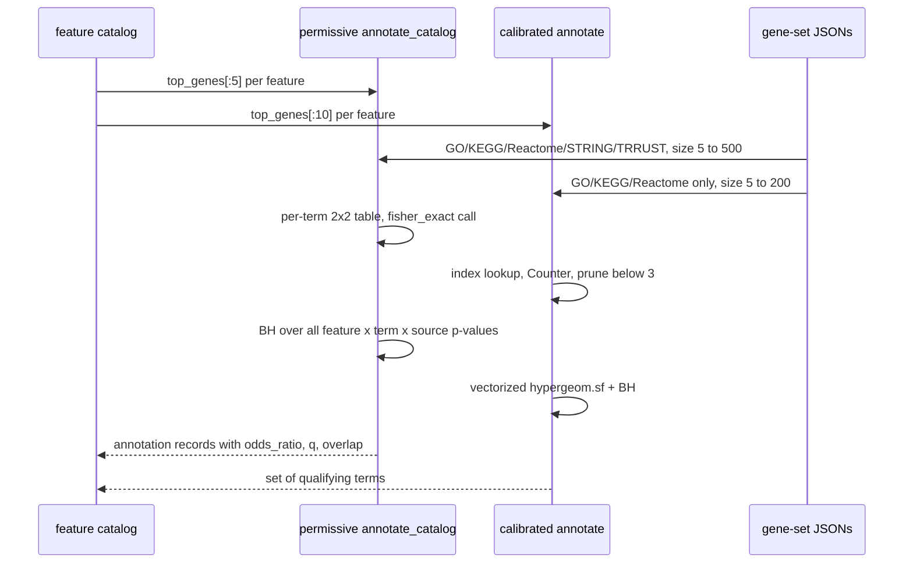

Every cross-model claim in this atlas rests on one methodological decision: which statistical procedure maps an SAE feature's top genes to biological concepts. The pipeline carries **two annotators side by side** — the *permissive* one inherited from the field's default practice, and the *calibrated* one derived in this repository by grid search against a random-gene null. This page explains what each annotator is, why the permissive variant was demoted to an illustrative role, how the calibrated configuration was found and frozen, and where each one now operates in the codebase.

Sources: [METHODS.md](docs/METHODS.md#L34-L41), [DECISIONS.md](docs/DECISIONS.md#L57-L79)

## The Two Annotators

The permissive annotator is the join key of the comparative atlas: the same test run on every model's feature catalogue so features are comparable in a shared concept vocabulary. For each feature, the catalogue retains the top-20 genes ranked by mean activation; the annotator slices the top-5, intersects them with a 16,205-gene background, and tests Fisher's exact test (one-sided, `alternative="greater"`) against five databases — GO_BP, Reactome and KEGG fetched via Enrichr, plus the interaction databases STRING (score ≥ 700) and TRRUST — restricted to term sizes 5–500. All p-values across every feature × term × source combination are corrected jointly with Benjamini–Hochberg at q ≤ 0.05. The top-5 slice is deliberate: the inline comment records that it produced "empirically sharper/more specific concepts (higher odds-ratio, no saturation)" than wider slices.

Sources: [annotate.py](pipeline/atlas_h100/common/annotate.py#L1-L8), [annotate.py](pipeline/atlas_h100/common/annotate.py#L40-L57), [METHODS.md](docs/METHODS.md#L23-L25), [DECISIONS.md](docs/DECISIONS.md#L59-L60)

The calibrated annotator is a stricter construction that survived the same test applied to random noise: take the top-10 genes per feature, require at least 3 of them in a single **curated** pathway set (GO_BP, Reactome or KEGG only — no PPI or regulon sets), cap set size at 200 genes, and apply BH ≤ 0.05 on the hypergeometric upper tail against the same background. Its constants are declared once — `ALPHA, TOP, AMIN, MX, NPERM = 0.05, 10, 3, 200, 30` — and every downstream consumer re-declares the identical tuple, making the configuration auditable at each call site.

Sources: [recalibrate_final.py](pipeline/scripts/recalibrate_final.py#L2-L4), [recalibrate_final.py](pipeline/scripts/recalibrate_final.py#L17), [METHODS.md](docs/METHODS.md#L39-L41), [DECISIONS.md](docs/DECISIONS.md#L62-L63)

| Dimension | Permissive | Calibrated |
|---|---|---|
| Top genes per feature | 5 (of 20 kept in catalogue) | 10 |
| Test statistic | Fisher exact, one-sided greater | Hypergeometric upper tail `sf(A-1, BGN, TG, LG)` |
| Multiple testing | BH ≤ 0.05, one joint correction | BH ≤ 0.05, one joint correction |
| Databases | GO_BP, Reactome, KEGG, STRING ≥700, TRRUST | GO_BP, Reactome, KEGG only (curated pathways) |
| Term size window | 5–500 genes | 5–200 genes |
| Minimum overlap | 2 | 3 |
| Odds-ratio floor | none | none (swept in grids, dropped from winner) |
| Background | 16,205 genes | 16,205 genes |
| Canonical implementation | `atlas_h100/common/annotate.py` | `recalibrate_final.py` constants, re-declared in consumers |
| Sanctioned role | Per-model description; site labels marked illustrative | Every cross-model claim |

Sources: [annotate.py](pipeline/atlas_h100/common/annotate.py#L14-L14), [METHODS.md](docs/METHODS.md#L35-L37), [DECISIONS.md](docs/DECISIONS.md#L73-L79)

The two annotators sit at different points of the claim-dependency graph. The random-gene null is not a competing annotator but the *arbiter*: it is the instrument that convicted the permissive variant and the objective function against which the calibrated configuration was tuned.

Sources: [DECISIONS.md](docs/DECISIONS.md#L65-L79), [RESULTS.md](docs/RESULTS.md#L24-L37)

## Why the Permissive Annotator Fails Its Own Null

The decisive control asks a deliberately hostile question: if random genes annotate features at the same rate as real ones, is the "universal core" of shared concepts also just what noise produces? `random_null.py` implements this by replacing every feature's top genes with genes drawn uniformly from the background, re-annotating all ten models at the mid layer with the *unchanged permissive procedure*, rebuilding the random-gene core (the intersection across models), and comparing it to the real core with a z-score over 100 permutations. It also derives the mean pairwise Jaccard between models' concept sets, a deduplicated core, and — critically — a "reproducibility baseline" as the overlap of two independent random-gene cores.

Sources: [random_null.py](pipeline/scripts/random_null.py#L1-L9), [random_null.py](pipeline/scripts/random_null.py#L77-L110)

The result was unambiguous and inverted the expected sign. Under the permissive annotator the ten models appear to share 1,977 concepts, while random genes share 3,570 (z = −24.2): the real core is a *deficit* relative to noise, not an excess. At the mid layer the naive core was 365 real against 582 random, and its celebrated held-out "replication" (Jaccard 0.50) proved no better than two random draws (0.51). The failure mechanism is database structure, not model structure: because the databases are large and heavily overlapping, almost any gene quintet lands inside some sufficiently large set often enough to survive BH correction.

Sources: [DECISIONS.md](docs/DECISIONS.md#L65-L68), [DECISIONS.md](docs/DECISIONS.md#L103-L105)

Sources: [random_null.py](pipeline/scripts/random_null.py#L111-L129), [DECISIONS.md](docs/DECISIONS.md#L65-L68)

> [!TIP]
> The permissive annotator was not modified in response to this failure — it was demoted. Keeping the original procedure intact, with all its outputs, preserves the negative result as a reproducible artifact (`random_null.json`, `heldout.json`) rather than erasing an embarrassing baseline. This is why the retraction is auditable by [Audit System and Manuscript Checks](18-audit-system-and-manuscript-checks).

## Deriving the Calibrated Annotator: Three Grid Rounds

The calibration was a search over annotator *configurations*, not a tuning of p-values. Each grid round evaluates a candidate configuration by running it on both real top-gene lists and random-gene lists, then scores it on two axes: does the random-gene annotation rate collapse to a controlled false-positive floor, and does the real cross-model core now beat the random core by a clear margin? Round one (`recalibrate.py`) swept the database subset (dropping STRING/TRRUST interaction sets), the maximum gene-set size (100 vs 200), the minimum overlap `a` (2 vs 3), and an odds-ratio floor (0, 5, 10) — with the top-5 slice held fixed. A configuration "won" if the random rate was controlled and the real core exceeded the random core beyond two standard deviations.

Sources: [recalibrate.py](pipeline/scripts/recalibrate.py#L1-L8), [recalibrate.py](pipeline/scripts/recalibrate.py#L100-L106)

Round two (`recalibrate2.py`) covered the two plausible rescues the first grid missed: keeping the loose overlap `a ≥ 2` but imposing a high odds-ratio floor (10 or 20) to retain only *specific* small-set hits, and conversely widening the gene slice to top-10 or top-20 while raising the overlap requirement to `a ≥ 3` or `a ≥ 4` — reasoning that real coherent features should be given the chance to land three genes in one set. Its acceptance test sharpened: a configuration must keep the real annotation rate *usable* (≥ 10 %) **and** drive the core z above 2. The top-10, `a ≥ 3`, size ≤ 200, no-PPI cell of this grid is the one that cleared both bars.

Sources: [recalibrate2.py](pipeline/scripts/recalibrate2.py#L1-L6), [recalibrate2.py](pipeline/scripts/recalibrate2.py#L74-L100)

| Round | Script | Knobs swept | Acceptance test | Output |
|---|---|---|---|---|
| 1 | `recalibrate.py` | DB subset (drop PPI), max set size 100/200, min overlap 2/3, OR floor 0/5/10; top-5 fixed | Random rate controlled AND real core > null mean + 2σ | `recalibrate.json` |
| 2 | `recalibrate2.py` | OR floor 10/20 at a ≥ 2; top-N 5/10/20 with a ≥ 3/4; set size 100/200/300 | Real rate ≥ 10 % AND core z > 2 | `recalibrate2.json` |
| Freeze | `recalibrate_final.py` | none — winner frozen: top-10, a ≥ 3, curated ≤ 200, no PPI | Shared-by-k spectrum vs null per tier, 30 permutations | `recalibrate_final.json` |
| Stress | `recalibrate_robust.py` | 5 neighbour configs × sharing tiers ≥ 7/8/9/10 | Fold over null per cell; housekeeping vs specific split | `recalibrate_robust.json` |

Sources: [RESULTS.md](docs/RESULTS.md#L61-L64), [recalibrate_robust.py](pipeline/scripts/recalibrate_robust.py#L1-L6)

Two procedural disciplines matter as much as the winning numbers. First, the target of the search is a **false-positive rate, not an effect size**: the grid was run until random genes annotated about 3 % of features against about 9 % for real ones, so the annotator is validated by the same null machinery that every downstream claim must survive. Second, the configuration was **frozen on the discovery corpus before the held-out corpus was touched** — the round-three script computes the honest shared-by-k spectrum and the all-ten core under the frozen winner, and the held-out evaluation (`heldout_calibrated.py`) then applied the constants verbatim, with no reopening of the search.

Sources: [DECISIONS.md](docs/DECISIONS.md#L68-L71), [recalibrate_final.py](pipeline/scripts/recalibrate_final.py#L78-L101), [heldout_calibrated.py](pipeline/scripts/heldout_calibrated.py#L2-L7)

> [!TIP]
> Every calibrated script re-declares the winning tuple (`TOP=10, AMIN=3, MX=200`) rather than importing it. This looks like duplication but functions as a distributed contract: each consumer's docstring restates the annotator string, so any script that silently drifts from the frozen configuration is legible in a diff — the pattern the audit system relies on when re-deriving manuscript numbers.

## Implementation Anatomy

The two annotators share a statistical skeleton but differ in execution strategy. The permissive `annotate_catalog` walks every (feature, source, term) triple with a nested loop, builds the 2×2 contingency table by hand, and calls `scipy.stats.fisher_exact` per term — correct but O(features × terms) in Python-level calls. The calibrated `annotate()` inverts this: it builds a **gene-to-terms index** once (`idx[gene].append(term)`), counts term membership per feature with a `Counter`, prunes every candidate below `AMIN = 3` *before* testing, then evaluates the hypergeometric survival function as one vectorized array operation across all surviving (feature, term) pairs and applies BH jointly. The upper tail `hypergeom.sf(A - 1, BGN, TG, LG)` is the exact one-sided "at least A overlaps" probability, statistically equivalent to Fisher's `greater` but computed in bulk.

Sources: [annotate.py](pipeline/atlas_h100/common/annotate.py#L50-L68), [recalibrate_final.py](pipeline/scripts/recalibrate_final.py#L21-L57)

Sources: [annotate.py](pipeline/atlas_h100/common/annotate.py#L40-L84), [recalibrate_final.py](pipeline/scripts/recalibrate_final.py#L40-L57)

Both annotators guard the same input edge cases: a feature contributing fewer than three genes to the background is skipped entirely, since no enrichment test on two drawable genes can be meaningful. Note also what the calibrated annotator deliberately *excludes* by dropping STRING and TRRUST: interaction databases were part of the permissive failure mode, because protein–protein and TF–target edges generate large, densely overlapping gene sets that random quintets hit by construction.

Sources: [recalibrate_final.py](pipeline/scripts/recalibrate_final.py#L42-L45), [recalibrate.py](pipeline/scripts/recalibrate.py#L2-L3)

## Stress-Testing the Chosen Configuration

A grid-search winner is only an argmax over one lucky cell unless the neighbourhood agrees with it. `recalibrate_robust.py` therefore sweeps five calibrated configurations — the winner plus perturbations to set size (150, 300), gene slice (top-12), and a restored odds-ratio floor (OR ≥ 5) — each crossed with four sharing thresholds (concepts in ≥ 7, 8, 9, or 10 of 10 models), and reports the real-vs-null fold at every cell of the grid. It then classifies the winner's ≥ 8 backbone against a keyword list of housekeeping machinery (translation, ribosome, splicing, proteasome, OXPHOS, cell cycle, chromatin, chaperone) versus specific programmes, so the surviving claim is quantified by *what kind* of biology it is, not just how many terms.

Sources: [recalibrate_robust.py](pipeline/scripts/recalibrate_robust.py#L1-L6), [recalibrate_robust.py](pipeline/scripts/recalibrate_robust.py#L96-L145)

Two further sensitivity checks close the remaining degrees of freedom. `topn_sweep.py` re-annotates every model's mid layer at top-5, 10, 15 and 20 genes under the permissive 5-database Fisher procedure, recording annotation rate, distinct concepts and median odds ratio — the evidence behind the original top-5 slice choice and the context for the calibrated annotator's top-10 choice. `kegg_robust.py` rebuilds the calibrated backbone with GO_BP and Reactome only: KEGG contributes 24 of the 96 backbone concepts, and without it the backbone is 72 concepts at 25.7× over the null, so no claim rests on that single database.

Sources: [topn_sweep.py](pipeline/scripts/topn_sweep.py#L1-L13), [DECISIONS.md](docs/DECISIONS.md#L241-L247)

The calibrated annotator also faces a stronger null variant than uniform random genes: the degree-matched null replaces each gene with one of *equal gene-set membership degree*, so mere database hub-ness cannot manufacture the backbone. That null (250 permutations), alongside the full null taxonomy, is the subject of [Null Models Behind Every Claim](10-null-models-behind-every-claim); here it suffices that the backbone survives it at 51.2×.

Sources: [DECISIONS.md](docs/DECISIONS.md#L81-L99), [DECISIONS.md](docs/DECISIONS.md#L127-L128)

## Where Each Annotator Lives Today

The division of labour is strict and documented. Every **cross-model** claim — the shared backbone, its depth profile, its held-out replication, the co-expression baseline — uses the calibrated annotator. The permissive annotator survives in two sanctioned niches: per-model description on the site (labelled *illustrative*) and the site's module theme labels (also permissive, labelled *hints*, since across all groups a label covers a median 20 % of a group's features). The per-layer concept matrices that feed the interactive explorer (`matrix_ts3_string.json`, `perlayer_concepts.json`) remain permissive because they serve browsing, not claims.

Sources: [DECISIONS.md](docs/DECISIONS.md#L73-L76), [RESULTS.md](docs/RESULTS.md#L51-L58)

| Consumer | Annotator | Output file | Role |
|---|---|---|---|
| `recalibrate_final.py` | calibrated (frozen) | `recalibrate_final.json` | shared-by-k spectrum, all-ten core vs null |
| `heldout_calibrated.py` | calibrated | `heldout_calibrated.json` | backbone replication on seed-1 cells; Jaccard vs two-random-draw baseline |
| `depth_calibrated.py` | calibrated | `depth_calibrated.json` | per-layer annotation-rate curves, all 172 layers |
| `coexpr_core_baseline.py` | calibrated | `coexpr_core_baseline.json` | no-model co-expression dictionary baseline for the backbone |
| `random_null.py` | permissive | `random_null.json` | the control that retracts the naive core |
| `topn_sweep.py` | permissive (5 DB) | `topn_sweep.json` | top-N gene cutoff sensitivity |
| `reannotate_string.py`, `alllayer_matrix.py` | permissive | `matrix_ts3_string.json`, `perlayer_concepts.json` | site concept matrices and gene-search index |
| `kegg_robust.py` | calibrated minus KEGG | `kegg_robust.json` | database-sensitivity check |

Sources: [RESULTS.md](docs/RESULTS.md#L24-L70), [depth_calibrated.py](pipeline/scripts/depth_calibrated.py#L1-L5)

One asymmetry deserves emphasis: annotation rate itself was retracted as an interpretability score under the permissive annotator, because random genes annotate almost as often. Under the calibrated annotator the rate becomes a usable per-model quantity — it spans 1.0 % to 29.3 % across the ten models at the mid layer — and `depth_calibrated.py` exists precisely to move the depth panel off the permissive variant, as its docstring puts it, "no more 'permissive illustrative'". Seed variance measurements were likewise taken under permissive (the mid-layer core varies by 12 %, 435 to 580 concepts; the all-layer core by 4 %), which contextualizes how much of that spread the stricter annotator had to absorb.

Sources: [DECISIONS.md](docs/DECISIONS.md#L106-L107), [depth_calibrated.py](pipeline/scripts/depth_calibrated.py#L1-L5), [DECISIONS.md](docs/DECISIONS.md#L43-L46)

## What the Calibration Changed in the Results

The retraction ledger is the cleanest measure of the decision's impact. Four claims died under the random-gene null: the ~2,000-concept universal core (365 vs 582 random at mid layer; 1,977 vs 3,570 on the all-layer union); annotation rate as an interpretability score; the "100 % of SAE features invisible to SVD" observation (true of random directions too — see [Cross-Model Geometry: CKA and SVD](12-cross-model-geometry-cka-and-svd)); and the "new biology" shortlist, whose degree-matched label permutation (`novel_calibrated.py`) showed 0 of 207 candidates surviving.

Sources: [DECISIONS.md](docs/DECISIONS.md#L101-L123)

What survived is correspondingly modest and specific. A backbone of **96 concepts** encoded by at least 8 of 10 models under the calibrated annotator — 27.5× the uniform null and 51.2× the degree-matched null — of which 42 concepts form one protein-synthesis block, 12 are other housekeeping, and 42 are specific programmes spanning 37 distinct themes; present at every depth (55 to 133 concepts) and reproduced on the held-out draw, which shares no cell with the corpus, on all ten models (Jaccard 0.52 against a 0.035 two-random-draw baseline, p = 0.02). Notably, no concept appears in all ten models — the all-ten intersection is brittle by construction, which is why the ≥ 8-of-10 tier, and not the intersection, is the calibrated backbone.

Sources: [DECISIONS.md](docs/DECISIONS.md#L125-L133), [heldout_calibrated.py](pipeline/scripts/heldout_calibrated.py#L89-L115)

This page's decision also pre-conditions the held-out regulatory test in an understated way: TRRUST qualifies as a clean evaluation target precisely because the calibrated annotator never used it, so the prediction stage scores against evidence no step of the pipeline consumed. That separation is developed in [Held-Out Regulatory Prediction Test](11-held-out-regulatory-prediction-test).

Sources: [DECISIONS.md](docs/DECISIONS.md#L148-L153)

## Reading Progression

The calibration story assumes the extraction and SAE machinery upstream: features are catalogued per layer by [TopK Sparse Autoencoder Training](7-topk-sparse-autoencoder-training), and the discovery/held-out corpus split that disciplines the freeze order is defined in [Shared Corpus and Held-Out Draw](8-shared-corpus-and-held-out-draw). The natural next pages are [Null Models Behind Every Claim](10-null-models-behind-every-claim), which generalizes the random-gene construction used here into the degree-matched, cell-shuffle and configuration-model nulls, and [Concept Matrices and Backbone Detection](13-concept-matrices-and-backbone-detection), which shows how the calibrated concept sets become the shared backbone and its programme composition. For the consequences of the retractions recorded above, see [Key Findings and Retracted Claims](4-key-findings-and-retracted-claims); for how these annotator choices are mechanically re-verified, see [Audit System and Manuscript Checks](18-audit-system-and-manuscript-checks).
