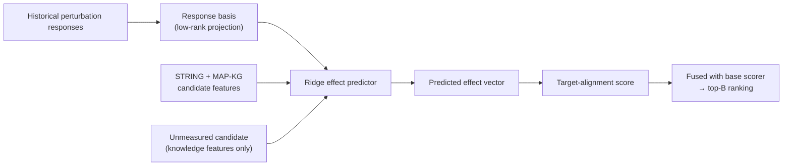
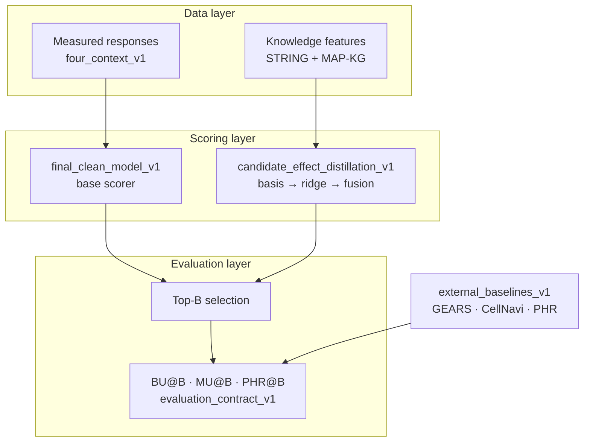

This page is the entry point to the VCDesign-CED documentation. It explains what the project solves, how its two scoring routes differ, how the Candidate Effect Distillation (CED) pipeline fits together, and how the repository is organized — everything a first-time reader needs before running code or diving into the deep-dive chapters. No prior familiarity with the project is assumed; all claims below are traced to specific files so you can verify them yourself.

Sources: [README.md](README.md#L1-L38), [CODE_PACKAGE_README.md](CODE_PACKAGE_README.md#L1-L5)

## What Problem Does VCDesign Solve?

VCDesign addresses **cellular intervention design** — deciding which gene perturbation experiments are worth actually running. Instead of the usual machine learning framing of *predicting* a cell's response to a perturbation, VCDesign frames the task as **finite-budget ranking over a variable candidate set**: a solver ranks feasible interventions for a requested source-to-target cellular transition, and evaluation scores only the executable top-B prefix of that ranking using independently measured, held-out outcomes. In the benchmark shipped with this repository, the domain is CRISPRi Perturb-seq perturbations of human cell lines.

Sources: [README.md](README.md#L32-L38), [CODE_PACKAGE_README.md](CODE_PACKAGE_README.md#L3-L9)

This framing produces three distinct capabilities, summarized below:

| Capability | What it means concretely |
| :--- | :--- |
| 🎯 **Rank a candidate set** | Score a variable set of feasible interventions for a source-to-target transition and select the top-B prefix. |
| 🧪 **Evaluate by outcomes** | Exclude the query identity and grade selected candidates using independently measured held-out outcomes — not by how well a model predicts them. |
| 🧬 **Transfer to unmeasured candidates** | Distill historical responses into an effect predictor that scores candidates whose responses were never measured, using STRING and MAP-KG knowledge features. |

Sources: [README.md](README.md#L42-L59)

## Two Decision Routes: Retrieval or Prediction

A defining design choice of VCDesign is that it supports **two information regimes** at decision time. If a candidate's response has already been measured (e.g., in another cellular context), direct retrieval of that measured profile is available; if it has not, the predicted-effect route (VCDesign-CED) is used. Crucially, both routes feed the same downstream decision interface — a candidate pool, an experimental budget B, and outcome-based evaluation — so they remain directly comparable.

| Candidate information at decision time | Recommended route |
| :--- | :--- |
| Measured candidate responses are available | **Direct response-profile retrieval** |
| Candidate responses are unavailable | **VCDesign-CED predicted-effect scoring** |

Sources: [README.md](README.md#L61-L68)

## Candidate Effect Distillation at a Glance

CED is the component that makes ranking possible for candidates whose responses were never measured. It learns a deliberately simple transfer map: historical perturbation responses are compressed into a **response basis** (a low-rank projection), STRING and MAP-KG candidate knowledge features drive a **ridge effect predictor** into that basis, and the reconstructed predicted effect is aligned against the requested target state. Two protocol guarantees matter for beginners: (1) the deployment candidate's measured response is **never an input** to CED — only knowledge features are; and (2) candidates missing all supported knowledge modalities receive a frozen "all-missing" score, so they are never silently dropped.



Sources: [README.md](README.md#L111-L123), [examples/ced_demo.py](examples/ced_demo.py#L17-L44)

> [!TIP]
> The architecture diagram above mirrors `examples/ced_demo.py` almost line for line — `basis.randomized_basis` builds the response basis, `RidgePath` is the predictor, `row_z` implements the fusion normalization. Running that 49-line file is the fastest way to see the whole pipeline execute end to end.

## Evaluation: Four Cellular Contexts

The benchmark spans four cellular contexts, all CRISPRi Perturb-seq. K562 serves as the primary genome-scale setting where the base scorer is trained, RPE1 provides cross-context evaluation, and HepG2 and Jurkat act as external cellular contexts that the model never adapts to. Data provenance — exact source versions and citations — is documented separately.

| Context | Perturbation setting | Role |
| :--- | :--- | :--- |
| **K562** | CRISPRi Perturb-seq | Primary genome-scale setting |
| **RPE1** | CRISPRi Perturb-seq | Cross-context evaluation |
| **HepG2** | CRISPRi Perturb-seq | External cellular context |
| **Jurkat** | CRISPRi Perturb-seq | External cellular context |

Sources: [README.md](README.md#L138-L147)

## What the Manuscript Establishes

The reported headline results are deliberately scoped. Under response masking in three held-out cellular contexts, CED delivers a **pooled paired BU@20 gain of +0.0492** over the same base scorer, and among 20 selections yields **1.11 more top-5% candidates** on average. When candidate responses have already been measured in other contexts, direct profile retrieval is stronger (**pooled BU@20 0.675 versus 0.508**). The authors are explicit that these are retrospective results for transcriptomic directional prioritization, not prospective evidence of improved biological endpoints — and that the fixed base scorer was itself trained on 68% of the masked candidate identities, with base-scorer-unseen subsets and a locked K562 identity test reported alongside.

Sources: [README.md](README.md#L70-L76)


## Repository Architecture

The codebase lives in a single Python package, `gene_open_inverse`, organized as **versioned protocol modules** — each directory suffixed `_v1` (or `_v2`) encapsulates one stage of the scientific workflow with its own `contract.py` defining data shapes and guarantees. This structure makes it possible to attribute every experimental number to exactly one module boundary. The overall data flow is:



Sources: [PROJECT_STRUCTURE.md](PROJECT_STRUCTURE.md#L1-L17), [README.md](README.md#L196-L212)

The physical layout of the repository is compact — a source tree, one frozen configuration, a synthetic demo, and integrity tooling:

```text
VCDesign-CED/
├── src/gene_open_inverse/        versioned protocol modules (see tree below)
├── configs/paper_run_v1.json     frozen paper-run configuration + asset paths
├── examples/ced_demo.py          synthetic, data-free end-to-end CED demo
├── tools/                        SHA-256 release verification utilities
├── paper/VCDesign.pdf            manuscript
├── assets/                       framework overview figure and site assets
├── requirements.txt / -cpu.txt   exact pinned environments
└── pyproject.toml                package metadata, extras, pytest config
```

The main `src/gene_open_inverse` modules map to the workflow as follows:

| Module | Responsibility |
| :--- | :--- |
| `candidate_effect_distillation_v1` | CED basis, ridge predictor, score fusion, evaluation |
| `final_clean_model_v1` | Base scorer, checkpoint selection, locked evaluation |
| `four_context_v1` | K562 / RPE1 / HepG2 / Jurkat data contracts |
| `external_baselines_v1` | GEARS, CellNavi, PHR comparator adapters and reporting |
| `open_vocab_generalization_v1` | Response masking and open-vocabulary analyses |
| `revision_v1` | Gene-grouped ridge penalty selection (post-review default) |
| `model/` | Frozen knowledge features and model components |

Sources: [PROJECT_STRUCTURE.md](PROJECT_STRUCTURE.md#L4-L17), [README.md](README.md#L198-L212)

## Engineering Culture: Frozen Artifacts, Integrity, and Corrections

Three habits distinguish this repository and are worth internalizing before reading further. First, **everything large is frozen and verifiable**: processed inputs, checkpoints, and run records are released on a companion Hugging Face dataset with a `DATA_MANIFEST.json` containing byte sizes and SHA-256 digests, checked by `tools/verify_processed_data.py`. Second, **the experiment configuration is frozen**: `configs/paper_run_v1.json` pins asset paths, comparator checkpoints, and even the SHA-256 of the selected reference checkpoint (`final_clean_epoch_008.pt`), and the training entry point refuses to overwrite an existing output directory. Third, **the code is self-testing**: the expected protocol test result for this release is `169 passed` under `pytest`.

Sources: [README.md](README.md#L149-L195), [CODE_PACKAGE_README.md](CODE_PACKAGE_README.md#L32-L45), [configs/paper_run_v1.json](configs/paper_run_v1.json#L1-L43)

> [!TIP]
> Watch the versioned module suffixes (`_v1`, `_v2`) throughout the source tree — they are not cosmetic. When a post-review correction changed ridge penalty selection from row-index CV to gene-grouped CV, it was added as `revision_v1` rather than silently patched, so the submitted and corrected implementations remain separately attributable. This "append, don't overwrite" pattern is why the SHA-256 manifests and test suite stay trustworthy.

Notably, two defects found during external review are documented rather than hidden: the ridge penalty selection was corrected to cut cross-validation folds by gene group (avoiding a gene leaking across folds), and the fusion normalization equation was restated to match what the code actually does — standardizing each branch over the whole scored pool. The originally submitted code is preserved unchanged in `release/VCDesign_ICLR2027_code/` for comparison, and the corrected protocol checks now fail under `pytest` when violated.

Sources: [README.md](README.md#L125-L136)

## Your First Commands

Getting hands-on requires only Python 3.11 and no biological data. The bundled demo is fully synthetic — it checks response-basis construction, ridge effect prediction, missing-knowledge handling, and score fusion, and its scores are explicitly a software smoke test rather than a biological result. Note the optional-dependency design: the base install needs only NumPy, while `model` (PyTorch, SciPy), `data` (anndata, pandas, scikit-learn), and `dev` (pytest) extras are pulled in only when needed.

```bash
git clone https://github.com/Boom5426/VCDesign-CED.git
cd VCDesign-CED
python3.11 -m venv .venv
source .venv/bin/activate
python -m pip install -e ".[model,data,dev]"
python examples/ced_demo.py
python -m pytest -q
```

| Install extra | Packages pulled in | Needed for |
| :--- | :--- | :--- |
| *(base)* | `numpy` | Package import only |
| `model` | `torch 2.4`, `scipy` | Base-scorer training and scoring |
| `data` | `anndata`, `pandas`, `scikit-learn` | Four-context data processing |
| `figures` | `matplotlib`, `scipy` | Plotting |
| `dev` | `pytest` | Protocol test suite |

Sources: [README.md](README.md#L78-L109), [pyproject.toml](pyproject.toml#L1-L29), [examples/ced_demo.py](examples/ced_demo.py#L1-L5)

## Where to Go Next

The documentation is organized as a Get Started sequence followed by Deep Dive chapters. For the recommended beginner path: run the installation and smoke test first with [Quick Start](2-quick-start), then walk through the CED pipeline line by line in [Synthetic Demo Walkthrough](3-synthetic-demo-walkthrough), and only then attempt full reproduction with [Reproducing Paper Results](4-reproducing-paper-results) — which pairs with the data provenance details in [Data Sources and Provenance](5-data-sources-and-provenance). When you are ready for the internals, start at [Architecture Overview](6-architecture-overview), then [Problem Formulation: Finite-Budget Ranking](7-problem-formulation-finite-budget-ranking) and the metric definitions in [Ranking Metrics: BU@B, MU@B, PHR@B](8-ranking-metrics-buatb-muatb-phratb), before working through the pipeline chapters [Response Basis Construction](11-response-basis-construction), [Ridge Effect Predictor](12-ridge-effect-predictor), and [Score Fusion and Beta Selection](14-score-fusion-and-beta-selection). For the integrity guarantees you saw summarized here, the dedicated chapters are [Leakage Prevention and Identity-Level Cross-Validation](21-leakage-prevention-and-identity-level-cross-validation), [Post-Review Corrections](22-post-review-corrections), and [Artifact Verification and SHA-256 Manifests](23-artifact-verification-and-sha-256-manifests).
