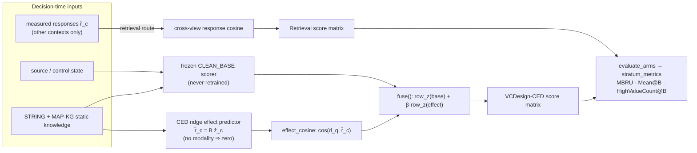
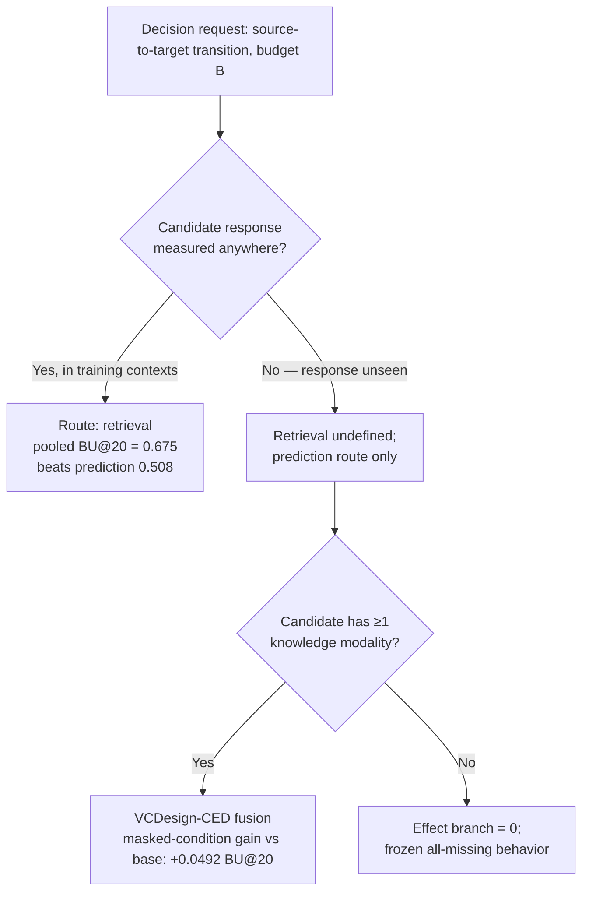

Every intervention-design problem in VCDesign asks the same question — rank a candidate pool and commit an experimental budget $B$ — but two distinct scoring families can fill the score matrix that the ranking consumes. This page defines the two **decision routes**: *direct response-profile retrieval*, which uses a candidate's measured response as its score, and *predicted-effect scoring*, the VCDesign-CED route, which synthesizes a score from static knowledge alone. It covers where each route is legal, how both converge on one shared decision interface, and how the evaluation harness keeps them exactly comparable.

## One Interface, Two Scoring Families

Both routes emit the same artifact: a `[queries × pool]` float matrix, one score per query-candidate pair. The grader never learns which route produced a matrix — `evaluate_arms` accepts any `score_by_arm` dictionary and runs every arm through the identical `stratum_metrics` pipeline (stable ordering, self-exclusion, `query_references`, budget prefix metrics). The evaluator's module docstring states the comparability rule directly: restricting the pool moves each stratum's own random and oracle references, so **only paired differences between arms inside one stratum are interpretable** — an absolute number from one stratum is never comparable to another's. This is what makes a retrieval arm and a prediction arm legitimately face each other in one table: they are two columns of the same grading contract, not two different experiments.

Sources: [evaluate.py](/src/gene_open_inverse/four_context_v1/evaluate.py#L1-L17), [evaluate.py](/src/gene_open_inverse/four_context_v1/evaluate.py#L152-L182)

The decision interface itself is defined by the frozen four-context contract: a candidate pool, a budget set, and outcome-based grading. The README's "Choose the information regime" table frames the route choice as the only genuinely open decision: *measured candidate responses available* → direct response-profile retrieval; *candidate responses unavailable* → VCDesign-CED predicted-effect scoring. Both routes feed "the same downstream decision interface: a candidate pool, an experimental budget, and outcome-based evaluation."

Sources: [contract.py](/src/gene_open_inverse/four_context_v1/contract.py#L111-L115), [README.md](/README.md#L72-L81)

## The Retrieval Route: Measured Responses as the Score

Retrieval scores a candidate by the geometric alignment between what the query wants and what the candidate measurably did. The measured quantity is the **consensus response** `r̄_c` — `consensus()` averages the two batch-disjoint measurement views into one response direction per candidate. Grading itself follows the anchor convention implemented in `cross_view_utility`: a query measured in view $v$ is graded by view $1-v$ responses, so the graded utility is literally a cross-view response cosine. This is why the **ORACLE arm** (`oracle_scores`, which ranks by the graded utility itself) represents the retrieval family's ceiling: it achieves perfect alignment with the grading function by reading the very responses the firewall forbids at deployment time. It is a reference bound, not a deployable route.

Sources: [evaluate.py](/src/gene_open_inverse/four_context_v1/evaluate.py#L32-L54), [evaluate.py](/src/gene_open_inverse/four_context_v1/evaluate.py#L140-L142), [loco.py](/src/gene_open_inverse/four_context_v1/loco.py#L105-L107)

Legality is a function of *where* the responses came from. The deployment firewall in the frozen contract lists three `FORBIDDEN_INPUTS` — the candidate's perturbed state, the target perturbation outcome, and the **held-context candidate response**. Retrieval that reads responses measured in *other* training contexts is legal and deployable; retrieval that reads the held context's own measurements is the oracle. The manuscript's headline comparison quantifies the legal version: when candidate responses have been measured in other contexts, direct profile retrieval scores pooled BU@20 `0.675` against VCDesign-CED's `0.508`.

Sources: [contract.py](/src/gene_open_inverse/four_context_v1/contract.py#L163-L169), [README.md](/README.md#L82-L90)

## The Prediction Route: VCDesign-CED

The prediction route assembles its score from two branches that are then fused. The **base branch** is the frozen `CLEAN_BASE` scorer: loaded read-only by `load_base_model`, never retrained, never told which context it is looking at — it scores source-to-goal alignment over candidate static knowledge (STRING + MAP-KG descriptors) embedded on the anchor gene axis. The **effect branch** is the CED predictor's output, `r̂_c = B ẑ_c`, reconstructed from the response basis and scored against the query direction by `effect_cosine` — with the hard rule that a candidate having no predicted effect scores exactly zero, and `EffectPredictor.effect` zeroes out any candidate lacking a legal knowledge modality. `effect_arms` glues the two per measurement view: `fuse(pack.base[view], ev.effect_cosine(pack.query_responses, effect, view))`.

Sources: [harness.py](/src/gene_open_inverse/four_context_v1/harness.py#L74-L82), [harness.py](/src/gene_open_inverse/four_context_v1/harness.py#L157-L160), [predictors.py](/src/gene_open_inverse/four_context_v1/predictors.py#L83-L87)

The fusion itself is deliberately frozen: `fuse()` performs row-wise z-score standardization of each branch, adds them at unit weight β=1.0 with no fitted coefficient. By default each branch is standardized over **every column of the pool it is given** — the published runs standardize over the whole scored pool, not the evaluated subset. An optional `standardize_over` mask restricts standardization to a column subset and returns 0.0 elsewhere, making those columns ungradable.

Sources: [evaluate.py](/src/gene_open_inverse/four_context_v1/evaluate.py#L82-L104), [evaluate.py](/src/gene_open_inverse/four_context_v1/evaluate.py#L57-L60)

> [!TIP]
> Route architecture at a glance — both branches of the prediction route and the retrieval route terminate in the same `[queries × pool]` matrix and the same grader:

Prerequisite for reading this diagram: a *query direction* $d_q$ is the query's view-`v` unit-normalized response; both routes reduce to cosines against directions — measured (`r̄_c`) versus predicted (`r̂_c`) — added to a base alignment score only in the prediction route.

## When Each Route Applies: The Decision Rule

The route choice is dictated entirely by the candidate's measurement status at decision time, and the manuscript's numbers bound what each choice is worth:

| Decision situation | Legal route | Evidence of record |
| :--- | :--- | :--- |
| Response measured in other contexts | Retrieval **or** prediction; retrieval wins | Pooled BU@20 `0.675` (retrieval) vs `0.508` (CED) |
| Response never measured | Prediction only | Masked-condition paired gain `+0.0492` BU@20 over the same base scorer; `1.11` more top-5% candidates among 20 selections |
| No knowledge modality present | Prediction with zeroed effect branch | Frozen all-missing score defined by the protocol |

Sources: [README.md](/README.md#L72-L90), [predictors.py](/src/gene_open_inverse/four_context_v1/predictors.py#L83-L87)

Note that the protocol's own quantity of record is always expressed *within* the prediction route: `PRIMARY_QUANTITY = "delta_MBRU_effect_minus_base"` — the mission measures whether the effect branch improves the base, judged on "budgeted intervention design utility, never response reconstruction." The retrieval-versus-prediction question is a separate, deployment-facing comparison layered on top of this primary quantity.

Sources: [contract.py](/src/gene_open_inverse/open_vocab_generalization_v1/contract.py#L84-L87)

## The Arm Taxonomy: Routes as Experimental Arms

The harness never hard-codes a route; it instantiates each route (and each route's controls) as a named **arm** whose value is the shared `[queries × pool]` score matrix. Reading the arm table is reading the route system:

| Arm | Route family | Score source | Experimental role | Code anchor |
| :--- | :--- | :--- | :--- | :--- |
| `BASE` | neither — reference | frozen `CLEAN_BASE` alone | transfer baseline every delta is measured against | [loco.py](/src/gene_open_inverse/four_context_v1/loco.py#L105-L107) |
| `RANDOM` | none — diagnostic | seeded Gaussian | keeps `BASE` interpretable where the base never trained | [loco.py](/src/gene_open_inverse/four_context_v1/loco.py#L101-L106) |
| `V1[design]` | prediction | `effect_arms(pack, effect)` per atlas design | CED at fixed recipe across 7 atlas designs | [loco.py](/src/gene_open_inverse/four_context_v1/loco.py#L122-L125) |
| `V2` | prediction (context-conditioned) | V1 + low-rank context residual | does context conditioning help | [contract.py](/src/gene_open_inverse/four_context_v1/contract.py#L118-L120) |
| `EFFECT_SEEN` | prediction | fusion with full-atlas predictor | response-exposed prediction | [masking.py](/src/gene_open_inverse/open_vocab_generalization_v1/masking.py#L333-L336) |
| `EFFECT_MASKED` | prediction | fusion with crossfit masked predictor | response-unseen prediction — the deployment condition | [masking.py](/src/gene_open_inverse/open_vocab_generalization_v1/masking.py#L352-L355) |
| `EFFECT_SIZE_CONTROL` | prediction | fusion with next-fold predictor | separates "never measured" from "smaller atlas" | [masking.py](/src/gene_open_inverse/open_vocab_generalization_v1/masking.py#L206-L215) |
| `ORACLE` | retrieval ceiling | the graded utility itself | upper bound; not deployable | [evaluate.py](/src/gene_open_inverse/four_context_v1/evaluate.py#L140-L142) |

The arm assembly is deliberately factored so that route differences cannot be confounded with rebuild differences: the base ranker, candidate features, and graded utility are computed **once per context** in the `ContextPack` and reused by every arm and every atlas size — "if they were rebuilt per arm, a difference between two arms could come from a rebuild rather than from the arm."

Sources: [harness.py](/src/gene_open_inverse/four_context_v1/harness.py#L1-L8), [harness.py](/src/gene_open_inverse/four_context_v1/harness.py#L28-L46)

> [!TIP]
> The masked arm's score columns are *not* zeroed outside the eligible set. `_crossfit` copies the seen arm's prediction into ineligible columns, because the frozen fusion standardizes each row over the whole pool before evaluation restricts it — filling those columns with zeros would hand the masked arm a different effective fusion weight and turn the exposure contrast into a fusion artifact.

Sources: [masking.py](/src/gene_open_inverse/open_vocab_generalization_v1/masking.py#L279-L296)

## Comparability Guarantees Across Routes

Three mechanisms guarantee that a retrieval number and a prediction number in the same table mean the same thing. **First**, identical grading: every arm passes through `stratum_metrics`, where self-exclusion survives pool restriction — the excluded index is recorded as `None` rather than `-1`, because the frozen `stable_order` would read `-1` as the last candidate and silently delete a real one. **Second**, exposure manipulations refit everything they legally touch: `masked_training_pool` removes a candidate's rows *by identity in every named context at once*, and the response basis and ridge are rebuilt inside the masked pool — reusing the seen arm's basis would leak masked responses through the very object the protocol says must be rebuilt. **Third**, stratification is shared: `SEEN_CANDIDATE` / `UNSEEN_CANDIDATE` masks are defined against the full training set rather than per design, so arms are graded on the same candidates, and paired statistics (`paired`, cluster bootstrap) are computed within-stratum.

Sources: [evaluate.py](/src/gene_open_inverse/four_context_v1/evaluate.py#L13-L16), [masking.py](/src/gene_open_inverse/open_vocab_generalization_v1/masking.py#L65-L86), [masking.py](/src/gene_open_inverse/open_vocab_generalization_v1/masking.py#L1-L30), [loco.py](/src/gene_open_inverse/four_context_v1/loco.py#L8-L14)

> [!TIP]
> The route choice has a sharp boundary in the code: any candidate with a measured response *somewhere* can be served by retrieval; any candidate without one falls to prediction, where the all-missing case degenerates gracefully to the base score because the zeroed effect branch contributes a constant row to the z-scored sum.

## Reading Progression

This page sits at the hinge between the evaluation framework and the distillation pipeline. For the grading machinery both routes feed, see [Ranking Metrics: BU@B, MU@B, PHR@B](8-ranking-metrics-buatb-muatb-phratb) and [Held-Out Context Evaluation Protocol](9-held-out-context-evaluation-protocol). For how the prediction route's effect branch is built, continue to [Response Basis Construction](11-response-basis-construction) and [Ridge Effect Predictor](12-ridge-effect-predictor); for the fusion mechanics and β selection, see [Score Fusion and Beta Selection](14-score-fusion-and-beta-selection); for the base branch, see [Final Clean Base Scorer](15-final-clean-base-scorer). For the experiment that quantifies the prediction route's value under response absence, see [Response Masking and Open-Vocabulary Analyses](18-response-masking-and-open-vocabulary-analyses).