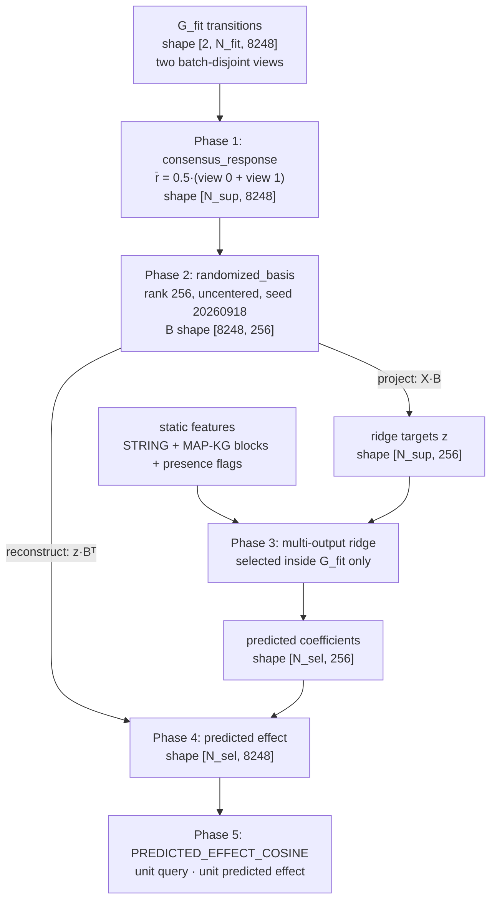
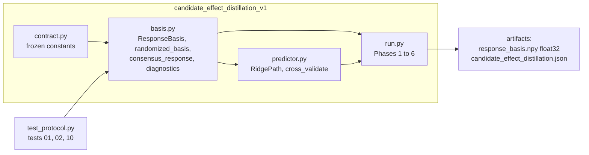
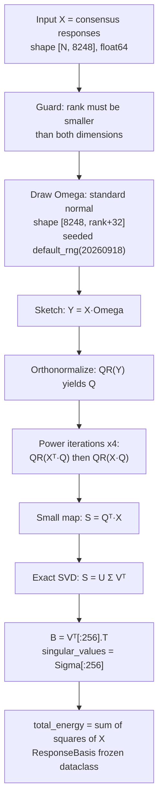

This page documents how the Candidate Effect Distillation (CED) pipeline builds its linear substrate: the **measured response target** and the **response basis `B`**. Both are constructed from `G_fit` measured perturbation responses alone, before any predictor is fitted, and both are frozen constants rather than tunable choices. The implementation lives in two files — `basis.py` holds the mathematics, `contract.py` holds the decisions — and is orchestrated as Phases 1–2 of `run.py`. This basis is the coordinate system in which every downstream artifact of the pipeline (ridge targets, predicted effects, cosine scores) is expressed.

Sources: [basis.py](src/gene_open_inverse/candidate_effect_distillation_v1/basis.py#L1-L9), [contract.py](src/gene_open_inverse/candidate_effect_distillation_v1/contract.py#L1), [PROJECT_STRUCTURE.md](PROJECT_STRUCTURE.md#L3-L11)

## Position in the Distillation Pipeline

The contract's hypothesis motivates why a basis is needed at all: STRING and MAP-KG descriptors live in a space with no relationship to the desired gene transition, so a ranker would otherwise have to learn *what a candidate does* and *how to compare it* simultaneously, from weak supervision. Distillation removes the second half — the pipeline first learns `static knowledge → signed gene-space effect` on `G_fit`, where measured responses are legally available, and a deployment candidate's predicted effect then lives in the same 8248-gene coordinate system as the query direction `d_q`, where comparison is a plain cosine that needs no learning. The basis is what defines that shared coordinate system.

Sources: [contract.py](src/gene_open_inverse/candidate_effect_distillation_v1/contract.py#L3-L12)

The legality boundary is strict and the basis construction respects it exactly: training may read `G_fit` static knowledge together with `G_fit` measured responses; inference reads only a candidate's static knowledge; a `G_select` candidate's measured response is used for grading and never as an input in any view; `G_check` is sealed. The basis, being derived from `G_fit` responses only, is therefore a legal training-time asset that is *reused* at inference but never *refit* there.

Sources: [contract.py](src/gene_open_inverse/candidate_effect_distillation_v1/contract.py#L14-L19), [run.py](src/gene_open_inverse/candidate_effect_distillation_v1/run.py#L2-L6)

The following diagram shows how Phases 1 and 2 feed the rest of the pipeline, with exact tensor shapes at every boundary:

Sources: [run.py](src/gene_open_inverse/candidate_effect_distillation_v1/run.py#L64-L102), [run.py](src/gene_open_inverse/candidate_effect_distillation_v1/run.py#L121-L129)

Module-level interaction is deliberately narrow: `contract.py` feeds constants to `basis.py`, whose `ResponseBasis` object is consumed by both `predictor.py` (for target projection and reconstruction in cross-validation) and `run.py` (for orchestration and artifact output). Protocol tests in `test_protocol.py` pin the invariants of exactly these two files.

Sources: [test_protocol.py](src/gene_open_inverse/candidate_effect_distillation_v1/test_protocol.py#L7-L10), [run.py](src/gene_open_inverse/candidate_effect_distillation_v1/run.py#L33-L35)

## The Response Target: Consensus of Batch-Disjoint Views

Phase 1 builds the supervision signal. `consensus_response` takes the transition tensor of shape `[2, candidates, genes]` — two batch-disjoint measurement views of the same identities — and returns `r̄_c`, the per-candidate mean `0.5·(view 0 + view 1)`. The function validates its input shape and rejects anything that is not a two-view stack, so a single-view tensor cannot silently pass as a target.

Sources: [basis.py](src/gene_open_inverse/candidate_effect_distillation_v1/basis.py#L38-L43), [contract.py](src/gene_open_inverse/candidate_effect_distillation_v1/contract.py#L46-L48)

The supervision population defaults to **every `G_fit` identity**. There is also a declared variant, `--eligible-targets`, that restricts supervision to measurement-eligible `G_fit` identities via `QUERY_ELIGIBILITY_V1`. The code comment is explicit that this variant is *motivated by a measurement rather than by a result*: the median `G_fit` response has a cross-view cosine of about 0.05, meaning for most identities the target is largely noise; eligibility flags which transitions are measurable. Crucially, the variant touches only the supervision population — evaluation, metric, and gate are unchanged. The schema record marks `supervision_is_a_declared_variant` so downstream readers can tell the two regimes apart.

Sources: [run.py](src/gene_open_inverse/candidate_effect_distillation_v1/run.py#L64-L77), [run.py](src/gene_open_inverse/candidate_effect_distillation_v1/run.py#L84-L93)

Because the target is a two-view average, the pipeline also *measures its own quality*. `view_reliability` computes the per-candidate cosine between the two views and reports median, mean, p05, p95, and the fraction of candidates with non-positive cosine. The record stores this both over the supervision population and over every `G_fit` identity, making the noise level of the target a first-class, reported quantity rather than an assumption.

Sources: [basis.py](src/gene_open_inverse/candidate_effect_distillation_v1/basis.py#L46-L55), [run.py](src/gene_open_inverse/candidate_effect_distillation_v1/run.py#L90-L91)

## Frozen Construction Constants

Every basis hyperparameter is a named constant frozen before any experiment ran — the module docstring states it plainly: *"Frozen before the first number."* Most consequential is that `BASIS_RANK = 256` is described as "one value, fixed in advance, no grid": rank is not selected by cross-validation or energy-threshold sweep, which removes an entire degrees-of-freedom channel through which leakage or overfitting could enter. Protocol test 10 asserts the declared values so any silent change fails loudly.

| Constant | Value | Role |
|---|---|---|
| `BASIS_RANK` | 256 | Subspace dimension; fixed a priori, explicitly no grid search |
| `BASIS_CENTERED` | `False` | Uncentered SVD — the basis spans responses, not deviations from the mean |
| `BASIS_SEED` | 20260918 | Seeds the random sketch; construction is fully deterministic |
| `BASIS_OVERSAMPLE` | 32 | Extra sketch columns beyond rank for QR-based accuracy |
| `BASIS_POWER_ITERATIONS` | 4 | Refinement passes concentrating the sketch on the leading subspace |
| `RESPONSE_DIM` | 8248 | Gene-space width; `B` is 8248 × 256 |

Sources: [contract.py](src/gene_open_inverse/candidate_effect_distillation_v1/contract.py#L1), [contract.py](src/gene_open_inverse/candidate_effect_distillation_v1/contract.py#L50-L55), [test_protocol.py](src/gene_open_inverse/candidate_effect_distillation_v1/test_protocol.py#L154-L160)

## Randomized SVD Construction

`randomized_basis` implements the classic Halko-style randomized SVD: a Gaussian sketch orthonormalized by QR, refined by power iterations, followed by an exact SVD of the small projected matrix. The guard `rank >= min(rows, columns)` rejects invalid configurations up front. The returned `ResponseBasis` stores the **right factor's** leading 256 rows, transposed — so `B` has shape `[8248, 256]` with orthonormal columns spanning the row space of the consensus responses.

Sources: [basis.py](src/gene_open_inverse/candidate_effect_distillation_v1/basis.py#L58-L75)

Sources: [basis.py](src/gene_open_inverse/candidate_effect_distillation_v1/basis.py#L60-L75)

> [!TIP]
> Because `B` is the transposed right singular factor, its columns are orthonormal: `project` returns *exact coordinates* in that basis, and `reconstruct(project(X))` is the rank-256 least-squares projection of `X` onto the row space. Test 02 verifies both properties mechanically — the Gram matrix `Bᵀ·B` equals the identity to 1e-8, and projection is idempotent (`reconstruct(project(·))` applied twice equals once).

Sources: [test_protocol.py](src/gene_open_inverse/candidate_effect_distillation_v1/test_protocol.py#L40-L48)

Determinism is total: the sketch is drawn from `np.random.default_rng(20260918)`, and there is no adaptive rank or tolerance anywhere in the path. Two runs on the same consensus matrix produce bit-identical bases — a property the reproduction protocol depends on.

Sources: [basis.py](src/gene_open_inverse/candidate_effect_distillation_v1/basis.py#L65-L66)

## The Uncentered Design: Spanning Responses, Not Deviations

The single most consequential design decision is `BASIS_CENTERED = False`. The module docstring explains it: `B` spans the response space itself rather than deviations from the mean response, which is what makes `r̂ = B·ẑ` a **complete reconstruction** rather than an offset from one. A centered PCA basis would require carrying the mean vector separately and would move the common perturbation response out of the basis entirely.

Sources: [basis.py](src/gene_open_inverse/candidate_effect_distillation_v1/basis.py#L1-L5), [contract.py](src/gene_open_inverse/candidate_effect_distillation_v1/contract.py#L51-L52)

The trade-off is honestly priced. The uncentered choice means the leading direction of `B` is the **common perturbation response** — the component every candidate shares — so a predictor that learns nothing candidate-specific will still produce a plausible-looking vector. The protocol's response is not to hide this but to instrument it (see the next section) and to couple it with the ridge design: `RIDGE_HAS_INTERCEPT = True` with the comment "the common response direction is a constant in z-space," and `RidgePath` de-means targets and adds the target mean back at prediction, absorbing that constant into an explicit intercept rather than pretending it away.

| Aspect | Uncentered (chosen) | Centered PCA (not chosen) |
|---|---|---|
| What `B` spans | The response space itself; `r̂ = B·ẑ` is a complete reconstruction | Deviations from the mean; reconstruction needs the mean vector stored separately |
| Leading direction | The common perturbation response | The first principal *deviation* |
| Failure mode | A candidate-blind predictor still yields plausible-looking effects | The shared-direction effect becomes invisible to diagnostics |
| Protocol mitigation | `common_direction_share` and cosine-to-mean diagnostics report it explicitly | Not applicable in this protocol |
| Predictor coupling | Intercept in z-space absorbs the constant (`RIDGE_HAS_INTERCEPT = True`) | Different intercept semantics |

Sources: [basis.py](src/gene_open_inverse/candidate_effect_distillation_v1/basis.py#L3-L8), [contract.py](src/gene_open_inverse/candidate_effect_distillation_v1/contract.py#L62), [predictor.py](src/gene_open_inverse/candidate_effect_distillation_v1/predictor.py#L49-L55)

> [!TIP]
> The uncentered basis and the ridge intercept are one *coupled* decision, not two independent ones: keeping the mean-response direction inside `B` means a constant offset in z-space, which `RidgePath`'s target de-meaning handles. Do not "clean up" the basis by centring it without re-deriving intercept semantics and re-reading the diagnostics — the two constants were frozen together.

Sources: [contract.py](src/gene_open_inverse/candidate_effect_distillation_v1/contract.py#L51-L52), [contract.py](src/gene_open_inverse/candidate_effect_distillation_v1/contract.py#L62), [predictor.py](src/gene_open_inverse/candidate_effect_distillation_v1/predictor.py#L52-L55)

## Instrumenting What the Basis Conceals

`common_direction_share` exists, in the docstring's words, "to make that visible rather than flattering." It computes how much of the total response energy lies on the single direction shared by every candidate — the unit mean response — and reports `share_of_response_energy_on_the_mean_direction` plus the distribution of per-candidate cosines to that direction (median, p05, p95). If the mean response explains most of the energy, then any predictor, however weak, reconstructs something that looks like a response, and a cosine against it ranks candidates almost identically for every query. The recorded number is the context in which the design result must be read — a built-in confound disclosure, not a marketing metric.

Sources: [basis.py](src/gene_open_inverse/candidate_effect_distillation_v1/basis.py#L78-L98), [run.py](src/gene_open_inverse/candidate_effect_distillation_v1/run.py#L92)

The same honesty extends downstream of Phase 2. At Phase 5, diagnostics compute the median cosine between predicted and measured `G_select` effects, per-coordinate correlations against basis-projected truth (`basis.project(measured)`), and — directly exploiting the uncentered design — the median cosine of the predicted effect to the `G_fit` mean response, plus the query-independent share of the score. The CLI prints the two headline basis numbers first: explained energy fraction and mean-direction share.

Sources: [run.py](src/gene_open_inverse/candidate_effect_distillation_v1/run.py#L188-L217), [run.py](src/gene_open_inverse/candidate_effect_distillation_v1/run.py#L210-L212), [run.py](src/gene_open_inverse/candidate_effect_distillation_v1/run.py#L277-L280)

Every construction decision is written into the run record for audit:

| Record field | Content | Verified at |
|---|---|---|
| `rank` / `centered` / `seed` | 256 / `False` / 20260918 | `run.py` Phase 2 record, mirroring `contract.py` |
| `selected_on` | `"G_fit only, no grid"` | Declares that no data-driven rank selection occurred |
| `explained_energy_fraction` | `basis.explained` — Σσᵢ² / total Frobenius energy | The subspace's coverage of `G_fit` responses |
| `singular_value_first` / `_last` | Spectrum endpoints | Shape of the decay across the kept 256 directions |
| `response_target.*` | Consensus definition, population, view reliability | Phase 1 audit of target noise |
| `common_response.*` | Mean-direction energy share | Phase 1 confound disclosure |

Sources: [run.py](src/gene_open_inverse/candidate_effect_distillation_v1/run.py#L95-L102), [basis.py](src/gene_open_inverse/candidate_effect_distillation_v1/basis.py#L27-L29)

## The `ResponseBasis` Interface

The class is a frozen dataclass — immutable after construction — carrying exactly the three things downstream consumers need, plus two algebraic operations. The narrow surface is intentional: consumers can express responses in basis coordinates and reconstruct effects, but cannot mutate the basis.

| Member | Type / behavior |
|---|---|
| `basis` | `np.ndarray`, shape [8248, 256], float64, C-contiguous; orthonormal columns |
| `singular_values` | Top-256 singular values of the consensus matrix |
| `total_energy` | Sum of squares of all consensus entries (Frobenius norm squared) |
| `explained` | Property: `Σσ² / total_energy` |
| `project(X)` | `X @ B` → coefficients in z-space, [N, 256] |
| `reconstruct(Z)` | `Z @ Bᵀ` → gene-space effects, [N, 8248] |

Sources: [basis.py](src/gene_open_inverse/candidate_effect_distillation_v1/basis.py#L19-L35)

The pipeline uses all of it: Phase 2 projects consensus responses to produce ridge targets; Phase 3's cross-validation reconstructs held-out predictions to gene space for cosine evaluation against the measured consensus; Phase 4 reconstructs predicted `G_select` coefficients into full signed effects, with all-missing candidates set to exactly `0.0` — the declared neutral score, never a learned one; and the final basis is persisted as `response_basis.npy` in float32 alongside the JSON record.

Sources: [run.py](src/gene_open_inverse/candidate_effect_distillation_v1/run.py#L96-L97), [predictor.py](src/gene_open_inverse/candidate_effect_distillation_v1/predictor.py#L74-L77), [run.py](src/gene_open_inverse/candidate_effect_distillation_v1/run.py#L121-L129), [run.py](src/gene_open_inverse/candidate_effect_distillation_v1/run.py#L255-L263), [contract.py](src/gene_open_inverse/candidate_effect_distillation_v1/contract.py#L30-L36)

## From Basis to Predictor

The basis is where construction ends and learning begins: the ridge predictor is, by its own module docstring, "a multi-output ridge onto the response basis" — the simplest linear map from STRING and MAP-KG descriptors to the 256 basis coefficients, deliberately minimal so that a negative result remains attributable. The penalty governing that map is selected by identity-level cross-validation inside `G_fit`, choosing held-out mean *gene-space cosine* over squared error, because the deployment use is a direction comparison. The mechanics of that selection belong to the next page.

Sources: [predictor.py](src/gene_open_inverse/candidate_effect_distillation_v1/predictor.py#L1-L10), [predictor.py](src/gene_open_inverse/candidate_effect_distillation_v1/predictor.py#L74-L77), [contract.py](src/gene_open_inverse/candidate_effect_distillation_v1/contract.py#L63-L68)

**Suggested reading progression**: continue to [Ridge Effect Predictor](12-ridge-effect-predictor) for how static features map onto these coefficients, then [Knowledge Features: STRING and MAP-KG](13-knowledge-features-string-and-map-kg) for the input side of that map, and [Score Fusion and Beta Selection](14-score-fusion-and-beta-selection) for how the reconstructed effect is blended into final rankings. For the evaluation semantics of the cosine scores this basis enables, see [Ranking Metrics: BU@B, MU@B, PHR@B](8-ranking-metrics-buatb-muatb-phratb).
