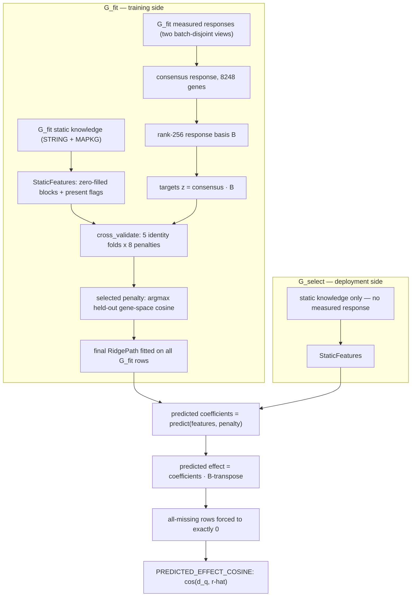

The ridge effect predictor is the learnable core of the Candidate Effect Distillation (CED) pipeline: a multi-output ridge regression that maps a candidate's static knowledge descriptors (STRING and MAP-KG) to a signed perturbation effect expressed in the 8248-gene coordinate system. It is deliberately the simplest model that could carry design signal — if a linear map works, that is the finding; if it does not, a larger model would only make the negative result harder to attribute. This page dissects the predictor's feature encoding, the single-SVD regularization path, the identity-level cross-validation that selects its one tunable hyperparameter, and the protocol guarantees that keep the whole construction honest.

Sources: [predictor.py](src/gene_open_inverse/candidate_effect_distillation_v1/predictor.py#L1-L11), [contract.py](src/gene_open_inverse/candidate_effect_distillation_v1/contract.py#L1-L12)

## Position in the Distillation Pipeline

Within `run.py`, the predictor occupies Phase 3 (fit and penalty selection, entirely inside `G_fit`) and Phase 4 (coefficient prediction and reconstruction for `G_select` deployment candidates). It consumes two upstream artifacts: the static feature matrix built from candidate knowledge, and the rank-256 response basis with its coefficient targets produced by [Response Basis Construction](11-response-basis-construction). Its output — the predicted effect `r̂_c` — is consumed downstream by the direct design probe, which scores candidates via `PREDICTED_EFFECT_COSINE = cos(d_q, r̂_c)`, and later by [Score Fusion and Beta Selection](14-score-fusion-and-beta-selection). The legality boundary is strict and encoded in the contract: training may read `G_fit` static knowledge together with `G_fit` measured responses; inference reads only a candidate's static knowledge; a `G_select` candidate's own measured response is used for grading and never as an input; `G_check` is sealed.



Sources: [run.py](src/gene_open_inverse/candidate_effect_distillation_v1/run.py#L104-L129), [contract.py](src/gene_open_inverse/candidate_effect_distillation_v1/contract.py#L14-L19), [contract.py](src/gene_open_inverse/candidate_effect_distillation_v1/contract.py#L71-L76)

## Static Feature Encoding: What the Ridge Is Allowed to See

The predictor never sees raw knowledge records; it sees a `StaticFeatures` frozen dataclass built by `static_features()`. For each primary modality, the descriptor block is multiplied elementwise by its presence mask — so descriptors of an absent modality are **exactly zero**, not imputed — and a single 0/1 flag per modality is appended to the feature vector. The `present_any` column marks candidates with at least one modality present, and `fit_rows()` returns exactly those row indices, implementing the frozen training population `RIDGE_FIT_POPULATION = "G_fit candidates with at least one primary modality present"`. The primary track uses `PRIMARY_MODALITIES = ("STRING", "MAPKG")` only: literature-derived TEXT is excluded under `GENE_INFORMATION_POLICY_v1`, and anything carrying TEXT is reported only as a labelled legacy-contract comparator.

| Feature segment | Width | Content | Absent-modality behavior |
| :--- | :--- | :--- | :--- |
| STRING descriptors | `d_STRING` | zero-filled capability block | rows exactly zero |
| MAPKG descriptors | `d_MAPKG` | zero-filled capability block | rows exactly zero |
| Present flags | 2 | one 0/1 indicator per modality | always written |

Sources: [predictor.py](src/gene_open_inverse/candidate_effect_distillation_v1/predictor.py#L21-L43), [contract.py](src/gene_open_inverse/candidate_effect_distillation_v1/contract.py#L41-L44), [contract.py](src/gene_open_inverse/candidate_effect_distillation_v1/contract.py#L61)

## RidgePath: One SVD, Every Penalty for Free

`RidgePath` implements the entire regularization path from a single eigendecomposition, as its docstring states: "One SVD, every penalty for free." In the constructor, features are standardized (per-column mean, with scale floored at `1e-8`) and the target mean is subtracted; the standardized design matrix is then factored once via `np.linalg.svd`, and `U.T @ (targets − target_mean)` is precomputed. For a standardized design `X̃ = UΣVᵀ` and centered targets, the multi-output ridge solution at penalty λ is `W(λ) = V · diag(σ / (σ² + λ)) · UᵀỸ`. Only the diagonal shrinkage factor depends on λ, so `weights(penalty)` is a cheap post-hoc evaluation — the eight-decade penalty grid costs almost nothing beyond the one SVD. Prediction re-standardizes new features, applies `W(λ)`, and adds back the target mean, which realizes `RIDGE_HAS_INTERCEPT = True` (the contract notes the common response direction acts as a constant in coefficient space).

| Method | Signature | Role |
| :--- | :--- | :--- |
| `__init__` | `(features, targets)` | caches standardization statistics, the SVD factors, and the projected targets once |
| `weights` | `(penalty) → coefficient matrix` | applies ridge shrinkage; only the diagonal term depends on the penalty |
| `predict` | `(features, penalty) → predicted targets` | standardize → shrink → de-center, in one matrix product |

Sources: [predictor.py](src/gene_open_inverse/candidate_effect_distillation_v1/predictor.py#L46-L63), [contract.py](src/gene_open_inverse/candidate_effect_distillation_v1/contract.py#L62)

## Identity-Level Cross-Validation and Penalty Selection

The single tunable quantity — the ridge penalty — is chosen by `identity_folds` + `cross_validate`, both operating on `G_fit` only. `identity_folds` permutes candidates with the frozen seed `20260918` and splits them into 5 disjoint, sorted blocks; because each row *is* one candidate identity, the disjointness is exact, and no candidate ever appears on both sides of a fold. `cross_validate` then, per fold, fits a `RidgePath` on the complement and evaluates all eight penalties on the held-out block, recording two criteria per penalty: gene-space cosine (predictions reconstructed through the basis and compared directionally against the measured consensus response, via `_gene_space_cosine`) and squared error in coefficient space. The frozen grid is `RIDGE_PENALTIES = (1e-2, 1e-1, 1e0, 1e1, 1e2, 1e3, 1e4, 1e5)`.

The selection rule is a deliberate protocol decision, stated in the contract comments: the penalty is chosen by **held-out mean cosine in gene space**, not by squared error, because the deployment use is a direction comparison (`cos(d_q, r̂_c)`) and squared error would spend the penalty budget on magnitude. Both criteria are `G_fit`-only; the squared-error choice is retained in the record as a declared sensitivity, not a decision input. The returned record carries the fold sizes, per-penalty held-out means for both criteria, `selected_penalty` (cosine argmax), `selected_penalty_by_squared_error` (squared-error argmin), the cosine at the selected penalty, and a distribution summary (median, mean, p05, p95, fraction non-positive) over per-candidate cosines.

| Constant | Frozen value | Meaning |
| :--- | :--- | :--- |
| `RIDGE_FOLDS` | `5` | number of identity-level cross-validation folds |
| `RIDGE_FOLD_SEED` | `20260918` | permutation seed for fold assignment |
| `RIDGE_PENALTIES` | `1e-2` … `1e5` (8 values) | decade grid searched from one SVD |
| `RIDGE_HAS_INTERCEPT` | `True` | target mean absorbed as intercept |
| `RIDGE_CRITERION` | `held_out_mean_cosine_in_gene_space` | primary selection rule |
| `RIDGE_SENSITIVITY_CRITERION` | `held_out_mean_squared_error_in_basis_space` | reported sensitivity only |

| Criterion | Evaluation space | Rule | Status |
| :--- | :--- | :--- | :--- |
| held-out mean cosine | reconstructed 8248-gene effect vs measured consensus | argmax over penalties | **primary** — matches deployment scoring |
| held-out mean squared error | coefficient space vs projected basis targets | argmin over penalties | sensitivity check only |

Sources: [predictor.py](src/gene_open_inverse/candidate_effect_distillation_v1/predictor.py#L66-L71), [predictor.py](src/gene_open_inverse/candidate_effect_distillation_v1/predictor.py#L74-L110), [contract.py](src/gene_open_inverse/candidate_effect_distillation_v1/contract.py#L57-L68)

## From Coefficients to a Signed Effect

Phase 4 of `run.py` turns the fitted path into deployment predictions in three steps. First, `path.predict(select_features.values, penalty)` produces basis coefficients for every `G_select` candidate from static knowledge alone. Second, `basis.reconstruct(predicted_coefficients)` maps coefficients back to the full 8248-gene space — an uncentered reconstruction `ẑ·Bᵀ`, which is a complete response rather than an offset from the mean. Third, the all-missing rule is applied: candidates with no primary modality present get `predicted_effect` forced to exactly zero, recorded with per-role counts and the rule string `"score fixed at 0.0, no learnable token"`. This is a corrective design choice: the contract explains that a shared learnable token for knowledge-free candidates is what previously put 92 information-free genes at the top of every goal-blind ordering, so neutral is defined as the cosine indifference point (zero) and fixed rather than tuned.

A consequence worth internalizing when reading results: because the basis spans responses (not deviations), its leading direction is the common perturbation response, so even a predictor that learns nothing candidate-specific produces a plausible-looking vector. That is why Phase 3's record and Phase 5's diagnostics surround the predictor with context — `common_direction_share`, goal-conditioning contrasts against `PREDICTED_EFFECT_MAGNITUDE`, and a non-deployable `MEASURED_EFFECT_COSINE` oracle row — so the design result can be read honestly rather than flatteringly.

Sources: [run.py](src/gene_open_inverse/candidate_effect_distillation_v1/run.py#L121-L129), [basis.py](src/gene_open_inverse/candidate_effect_distillation_v1/basis.py#L31-L35), [contract.py](src/gene_open_inverse/candidate_effect_distillation_v1/contract.py#L30-L36), [run.py](src/gene_open_inverse/candidate_effect_distillation_v1/run.py#L138-L149)

## Protocol Guarantees and the Test Suite

The predictor's behavioral guarantees are pinned by `test_protocol.py`, whose stated philosophy is that each test "names a failure that would otherwise look like a valid gain." The suite verifies that static features carry no response information and flag missingness exactly (the one structural guarantee the phase rests on); that identity folds partition the candidate set exactly; that out-of-fold predictions are measurably less optimistic than in-sample ones (asserting `optimistic > honest` on the fixture, and that all-missing rows stay exactly zero); that cross-validation never scores a fold with its own predictor; and that every frozen constant matches its declared value, so silent contract drift fails CI rather than surfacing in a paper number. The submitted implementation's penalty selection cut folds over row indices and let held-out responses shape the basis — the identity-level machinery here is the corrected form, as documented in [Post-Review Corrections](22-post-review-corrections).

| Test | Failure it names | Location |
| :--- | :--- | :--- |
| `test_04_identity_folds_partition_exactly` | folds overlap or drop candidates | [test_protocol.py](src/gene_open_inverse/candidate_effect_distillation_v1/test_protocol.py#L64-L70) |
| `test_05_out_of_fold_predictions_are_not_in_sample` | in-sample optimism inflating apparent prediction quality | [test_protocol.py](src/gene_open_inverse/candidate_effect_distillation_v1/test_protocol.py#L73-L93) |
| `test_06_all_missing_candidates_get_the_declared_neutral_score` | a learnable token preferring information-free candidates | [test_protocol.py](src/gene_open_inverse/candidate_effect_distillation_v1/test_protocol.py#L96-L117) |
| `test_09_cross_validation_never_scores_a_fold_with_its_own_predictor` | a fold evaluated by a predictor that saw it | [test_protocol.py](src/gene_open_inverse/candidate_effect_distillation_v1/test_protocol.py#L139-L150) |
| `test_10_the_frozen_constants_are_the_declared_ones` | silent drift of modality, basis, fold, or scoring constants | [test_protocol.py](src/gene_open_inverse/candidate_effect_distillation_v1/test_protocol.py#L153-L160) |

Sources: [test_protocol.py](src/gene_open_inverse/candidate_effect_distillation_v1/test_protocol.py#L1-L19), [predictor.py](src/gene_open_inverse/candidate_effect_distillation_v1/predictor.py#L8-L10)

## Reusing the Predictor Out of Fold

The predictor's fold machinery is deliberately reusable, and the fusion stage exploits it. `out_of_fold_effect()` in `fuse.py` re-runs the identical `identity_folds` partition so that every `G_fit` candidate's predicted effect comes from a ridge that never saw that candidate's measured response — a necessity for honest β selection, since an in-sample effect would make the effect branch look far better on `G_fit` than it can be on a deployment candidate. The all-missing zero rule is reapplied identically (`effect[missing] = 0.0`), and `run.py` persists the selected penalty in `candidate_effect_distillation.json` precisely so the fusion stage can reload it rather than re-derive it. The mechanics of how this out-of-fold effect is weighted against the incumbent scorer are covered in [Score Fusion and Beta Selection](14-score-fusion-and-beta-selection).

Sources: [fuse.py](src/gene_open_inverse/candidate_effect_distillation_v1/fuse.py#L56-L68), [run.py](src/gene_open_inverse/candidate_effect_distillation_v1/run.py#L118-L119)

## Minimal Working Example

The bundled synthetic demo exercises the predictor end-to-end in under a dozen lines, with no biological data: build `StaticFeatures` from two synthetic capability matrices (with the last two candidates missing all knowledge), fit a rank-8 basis on the training split, project responses to coefficient targets, fit `RidgePath`, predict held-out candidates at a fixed `penalty=1.0`, reconstruct effects, and zero-fill the all-missing rows. Scoring then takes the cosine of each predicted effect against a goal direction and fuses it with a base score via per-row standardization — exactly the structure the production pipeline uses at scale. The demo prints the ranked prefix and the all-missing raw scores (both exactly zero), serving as a software smoke test rather than a biological result.

```python
fitted_basis = basis.randomized_basis(responses[:train_count], rank=8)
targets = fitted_basis.project(responses[:train_count])
path = predictor.RidgePath(features.values[:train_count], targets)
effect = fitted_basis.reconstruct(path.predict(features.values[train_count:], penalty=1.0))
effect[~features.present_any[train_count:]] = 0.0
```

Sources: [ced_demo.py](examples/ced_demo.py#L31-L35), [ced_demo.py](examples/ced_demo.py#L37-L44), [README.md](README.md#L57-L59)

## Where to Go Next

Two natural continuations follow this page. To understand where the STRING and MAP-KG descriptor blocks actually come from — their construction, coverage, and provenance — continue to [Knowledge Features: STRING and MAP-KG](13-knowledge-features-string-and-map-kg). To see how the predicted effect becomes a deployed ranking signal alongside the incumbent base scorer, continue to [Score Fusion and Beta Selection](14-score-fusion-and-beta-selection). For the upstream artifact the ridge regresses onto, revisit [Response Basis Construction](11-response-basis-construction), and for the leakage rules governing the `G_fit`/`G_select` split, see [Leakage Prevention and Identity-Level Cross-Validation](21-leakage-prevention-and-identity-level-cross-validation).
