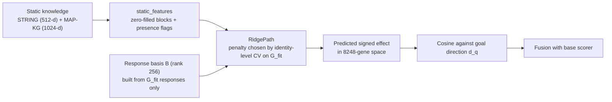
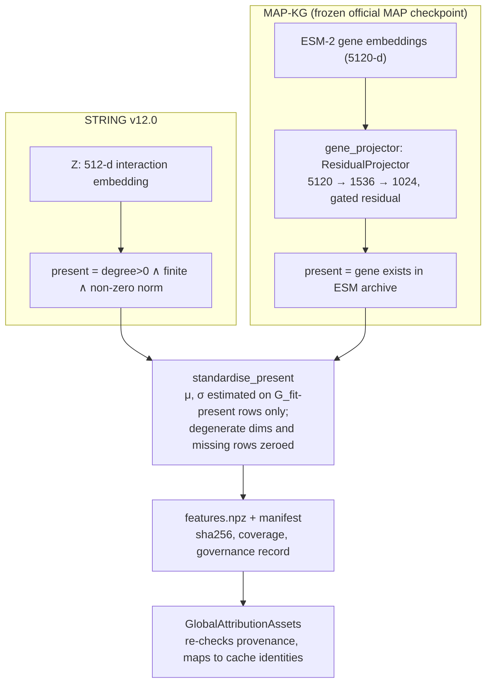

This page documents the two static knowledge modalities — **STRING** and **MAP-KG** — that carry candidate-gene information into the Candidate Effect Distillation (CED) predictor. It covers where each modality comes from, how its feature archive is built and standardized, the provenance gates that guard it, how missing knowledge is handled, and how the features are assembled into the ridge predictor's input matrix. Predictor training mechanics are covered in [Ridge Effect Predictor](12-ridge-effect-predictor); how the resulting scores are combined with the base scorer is covered in [Score Fusion and Beta Selection](14-score-fusion-and-beta-selection).

Sources: [README.md](README.md#L93-L104), [contract.py](src/gene_open_inverse/candidate_effect_distillation_v1/contract.py#L5-L12)

## Position in the Candidate Effect Distillation Pipeline

CED addresses a specific deployment problem: for a candidate whose measured response is unavailable, the only legal inputs are static knowledge descriptors. The protocol's framing is explicit — STRING and MAP-KG live in a space with no built-in relationship to the desired source-to-target transition, so instead of asking a ranker to learn both *what a candidate does* and *how to compare it* under weak supervision, distillation learns a single map `static knowledge → signed gene-space effect` on `G_fit`, after which deployment-time comparison is a plain cosine in the shared 8248-gene coordinate system. The knowledge features are therefore the *only* carrier of candidate identity at inference time.

Sources: [contract.py](src/gene_open_inverse/candidate_effect_distillation_v1/contract.py#L5-L12), [README.md](README.md#L93-L104)

## The Two Knowledge Modalities

The primary track fixes exactly two modalities: `PRIMARY_MODALITIES = ("STRING", "MAPKG")`. A third modality, TEXT (literature-derived gene descriptions), exists in the frozen asset chain but is excluded from the primary model by the `GENE_INFORMATION_POLICY_v1` literature-leakage bar and is carried only as a labelled legacy-contract comparator. The comparison below summarizes each modality's provenance, geometry, and presence semantics as implemented in the build and loading code.

| Property | STRING | MAP-KG | TEXT (legacy comparator only) |
| :--- | :--- | :--- | :--- |
| Upstream source | STRING v12.0 protein interaction database | MAP frozen knowledge-graph gene representation ([MAGIC-AI4Med/MAP](https://github.com/MAGIC-AI4Med/MAP)) | NCBI gene descriptions + text encoder |
| Raw representation | 512-d interaction embedding (`Z` archive) | 1024-d output of the frozen MAP checkpoint's `gene_projector` applied to 5120-d ESM-2 gene embeddings | 384-d description embedding |
| Presence rule | `degree > 0` ∧ all-finite ∧ non-zero norm | gene present in the ESM embedding archive | non-empty mapped description |
| Standardization | mean/σ from G_fit-present rows only | mean/σ from KG_fit-present rows only | mean/σ from G_fit-present rows only |
| Status in primary track | Primary modality | Primary modality | Excluded (`PRIMARY_EXCLUDES_TEXT = True`) |

Sources: [DATA_SOURCES.md](DATA_SOURCES.md#L7-L14), [contract.py](src/gene_open_inverse/candidate_effect_distillation_v1/contract.py#L41-L44), [build_features.py](src/gene_open_inverse/model/mapkg_candidate_adjudication_v1/build_features.py#L54-L67), [assets.py](src/gene_open_inverse/model/global_objective_knowledge_attribution_v1/assets.py#L116-L123)

## How the Feature Archive Is Built

Both modality archives are produced by `mapkg_candidate_adjudication_v1/build_features.py`, whose module contract is stated in its first line: extract static STRING and frozen official MAP-KG gene features, **never reading any perturbation response**. The STRING path is purely algebraic: it loads the 512-dimensional `Z` matrix, forms the presence mask from network degree, finiteness, and non-zero norm, and standardizes present rows. The MAP-KG path is a frozen forward pass: each gene's 5120-d ESM-2 embedding is pushed through the checkpoint's `gene_projector` — a `ResidualProjector` mapping 5120 → 1536 → 1024 with a sigmoid-gated residual branch — under `torch.inference_mode()`, with no fine-tuning and no downstream MAP training state loaded.

The shared standardization primitive, `standardise_present`, is deliberately conservative: μ and σ are computed **only over G_fit-present rows** (in this module's split, `KG_fit`), dimensions whose σ falls below a configured floor are zeroed, and all absent rows are written as zeros. This means no evaluation-side candidate ever contributes to feature preprocessing statistics.

Sources: [build_features.py](src/gene_open_inverse/model/mapkg_candidate_adjudication_v1/build_features.py#L1-L16), [build_features.py](src/gene_open_inverse/model/mapkg_candidate_adjudication_v1/build_features.py#L54-L67), [common.py](src/gene_open_inverse/model/mapkg_candidate_adjudication_v1/common.py#L73-L82)

> [!TIP]
> The `standardise_present` rule is a leakage firewall, not just normalization hygiene: because μ/σ come solely from G_fit-present rows, G_select and G_check candidates influence neither the feature scale nor the dimensionality mask. This is the same identity-level separation discipline documented in [Leakage Prevention and Identity-Level Cross-Validation](21-leakage-prevention-and-identity-level-cross-validation).

## Provenance Gates and Integrity Assertions

Both feature construction and asset loading are guarded by hard assertions that bind each knowledge archive to its claimed provenance. At build time, the runner refuses to proceed unless the upstream legality gate reads **PASS**, the MAP checkpoint matches a recorded size and MD5, and the ESM archive matches a recorded SHA-256. The extractor additionally strips only the `gene_projector.` prefix from checkpoint state and asserts that no response-prediction-specific keys (`perturb`, `scfm`, `condition_encoder`, `cell_projector`, `gene_decoder`, `project_out`) are present — preventing a downstream perturbation-trained model from being smuggled in under a MAP-KG label. The emitted manifest records `STATIC_FEATURES_COMPLETE_NO_RESPONSE_READ` status plus governance flags asserting that no perturbation response, no relevance data, no downstream MAP checkpoint, and no MAP-KG fine-tuning were involved.

| Check | Location | Failure mode |
| :--- | :--- | :--- |
| Legality gate text `Gate status: **PASS**` | Build entry | Refuses to build features |
| MAP checkpoint size + MD5; ESM SHA-256 | Build entry | Refuses to build features |
| No downstream perturbation keys in checkpoint | State extraction | Assertion error |
| Manifest status `STATIC_FEATURES_COMPLETE_NO_RESPONSE_READ`, governance flags false | Asset loading | `RuntimeError` on load |
| Manifest-bound archive hash; universe/shape validation | Asset loading | `RuntimeError` on load |

The loader re-verifies everything independently: `GlobalAttributionAssets._load_multi` rejects any MAP-KG archive whose manifest fails the response-independent provenance contract, validates the TEXT freeze against its own manifest hash, then maps each archive from its native gene universe onto the frozen cache identities, dropping any row that is absent, non-finite, or zero-norm.

Sources: [build_features.py](src/gene_open_inverse/model/mapkg_candidate_adjudication_v1/build_features.py#L44-L53), [build_features.py](src/gene_open_inverse/model/mapkg_candidate_adjudication_v1/build_features.py#L28-L42), [build_features.py](src/gene_open_inverse/model/mapkg_candidate_adjudication_v1/build_features.py#L70-L75), [assets.py](src/gene_open_inverse/model/global_objective_knowledge_attribution_v1/assets.py#L105-L123)

## Contract Rules: Primary versus Legacy Modalities and Role Limits

The modality whitelist is enforced structurally, not by convention: `GlobalAttributionAssets.__init__` accepts only the frozen `("STRING",)` factorial path or the full `("STRING", "MAPKG", "TEXT")` path, and the CED runner instantiates the latter while consuming only `PRIMARY_MODALITIES` downstream. The TEXT exclusion is resolved by *non-dependence* rather than argument — anything carrying TEXT is reported as a labelled legacy-contract comparator, per `TEXT_EXCLUSION_REASON`. Role access is equally narrow: `role_arrays` raises for any role other than `G_fit` or `G_select`, so `G_check` is structurally inaccessible to the feature pathway.

```mermaid
flowchart LR
    A["GlobalAttributionAssets<br/>(whitelist: STRING ∣ STRING+MAPKG+TEXT)"] -->|"role_arrays('G_fit') / role_arrays('G_select')"| B["AttributionRoleArrays<br/>capabilities + capability_present"]
    B -->|dict of per-modality arrays| C["static_features()"]
    C --> D["StaticFeatures<br/>values, present_any, names"]
    D --> E["RidgePath / cross_validate<br/>(G_fit only)"]
    E --> F["PREDICTED_EFFECT_COSINE<br/>on G_select"]
    X["G_check"] -.->|"access forbidden"| A
```

Sources: [contract.py](src/gene_open_inverse/candidate_effect_distillation_v1/contract.py#L23-L28), [contract.py](src/gene_open_inverse/candidate_effect_distillation_v1/contract.py#L41-L44), [assets.py](src/gene_open_inverse/model/global_objective_knowledge_attribution_v1/assets.py#L36-L39), [assets.py](src/gene_open_inverse/model/global_objective_knowledge_attribution_v1/assets.py#L129-L131), [run.py](src/gene_open_inverse/candidate_effect_distillation_v1/run.py#L59-L60)

## Feature Assembly into the Predictor Input

`static_features(role, modalities)` is the single choke point where knowledge archives become a predictor-ready matrix. For each modality it takes the standardized capability block, zeroes rows where the modality is absent (`values * present[:, None]`), and appends one binary present-flag column per modality, yielding a `StaticFeatures` record with `values`, an `any`-modality `present_any` mask, and modality names. With the primary pair, the deployed feature dimension is 512 (STRING) + 1024 (MAP-KG) + 2 (flags) = **1538**; the runner records this as `feature_dimension` in its output manifest. The fit population is likewise knowledge-defined: `RIDGE_FIT_POPULATION` is "G_fit candidates with at least one primary modality present", selected via `StaticFeatures.fit_rows()`.

| Input component | Shape per candidate | Absent-row behavior |
| :--- | :--- | :--- |
| STRING block | 512 | zeroed; flag column = 0 |
| MAP-KG block | 1024 | zeroed; flag column = 0 |
| Presence flags | 2 | encodes exactly which modalities exist |

Sources: [predictor.py](src/gene_open_inverse/candidate_effect_distillation_v1/predictor.py#L21-L43), [run.py](src/gene_open_inverse/candidate_effect_distillation_v1/run.py#L104-L119), [contract.py](src/gene_open_inverse/candidate_effect_distillation_v1/contract.py#L61-L62)

> [!TIP]
> The presence-flag columns make missingness itself a learnable feature: the ridge can condition its use of the knowledge blocks on which modalities exist, rather than treating zero-fill as ordinary signal. The paired `present_any` mask then serves a separate, non-learned role in the all-missing rule below.

## Handling Candidates with Missing Knowledge

A candidate carrying **no** static modality has no predicted effect at all. The contract fixes this case to an exactly neutral score of `ALL_MISSING_SCORE = 0.0` — a cosine's own indifference point, fixed in advance and never tuned — explicitly rejecting the alternative of a shared learnable token, which in a previous phase put 92 information-free genes at the top of every goal-blind ordering. The implementation enforces this at two points: Phase 4 zeroes the reconstructed effect vector for all-missing rows, and Phase 5 forcibly overwrites their score column to 0.0 so they can never win a ranking slot through geometry. The counts and fractions of such candidates in both roles are recorded in the run output under `all_missing`.

| Scenario | Predicted effect | Score behavior |
| :--- | :--- | :--- |
| ≥1 primary modality present | Ridge output reconstructed through basis | Standard cosine against goal direction |
| All modalities missing | Zeroed | Fixed at 0.0, excluded from learned ranking |

The bundled synthetic demo exercises this exact path with toy capability matrices (12-d STRING, 10-d MAPKG — deliberately not the deployed dimensions, since it is a software smoke test): it zeroes the two all-missing candidates' effects and prints their resulting raw scores, confirming the neutral-score behavior end to end.

Sources: [contract.py](src/gene_open_inverse/candidate_effect_distillation_v1/contract.py#L32-L36), [contract.py](src/gene_open_inverse/candidate_effect_distillation_v1/contract.py#L71-L76), [run.py](src/gene_open_inverse/candidate_effect_distillation_v1/run.py#L121-L129), [run.py](src/gene_open_inverse/candidate_effect_distillation_v1/run.py#L145-L149), [ced_demo.py](examples/ced_demo.py#L23-L36)

## Why Static Knowledge Enters Only Through Distillation

The design's central bet is architectural: a linear map from knowledge space to basis coefficients, chosen entirely inside `G_fit`, is the *simplest* transfer mechanism that can carry design signal — and its simplicity is diagnostic. If a linear map from STRING and MAP-KG carries ranking signal, that is the finding; if it does not, a larger model would only make the negative result harder to attribute. Every tunable choice is made by identity-level cross-validation on `G_fit` (a candidate never appears on both sides of a fold), and the deployment comparison itself requires no learning: the predicted effect lands in the same 8248-gene coordinate system as the query direction, so scoring is a cosine.

| Design choice | Rationale | Trade-off accepted |
| :--- | :--- | :--- |
| Multi-output ridge (linear map) | Negative results remain attributable; signal, if present, is provable | Forfeits nonlinear knowledge interactions |
| Zero-fill + presence flags | Missingness is explicit, uniform-shape matrix | Absent rows contribute exact zeros |
| Fixed neutral score for all-missing | No learnable token to be exploited by goal-blind orderings | Such candidates cannot be ranked above others by the effect branch |
| Penalty by held-out gene-space cosine | Deployment use is direction comparison, not magnitude | Squared-error choice reported only as sensitivity |

Sources: [predictor.py](src/gene_open_inverse/candidate_effect_distillation_v1/predictor.py#L1-L11), [contract.py](src/gene_open_inverse/candidate_effect_distillation_v1/contract.py#L5-L12), [contract.py](src/gene_open_inverse/candidate_effect_distillation_v1/contract.py#L63-L68)

## Reading Progression

To see how the response basis these features are mapped onto is constructed, continue with [Response Basis Construction](11-response-basis-construction); for the ridge fitting, cross-validation, and penalty selection that consume `StaticFeatures`, see [Ridge Effect Predictor](12-ridge-effect-predictor); for how `PREDICTED_EFFECT_COSINE` is combined with the base scorer, see [Score Fusion and Beta Selection](14-score-fusion-and-beta-selection). The governance and hashing discipline around these knowledge archives connects directly to [Artifact Verification and SHA-256 Manifests](23-artifact-verification-and-sha-256-manifests), and the deployment regime where measured candidate responses are masked — making these static features the only legal carrier of candidate information — is analyzed in [Response Masking and Open-Vocabulary Analyses](18-response-masking-and-open-vocabulary-analyses).
