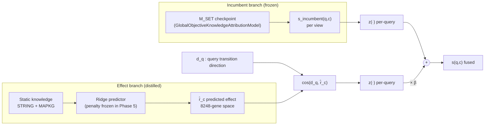
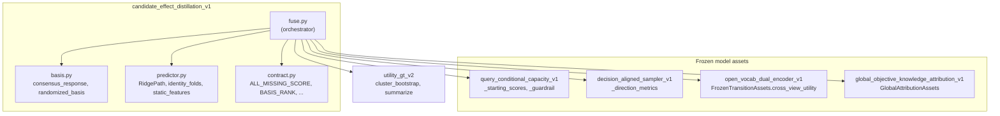
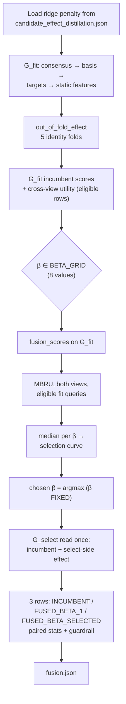

This page documents Phases 8–9 of the Candidate Effect Distillation pipeline: how the learned ridge-based effect branch is fused with the frozen incumbent scorer, and how the single fusion weight β is selected. The implementation lives entirely in `fuse.py`, which produces one artifact — `fusion.json` — recording the β selection curve, honesty diagnostics, and paired evaluation rows. The module's design constraint is stated in its first line: *"the smallest form that respects the firewall"* — exactly one quantity is fitted (the scalar β), and it is fitted on `G_fit` alone.

This page builds directly on the preceding pipeline stages: the response basis from [Response Basis Construction](11-response-basis-construction), the ridge map from [Ridge Effect Predictor](12-ridge-effect-predictor), and the static descriptors from [Knowledge Features: STRING and MAP-KG](13-knowledge-features-string-and-map-kg).

Sources: [fuse.py](src/gene_open_inverse/candidate_effect_distillation_v1/fuse.py#L1-L20), [run.py](src/gene_open_inverse/candidate_effect_distillation_v1/run.py#L1-L8)

## The Fusion Rule

The integrated score composes two branches per query–candidate pair, per view:

```
s(q,c) = z[ s_incumbent(q,c) ] + β · z[ cos(d_q, r̂_c) ]
```

where `z` is a **per-query standardization** across candidates: each score row is centered and scaled to mean 0, variance 1 within one query (with a `1e-12` epsilon floor, so a query with constant scores does not divide by zero). This is implemented in `_row_z`. Standardizing per query — rather than globally — is what makes β dimensionless and comparable across queries whose incumbent score spreads differ by orders of magnitude. The effect branch computes the cosine between the query's own transition direction `d_q` and the candidate's predicted effect `r̂_c` (both L2-normalized via `_unit`, which floors norms at `1e-30`).

The standardized combination is **rank-preserving within each branch**: `z` is a monotone per-row transform, so `argsort` of the fused matrix equals `argsort` of the sum of rank-preserving components (enforced by test_08). This also guarantees the `β = 0` edge case exactly restores the incumbent ordering, since `β · z(cosine)` collapses to an exact zero matrix (enforced by test_07).

Sources: [fuse.py](src/gene_open_inverse/candidate_effect_distillation_v1/fuse.py#L4-L19), [fuse.py](src/gene_open_inverse/candidate_effect_distillation_v1/fuse.py#L46-L53), [test_protocol.py](src/gene_open_inverse/candidate_effect_distillation_v1/test_protocol.py#L124-L136)

### Concept relationships

To read the diagram: the incumbent branch is the frozen neural scorer from the base model; the effect branch is the distilled linear ridge from the earlier phases. Each branch is standardized independently per query, then combined by a weighted sum where β scales only the effect branch.



Sources: [fuse.py](src/gene_open_inverse/candidate_effect_distillation_v1/fuse.py#L71-L80), [query_conditional_capacity_v1/run.py](src/gene_open_inverse/model/query_conditional_capacity_v1/run.py#L36-L55)

### Module interaction map

`fuse.py` is deliberately thin: it orchestrates frozen components rather than defining new models. It pulls the consensus response and randomized basis from `basis.py`, the ridge machinery (`RidgePath`, `identity_folds`, `static_features`) from `predictor.py`, every tunable constant from `contract.py`, the incumbent scorer entry point `_starting_scores` and the J-guardrail from the frozen model assets, the ranking metric `_direction_metrics` from the sampler evaluator, and bootstrap statistics from `utility_gt_v2`.



Sources: [fuse.py](src/gene_open_inverse/candidate_effect_distillation_v1/fuse.py#L32-L43), [predictor.py](src/gene_open_inverse/candidate_effect_distillation_v1/predictor.py#L1-L12)

## The Out-of-Fold Firewall

The central honesty problem: β is selected by measuring how much the effect branch improves ranking on `G_fit` — but the ridge was *trained* on `G_fit` measured responses. If β were fitted against in-sample effect predictions, the effect branch would look far better on `G_fit` than it can be on any deployment candidate, and *"β would be chosen for a model that does not exist."* The fix is `out_of_fold_effect`: for every `G_fit` candidate, the effect prediction is produced by a ridge that never saw that candidate's measured response.

The mechanism reuses the identity-level fold machinery from `predictor.py`: the eligible `G_fit` rows are partitioned into 5 disjoint identity blocks (`identity_folds`, seed `20260918` — a candidate is one identity, so leakage across folds is structurally impossible). For each held fold, a fresh `RidgePath` is fit on the remaining folds and predicts coefficients for the held candidates; coefficients are then reconstructed into gene space via the shared basis. Candidates outside the eligible set (all modalities missing) get an exactly-zero effect vector.

The cost of skipping this firewall is not left to argument — it is measured. The run computes both an out-of-fold and an in-sample median cosine-to-measured on `G_fit` and records them as `prediction_honesty`; the in-sample value exists *"only to show how much an in-sample beta would have been misled."* Test_05 asserts on a synthetic fixture that the in-sample cosine strictly exceeds the honest one, proving the fixture is capable of detecting the optimism it guards against.

> [!TIP]
> Every `G_fit` effect prediction used anywhere in β selection comes from a ridge trained on the other four folds — the same `identity_folds` primitive that selects the ridge penalty. This means β is calibrated against exactly the predictor quality that deployment can deliver, not the inflated quality of a predictor grading its own training data.

Sources: [fuse.py](src/gene_open_inverse/candidate_effect_distillation_v1/fuse.py#L11-L16), [fuse.py](src/gene_open_inverse/candidate_effect_distillation_v1/fuse.py#L56-L68), [fuse.py](src/gene_open_inverse/candidate_effect_distillation_v1/fuse.py#L103-L112), [predictor.py](src/gene_open_inverse/candidate_effect_distillation_v1/predictor.py#L70-L75), [test_protocol.py](src/gene_open_inverse/candidate_effect_distillation_v1/test_protocol.py#L85-L101)

## Beta Selection Protocol

β is selected by grid search over the frozen constant `BETA_GRID = (0.0, 0.25, 0.5, 0.75, 1.0, 1.5, 2.0, 3.0)` — eight values, spanning "effect branch off" (`0.0`) through parity (`1.0`) to effect-branch dominance (`3.0`). For each grid value, the fused scores are computed on `G_fit` using the out-of-fold effects, evaluated with `_direction_metrics` on both views over the **eligible** `G_fit` queries (rows from `G_fit_eligible.npy`), and the per-query MBRU values from both views are concatenated; the selection criterion is the **median** MBRU. The chosen β is the grid maximizer of that median. The full curve is preserved in the artifact as `beta_selection_curve_G_fit_MBRU`, alongside the declaration `"beta_selected_on": "G_fit eligible queries only"`.

The criterion metric — MBRU (from `mbru_from_nru(normalized_ranked_utility(...))`) plus `Mean@B` and `HighValueCount@B` at a 95th-percentile high-value threshold — is the same training-side direction-utility surrogate the base scorer was optimized against, computed with `stable_order` excluding the self-pair. Full metric definitions are covered in [Ranking Metrics: BU@B, MU@B, PHR@B](8-ranking-metrics-buatb-muatb-phratb).

The second firewall: **`G_select` is never consulted while choosing β**. Only after `chosen = max(BETA_GRID, key=...)` is fixed are the select-role assets loaded — incumbent scores, transitions, features, and the select-side effect predicted by the fully-fit ridge (the same `RidgePath` fit on all eligible `G_fit` rows, using the penalty inherited from the earlier distillation artifact's `cross_validation.selected_penalty`). After selection, the fit-side incumbent scores and utilities are explicitly `del`eted before the select side is built, so the two phases cannot share state.

Sources: [fuse.py](src/gene_open_inverse/candidate_effect_distillation_v1/fuse.py#L43), [fuse.py](src/gene_open_inverse/candidate_effect_distillation_v1/fuse.py#L114-L124), [fuse.py](src/gene_open_inverse/candidate_effect_distillation_v1/fuse.py#L126-L133), [fuse.py](src/gene_open_inverse/candidate_effect_distillation_v1/fuse.py#L93-L94), [decision_aligned_sampler_v1/evaluate.py](src/gene_open_inverse/model/decision_aligned_sampler_v1/evaluate.py#L54-L69)

### Selection and evaluation flow

Reading the diagram: everything above the "β fixed" barrier touches only `G_fit` (with out-of-fold effects); everything below reads `G_select` exactly once, with β already frozen.



Sources: [fuse.py](src/gene_open_inverse/candidate_effect_distillation_v1/fuse.py#L83-L133), [fuse.py](src/gene_open_inverse/candidate_effect_distillation_v1/fuse.py#L146-L155)

## Reporting Rows: Three Numbers, Not One

The select-side evaluation emits exactly three rows, each isolating a different claim. Every row is evaluated with the same `_direction_metrics` on both views and the same `_guardrail` on the four-way eligible subset — the physical-units endpoint-improvement check `J(a) = 2a⟨r,d⟩ − a²‖r‖²`, cross-fitted so the measurement that chooses attenuation never grades it (see [Held-Out Context Evaluation Protocol](9-held-out-context-evaluation-protocol)). Each fused row also carries a **paired-against-incumbent** block: per-query MBRU differences against the incumbent row, summarized with a cluster bootstrap (95% CI at the median) and the fraction of queries improved.

| Row | β | What it isolates |
|---|---|---|
| `INCUMBENT` | `null` | The frozen base scorer alone; the reference every other row is paired against |
| `FUSED_BETA_1` | `1.0` | Fusion at unit weight — needs **no fitting at all**; a result surviving only at a fitted weight is explicitly reported as weaker |
| `FUSED_BETA_SELECTED` | argmax of G_fit curve | The fitted-fusion result, with its paired bootstrap CI |

| Selection-curve fields | Content |
|---|---|
| `beta_grid` | The frozen 8-value grid |
| `beta_selected_on` | `"G_fit eligible queries only"` |
| `beta_selection_curve_G_fit_MBRU` | Median MBRU per β, both views concatenated |
| `prediction_honesty` | Out-of-fold vs in-sample median cosine to measured consensus |
| `read_G_check` | Always `false` — the sealed context is never opened |

Sources: [fuse.py](src/gene_open_inverse/candidate_effect_distillation_v1/fuse.py#L18-L19), [fuse.py](src/gene_open_inverse/candidate_effect_distillation_v1/fuse.py#L157-L176), [decision_aligned_sampler_v1/evaluate.py](src/gene_open_inverse/model/decision_aligned_sampler_v1/evaluate.py#L1-L22)

## All-Missing Candidates and the Neutral-Score Policy

Candidates whose static knowledge is entirely absent have no predicted effect. The contract fixes their raw effect-branch score at `ALL_MISSING_SCORE = 0.0` — *"a cosine's own indifference point, fixed here and not tuned"* — with **no learnable token**, because the previous phase showed a shared learnable token is what pushed 92 information-free genes to the top of every goal-blind ordering. In `fusion_scores`, the zero-norm effect rows are detected (`norm ≤ 0`) and their cosine columns overwritten with `0.0` **before** per-query standardization.

This placement has a subtle consequence that the protocol tests make explicit: after `z`, the neutral candidates' fused scores are equal *to each other within a query row*, but their absolute fused value depends on that query's own score spread. Test_06 therefore asserts the correct invariant — row-equality (`block − block[:, :1] ≈ 0`) and finiteness, not cross-row equality — so the policy can never prefer one information-free candidate over another, while the same candidates may sit at different fused values under different queries. The all-missing candidates themselves are zeroed out of the effect vector in both the out-of-fold (`effect[missing] = 0.0`) and select-side (`select_effect[~present_any] = 0.0`) paths.

> [!TIP]
> The neutral score `0.0` is applied to the *raw cosine block* before `_row_z`, not to the fused output. Post-standardization, "neutral" means "indistinguishable from every other neutral candidate within the query," not "value zero." Reproducing or extending the fusion code must preserve this ordering of operations or the all-missing policy silently changes meaning.

Sources: [contract.py](src/gene_open_inverse/candidate_effect_distillation_v1/contract.py#L26-L30), [contract.py](src/gene_open_inverse/candidate_effect_distillation_v1/contract.py#L63-L74), [fuse.py](src/gene_open_inverse/candidate_effect_distillation_v1/fuse.py#L71-L80), [test_protocol.py](src/gene_open_inverse/candidate_effect_distillation_v1/test_protocol.py#L104-L121)

## Protocol Invariants Enforced by Tests

The test module's stated purpose: *"Each names a failure that would otherwise look like a valid gain."* The fusion-relevant invariants form a defense-in-depth chain around the two firewalls:

| Test | Invariant | Failure it prevents |
|---|---|---|
| test_05 | Out-of-fold cosine < in-sample cosine on the fixture; all-missing rows exactly zero | β tuned against an optimistic predictor that does not exist at deployment |
| test_06 | All-missing candidates equal within every query row, finite fused scores | A "neutral" policy that secretly prefers specific information-free candidates |
| test_07 | `β = 0` reproduces the incumbent `argsort` exactly | Fusion code silently perturbing the baseline it claims to improve upon |
| test_08 | `_row_z` is per-query (row mean 0, std 1) and rank-preserving | Standardization changing branch orderings, making β non-interpretable |
| test_09 | CV fold sizes partition exactly; a fold is never scored by its own predictor | Penalty (and thus effect quality) selected on leaked folds |
| test_10 | Frozen constants match declarations (`ALL_MISSING_SCORE == 0.0`, `RIDGE_FOLDS == 5`, …) | Silent drift of the contract between runs |

Sources: [test_protocol.py](src/gene_open_inverse/candidate_effect_distillation_v1/test_protocol.py#L1-L6), [test_protocol.py](src/gene_open_inverse/candidate_effect_distillation_v1/test_protocol.py#L85-L169)

## Artifact and CLI Interface

The module writes a single JSON artifact, `fusion.json`, under schema `VCDESIGN_CANDIDATE_EFFECT_DISTILLATION_V1_FUSION`, with sorted keys and a runtime block (UTC timestamp, Python and NumPy versions). The console output prints the honesty contrast, the full β selection curve, and a per-row table of MBRU, `Mean@B`, `HighValueCount@B`, guardrail `RU@10` / `J>0@10`, and the paired bootstrap interval against the incumbent.

| CLI argument | Purpose |
|---|---|
| `--config` | Frozen `AuditConfig` JSON (checkpoint paths, asset arguments) |
| `--eligibility` | Directory holding `G_fit_eligible.npy` / `G_select_eligible.npy` |
| `--asset` | Directory with `quarter_responses.npy`, `identity_axis.npy`, `four_way_eligible.npy` (guardrail inputs) |
| `--distillation` | Directory of the Phase 1–6 artifact supplying the selected ridge penalty |
| `--output` | Destination for `fusion.json` |
| `--device` | Torch device, default `cuda` |

Sources: [fuse.py](src/gene_open_inverse/candidate_effect_distillation_v1/fuse.py#L146-L155), [fuse.py](src/gene_open_inverse/candidate_effect_distillation_v1/fuse.py#L178-L182), [fuse.py](src/gene_open_inverse/candidate_effect_distillation_v1/fuse.py#L184-L209)

## Position in the Broader Evaluation

The fusion stage is the integration point of the distillation pipeline: it answers whether the knowledge-feature effect branch adds ranking value *on top of* the incumbent scorer, under leakage-controlled calibration. The leakage mechanics it relies on — identity-level folds, the sealed `G_check`, the fit/select discipline — are analyzed in depth in [Leakage Prevention and Identity-Level Cross-Validation](21-leakage-prevention-and-identity-level-cross-validation). For the next stage of the pipeline, continue to [Final Clean Base Scorer](15-final-clean-base-scorer); for how these fused numbers land in the paper's headline results, see [Key Benchmark Findings](26-key-benchmark-findings).
