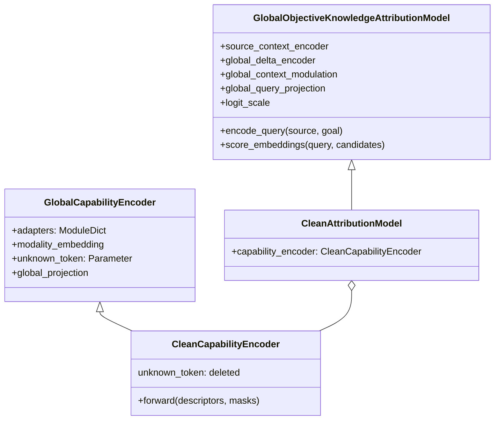
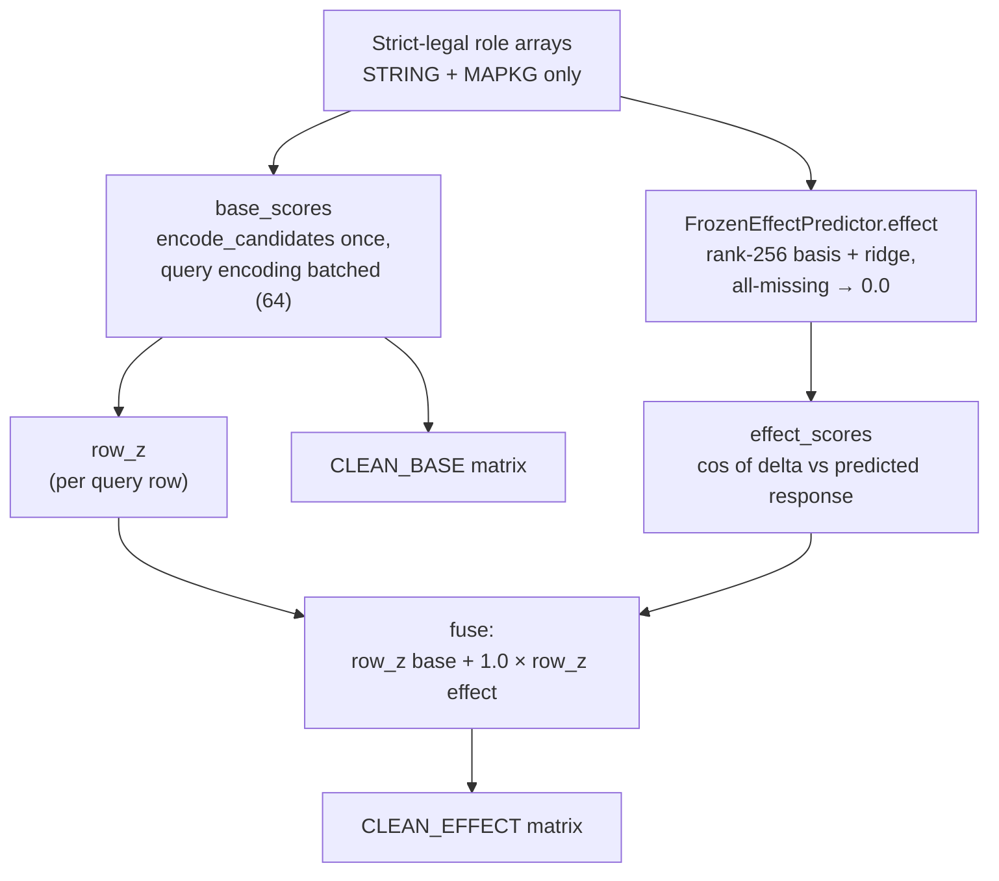
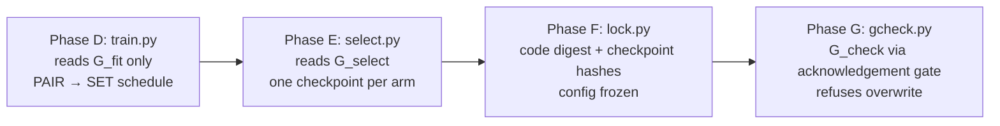

The Final Clean Base Scorer is the locked retrieval model that produces the paper's primary results. It lives in `src/gene_open_inverse/final_clean_model_v1/`, a self-contained module that defines the model pair (`CLEAN_BASE` and `CLEAN_EFFECT`), the frozen evaluation contract, the training entry point, and the single gated evaluation that reads the `G_check` split. The module's design philosophy is minimal delta: it inherits the incumbent architecture literally and changes exactly one thing — it removes the learnable unknown token — so that every measured difference is attributable to that one correction and nothing else.

Sources: [model.py](src/gene_open_inverse/final_clean_model_v1/model.py#L1-L8), [\_\_init\_\_.py](src/gene_open_inverse/final_clean_model_v1/__init__.py#L1-L2)

## Design Thesis: One Correction to the Incumbent

The clean model is a subclass, not a reimplementation. `CleanAttributionModel` extends `GlobalObjectiveKnowledgeAttributionModel` (the SRC-Energy-V2 global retrieval pathway) and swaps only the capability encoder, while `CleanCapabilityEncoder` extends `GlobalCapabilityEncoder` and deletes `unknown_token` from the parameter set. Every other weight, layer, and forward rule is inherited verbatim. This inheritance-by-construction guarantees that a before/after comparison isolates a single causal variable.

Sources: [model.py](src/gene_open_inverse/final_clean_model_v1/model.py#L18-L42), [model.py (incumbent)](src/gene_open_inverse/model/global_objective_knowledge_attribution_v1/model.py#L1-L3)

The correction matters because the incumbent gave candidates with no legal modality a shared *learnable* token — and the previous phase measured that token sitting at the top of every goal-blind ordering, placing 100% of information-free genes in its Top-10. The clean encoder replaces it with a fixed neutral: a candidate with no evidence contributes exactly zero to the score for every query. Zero is not arbitrary — it is a cosine similarity's own indifference point, chosen before looking at any selection data.

Sources: [model.py](src/gene_open_inverse/final_clean_model_v1/model.py#L1-L8), [contract.py](src/gene_open_inverse/final_clean_model_v1/contract.py#L1-L28)



The diagram shows the deliberate one-class-deep inheritance chain: `CleanAttributionModel` replaces its parent's capability encoder with `CleanCapabilityEncoder`, whose defining act is deleting `unknown_token` in `__init__`. The modality adapters and pooling arithmetic flow down unchanged from the frozen V2 knowledge layer.

Sources: [model.py](src/gene_open_inverse/final_clean_model_v1/model.py#L18-L26), [knowledge.py](src/gene_open_inverse/model/structured_requirement_capability_energy_v2/knowledge.py#L10-L23)

| Behavior | Incumbent (M_SET) | Final clean model |
|---|---|---|
| Candidate present in ≥1 modality | Pooled normalized tokens | Identical (inherited) |
| Candidate missing all modalities | Shared **learnable** UNKNOWN token | Fixed zero embedding → score exactly 0.0 |
| All-missing handling differs per arm | N/A | No — identical in both arms |
| Modality-restricted candidate banks | Available via `encode_modality_embeddings` | Deliberately `NotImplementedError` |
| Goal-blind ordering pathology | Unknown token ranked top of every ordering | Eliminated by construction |

Sources: [model.py](src/gene_open_inverse/final_clean_model_v1/model.py#L25-L42), [contract.py](src/gene_open_inverse/final_clean_model_v1/contract.py#L44-L48)

> [!TIP]
> The zero-embedding rule is what makes `CLEAN_EFFECT − CLEAN_BASE` a clean causal contrast: because both arms share every weight of one trained network, the score difference isolates the effect branch alone. Insert any learned fallback and the contrast becomes confounded.

## The Frozen Contract: Constants Before Computation

`contract.py` is the module's constitution: every design decision that could have been tuned is pinned as a named constant with a written justification, frozen before training and never revisited. The method of record is `CANDIDATE_EFFECT_DISTILLATION_V1`, the fusion is z-score additive with `beta = 1.0` — chosen *before any `G_check` access* for a principled reason: it is the only member of the fusion family with no fitted coefficient, so it cannot have been tuned on anything.

Sources: [contract.py](src/gene_open_inverse/final_clean_model_v1/contract.py#L31-L38)

| Constant | Value | Meaning |
|---|---|---|
| `FINAL_METHOD` | `CANDIDATE_EFFECT_DISTILLATION_V1` | Method of record |
| `FINAL_FUSION` / `FINAL_BETA` | `z_score_additive` / `1.0` | No fitted coefficient, selected before `G_check` |
| `PRIMARY_MODALITIES` | `("STRING", "MAPKG")` | Strict legal candidate features |
| `TEXT_STATUS` | `EXCLUDED_FROM_FINAL_PRIMARY_TRACK` | Banned by `GENE_INFORMATION_POLICY_v1` (literature-leakage bar) |
| `ALL_MISSING_CONTRIBUTION` | `0.0` | Neutral cosine value, identical in both arms |
| `ARMS` | `("CLEAN_BASE", "CLEAN_EFFECT")` | One network, two scoring rules |
| `EVALUATION_SPLIT_NAME` | `locked final evaluation split` | Must **not** be called "untouched blind test" |

Sources: [contract.py](src/gene_open_inverse/final_clean_model_v1/contract.py#L31-L61)

Two exclusions deserve attention. TEXT is barred from the primary track because literature-derived gene descriptions leak information the deployment cannot legally use — the legacy incumbent that carries TEXT stays in result tables as historical context but is explicitly *not* the paired comparator. And the split naming is deliberate honesty: earlier phases of the wider programme did read `G_check`, so this phase claims only that its method, predictor, fusion, and checkpoints were selected without it — not that the split is pristine.

Sources: [contract.py](src/gene_open_inverse/final_clean_model_v1/contract.py#L40-L52), [lock.py](src/gene_open_inverse/final_clean_model_v1/lock.py#L108-L114)

## Architecture Walkthrough: Query, Candidates, and the Neutral Embedding

The query path is inherited intact. A source state and goal state (each `[B, 8248]`) are encoded separately: a source context encoder produces a 512-dim context vector, while a deeper delta encoder embeds `goal − source`. A zero-initialized context modulation layer then produces FiLM-style `gamma`/`beta` parameters that scale and shift the delta embedding, and the result is projected to 256 dimensions and L2-normalized.

Sources: [model.py (incumbent)](src/gene_open_inverse/model/global_objective_knowledge_attribution_v1/model.py#L128-L151)

The candidate path is where the clean model diverges. Each modality (STRING: 512-d, MAPKG: 1024-d) passes through its own frozen V2 `CapabilityAdapter` (LayerNorm → Linear-512 → GELU → Dropout → Linear-128 → LayerNorm), is augmented with a learned modality embedding, and normalized into a token. The clean encoder then performs masked mean pooling over *present* tokens only — no UNKNOWN token is appended — projects to 256 dims, normalizes, and finally zeroes the embedding of any candidate with no present modality via `torch.where`.

Sources: [model.py](src/gene_open_inverse/final_clean_model_v1/model.py#L28-L36), [knowledge.py](src/gene_open_inverse/model/structured_requirement_capability_energy_v2/knowledge.py#L15-L23)

Scoring is a scaled inner product: `logit_scale.exp().clamp(max=100) × (query · candidate)`. Because an all-missing candidate's embedding is the zero vector, its inner product against *every* query is exactly zero — the neutral cosine value falls out of the arithmetic rather than being special-cased in the scorer. A convenience helper, `all_missing_mask`, recomputes the all-missing flag from role arrays by OR-ing the per-modality presence masks, keeping the candidate axis ordering stable.

Sources: [model.py (incumbent)](src/gene_open_inverse/model/global_objective_knowledge_attribution_v1/model.py#L153-L166), [model.py](src/gene_open_inverse/final_clean_model_v1/model.py#L45-L67)

> [!TIP]
> Training enforces the architecture's invariant at runtime: `train.py` scans `model.named_parameters()` and aborts if any name ends with `unknown_token`. The invariant is tested, asserted at build time, and structurally impossible to violate silently.

## Two Arms, One Network: CLEAN_BASE and CLEAN_EFFECT

One network is trained; the two arms are two *scoring rules* over the same weights. `CLEAN_BASE` is the network's raw retrieval score. `CLEAN_EFFECT` fuses that score with the frozen distillation effect branch: per-query-row z-scores of the base matrix plus `beta = 1.0` times per-query-row z-scores of `cos(d_q, r̂_c)` effect matrices, where all-missing candidates receive the declared neutral `0.0`. Row-wise z-scoring is order-preserving, so it changes only the calibration between arms, never the base ranker's internal ordering.

Sources: [train.py](src/gene_open_inverse/final_clean_model_v1/train.py#L10-L16), [scoring.py](src/gene_open_inverse/final_clean_model_v1/scoring.py#L95-L133)



The effect predictor is not loaded from disk — it is *rebuilt deterministically* from `G_fit` (consensus response → randomized rank-256 basis → ridge path at the CV-selected penalty) and then verified against the artifact the distillation phase saved, with a hard failure above `1e-3` max absolute difference. Recomputing makes the locked evaluation self-contained; checking makes it provably the same predictor.

Sources: [scoring.py](src/gene_open_inverse/final_clean_model_v1/scoring.py#L73-L92), [scoring.py](src/gene_open_inverse/final_clean_model_v1/scoring.py#L1-L9)

| Property | CLEAN_BASE | CLEAN_EFFECT |
|---|---|---|
| Score source | Trained network only | Network + frozen ridge effect predictor |
| Extra artifacts needed | Checkpoint only | Checkpoint + `G_fit` arrays + penalty |
| Effect-branch information | None | Static legal features → predicted response |
| All-missing candidate score | 0.0 | 0.0 (identical rule) |
| Checkpoint selection | Own epoch, own rule | Own epoch, own rule |
| Role in comparison | Baseline arm | Primary arm (`CLEAN_EFFECT − CLEAN_BASE`) |

Sources: [scoring.py](src/gene_open_inverse/final_clean_model_v1/scoring.py#L130-L133), [select.py](src/gene_open_inverse/final_clean_model_v1/select.py#L82-L92)

## Phase D: Training by Construction, Not by Inspection

Phase D's central claim is that the incumbent's recipe is *imported, not reimplemented*: `_epoch`, `_role_tensors`, `_seed`, `capture_branch_state`, and every hyperparameter constant come from the incumbent's `train_factorial.py`, so optimizer, scheduler, loss, sampler, batch size, seed, and objective schedule are identical **by construction** rather than by inspection. Exactly two deltas exist: the modality set is the strict legal pair (no TEXT), and the capability encoder has no learnable unknown token.

Sources: [train.py](src/gene_open_inverse/final_clean_model_v1/train.py#L1-L35)

| Recipe element | Value | Source |
|---|---|---|
| Seed | 20260916 | `train_factorial.SEED` (imported) |
| Optimizer | AdamW, LR 1e-4, WD 1e-4 | imported constants |
| Gradient clip | 1.0 | `CLIP_NORM` |
| Batch size | 8 identities | `BATCH_SIZE` |
| Objective schedule | PAIR epochs 1–5 → SET epochs 6–10 | `_epoch(objective=...)` |
| PAIR loss | `top_focused_pairwise_loss` (gt/predicted top-128, 256 random negatives, ≤4096 pairs/query) | imported |
| SET loss | `gt_top20_positive_set_loss` (positive_k=20) | imported |
| Precision | bfloat16 autocast on CUDA | `amp = device.type == "cuda"` |

Sources: [train_factorial.py](src/gene_open_inverse/model/global_objective_knowledge_attribution_v1/train_factorial.py#L19-L30), [train_factorial.py](src/gene_open_inverse/model/global_objective_knowledge_attribution_v1/train_factorial.py#L72-L77), [train_factorial.py](src/gene_open_inverse/model/global_objective_knowledge_attribution_v1/train_factorial.py#L110-L121)

The data path enforces legality defensively. The frozen asset loader only admits STRING or STRING+MAPKG+TEXT configurations, so `train.py` uses it *exactly as frozen* and then drops TEXT immediately via `strict_legal_role` — before any tensor exists — double-checking with runtime assertions (`"TEXT" in tensors` → hard failure). Checkpoints for epochs past the base phase are saved with SHA-256 digests, tagged with the schema `VCDESIGN_FINAL_CLEAN_MODEL_V1`, and a `train_manifest.json` records the full recipe, history, parameter count, and a `read_G_check: False` attestation.

Sources: [train.py](src/gene_open_inverse/final_clean_model_v1/train.py#L38-L60), [scoring.py](src/gene_open_inverse/final_clean_model_v1/scoring.py#L29-L48), [train.py](src/gene_open_inverse/final_clean_model_v1/train.py#L62-L107)

## Phases E–G: Selection, Lock, and the One Gated Evaluation

Phase E (`select.py`) is allowed exactly one decision: which epoch of the single training curve each arm uses, scored on `G_select` by median MBRU, with each arm free to pick its own checkpoint because each is scored by its own rule. Everything else — architecture, fusion, predictor, feature set, sampler, loss, query gate — is fixed before the script runs, and each per-epoch evaluation also records a guardrail block and the fraction of all-missing candidates in the top-budget prefix.

Sources: [select.py](src/gene_open_inverse/final_clean_model_v1/select.py#L1-L9), [select.py](src/gene_open_inverse/final_clean_model_v1/select.py#L84-L131)

Phase F (`lock.py`) writes the pre-evaluation seal: it hashes every source file in the four dependent packages into a combined `code_digest` (because a commit hash alone cannot identify uncommitted work), records the git commit, the selected checkpoints, the fusion, the predictor penalty, and the full evaluation protocol — then refuses to overwrite an existing lock and self-hashes the record into `lock_sha256`. After this file exists, no configuration change is permitted.

Sources: [lock.py](src/gene_open_inverse/final_clean_model_v1/lock.py#L1-L9), [lock.py](src/gene_open_inverse/final_clean_model_v1/lock.py#L21-L58)

Phase G (`gcheck.py`) is the one locked final evaluation — the *only* code in the repository that reaches `G_check`, and only through `locked_check_arrays`, which demands the explicit acknowledgement string `"I_AM_PERFORMING_THE_ONE_LOCKED_FINAL_EVALUATION"` and refuses to overwrite its own output. It scores seven policy rows (RANDOM, STRICT_LEGAL_CANDIDATE_PRIOR, EFFECT_BRANCH_ONLY, LEGACY_M_SET, CLEAN_BASE, CLEAN_EFFECT, MEASURED_RESPONSE_ORACLE), applies the frozen `QUERY_ELIGIBILITY_V1` gate at FDR 0.05 unchanged, and reports paired identity-cluster bootstrap contrasts (10,000 replicates) with `CLEAN_EFFECT − CLEAN_BASE` as the primary comparison.

Sources: [scoring.py](src/gene_open_inverse/final_clean_model_v1/scoring.py#L25-L26), [scoring.py](src/gene_open_inverse/final_clean_model_v1/scoring.py#L55-L70), [gcheck.py](src/gene_open_inverse/final_clean_model_v1/gcheck.py#L1-L17), [gcheck.py](src/gene_open_inverse/final_clean_model_v1/gcheck.py#L43-L55)



| Phase | Module | Split read | Decision permitted | Output |
|---|---|---|---|---|
| D | `train.py` | `G_fit` | None (frozen recipe) | Checkpoints + `train_manifest.json` |
| E | `select.py` | `G_select` | Checkpoint epoch per arm, nothing else | Selection record + SHA-256s |
| F | `lock.py` | none | None (hashes + seals) | `VCDESIGN_FINAL_LOCK_V1` record |
| G | `gcheck.py` | `G_check` (gated) | None (reads the lock) | Locked evaluation record |

Sources: [train.py](src/gene_open_inverse/final_clean_model_v1/train.py#L30-L35), [select.py](src/gene_open_inverse/final_clean_model_v1/select.py#L125-L131), [lock.py](src/gene_open_inverse/final_clean_model_v1/lock.py#L56-L70), [gcheck.py](src/gene_open_inverse/final_clean_model_v1/gcheck.py#L54-L55)

## Protocol Guarantees: What the Test Suite Pins Down

`test_protocol.py` converts the contract's prose promises into twelve executable assertions, so the guarantees survive refactoring. They cover the model invariants (no unknown token, exact-zero all-missing scores, single-modality candidates not treated as missing), the security gate (wrong acknowledgements raise `PermissionError`; the frozen loader still refuses `G_check` for all other callers), the fusion's frozen form and ordering preservation, TEXT exclusion, honest split naming, and the strict-legal restriction's error paths.

Sources: [test_protocol.py](src/gene_open_inverse/final_clean_model_v1/test_protocol.py#L1-L19)

| Test | Guarantee enforced |
|---|---|
| `test_01` | No parameter named `*_unknown_token` exists on the clean model |
| `test_02` | All-missing candidate embedding is exactly zero; scores exactly `ALL_MISSING_CONTRIBUTION` |
| `test_03` | A candidate present in one modality is *not* treated as missing |
| `test_04` / `test_05` | `G_check` unreachable without the acknowledgement; loader refuses it elsewhere |
| `test_06` / `test_07` | Fusion is exactly `row_z(base) + row_z(effect)`; `row_z` preserves per-query orderings |
| `test_08` / `test_09` | TEXT excluded; split named "locked final evaluation split", never "untouched blind test" |
| `test_10`–`test_12` | Strict-legal restriction drops TEXT, errors on missing modality; modality banks undefined |

Sources: [test_protocol.py](src/gene_open_inverse/final_clean_model_v1/test_protocol.py#L20-L142)

## Running It and Where to Go Next

Reproduction starts with the Phase D entry point, which writes checkpoints and a manifest and refuses non-empty output directories; the frozen reference checkpoint for the paper run is `checkpoints/final_clean_epoch_008.pt`, whose SHA-256 is recorded in `configs/paper_run_v1.json` and the processed-data manifest:

```bash
python3 -m gene_open_inverse.final_clean_model_v1.train \
  --config configs/paper_run_v1.json \
  --output outputs/final_clean_train \
  --device cuda
```

Sources: [REPRODUCE.md](REPRODUCE.md#L28-L43)

To go deeper, follow the catalog: [Training Pipeline and Frozen Configuration](16-training-pipeline-and-frozen-configuration) details the incumbent recipe internals that Phase D imports; [Score Fusion and Beta Selection](14-score-fusion-and-beta-selection) explains the fusion family that `beta = 1` was chosen from; [Knowledge Features: STRING and MAP-KG](13-knowledge-features-string-and-map-kg) covers the candidate descriptors feeding the capability adapters; [Leakage Prevention and Identity-Level Cross-Validation](21-leakage-prevention-and-identity-level-cross-validation) and [Artifact Verification and SHA-256 Manifests](23-artifact-verification-and-sha-256-manifests) expand the hygiene machinery seen in Phases F–G; and [Key Benchmark Findings](26-key-benchmark-findings) reports what the locked evaluation found.
