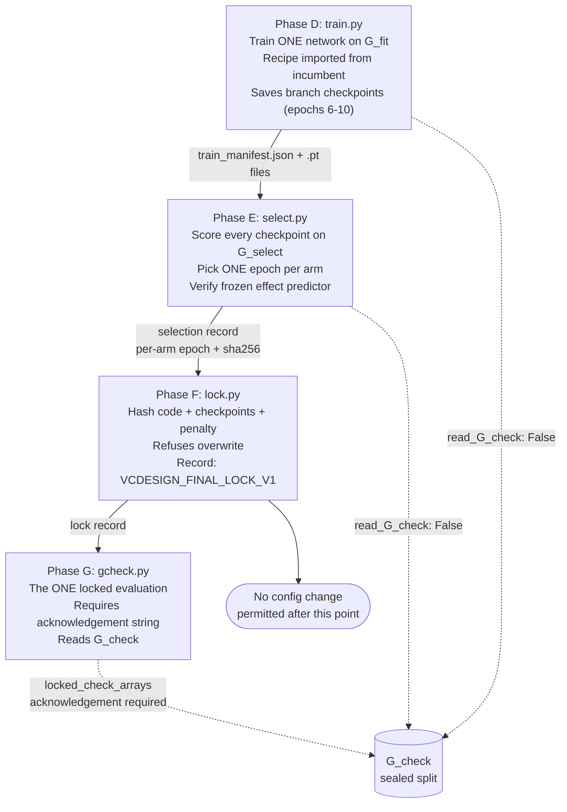

This page documents how the final clean base scorer is trained, how checkpoints are selected, and — critically — **what is frozen, when it was frozen, and why it can never be re-tuned**. The system is organized as a four-phase pipeline (train → select → lock → evaluate) under a strict information barrier: the held-out evaluation role `G_check` is structurally unreachable until the final phase, and every hyperparameter is committed *before* that phase runs. This page assumes you have read the model description in [Final Clean Base Scorer](15-final-clean-base-scorer).

## Pipeline Position: Four Phases Under an Information Barrier

The training pipeline is not a single script but a sequence of phases, each producing artifacts that later phases consume and hash. The defining constraint is that Phases D and E operate exclusively on `G_fit` (fitting) and `G_select` (selection); `G_check` is sealed behind an explicit acknowledgement string and a pre-evaluation lock:



Each training and selection manifest explicitly records `"read_G_check": False` ([train.py](src/gene_open_inverse/final_clean_model_v1/train.py#L86-L91), [select.py](src/gene_open_inverse/final_clean_model_v1/select.py#L85-L91)), and the selection phase states the only decision it may take: *"the checkpoint epoch of each arm, and nothing else"* ([select.py](src/gene_open_inverse/final_clean_model_v1/select.py#L87)).

Sources: [train.py](src/gene_open_inverse/final_clean_model_v1/train.py#L1-L124), [select.py](src/gene_open_inverse/final_clean_model_v1/select.py#L1-L146), [lock.py](src/gene_open_inverse/final_clean_model_v1/lock.py#L1-L162), [gcheck.py](src/gene_open_inverse/final_clean_model_v1/gcheck.py#L1-L70)

## The Imported Recipe: Identical by Construction

The most consequential design decision in Phase D is a negative one: **the training recipe is not reimplemented**. The optimizer, scheduler, loss, sampler, batch size, seed, horizon, and objective schedule are *imported as Python objects* from the incumbent's training module, `global_objective_knowledge_attribution_v1.train_factorial` — so they are identical to the incumbent *by construction* rather than by inspection ([train.py](src/gene_open_inverse/final_clean_model_v1/train.py#L6-L12)). This eliminates an entire class of reproduction bugs: a transcription error in a constant would be a *different program*, and here that program cannot exist.

Exactly **two deliberate deviations** from the incumbent exist, and both are enforced with runtime assertions rather than comments:
1. The modality set is the strict legal one (STRING + MAPKG) without TEXT — enforced by raising if TEXT ever reaches a tensor ([train.py](src/gene_open_inverse/final_clean_model_v1/train.py#L38-L53)).
2. The capability encoder has no learnable unknown token — enforced by scanning `named_parameters()` for any name ending in `unknown_token` ([train.py](src/gene_open_inverse/final_clean_model_v1/train.py#L54-L56)).

The frozen recipe constants ([train_factorial.py](src/gene_open_inverse/model/global_objective_knowledge_attribution_v1/train_factorial.py#L27-L28)):

| Constant | Value | Role |
|---|---|---|
| `SEED` | `20260916` | Seeds `random`, NumPy, and Torch (all devices) before training |
| `LR` | `1e-4` | AdamW learning rate |
| `WEIGHT_DECAY` | `1e-4` | AdamW weight decay |
| `CLIP_NORM` | `1.0` | Gradient clipping bound |
| `BATCH_SIZE` | `8` | Rows per optimizer step |
| `BASE_EPOCHS` | `5` | Epochs 1–5 run the `PAIR` objective |
| `FINAL_EPOCH` | `10` | Total horizon; epochs 6–10 run the `SET` objective |

The optimizer is constructed once — `torch.optim.AdamW(model.parameters(), lr=LR, weight_decay=WEIGHT_DECAY)` — and randomness flows through a dedicated `torch.Generator` seeded with `SEED`, which the sampler, pairwise-loss pair selection, and negative mining all share ([train.py](src/gene_open_inverse/final_clean_model_v1/train.py#L57-L60), [train_factorial.py](src/gene_open_inverse/model/global_objective_knowledge_attribution_v1/train_factorial.py#L74-L75)). Mixed precision is enabled automatically whenever the device is CUDA, using `torch.autocast` with `bfloat16` ([train_factorial.py](src/gene_open_inverse/model/global_objective_knowledge_attribution_v1/train_factorial.py#L83-L84)).

Sources: [train.py](src/gene_open_inverse/final_clean_model_v1/train.py#L6-L60), [train_factorial.py](src/gene_open_inverse/model/global_objective_knowledge_attribution_v1/train_factorial.py#L27-L84)

## Objective Schedule: PAIR Then SET

Training runs one network through a **two-stage objective schedule**. Epochs 1–5 (`BASE_EPOCHS`) optimize the `PAIR` objective; epochs 6–10 optimize the `SET` objective. The stage name maps deterministically to a loss composition via `combined_v2_loss` ([train_factorial.py](src/gene_open_inverse/model/global_objective_knowledge_attribution_v1/train_factorial.py#L41-L47)):

| Objective | Epochs | Composition | Loss components |
|---|---|---|---|
| `PAIR` ("global") | 1–5 | `pair_loss` alone | `top_focused_pairwise_loss` |
| `SET` ("conditional") | 6–10 | `pair_loss + 0.5 * set_loss` | pairwise + `gt_top20_positive_set_loss` |

The **pairwise term** is top-focused and utility-gap-weighted: for each query it takes the union of the ground-truth top-128, the predicted top-128, and 256 random eligible candidates (never materializing a full N² grid), forms pairs whose utility gap exceeds the measurement margin, caps at 4096 pairs per query, and weights each pair by its utility gap normalized by the eligible IQR ([loss.py](src/gene_open_inverse/model/open_vocab_dual_encoder_v1/loss.py#L20-L46)). The generating intervention itself is masked out via `self_indices` in both pair construction and reduction ([loss.py](src/gene_open_inverse/model/open_vocab_dual_encoder_v1/loss.py#L40-L46)).

The **set term** is a top-20 set loss: `logsumexp` over all legal candidates minus `logsumexp` over the ground-truth top-20 legal candidates ([loss.py](src/gene_open_inverse/model/structured_requirement_capability_energy_v2/loss.py#L9-L33)). During `PAIR` epochs the set loss is present but detached and zeroed (`pair_loss.detach() * 0.0`), keeping the graph shape uniform across stages ([train_factorial.py](src/gene_open_inverse/model/global_objective_knowledge_attribution_v1/train_factorial.py#L87-L91)).

Sources: [train_factorial.py](src/gene_open_inverse/model/global_objective_knowledge_attribution_v1/train_factorial.py#L41-L91), [loss.py](src/gene_open_inverse/model/open_vocab_dual_encoder_v1/loss.py#L20-L46), [loss.py](src/gene_open_inverse/model/structured_requirement_capability_energy_v2/loss.py#L35-L41)

## Checkpoint Policy: Branch States After the Objective Switch

Checkpoints are **not** written every epoch. Only epochs after `BASE_EPOCHS` — i.e., the epochs where the `SET` branch objective is active — are persisted, and each payload is a complete *branch state* captured by `capture_branch_state`: model weights, optimizer state, generator state, plus the Python/NumPy/Torch/CUDA RNG states ([train_factorial.py](src/gene_open_inverse/model/global_objective_knowledge_attribution_v1/train_factorial.py#L44-L62)). Full RNG capture means any checkpoint can restore bit-exact training continuation; the restore path even guards against serialized RNG byte tensors having been moved to CUDA by `map_location` ([train_factorial.py](src/gene_open_inverse/model/global_objective_knowledge_attribution_v1/train_factorial.py#L64-L76)).

Each saved payload is stamped with the schema `VCDESIGN_FINAL_CLEAN_MODEL_V1`, its epoch, its objective, the modality list, and the all-missing rule, then immediately hashed to SHA-256 ([train.py](src/gene_open_inverse/final_clean_model_v1/train.py#L82-L92)). The run terminates by writing `train_manifest.json`, which embeds the entire recipe, per-epoch history (loss, pair/set components, gradient norm, wall-clock seconds), parameter count, and the checkpoint→sha256 map ([train.py](src/gene_open_inverse/final_clean_model_v1/train.py#L86-L108)).

> [!TIP]
> The single-network design is what makes the two arms scientifically meaningful: `CLEAN_BASE` is the network's score, and `CLEAN_EFFECT` is that same score fused with the frozen effect branch at β=1. Because they share every weight, `CLEAN_EFFECT − CLEAN_BASE` is a *clean causal contrast* isolating the effect branch — no architecture confound is possible ([train.py](src/gene_open_inverse/final_clean_model_v1/train.py#L6-L12)).

Sources: [train.py](src/gene_open_inverse/final_clean_model_v1/train.py#L61-L108), [train_factorial.py](src/gene_open_inverse/model/global_objective_knowledge_attribution_v1/train_factorial.py#L44-L76)

## Per-Arm Checkpoint Selection (Phase E)

Phase E scores **every** saved checkpoint on `G_select` under both arms and then picks one epoch per arm — and per-arm selection is explicitly permitted because each arm is scored by its own rule ([select.py](src/gene_open_inverse/final_clean_model_v1/select.py#L1-L8)). Before any scoring, Phase E performs a self-integrity check: it *rebuilds* the frozen effect predictor deterministically from `G_fit` (consensus response → randomized basis → ridge path with the penalty recorded in the distillation artifact) and verifies the reconstruction against the saved prediction array, aborting if the max absolute difference exceeds 1e-3 ([scoring.py](src/gene_open_inverse/final_clean_model_v1/scoring.py#L66-L84), [select.py](src/gene_open_inverse/final_clean_model_v1/select.py#L86-L95)).

For each candidate epoch, both arms are evaluated on directional metrics (aggregated over the two measurement views), the production guardrail, and the fraction of all-missing candidates appearing in each budget prefix ([select.py](src/gene_open_inverse/final_clean_model_v1/select.py#L99-L121)). Selection is then a single argmax per arm:

```python
best = max(record["epochs"],
           key=lambda e: record["epochs"][e]["arms"][arm]["direction"]["MBRU"]["median"])
```
([select.py](src/gene_open_inverse/final_clean_model_v1/select.py#L123-L130))

The paper's frozen outcome is recorded in the release configuration: `FINAL_CLEAN_EPOCH_008` was selected for both `CLEAN_BASE` and `CLEAN_EFFECT`, with its SHA-256 (`58da13d2…`) pinned in `configs/paper_run_v1.json` ([paper_run_v1.json](configs/paper_run_v1.json#L26-L44)).

Sources: [select.py](src/gene_open_inverse/final_clean_model_v1/select.py#L85-L136), [scoring.py](src/gene_open_inverse/final_clean_model_v1/scoring.py#L66-L84), [paper_run_v1.json](configs/paper_run_v1.json#L17-L44)

## The Frozen Configuration Contract

The contract module is the normative statement of what is frozen. It was **frozen before training and never revisited** ([contract.py](src/gene_open_inverse/final_clean_model_v1/contract.py#L3-L5)). Each entry pairs a decision with its justification, and several entries encode anti-hindsight rules as booleans:

| Frozen item | Value | Stated reason |
|---|---|---|
| Method of record | `CANDIDATE_EFFECT_DISTILLATION_V1` | The pipeline's declared method ([contract.py](src/gene_open_inverse/final_clean_model_v1/contract.py#L23)) |
| Fusion form | `z_score_additive`, β = 1.0 | The only fusion in the family with **no fitted coefficient**, so it cannot have been tuned on anything; chosen before any `G_check` access, not on performance ([contract.py](src/gene_open_inverse/final_clean_model_v1/contract.py#L24-L29)) |
| Primary modalities | `("STRING", "MAPKG")` | TEXT excluded by `GENE_INFORMATION_POLICY_v1` (literature-leakage bar) ([contract.py](src/gene_open_inverse/final_clean_model_v1/contract.py#L32-L34)) |
| All-missing contribution | `0.0`, non-learnable | Zero is a cosine's own indifference point; the incumbent's learnable shared unknown token produced goal-blind top-10s of information-free genes ([contract.py](src/gene_open_inverse/final_clean_model_v1/contract.py#L36-L40)) |
| Arms | `CLEAN_BASE`, `CLEAN_EFFECT` | Legacy M_SET is context only, never the primary comparator ([contract.py](src/gene_open_inverse/final_clean_model_v1/contract.py#L42-L44)) |
| Split naming | "locked final evaluation split" | Must **not** be called "untouched blind test" — earlier programme phases read `G_check` ([contract.py](src/gene_open_inverse/final_clean_model_v1/contract.py#L46-L48)) |
| Post-lock policy | `NO_CONFIG_CHANGE_ALLOWED_AFTER_G_CHECK_ACCESS = True` | No configuration change permitted after `G_check` access ([contract.py](src/gene_open_inverse/final_clean_model_v1/contract.py#L50)) |

The release configuration `configs/paper_run_v1.json` (schema `VCDESIGN_PAPER_RUN_V1`) operationalizes this contract as concrete artifact paths: eleven input assets (freeze records, response cache, STRING/MAPKG features), comparator checkpoints (`M_PAIR` and `M_SET` at epoch 10 under the "frozen GOKA final config endpoint" rule), five cached score arrays, and the pinned SHA-256 of the selected final checkpoint ([paper_run_v1.json](configs/paper_run_v1.json#L1-L44)).

Sources: [contract.py](src/gene_open_inverse/final_clean_model_v1/contract.py#L1-L61), [paper_run_v1.json](configs/paper_run_v1.json#L1-L44)

## Pre-Evaluation Lock (Phase F) and the G_check Gate

Phase F writes the pre-evaluation lock — the mechanism that turns "we promise not to retune" into a machine-checkable artifact. It hashes **every source file** in the four code packages the evaluation depends on (`final_clean_model_v1`, `candidate_effect_distillation_v1`, `utility_gt_v2`, `action_conditioned_utility_v1`) into a combined digest, deliberately, because a commit hash alone cannot identify code in a checkout with uncommitted work ([lock.py](src/gene_open_inverse/final_clean_model_v1/lock.py#L19-L40)). The record also pins the effect-predictor penalty, fusion form, per-arm selected checkpoints with their SHA-256s, the bootstrap statistic (paired identity-cluster bootstrap, 10000 replicates, seed 20260916), and an explicit `G_check_never_used_to_select` block asserting this for method, predictor, fusion, checkpoints, query gate, and feature contract alike ([lock.py](src/gene_open_inverse/final_clean_model_v1/lock.py#L68-L134)). It **refuses to overwrite an existing lock** and self-hashes into `lock_sha256` ([lock.py](src/gene_open_inverse/final_clean_model_v1/lock.py#L62-L66), [lock.py](src/gene_open_inverse/final_clean_model_v1/lock.py#L134)).

`G_check` itself is reachable through exactly **one** function in the entire repository, `locked_check_arrays`, which refuses to run unless the caller passes the literal acknowledgement string `"I_AM_PERFORMING_THE_ONE_LOCKED_FINAL_EVALUATION"` — deliberately awkward to call, so it cannot be reached by accident or by a default argument ([scoring.py](src/gene_open_inverse/final_clean_model_v1/scoring.py#L18-L63)). Phase G is the only caller; it also refuses to overwrite its own output, making a second, adjusted run into the same path impossible ([gcheck.py](src/gene_open_inverse/final_clean_model_v1/gcheck.py#L40-L42)). The evaluation module reads its checkpoints and predictor penalty **from the lock record**, so the lock is load-bearing, not ceremonial ([lock.py](src/gene_open_inverse/final_clean_model_v1/lock.py#L4-L7)).

> [!TIP]
> The honesty boundary is encoded in naming: the contract requires this split be called a "locked final evaluation split" and forbids calling it an "untouched blind test", because earlier phases of the wider research programme *did* read `G_check` ([contract.py](src/gene_open_inverse/final_clean_model_v1/contract.py#L46-L48), [lock.py](src/gene_open_inverse/final_clean_model_v1/lock.py#L97-L104)). What is guaranteed is narrower and verifiable: this phase's method, predictor, fusion, and checkpoints were selected without it.

Sources: [lock.py](src/gene_open_inverse/final_clean_model_v1/lock.py#L19-L134), [scoring.py](src/gene_open_inverse/final_clean_model_v1/scoring.py#L18-L63), [gcheck.py](src/gene_open_inverse/final_clean_model_v1/gcheck.py#L1-L70)

## Running the Pipeline

After installing the package and downloading the processed data snapshot (verified against `DATA_MANIFEST.json` via `tools/verify_processed_data.py`), Phase D runs as a module invocation with three arguments ([REPRODUCE.md](REPRODUCE.md#L26-L39)):

```bash
python3 -m gene_open_inverse.final_clean_model_v1.train \
  --config configs/paper_run_v1.json \
  --output outputs/final_clean_train \
  --device cuda
```

| Parameter | Required | Default | Purpose |
|---|---|---|---|
| `--config` | yes | — | Path to the frozen `AuditConfig` (release: `configs/paper_run_v1.json`) |
| `--output` | yes | — | Output directory; **must not exist** — the run refuses to overwrite ([train.py](src/gene_open_inverse/final_clean_model_v1/train.py#L38-L39)) |
| `--device` | no | `cuda` | Any Torch device string; CPU runs are possible but the recipe assumes CUDA-speed AMP |

Note that `--device` defaults to `cuda`, and AMP (`bfloat16`) activates automatically only on CUDA; on CPU the identical arithmetic runs in full precision ([train.py](src/gene_open_inverse/final_clean_model_v1/train.py#L59-L60), [train_factorial.py](src/gene_open_inverse/model/global_objective_knowledge_attribution_v1/train_factorial.py#L83-L84)). For a lower-friction entry point before committing to the full run, the synthetic demo at [Synthetic Demo Walkthrough](3-synthetic-demo-walkthrough) exercises the same contracts on a small fixture.

Sources: [REPRODUCE.md](REPRODUCE.md#L26-L39), [train.py](src/gene_open_inverse/final_clean_model_v1/train.py#L111-L123), [train_factorial.py](src/gene_open_inverse/model/global_objective_knowledge_attribution_v1/train_factorial.py#L83-L84)

## Where to Go Next

The training pipeline sits at the center of a web of contracts documented elsewhere in this catalog. To understand *what the network computes* (query/candidate encoders, scoring), read [Final Clean Base Scorer](15-final-clean-base-scorer). For the frozen effect branch that `CLEAN_EFFECT` fuses in — the rank-256 response basis, ridge predictor, and β-fusion family — see [Response Basis Construction](11-response-basis-construction), [Ridge Effect Predictor](12-ridge-effect-predictor), and [Score Fusion and Beta Selection](14-score-fusion-and-beta-selection). The lock and hash mechanisms connect directly to artifact integrity verification in [Artifact Verification and SHA-256 Manifests](23-artifact-verification-and-sha-256-manifests) and to the protocol tests guarding them in [Protocol Test Suite](24-protocol-test-suite). Finally, how the two arms are compared at budgeted ranking is the subject of [Ranking Metrics: BU@B, MU@B, PHR@B](8-ranking-metrics-buatb-muatb-phratb).