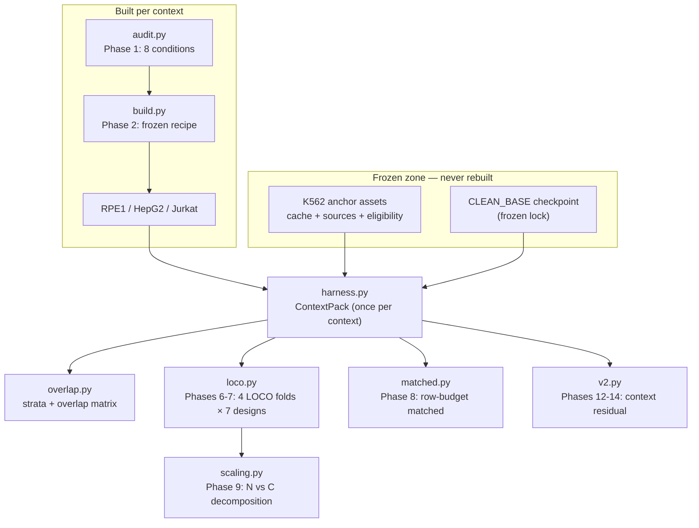
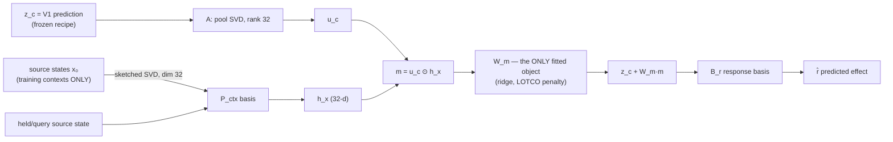

This page documents the `four_context_v1` package: the pre-registered data contracts that let one experiment ask whether a perturbation-response model improves when its atlas grows from one cell context (K562) to four (K562, RPE1, HepG2, Jurkat). The contracts govern who trains on what, which genes every context is reduced to, how the measurement recipe is inherited from the frozen K562 lock, and which quantities were fixed before any model ran. Everything here lives in `src/gene_open_inverse/four_context_v1/`, and nothing in it retunes a threshold after seeing a result.

Sources: [contract.py](src/gene_open_inverse/four_context_v1/contract.py#L1-L52), [contexts.py](src/gene_open_inverse/four_context_v1/contexts.py#L1-L18)

## Why Four Contexts: Three Pre-Registered Questions

The contract exists to answer three questions, stated in the module docstring before any HepG2 or Jurkat number existed: **Q1** — does a larger perturbation atlas improve the `static knowledge → effect geometry` mapping; **Q2** — does any improvement come from more training rows or from more biological contexts; **Q3** — after controlling atlas size, does `f(candidate, source context)` beat `f(candidate)` on a cell context never seen in training. Q2 is the reason the mission exists: a pooled atlas gains both rows and diversity simultaneously, so a pooled win alone is uninterpretable. Every scaling claim in the package is therefore paired with a row-count-matched control in which the only thing that changes is how many contexts the same number of rows came from.

Sources: [contract.py](src/gene_open_inverse/four_context_v1/contract.py#L3-L13)

## The Four Contexts and Their Asymmetric Provenance

The context roster is frozen as a module constant — `CONTEXTS = ("K562", "RPE1", "HepG2", "Jurkat")` — with K562 designated the **anchor** (`ANCHOR_CONTEXT = "K562"`) and HepG2/Jurkat the new acquisitions from accession `GSE264667`. There is a declared asymmetry: RPE1, HepG2 and Jurkat are produced by `build.py` through a single code path, while K562 is loaded from its frozen assets because the anchor lock forbids rebuilding it. The package's safety argument for this asymmetry is recorded rather than hidden — the anchor's source states carry exactly the definition `build.py` implements, and the anchor's manifest records that `x_goal − x_source` reproduces the frozen response cache to 4.2e-06.

| Context | Role | Data provenance | Build path | Training input | Query population |
| --- | --- | --- | --- | --- | --- |
| K562 | Frozen anchor | Frozen lock assets (`VCDesign_FINAL_LOCK_2026-09-18.md`) | Loaded, never rebuilt | Anchor `G_fit` identities only | `G_select` identities, eligibility-gated |
| RPE1 | Built context | Per audit record | `build.py`, frozen recipe | Every usable identity | Every usable, eligible identity |
| HepG2 | New context | `GSE264667_hepg2_raw_singlecell_01.h5ad` | `build.py`, frozen recipe | Every usable identity | Every usable, eligible identity |
| Jurkat | New context | `GSE264667_jurkat_raw_singlecell_01.h5ad` | `build.py`, frozen recipe | Every usable identity | Every usable, eligible identity |

Sources: [contract.py](src/gene_open_inverse/four_context_v1/contract.py#L56-L65), [contexts.py](src/gene_open_inverse/four_context_v1/contexts.py#L1-L9), [contexts.py](src/gene_open_inverse/four_context_v1/contexts.py#L30-L32)

## The Uniform `Context` Dataclass

Every context — built or frozen — is reduced to the same frozen dataclass so that nothing downstream special-cases a dataset. A `Context` carries the identity axis `ids`, the gene axis `genes`, the response tensors `responses` and `sources` (each `[2, n, g]` float32, one layer per measurement view, with responses defined as *perturbed minus matched control*), and four boolean gates: `usable` (depth gate passed in both views), `eligible` (`QUERY_ELIGIBILITY_V1`), `train_ok` and `query_ok`. Two derived properties, `fit_rows` (`usable & train_ok`) and `query_rows` (`usable & query_ok & eligible`), are the only rows any consumer is permitted to touch, and `summary()` emits a per-context dict that folds embed verbatim in their output records.

Sources: [contexts.py](src/gene_open_inverse/four_context_v1/contexts.py#L35-L61)

Two loaders produce this object. `load_built()` reads the arrays `build.py` wrote to disk (`identity_axis.npy`, `gene_axis.npy`, `side_responses.npy`, `side_sources.npy`, `usable.npy`, `eligible.npy`) and accepts an optional gene axis to restrict to. `load_anchor()` reads K562 from the frozen lock instead: it takes the cached responses and source states, sets `train_ok` only on `role_indices["G_fit"]` and `query_ok` only on `role_indices["G_select"]`, loads per-role eligibility vectors, and — critically — **drops `G_check` rows from every array the programme can reach**, raising a `RuntimeError` if any sealed identity ever becomes reachable.

Sources: [contexts.py](src/gene_open_inverse/four_context_v1/contexts.py#L79-L91), [contexts.py](src/gene_open_inverse/four_context_v1/contexts.py#L94-L132)

## The Inherited Measurement Contract

The new contexts do not get a recipe chosen for them; they get the anchor's recipe, reproduced. Phase 2 of the protocol requires that the A/B batch hash, the quarter refinement, the minimum cell threshold, per-batch control subtraction, the identity-incidence-weighted control reference and the `QUERY_ELIGIBILITY_V1` gate are taken from the frozen K562 lock and applied unchanged. The frozen constants are module-level: `LIBRARY_TARGET = 1.0e4`, `MIN_VIEW_CELLS = 25`, `VIEW_SEED = 20260914`, the namespaces `REPLOGLE_BATCH_DISJOINT_V1` and `REPLOGLE_BATCH_QUAD_REFINEMENT_V1`, and `ELIGIBILITY_FDR = 0.05`. One documented quirk is accepted rather than worked around: the batch hash is applied to each context's *own* batch names, so two contexts whose lanes coincidentally share names receive the same A/B pattern — harmless because no quantity in the programme ever pairs a batch in one context with a batch in another.

| Parameter | Frozen value | Function |
| --- | --- | --- |
| `LIBRARY_TARGET` | 1.0e4 | Normalize each cell to this library size, then `log1p` |
| `MIN_VIEW_CELLS` | 25 | Minimum cells per identity per view, both sides |
| `VIEW_SEED` / namespaces | 20260914 / `REPLOGLE_BATCH_DISJOINT_V1`, `..._QUAD_REFINEMENT_V1` | Deterministic A/B side and four-way quarter assignment per batch |
| `ELIGIBILITY_FDR` | 0.05 | FDR level of the `QUERY_ELIGIBILITY_V1` query gate |
| `INHERITED_FROM` | `VCDesign_FINAL_LOCK_2026-09-18.md` | The K562 anchor lock these values come from |

Sources: [contract.py](src/gene_open_inverse/four_context_v1/contract.py#L16-L33), [contract.py](src/gene_open_inverse/four_context_v1/contract.py#L67-L74)

`build.py` implements this recipe as a streaming pipeline that trains nothing and ranks nothing. `view_side()` derives each batch's frozen A/B bit from a SHA-256 token over the namespace, seed and batch name, and `quarter_of()` derives the four-way refinement used for cross-fitted estimation. `accumulate()` performs one pass computing per-side, per-quarter and per-batch-control sums — with the deliberate detail that the library-size denominator is computed on the full gene row *before* ambiguous-gene restriction, because normalization is a property of the cell, not of whichever genes the programme keeps. Duplicated gene symbols are dropped entirely (both copies) rather than deduplicated, since a repeated symbol would otherwise let one column silently win untraceably.

Sources: [build.py](src/gene_open_inverse/four_context_v1/build.py#L1-L12), [build.py](src/gene_open_inverse/four_context_v1/build.py#L33-L43), [build.py](src/gene_open_inverse/four_context_v1/build.py#L46-L104), [build.py](src/gene_open_inverse/four_context_v1/build.py#L124-L136)

> [!TIP]
> Phase 1 (`audit.py`) runs *before* the build and reads data properties only, never a model. It resolves the perturbation, batch and guide columns from a priority list declared before looking at the files, and its `count_semantics()` check detects whether a matrix is raw counts or already normalized — because the inherited 1e4/log1p recipe applied to an already-normalized matrix would produce a plausible-looking response that no downstream stage could detect as wrong.

Sources: [audit.py](src/gene_open_inverse/four_context_v1/audit.py#L1-L36), [audit.py](src/gene_open_inverse/four_context_v1/audit.py#L56-L92)

## Hard Qualification Conditions (Phase 1)

A context only enters the programme if it passes eight hard qualification conditions, evaluated by the audit and recorded as failed rather than relaxed when they fail: gene-level CRISPRi knockdown, explicit non-targeting controls, batch/gemgroup structure, every retained batch having controls, minimum view cells on both sides, at least several hundred usable identities (`MIN_USABLE_IDENTITIES = 300`, fixed before the audit runs), a sufficient common gene axis, and no candidate response leaking into inference features. These are the contract's admission gate; a dataset that fails one is out, not adjusted.

Sources: [contract.py](src/gene_open_inverse/four_context_v1/contract.py#L97-L108)

## The `G_4` Gene Axis and the Anchor Bridge

**The gene axis is the one genuinely new construction** in this programme. `G_4` is the intersection of the four measured axes, taken once via `common_gene_axis()` before any model runs; the historical K562 result keeps its 8248-gene axis and is not recomputed, making the four-context programme a separate experiment on `G_4`. Restriction is strict: `_restrict()` raises `KeyError` naming the count if a context does not measure a requested gene, rather than filling with zeros.

Sources: [contract.py](src/gene_open_inverse/four_context_v1/contract.py#L28-L32), [contexts.py](src/gene_open_inverse/four_context_v1/contexts.py#L64-L76), [contexts.py](src/gene_open_inverse/four_context_v1/contexts.py#L135-L142)

Because every context is scored by the same frozen K562 `CLEAN_BASE` ranker, every context's `G_4` values must be placed on the anchor's 8248-gene axis. `harness.anchor_bridge()` computes where each `G_4` gene sits on the anchor axis (raising if any gene is absent), and `embed()` places values there and zeros everything else. The embed applies to K562 too — leaving the anchor on its full axis while others carry ~7000 would make the base stronger in one context for a reason unrelated to the question. The base is never retrained, never adapted, and never told which context it is looking at, which deliberately makes the K562 fold's `effect − base` delta *harder* rather than easier; the contract declares this asymmetry instead of correcting it.

Sources: [harness.py](src/gene_open_inverse/four_context_v1/harness.py#L49-L71), [contract.py](src/gene_open_inverse/four_context_v1/contract.py#L34-L43)

## Architecture: From Contexts to Folds

The module interaction pattern is "pack once, fold many": contexts are loaded, reduced to `ContextPack`s (features, base scores, utility, fit masks) exactly once per context, and every fold, arm and atlas size reuses those packs. This separation is deliberate — if packs were rebuilt per arm, an arm-to-arm difference could come from a rebuild rather than from the arm.

Sources: [harness.py](src/gene_open_inverse/four_context_v1/harness.py#L1-L8), [harness.py](src/gene_open_inverse/four_context_v1/harness.py#L28-L47)

## Candidate Strata: Two Generalizations, Never Collapsed

Phase 5 defines the strata every result is split by, and the contract's note is explicit: **context generalization and candidate generalization are different questions and are never collapsed into one number**. A candidate whose response was measured in a training context had its own effect supervised, so evaluating it in a held context tests whether the *context* transfers; a candidate no training context measured additionally tests whether the *candidate mapping* transfers. `COMMON4` — identities usable in all four contexts — is the only population on which a context residual can be estimated at all. Membership is a property of which identities were measured where; it never depends on a score.

| Stratum | Definition | Question answered |
| --- | --- | --- |
| `ALL` | Every usable candidate in the held context | Overall performance |
| `SEEN_CANDIDATE` | Response was supervised in ≥1 training context | Does the *context* transfer? |
| `UNSEEN_CANDIDATE` | No training context measured it | Does the *candidate mapping* transfer too? |
| `COMMON4` | Measured in all four contexts | Only population for residual estimation |

Sources: [contract.py](src/gene_open_inverse/four_context_v1/contract.py#L110-L115), [overlap.py](src/gene_open_inverse/four_context_v1/overlap.py#L1-L13), [overlap.py](src/gene_open_inverse/four_context_v1/overlap.py#L21-L43)

`overlap.py` also computes the pairwise identity-overlap matrix (shared counts and Jaccard per context pair) and the histogram of identities measured in exactly *k* contexts, all from data alone via `fold_strata()` so a fold needs no recomputation.

Sources: [overlap.py](src/gene_open_inverse/four_context_v1/overlap.py#L46-L80)

## The LOCO Fold Design and Its Fixed Evaluation Population

`loco.py` (Phases 6–7) runs four leave-one-context-out folds. In each, the held context's responses are invisible to every predictor because the training pool is built only from the other three contexts — there is deliberately **no hash split inside a context**, since a held context contributes no training row at all in a LOCO fold, and splitting it further would only throw away half its queries (this is the anchor-only exception discussed below). Each fold trains the unchanged V1 recipe on seven atlas designs: three single contexts, three pairs, and the pooled triple. The evaluation population is fixed per fold — `SEEN_CANDIDATE` is defined against the *full* three-context training set, not per design, so a one-context and a three-context design are graded on the same candidates, with each design separately reporting what fraction of each stratum it actually supervised.

Sources: [contract.py](src/gene_open_inverse/four_context_v1/contract.py#L76-L82), [loco.py](src/gene_open_inverse/four_context_v1/loco.py#L1-L17), [loco.py](src/gene_open_inverse/four_context_v1/loco.py#L44-L49), [loco.py](src/gene_open_inverse/four_context_v1/loco.py#L94-L110)

A `RANDOM` score arm (seeded per fold) is present but explicitly not the comparison of record: it exists so `BASE` is interpretable in a context the frozen base ranker has never seen — if `BASE − RANDOM` collapses somewhere, a large `V1 − BASE` there says more about a failed base than about the effect model, and the fold record makes that visible. Every LOCO record self-describes its compliance: `"read_anchor_G_check": False` and `"context_feature_given_to_any_model": False`.

Sources: [loco.py](src/gene_open_inverse/four_context_v1/loco.py#L80-L107)

## Separating Size from Diversity: Row-Budget Matching (Phase 8)

`matched.py` holds one growth factor fixed at a time. **8B, row-count matched**: every arm trains on exactly `N` rows, where `N` is the largest budget every comparable arm can meet — the smallest single-context usable training pool in the fold, computed from row counts alone (`row_budget()`), never from a model result. A one-context arm takes all `N` from one atlas; a two-context arm takes `N/2` per context; a three-context arm `N/3` per context — so anything that differs between arms is context mix, not size. **8C, unique-candidate matched**: rows are restricted to identities every training context measured, giving three readings — one context at `M` rows, the same identities spread across three contexts at `M` rows (the sharp arm: same identities, same rows, only context mix moves), and all three contexts at `3M` rows. Both phases run the five pre-registered `MATCH_SEEDS`; the seed count is never raised after seeing a result.

| Arm | Rows | Context mix | What a win over single-context means |
| --- | --- | --- | --- |
| 1 context | N | 1 context | Baseline |
| 2 contexts | N (N/2 each) | 2 contexts | Diversity at fixed size |
| 3 contexts | N (N/3 each) | 3 contexts | Diversity at fixed size |
| 3 contexts | 3M (all rows) | 3 contexts | Natural growth (size + diversity together) |

Phase 9 (`scaling.py`) then fits `Gain = α + β_N·log N_rows + β_C·N_contexts` descriptively: the *full* fit (natural arms only, `β_C` unidentified), the *matched* fit (rows constant by construction, `β_C` is the whole answer), and a *pooled* fit with per-held-context intercepts. Ordinary-least-squares errors are reported as descriptive spread only — points within a fold share a held context and pool, so the claims rest on the paired bootstraps of the producing phases, not these errors.

Sources: [matched.py](src/gene_open_inverse/four_context_v1/matched.py#L1-L23), [matched.py](src/gene_open_inverse/four_context_v1/matched.py#L51-L78), [contract.py](src/gene_open_inverse/four_context_v1/contract.py#L117-L126), [scaling.py](src/gene_open_inverse/four_context_v1/scaling.py#L1-L24)

## The V2 Context-Residual Contract

The context representation itself is pre-registered in the contract before the first V2 number: `CONTEXT_DIM = 32` (no dimension search), `CONTEXT_BASIS_SEED`, `INTERACTION_RANK = 32`, and a ridge penalty grid `CONTEXT_PENALTIES = (1e1 … 1e7)` selected by leave-one-training-context-out validation *inside* the three training contexts only. The rank is not tuned — the modulation is a Hadamard product of two projections, so interaction features equal the rank, and since `v_x = B·h_x` has at most `CONTEXT_DIM` degrees of freedom, setting rank = dimension is the largest value the architecture can use, not a chosen one. The penalty grid's top end is documented to leave V1 inside the selectable model class (modulation effectively switched off), and `V2_IS_RESIDUAL = True` records the degeneracy guarantee: if context carries nothing, the weight goes to zero and V2 becomes V1 by construction.

Sources: [contract.py](src/gene_open_inverse/four_context_v1/contract.py#L128-L155)

The math is a single fitted object on top of a frozen recipe:

Everything except `W_m` is fixed before it is fitted — `P_ctx` is the training-context source-state SVD at dimension 32 (`context_basis()`, fitted on source states only, no perturbed cell entering it), `A` is the training-pool SVD of `z_c` at rank 32, and the V1 branch is the frozen recipe. A headroom gate additionally requires the residual to be both non-trivial in variance share and reproducible across the two independent measurement views before V2 is built at all. The implementation never materializes the naive `queries × candidates × genes` tensor: with `g_k = B_r·W_m[k]` fixed gene-space directions, the needed inner products and norms expand into small matrix products over the interaction rank, and `test_protocol` checks the expansion against a brute-force evaluation.

Sources: [v2.py](src/gene_open_inverse/four_context_v1/v2.py#L1-L32), [v2.py](src/gene_open_inverse/four_context_v1/v2.py#L54-L70), [contract.py](src/gene_open_inverse/four_context_v1/contract.py#L157-L161)

> [!TIP]
> The `WeightedRidgePath` used to fit V1 on pooled pools keeps the frozen penalty grid meaningful: its row scaling uses weights whose *mean* is one (not weights summing to one), so equal weights reduce exactly to the frozen `RidgePath` — dividing by the sum instead would multiply the effective penalty by row count and quietly turn every pooled fit into a different model than the one the programme claims to reuse. The test suite asserts that equivalence rather than assuming it.

Sources: [predictors.py](src/gene_open_inverse/four_context_v1/predictors.py#L26-L63)

## The Deployment Firewall

The contract ends with a hard input firewall, stated as tuples rather than prose: a deployed caller may supply **candidate static knowledge** and a **source or control state** — nothing else. `FORBIDDEN_INPUTS` names what must never reach a predictor: the candidate's perturbed state, the target perturbation outcome, or any held-context candidate response. And `ANCHOR_G_CHECK_IS_SEALED = True` makes the sealed zone explicit at the contract level, matching the loader-level `RuntimeError` in `load_anchor()` and the `G_check` row-drop enforced in every fold. This is the structural complement to the identity-level cross-validation described in [Leakage Prevention and Identity-Level Cross-Validation](21-leakage-prevention-and-identity-level-cross-validation).

Sources: [contract.py](src/gene_open_inverse/four_context_v1/contract.py#L163-L170), [contexts.py](src/gene_open_inverse/four_context_v1/contexts.py#L104-L110)

## Verification, Documentation Regeneration, and Self-Testing

The contract closes its own loop in three ways. First, every context is independently verified under the frozen `RESPONSE_ASSET_VERIFIER_CONTRACT_V1_FLOAT32_STORAGE_AWARE` with no per-context tolerance, and each run carries a deliberately corrupted asset witness — a run whose witness does not FAIL is itself a failure. Second, `dataset_doc.py` regenerates the four-context dataset audit document entirely from the JSON artifacts on disk (provenance table with SHA-256s, per-context verdicts, the measurement contract as built), so the document cannot drift from the run that produced it — the same artifact-first philosophy documented in [Artifact Verification and SHA-256 Manifests](23-artifact-verification-and-sha-256-manifests). Third, `selftest_phases.py` runs Phases 8–17 end-to-end on synthetic contexts with planted answers (V1 must beat random; a known variance-share residual must be recovered), so long phases are never executed for the first time on real data where a shape error costs hours and looks like a result that failed to appear. To reproduce the pipeline end-to-end, follow the frozen-snapshot verification and training steps in [Reproducing Paper Results](4-reproducing-paper-results) before loading any context.

Sources: [dataset_doc.py](src/gene_open_inverse/four_context_v1/dataset_doc.py#L1-L20), [dataset_doc.py](src/gene_open_inverse/four_context_v1/dataset_doc.py#L72-L80), [selftest_phases.py](src/gene_open_inverse/four_context_v1/selftest_phases.py#L1-L13), [REPRODUCE.md](REPRODUCE.md#L1-L47)

## Where This Fits in the Catalog

The four-context contracts are the substrate the surrounding experiments stand on. The graded per-query quantities (`cross_view_utility`, MBRU deltas) consumed by the folds come from the evaluation framework in [Ranking Metrics: BU@B, MU@B, PHR@B](8-ranking-metrics-buatb-muatb-phratb) and the protocol in [Held-Out Context Evaluation Protocol](9-held-out-context-evaluation-protocol); the V1 recipe the folds reuse unchanged is detailed in [Response Basis Construction](11-response-basis-construction) and [Ridge Effect Predictor](12-ridge-effect-predictor); and the downstream consumers of these contracts are covered in [Response Masking and Open-Vocabulary Analyses](18-response-masking-and-open-vocabulary-analyses) and [External Baselines: GEARS, CellNavi, PHR](19-external-baselines-gears-cellnavi-phr). For the head-to-head comparison this contract enables, continue to [Key Benchmark Findings](26-key-benchmark-findings).
