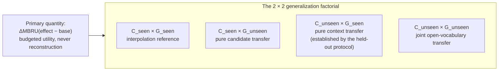
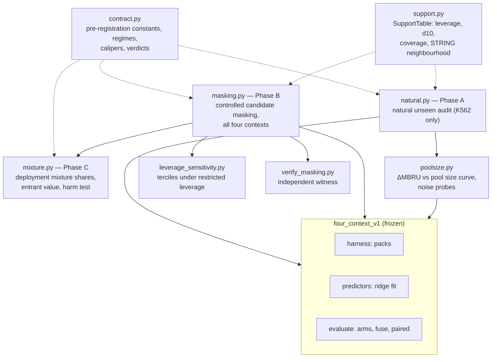
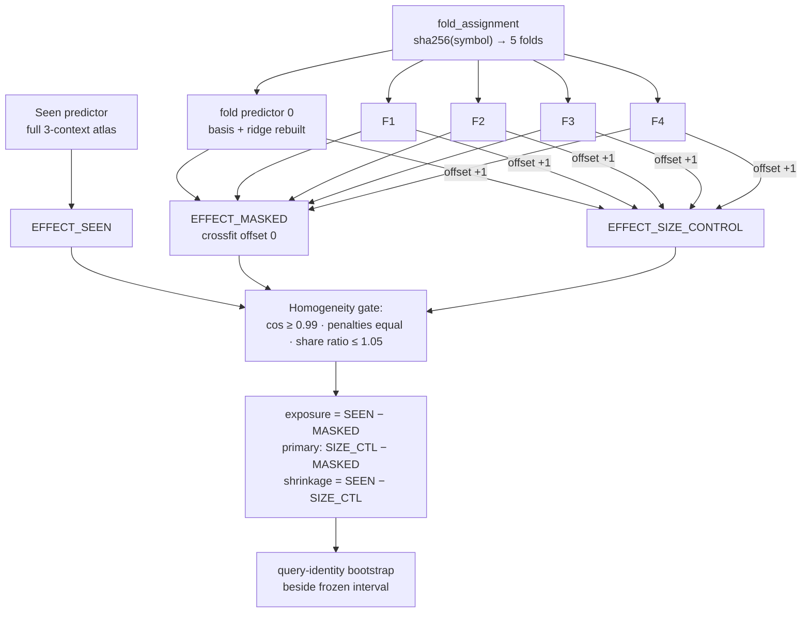

This page documents `open_vocab_generalization_v1`, the module that measures how far historical response measurements reach: does knowing a candidate's measured responses improve budgeted intervention design when that candidate's responses have never been measured? The module is a pre-registered, multi-phase analysis program — a frozen contract, a natural-experiment audit, a controlled masking experiment, a pool-size confound curve, a deployment mixture study, and an independent verifier — all judged on budgeted design utility (BU@B/MU@B-family quantities) and never on response reconstruction accuracy. It sits in the *Experiments and Baselines* section, directly downstream of the four-context data contracts and upstream of the external-baseline comparisons.

Sources: [contract.py](src/gene_open_inverse/open_vocab_generalization_v1/contract.py#L1-L85), [PROJECT_STRUCTURE.md](PROJECT_STRUCTURE.md#L11), [__init__.py](src/gene_open_inverse/open_vocab_generalization_v1/__init__.py#L1-L2)

## The Question, the Factorial, and the Pre-Registered Contract

The motivating evidence is a natural experiment from the held-out-context programme: on the K562 fold, the effect branch delivered `delta MBRU = −0.0103` on the 6,255 training-atlas-unseen candidates but `+0.0095` on the same fold's 1,570 seen candidates. Because library membership — not assignment — determined which candidates were unseen, candidate novelty is entangled with context novelty, and two incompatible hypotheses survive: **H1** says unseen candidates fail because their static knowledge is poorly supported; **H2** says static knowledge cannot extrapolate effects to a response-unsupervised intervention at any support level. `contract.py` exists to separate them, and it is frozen *before any support number or masked result exists*.

The design is a factorial over two axes, never added together: the **context axis** (C: has the predictor seen the evaluated context's responses?) crossed with the **candidate axis** (G: has it seen this candidate's responses anywhere?).

The contract also records, rather than fixes, two inherited defects so they cannot silently distort conclusions: `predictors._cross_validate` folds by row index, making penalty selection in a pooled atlas mildly optimistic (identical across arms, and irrelevant in the G-unseen arm where masked identities are absent entirely); and the frozen `cluster_bootstrap` resamples the two batch-disjoint query views as if they were independent clusters. Everything else — the frozen CLEAN_BASE scorer, the CED architecture, the basis rank, the ridge penalty grid, the fusion weight, the utility definition and the budget set {10, 20, 50} — is explicitly *not re-opened*: this mission adds no model, it measures a capability boundary of the model that already exists.

Sources: [contract.py](src/gene_open_inverse/open_vocab_generalization_v1/contract.py#L1-L85), [contract.py](src/gene_open_inverse/open_vocab_generalization_v1/contract.py#L200-L240)

## Module Architecture

The module is a pipeline of sibling scripts sharing one contract and one support library, importing the frozen four-context harness, evaluator, and ridge fitter:

| File | Role |
|---|---|
| `contract.py` | Pre-registration: regimes, support diagnostics, masking folds, calipers, verdicts — all frozen before any result |
| `support.py` | `SupportTable`: deployment-time support diagnostics computed from static features + atlas membership only |
| `natural.py` | Phase A: explain the natural unseen failure on K562; stratification, matching, controls |
| `masking.py` | Phase B: controlled candidate masking; cross-context (primary) and within-context (reference) designs |
| `mixture.py` | Phase C: nested unseen-share deployment mixtures; entrant value; support-predicts-harm test |
| `poolsize.py` | ΔMBRU as a function of candidate-pool size, with a noise-injection mechanism probe |
| `leverage_sensitivity.py` | Re-runs Phase B terciles with degenerate leverage columns removed |
| `verify_masking.py` | Independent re-derivation of the masking run's claims; FAIL-not-raise verdicts |

Sources: [PROJECT_STRUCTURE.md](PROJECT_STRUCTURE.md#L11), [masking.py](src/gene_open_inverse/open_vocab_generalization_v1/masking.py#L196-L215), [mixture.py](src/gene_open_inverse/open_vocab_generalization_v1/mixture.py#L110-L200)

## Deployment-Time Support Diagnostics (`support.py`)

Every diagnostic is a function of the candidate's **static** features and of which identities the training atlas measured — no response, score, or result is ever read, so all of them are usable at deployment time for a gene nobody has perturbed. None is a model input; they only describe and stratify. The **primary** diagnostic is the ridge's own extrapolation statement, leverage:

$$L_c = k_c^T (X^T X + \lambda I)^{-1} k_c$$

with X the standardized training matrix and λ the penalty the fit actually selected. It is computed from the SVD stored on the fitted path, and the null-space remainder term is kept explicitly: with 1,538 features (512 STRING + 1,024 MAP-KG + 2 modality flags) and fewer training rows than features, the unspanned part is the dominant term, and dropping it would make every candidate look equally well supported.

| Diagnostic | Definition | Role |
|---|---|---|
| `leverage` / `leverage_percentile` | Ridge leverage above, in the ridge's own standardization | Primary support axis; stratification and matching |
| `d10` (+ `d1`, `d50`, `mapkg_d10`) | Mean Euclidean distance to the 10 nearest *unique* training identities in the frozen feature space | Secondary; k ∈ {1, 50} reported as sensitivity, never substituted |
| `coverage` | `BOTH / STRING_ONLY / MAPKG_ONLY / NEITHER` from the two modality flags | Matched **exactly** in support matching |
| `string_degree`, `training_neighbours`, `training_neighbour_weight` | STRING graph degree and how much of it lands inside the training atlas | Descriptive; degree is diagnostic-only, never a model feature |

Two implementation subtleties matter. `_sorted_distances` excludes each candidate's own training row: a static feature vector is a pure function of the gene symbol, so an atlas-measured candidate sits at distance exactly zero from itself, and leaving that in would give every seen candidate a free "well supported" score precisely on the axis being compared. And `neighbourhood` deduplicates training rows to unique identities, so a candidate measured in three contexts cannot inflate its neighbours' support by counting three times.

Sources: [support.py](src/gene_open_inverse/open_vocab_generalization_v1/support.py#L1-L19), [support.py](src/gene_open_inverse/open_vocab_generalization_v1/support.py#L100-L127), [support.py](src/gene_open_inverse/open_vocab_generalization_v1/support.py#L155-L172), [contract.py](src/gene_open_inverse/open_vocab_generalization_v1/contract.py#L98-L135)

## Phase A: The Natural Unseen Audit (`natural.py`)

Phase A is deliberately restricted to the **K562 fold** — the only one whose unseen pool is not degenerate (6,255 candidates against a largest budget of 50; the other folds hold 25, 73, and 105) — and trains no new model. It refits the same three-context pooled V1 predictor under the same recipe and seeds, and its first output is a **reproduction check**: does the refit reproduce the C-014 delta MBRU it is trying to explain? Only then does it stratify. The unseen pool is split into five equal-count quintiles of ascending leverage (`Q1_best_supported` … `Q5_weakest_supported`) via `quantile_strata`, which splits by rank so per-stratum results are never statements about how many candidates fell in a value band.

Seen candidates are then matched to unseen ones **one-to-one without replacement**: coverage pattern matched exactly, leverage and d10 percentiles matched within a caliper of 0.05 on each axis (a box covering ~1% of the joint support space; 0.02 is a sensitivity only), greedy in ascending joint pair distance. Both matched pools end exactly the same size, so absolute MBRU is comparable.

> [!TIP]
> Phase A round 1 produced a decomposition that did not behave like a decomposition — every leverage stratum was 3–7× more negative than the pool it partitions, and the support-matched unseen pool came out positive while its source pool was negative. The fix was not a new metric but a **size-matched null**: random equal-size strata over the same pool (seeds `20260918–20`), and twelve seeds for the matched-size null because three seeds gave a null spanning 0.030 — wider than the 0.027 effect it was meant to bound. Controls are sized by their resolution, not by convention.

Because the frozen standardization clips a feature's scale at 1e-8, columns the training rows never vary acquire enormous standardized coordinates — and enormous leverage. Phase A therefore also recomputes leverage from scratch (`leverage_from_matrix`, a **second independent implementation**, so agreement is evidence rather than tautology) with those degenerate columns dropped, and reports the Spearman correlation between primary and restricted leverage beside the unchanged primary stratification.

Sources: [natural.py](src/gene_open_inverse/open_vocab_generalization_v1/natural.py#L1-L16), [natural.py](src/gene_open_inverse/open_vocab_generalization_v1/natural.py#L47-L88), [natural.py](src/gene_open_inverse/open_vocab_generalization_v1/natural.py#L90-L110), [natural.py](src/gene_open_inverse/open_vocab_generalization_v1/natural.py#L200-L372)

## Phase B: Controlled Candidate Masking (`masking.py`)

Phase B *manufactures* the response-unseen condition instead of inheriting it. The candidate identity, its static knowledge, the evaluation pool, the queries, the base ranker and the graded utility are all held fixed; the single thing that varies is whether that identity's measured responses were available to fit the effect predictor. Masking folds come from `fold_assignment`: `sha256("VCDESIGN_OPEN_VOCAB_CANDIDATE_MASK_V1:{symbol}")` mod 5 — deterministic, outcome-independent, and stable across contexts, so the same identity is masked in the same fold everywhere it appears. Removal is **by identity in every named training context at once**, and the response basis and ridge are rebuilt inside each masked pool — reusing the seen arm's basis would leak the masked responses through the very object the protocol says must be rebuilt.

| Property | `cross_context` (primary) | `within_context` (reference) |
|---|---|---|
| Training atlas | The other three contexts | The same single context |
| SEEN arm fits on the graded candidate's own response? | No | Yes |
| `SEEN − MASKED` reads as | Clean exposure effect | **Upper bound**; leverage interaction mechanically confounded |
| Role | Pre-registered estimate of record | Reported with caveat only |

RPE1, HepG2 and Jurkat are primary masking contexts (pools of 254/152/290 at `MASK_FOLDS = 5`, all clearing the floor of 200 = 4× the largest budget); K562 is **secondary** because the frozen base ranker was trained on K562 responses, so a masked K562 candidate can retain exposure through the base even after the effect branch loses it. HepG2, below the floor, is diagnostic-only in the per-fold contrast but still enters the pooled cross-fitted contrast (pool 764).

Three effect arms, not two — this is the design's core:

| Arm | Effect source | What it isolates |
|---|---|---|
| `EFFECT_SEEN` | Full three-context predictor | The deployed model |
| `EFFECT_MASKED` | Crossfit of the five fold predictors (offset 0) | Candidate-specific exposure loss |
| `EFFECT_SIZE_CONTROL` | Crossfit of the same five predictors (offset +1) | Removing one fold's rows *only* |

> [!TIP]
> The size control costs **zero extra fits**: "fold M is size controlled by the predictor that masked fold (M + 1) mod 5." Removing a candidate's rows also removes *rows*, and atlas size is the primary driver of distillation quality (established in C-013), so `SEEN − MASKED` alone cannot separate "this candidate was never measured" from "the atlas is a fifth smaller." The primary exposure quantity is therefore `exposure_value_size_controlled = SIZE_CONTROL − MASKED`, with `exposure = SEEN − MASKED` as the upper bound and `atlas_shrinkage_cost = SEEN − SIZE_CONTROL` as the decomposition's second half.

Because the crossfit mixes five independently fitted predictors into one score matrix, a **homogeneity gate** guards the secondary contrast: minimum pairwise cosine between intercept reconstructions ≥ 0.99 (the direction test alone cannot fail), identical selected penalties, and a candidate-specific-share ratio ≤ 1.05. The primary contrast is immune by construction — both arms mix the *same* five predictors permuted by one fold, so any mixing distortion cancels. Non-eligible candidates keep the seen arm's effect in every arm, so the frozen fusion's full-pool standardization cannot turn exposure into a fusion-weight artifact.

> [!TIP]
> Every headline interval is computed twice. The frozen `cluster_bootstrap` resamples the length-2Q concatenated vector entry-by-entry, treating the two views of one query as independent clusters — narrower intervals than its own docstring's cluster unit implies, for C-013 and C-014 alike. Changing it would break comparability, so `query_cluster_bootstrap` (10,000 replicates, seed 20260916) resamples **query identities** carrying both views together, and is reported *beside* the frozen interval so a reader can see whether any conclusion depends on it.

Sources: [masking.py](src/gene_open_inverse/open_vocab_generalization_v1/masking.py#L1-L29), [masking.py](src/gene_open_inverse/open_vocab_generalization_v1/masking.py#L50-L85), [masking.py](src/gene_open_inverse/open_vocab_generalization_v1/masking.py#L254-L296), [masking.py](src/gene_open_inverse/open_vocab_generalization_v1/masking.py#L299-L390), [masking.py](src/gene_open_inverse/open_vocab_generalization_v1/masking.py#L439-L478), [contract.py](src/gene_open_inverse/open_vocab_generalization_v1/contract.py#L140-L199)

## The Pool-Size Confound (`poolsize.py`)

Added on 2026-09-18, after Phase A's size-matched null exposed something larger: **random** subsets of the 6,255 unseen candidates give a *positive* delta MBRU at stratum size 1,251 while the whole pool gives a negative one — same candidates, same predictor, same queries; only how many candidates each query ranks changed. Mechanically, the first B slots of a larger pool are filled by the largest order statistics of the score, so a score with systematic error pushes more of that error into a fixed budget as the pool grows. That makes the C-014-style 1,570-vs-6,255 contrast uncontrolled unless the curve is flat.

The script measures delta MBRU against pool size (250, 500, 1,000, 1,570, 3,000, 6,255; three seeds) separately inside the seen pool, the unseen pool, and the full pool, plus a **mechanism probe**: a deliberately degraded score entering the fusion exactly where the effect branch does — `row_z(base) + λ · row_z(noise)` at λ ∈ {0.25, 0.5, 1.0}, weights fixed before the run — should trace the same shape if the mechanism is real. Only the shape is read, never the level (D-005 stands: random is never the comparison of record). A `--standardize` flag separates `pool` fusion (each branch standardized over the whole fold, as published) from `subset` fusion (re-standardized per subsample), isolating whether the curve depends on the standardization population.

Sources: [poolsize.py](src/gene_open_inverse/open_vocab_generalization_v1/poolsize.py#L1-L37), [poolsize.py](src/gene_open_inverse/open_vocab_generalization_v1/poolsize.py#L43-L58), [poolsize.py](src/gene_open_inverse/open_vocab_generalization_v1/poolsize.py#L74-L180)

## Phase C: The Deployment Mixture and Support-Predicts-Harm (`mixture.py`)

A real vocabulary is neither all measured nor all unmeasured. Phase C holds the candidate pool, queries, base and graded utility fixed and varies only *which* candidates take their predicted effect from the predictor that masked them, at nested unseen shares of 25%, 50% and 75%. Nesting comes from a per-identity hash value in [0, 1): whatever is unseen at 0.25 is unseen at 0.50 and 0.75, so differences between shares are about how much unseen material the pool holds, not about which candidates happened to be drawn.

The evaluated arms are `BASE`, `ALL_SEEN`, `ALL_UNSEEN`, and `MIXED` (per-candidate seen/masked effects fused over the full pool, then restricted — matching the fusion convention of Phases A and B so one arm never reports two numbers). Composition diagnostics report what fraction of the first B slots and how much of their utility each group contributes — `seen`, `unseen`, and `unseen_{high,medium,low}_support` terciles. The unit of value is deliberately not the promoted candidate's own utility but its **entrant value**: for a candidate entering the top-B under the fused score but not under the base alone, `utility(q, c)` minus the mean utility of the candidates it displaced — what the effect branch *actually bought* by the swap.

Section 21 asks one question and builds nothing: does support predict the sign of what the effect branch buys? The primary statistic is `spearman(leverage_percentile, mean_entrant_value)` at share 0.50. **No support-aware gate is implemented in this mission under any name** — the module only measures whether support predicts harm; gate design would be a new mission with its own pre-registration.

Sources: [mixture.py](src/gene_open_inverse/open_vocab_generalization_v1/mixture.py#L1-L20), [mixture.py](src/gene_open_inverse/open_vocab_generalization_v1/mixture.py#L28-L92), [mixture.py](src/gene_open_inverse/open_vocab_generalization_v1/mixture.py#L110-L200), [contract.py](src/gene_open_inverse/open_vocab_generalization_v1/contract.py#L200-L219)

## Sensitivity and the Independent Witness

`leverage_sensitivity.py` answers a targeted question: do Phase B's support terciles survive the leverage diagnostic's degenerate-column defect? It recomputes terciles with the 1e-8-clip columns removed and re-evaluates using the effect cosines the masking run **cached** (`support_{held}.npz`, `effect_cosine_{held}.npz`), refitting nothing, so the arms are numerically the ones Phase B produced. It is a sensitivity, not a replacement — the pre-registered primary stays as registered.

`verify_masking.py` implements the programme's Lesson L3: *a script must not be its own only witness*. From the cached packs and frozen assets alone, with its own code rather than the run's, it re-derives the masking folds from the symbols, rebuilds one context's masked training pool with a different loop, refits the named predictor and checks the recorded penalty and held-out cosine (tolerance 1e-12), and re-ranks both arms with an ordering that breaks ties **differently on purpose** — agreement proves the result does not rest on a tie convention, and disagreement is reported as the tie rate. It refuses to overwrite its own output and downgrades to FAIL rather than raising, so a failure is a recorded verdict, not a missing file.

Sources: [leverage_sensitivity.py](src/gene_open_inverse/open_vocab_generalization_v1/leverage_sensitivity.py#L1-L14), [leverage_sensitivity.py](src/gene_open_inverse/open_vocab_generalization_v1/leverage_sensitivity.py#L18-L105), [verify_masking.py](src/gene_open_inverse/open_vocab_generalization_v1/verify_masking.py#L1-L16), [verify_masking.py](src/gene_open_inverse/open_vocab_generalization_v1/verify_masking.py#L40-L76)

## Allowed Verdicts and the Frozen Boundary

The contract enumerates exactly four verdicts this mission may reach — everything else is out of scope by construction:

| Verdict token | Reading |
|---|---|
| `STATIC_KNOWLEDGE_SUPPORT_LIMITED` | H1: unseen candidates fail because static support is poor |
| `MEASURED_CANDIDATE_COVERAGE_LIMITED` | H2: exposure to measured responses is the binding constraint |
| `SUPPORT_DEPENDENT_OPEN_VOCABULARY` | The effect branch's value for unseen candidates varies with support |
| `OPEN_VOCABULARY_FAILURE_UNRESOLVED` | Neither axis explains the deficit |

The frozen boundary is explicit: K562 CLEAN_BASE, the CED architecture, the ridge penalty recipe, the fusion weight, the utility definition and more are not re-opened; STRING adjacency is read for degree and neighbour counts as diagnostics only and is never given to a model as a feature; and no uncertainty model or OOD detector is trained anywhere in this mission.

Sources: [contract.py](src/gene_open_inverse/open_vocab_generalization_v1/contract.py#L221-L240)

## Running the Analyses

All scripts are module invocations taking explicit `--packs` (the four-context processed packs) and a new `--output` path; the complete command sequence for a full reproduction lives in [REPRODUCE.md](REPRODUCE.md).

| Script | Command | Distinguishing flags | Consumes / emits |
|---|---|---|---|
| Phase A | `python3 -m gene_open_inverse.open_vocab_generalization_v1.natural` | `--string-adjacency` | Emits the audit JSON + `k562_support_table.npz` |
| Phase B | `python3 -m gene_open_inverse.open_vocab_generalization_v1.masking` | `--string-adjacency` | Emits masking JSON + `support_{ctx}.npz`, `effect_cosine_{ctx}.npz` |
| Pool-size curve | `python3 -m gene_open_inverse.open_vocab_generalization_v1.poolsize` | `--standardize {pool,subset}` | Emits the curve JSON |
| Phase C | `python3 -m gene_open_inverse.open_vocab_generalization_v1.mixture` | (driver reads the masking record) | Consumes `effect_cosine_{ctx}.npz` caches |
| Leverage sensitivity | `python3 -m gene_open_inverse.open_vocab_generalization_v1.leverage_sensitivity` | `--record <masking JSON>` | Consumes masking record + cached cosines |
| Verification | `python3 -m gene_open_inverse.open_vocab_generalization_v1.verify_masking` | `--record`, `--context`, `--fold`, `--tolerance` | Emits PASS/FAIL JSON; refuses overwrite |

Run order matters: Phase B's artifacts feed Phase C and the sensitivity; the verification run needs Phase B's record. Every long-running stage should write to an explicit new output path.

Sources: [natural.py](src/gene_open_inverse/open_vocab_generalization_v1/natural.py#L375-L399), [masking.py](src/gene_open_inverse/open_vocab_generalization_v1/masking.py#L481-L540), [leverage_sensitivity.py](src/gene_open_inverse/open_vocab_generalization_v1/leverage_sensitivity.py#L107-L124), [poolsize.py](src/gene_open_inverse/open_vocab_generalization_v1/poolsize.py#L182-L213), [PROJECT_STRUCTURE.md](PROJECT_STRUCTURE.md#L24-L30)

## Reading Path

This page assumes the metric vocabulary of [Ranking Metrics: BU@B, MU@B, PHR@B](8-ranking-metrics-buatb-muatb-phratb) and the arm-grading machinery of [Held-Out Context Evaluation Protocol](9-held-out-context-evaluation-protocol); the ridge and basis being masked are defined in [Response Basis Construction](11-response-basis-construction) and [Ridge Effect Predictor](12-ridge-effect-predictor), and the feature layout behind the support diagnostics in [Knowledge Features: STRING and MAP-KG](13-knowledge-features-string-and-map-kg). For what precedes these analyses, read [Four-Context Data Contracts](17-four-context-data-contracts); for how the same evaluators compare against comparator methods, continue to [External Baselines: GEARS, CellNavi, PHR](19-external-baselines-gears-cellnavi-phr) and [Utility Ground Truth Validation](20-utility-ground-truth-validation). The cross-validation and bootstrap defects recorded here are part of the broader integrity story in [Leakage Prevention and Identity-Level Cross-Validation](21-leakage-prevention-and-identity-level-cross-validation) and [Post-Review Corrections](22-post-review-corrections).