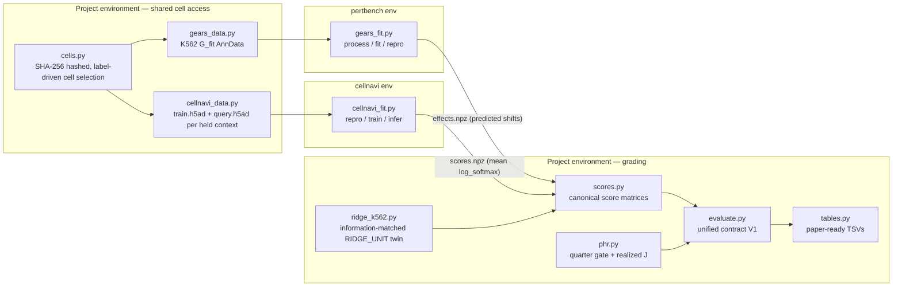
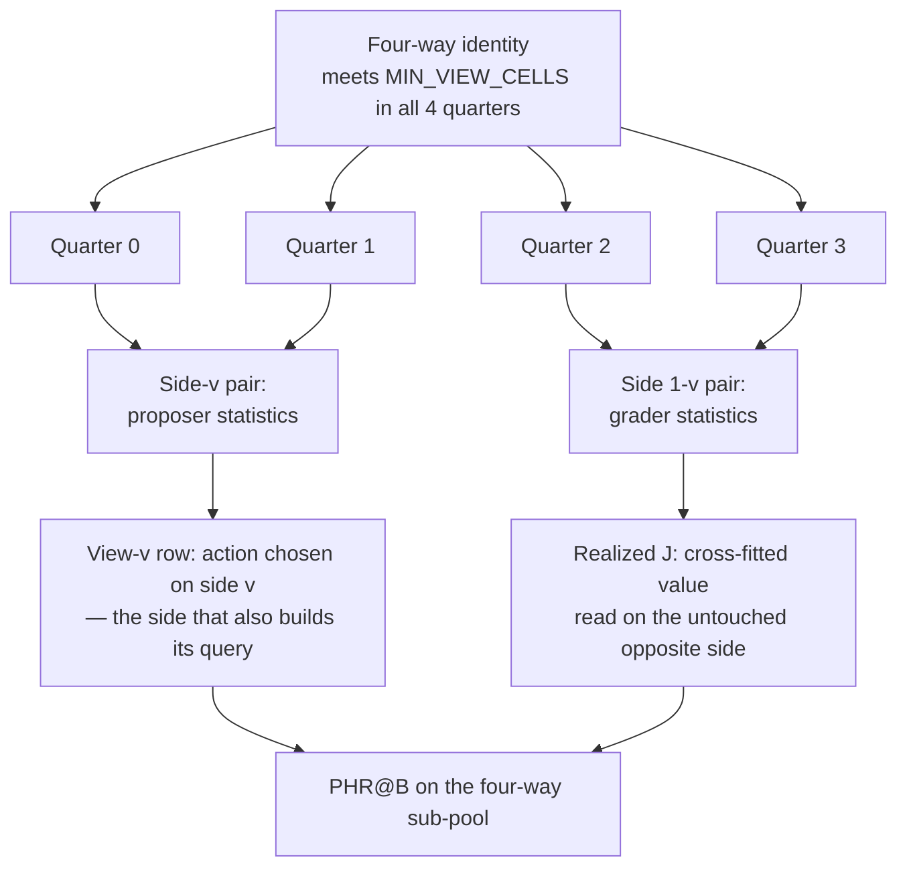

This page documents `src/gene_open_inverse/external_baselines_v1/`, the module that adapts published methods — GEARS, CellNavi, and the PHR@B realized-value machinery — into a single frozen evaluation closure named `EXTERNAL_BASELINE_AND_EVALUATION_CLOSURE_V1`. The design goal is strict comparability: every method, whether a third-party model or an internal reference arm, is graded on the same queries, the same candidate stratum, the same utilities, budgets, tie rule, and bootstrap, with all protocol constants fixed in one machine-readable contract before any outcome is observed.

Sources: [contract.py](src/gene_open_inverse/external_baselines_v1/contract.py#L1-L20), [scores.py](src/gene_open_inverse/external_baselines_v1/scores.py#L1-L6)

## The Frozen Contract: Arms, Taxonomy, and Legality

The contract declares the experimental frame once: three primary held-out contexts (`RPE1`, `HepG2`, `Jurkat`), four training contexts (`K562` plus the three primary), two regimes (`SEEN` and `MASKED` over 5 cross-validation folds), budgets `(10, 20, 50)` with `BU@20` as the primary metric, and a single global seed `20260919`. Frozen run directories (`C018_RUN`, `EVIDENCE_RUN`, `FOUR_CONTEXT_RUN`) are the only inputs, and paths are recorded in every output for provenance.

Sources: [contract.py](src/gene_open_inverse/external_baselines_v1/contract.py#L8-L20), [contract.py](src/gene_open_inverse/external_baselines_v1/contract.py#L66-L76)

Eleven arms are organized into a lettered taxonomy (`A. random` through `F. analysis-only oracle`) plus three companions, each with an explicit legality statement — the protocol's answer to "what information was this arm allowed to see?" GEARS and the internal forward arms are *strict legal in both regimes* (no masked identity's response enters their fit), while CellNavi variants are *MEASURED-CANDIDATE inverse baselines* that require a candidate's measured cells in some training context and therefore run `SEEN` only. The oracle reads held-context responses and is marked `DIAGNOSTIC_ORACLE_NOT_DEPLOYABLE`.

| Arm constant | Label | Taxonomy | Legality | Regimes |
|---|---|---|---|---|
| `RANDOM` | Random | A. random | no information | both |
| `GOAL_BLIND_PRIOR` | Goal-blind prior (‖raw CED‖) | B. goal-blind candidate prior | strict legal, goal blind | both |
| `BASE` | Direct inverse | C (and E. VCDesign base) | strict legal | both |
| `CELLNAVI_DESIGN_COMPATIBLE` | CellNavi, official recipe | C. direct inverse, published | measured-candidate inverse; SEEN only | SEEN |
| `CELLNAVI_NATIVE_SCALE` | CellNavi at native class scale | C, published (Deviation 5) | same legality as CellNavi | SEEN |
| `GEARS_FORWARD_ENUMERATE` | GEARS | D. forward-enumerate-retrieve, published | strict legal in both regimes | both |
| `INTERNAL_FORWARD_THEN_MATCH` | RIDGE_UNIT effect-only cosine | D. internal reference | strict legal | both |
| `VCDESIGN_BASE_PLUS_RIDGE_UNIT` | VCDesign | E. VCDesign | strict legal | both |
| `MEASURED_RESPONSE_ORACLE` | Measured-response oracle | F. analysis-only | diagnostic, not deployable | both |
| `RIDGE_UNIT_K562_ATLAS` | RIDGE_UNIT on K562 atlas | companion (GEARS-matched) | strict legal | both |
| `PROFILED_SIGNATURE_RETRIEVAL` | Library retrieval on training signatures | companion | SEEN-only library retrieval | SEEN |

Sources: [contract.py](src/gene_open_inverse/external_baselines_v1/contract.py#L22-L64)

## Adapter Architecture: Isolated Environments, One Score Matrix

The module follows an *interface adapter* pattern with strict environment isolation. The two third-party models each run in their own pinned environment — GEARS via `cell-gears==0.1.2` in a `pertbench` env, CellNavi at upstream commit `ea1660fc3057c63ecd849d506f24241bdc4b3f33` in a `cellnavi` env — while data preparation, scoring, and grading all run in the shared project environment. The adapters emit only neutral artifacts (`effects.npz` of predicted shifts for GEARS, `scores.npz` of class log-probabilities for CellNavi); `scores.py` then converts those artifacts into canonical `[queries × pool]` float64 matrices per view, which `evaluate.py` grades without ever re-running a model.

To read the diagram: the left column builds inputs in the project environment from the frozen single-cell sources; the middle column is the two upstream-model environments; the right column is the closure's grading stack that all arms flow into.

Sources: [gears_fit.py](src/gene_open_inverse/external_baselines_v1/gears_fit.py#L1-L12), [cellnavi_fit.py](src/gene_open_inverse/external_baselines_v1/cellnavi_fit.py#L1-L11), [scores.py](src/gene_open_inverse/external_baselines_v1/scores.py#L1-L6), [ridge_k562.py](src/gene_open_inverse/external_baselines_v1/ridge_k562.py#L1-L6)

| File | Environment | Role |
|---|---|---|
| `cells.py` | project | deterministic hashed cell selection over backed h5ad sources; reads only chosen rows' expression |
| `gears_data.py` / `gears_fit.py` | project / `pertbench` | GEARS training AnnData builder / official-package fit and tutorial reproduction |
| `cellnavi_data.py` / `cellnavi_fit.py` | project / `cellnavi` | CellNavi train/query files / official-code reproduction, fine-tune, inference |
| `ridge_k562.py` | project | RIDGE_UNIT A1 recipe on the K562-only atlas under GEARS's masks |
| `scores.py` | project | merges all arms into self-sufficient score files |
| `phr.py` | project | PHR reconstruction gate and realized `J` matrices |
| `evaluate.py` / `tables.py` | project | unified grading with gates and contrasts / TSV emission |

Sources: [cells.py](src/gene_open_inverse/external_baselines_v1/cells.py#L1-L6), [tables.py](src/gene_open_inverse/external_baselines_v1/tables.py#L1-L3)

## GEARS: Forward-Enumerate-Retrieve on the K562 Atlas

GEARS is treated as a *forward predictor*: it is trained once on K562 `G_fit` single cells to predict perturbation responses, and its predicted shift `x_hat_c − x_s` is converted into ranking scores through the same effect-cosine used by internal arms. The data builder keeps only anchor `G_fit` identities that lie in GEARS's own default perturbation graph (`gene2go_all` restricted to its essential-gene list), caps each identity at 16 hashed-selected cells (Deviation 1, a compute-side choice made before any GEARS prediction), adds 4,096 hashed control cells, and writes log1p(CP10k) expression restricted to the frozen four-context gene axis `G_4`. Crucially, masking is deferred to fit time via splits, so this one shared cell pool serves all folds without re-reading expression.

Sources: [gears_data.py](src/gene_open_inverse/external_baselines_v1/gears_data.py#L1-L9), [contract.py](src/gene_open_inverse/external_baselines_v1/contract.py#L79-L88)

The fit stage uses GEARS's custom-split format: a SHA-256 hashed 10% validation bucket (`bucket 0` of 10 under a dedicated namespace), the rest training, and masked identities nowhere — with a hard `RuntimeError` if a masked identity ever reaches a split. The `MASKED` regime applies `GEARS_MASK_RULE`, the *fold union*: for fold *f*, every C-016-eligible identity of fold *f* across all three held pools is excluded from the K562 training set, so one masked fit serves all three held contexts and each pool's masked set is a verified subset. The adapter also verifies an upstream premise rather than assuming it: because GEARS's model outputs `f(pert) + x`, the predicted shift should be identical for every control cell, and the adapter checks this on 8 hashed control cells at tolerance 1e-4 before saving `effects.npz`.

Sources: [gears_fit.py](src/gene_open_inverse/external_baselines_v1/gears_fit.py#L66-L96), [contract.py](src/gene_open_inverse/external_baselines_v1/contract.py#L83-L90), [gears_fit.py](src/gene_open_inverse/external_baselines_v1/gears_fit.py#L200-L231)

Before any comparison is published, the adapter runs GEARS's official tutorial as a reproduction gate: the Norman dataset, simulation split at seed 1, one epoch, and the gate is the printed `Test Top 20 DE MSE` headline plus the split composition. The frozen verdict is `GEARS_OFFICIAL_REPRODUCTION_FAILED` — headline 0.2456 versus the published 0.2540 and composition 9/43/19/36 versus 9/52/18/37 — so GEARS is placed as a labelled companion outside the main table (Deviation 4). A two-environment shim, `SeriesSafeAnnData`, wraps `adata.X` so GEARS 0.1.2's pandas boolean Series indexing works against the environment's scipy, documented as an environment-only change with no numerical effect.

| Setting | Value | Note |
|---|---|---|
| Package / env | `cell-gears==0.1.2` / `pertbench` | official package, isolated environment |
| Training context | K562 (`G_fit` anchors only) | paired with random controls of its own dataset |
| Cells per identity / controls | 16 (Deviation 1) / 4,096 | hashed selection, deterministic |
| Validation split | SHA-256 bucket 0 of 10 | GEARS's own validation bucket |
| Hyperparameters | hidden 64, epochs 20, lr 1e-3, wd 5e-4, batch 32/128 | official, best-validation epoch kept |
| `MASKED` rule | fold union across three held pools | one fit serves all contexts |
| Prediction check | 8 controls, invariance ≤ 1e-4 | adapter premise verified, not assumed |
| Reproduction gate | norman / simulation / 1 epoch; target Top-20 DE MSE 0.2540 ± 0.05 | verdict: FAILED → companion placement |

Sources: [contract.py](src/gene_open_inverse/external_baselines_v1/contract.py#L79-L104), [gears_fit.py](src/gene_open_inverse/external_baselines_v1/gears_fit.py#L116-L163), [gears_fit.py](src/gene_open_inverse/external_baselines_v1/gears_fit.py#L33-L60)

> [!TIP]
> Because the frozen verdict records that every GEARS fit collapses to one perturbation-independent shift (`GEARS_COLLAPSE_DIAGNOSTIC.json`), its ranking degenerates to the tie rule. When reading results tables, GEARS rows are commented with this verdict in the companion TSVs — the number you see is effectively the tie-breaking behavior, not a discriminating ranking.

## CellNavi: Class-Based Inverse Under the Official Recipe

CellNavi is adapted as a *published inverse baseline*: its classifier, fine-tuned with the official trainer and the official tutorial recipe, scores each candidate identity as a class. The data builder creates per-held-context files in the project environment. The training file holds raw-count cells of every identity the held context's `RIDGE_UNIT` SEEN fit may train on, drawn from the three training contexts only, capped at 32 hashed cells per (context, identity) — no control cells, since CellNavi's released code never reads them. The query file takes up to 16 hashed cells per (query, view) *from that view's batches only*, so a view-v row's CellNavi input comes from the same batches that build its view-v query direction. The gene axis is the released CellNavi graph's genes in its exact column order, filled only where graph genes intersect `G_4`; unmeasured graph genes stay zero and are never tokenized, guaranteeing every arm sees the same measured gene universe.

Sources: [cellnavi_data.py](src/gene_open_inverse/external_baselines_v1/cellnavi_data.py#L1-L14), [contract.py](src/gene_open_inverse/external_baselines_v1/contract.py#L107-L123)

The fit adapter runs three stages, each with a verifiable gate. `repro` first verifies MD5 hashes of the released pretrain weights and tutorial checkpoint, then evaluates the released step-1000 checkpoint on the released test file: it must reproduce accuracy 0.510, weighted F1 0.498, 3,158 cells, and 70 classes within ±0.005 (three-decimal rounding of the published tutorial output). `train` fine-tunes from `pretrain_weights.pth` with the official distributed trainer; the only code change is widening the class-head MLP (`n_cls` is hard-coded to 2058 upstream) to the number of training classes. `infer` runs the official validation tokenization — no down-sampling, no truncation — over held-context query cells and emits the score contract defines: mean over the query-view cells of `log_softmax(logits)[class of c]`.

Sources: [cellnavi_fit.py](src/gene_open_inverse/external_baselines_v1/cellnavi_fit.py#L1-L11), [cellnavi_fit.py](src/gene_open_inverse/external_baselines_v1/cellnavi_fit.py#L114-L170), [contract.py](src/gene_open_inverse/external_baselines_v1/contract.py#L107-L123)

Two interface patches keep the official code intact otherwise. `_patch_io` replaces the graph-distance mask gather: upstream builds each cell's mask as `mtx[u][:, u]` on an int64 11,936 × 11,936 matrix (~195 MB copied per cell, 0.33 s), so an int8 copy gathered with `np.ix_` (identical values, 0.043 s) is substituted after a self-check compares both gathers on a hashed 512-index probe. `_patch_classes` re-wraps only the final linear layer. Additionally, two class rules are frozen for the class head: `all_training` (every trainable identity) and `stratum` — the held context's C-016 SEEN stratum, which is exactly the candidate library the task ranks; the latter defines the `CELLNAVI_NATIVE_SCALE` arm (Deviation 5), kept as a separate variant directory `cellnavi_native` via the `--subdir` flag.

| Setting | Value | Note |
|---|---|---|
| Upstream pin | commit `ea1660fc…` / env `cellnavi` | interface adapter only |
| Released assets | MD5-gated pretrain + tutorial checkpoint | mismatch aborts |
| Reproduction gate | acc 0.510, wF1 0.498, 3,158 cells, 70 classes, ±0.005 | notebook gene-name route |
| Train / query cells | 32 per (context, identity) / 16 per (query, view) | deterministic hashed selection |
| Eval checkpoint | step 1000 | the tutorial's own evaluation point |
| Score | mean `log_softmax` over query-view cells | frozen `CELLNAVI_SCORE` |
| Class rules | `all_training` vs `stratum` | the latter is Deviation 5 (native scale) |
| Code changes | class-head width; int8 `np.ix_` gather (self-checked) | everything else untouched |

Sources: [cellnavi_fit.py](src/gene_open_inverse/external_baselines_v1/cellnavi_fit.py#L72-L98), [cellnavi_fit.py](src/gene_open_inverse/external_baselines_v1/cellnavi_fit.py#L209-L242), [contract.py](src/gene_open_inverse/external_baselines_v1/contract.py#L121-L123)

## Information-Matched Companions and Reference Arms

An external baseline is only interpretable against arms that hold information constant. `RIDGE_UNIT_K562_ATLAS` runs the frozen A1 ridge recipe — same modality, rank 256, K562-only atlas — under exactly GEARS's fold-union masks, and its SEEN fit must equal the evidence run's saved K562-only spec to 1e-10 before anything is kept; this isolates "the recipe" from "the atlas + masks". `INTERNAL_FORWARD_THEN_MATCH` (RIDGE_UNIT effect-only cosine, read from C-018's saved arrays) provides the internal forward-then-match reference in taxonomy class D, and `PROFILED_SIGNATURE_RETRIEVAL` builds unit-norm mean consensus-response signatures per candidate across training contexts to emulate CMap-style library retrieval. Floors and ceilings complete the frame: seeded `RANDOM` Gaussian scores, the goal-blind `‖raw CED‖` magnitude prior, and the measured-response oracle.

Sources: [ridge_k562.py](src/gene_open_inverse/external_baselines_v1/ridge_k562.py#L1-L6), [ridge_k562.py](src/gene_open_inverse/external_baselines_v1/ridge_k562.py#L36-L44), [scores.py](src/gene_open_inverse/external_baselines_v1/scores.py#L89-L103), [contract.py](src/gene_open_inverse/external_baselines_v1/contract.py#L22-L33)

> [!TIP]
> Watch the two-tier unscored convention in `scores.py`. Effect-producing arms (GEARS, RIDGE_UNIT twins) follow the contract's `UNSCORED` rule — an unrepresentable candidate gets a zero effect, which the frozen effect cosine scores 0 — while score-producing arms (CellNavi) use `NOT_SCORED = -1.0e300` columns for uncovered candidates. Both cases are recorded in per-arm `covered` masks, and `evaluate.py` additionally re-grades everything on a *common-coverage stratum* so headline contrasts are never silently affected by coverage differences.

## PHR Under the Closure: Quarter Gate and Realized J

Within this closure, PHR@B is realized through `phr.py` on the *four-way sub-pool*: candidates in the C-016 stratum and queries meeting `MIN_VIEW_CELLS` in all four batch quarters. The frozen build computes quarter responses in the same streaming pass that built the two views, so no reprocessing is needed — but the module proves it rather than trusting it. The reconstruction gate checks, per held context, that the cell-count-weighted mean of Q0 and Q1 reproduces view A's responses, Q2 and Q3 reproduce view B's, the pack's responses equal the build's side responses exactly, quarter batches refine the A/B sides, and at least 25 cells exist per quarter, all at tolerance 1e-5 (float32 storage of responses of magnitude ≤ ~4). PHR is computed only when the gate passes; otherwise the frozen sentinel `PHR_UNAVAILABLE_DUE_TO_PACK_LIMITATION` applies.

Sources: [phr.py](src/gene_open_inverse/external_baselines_v1/phr.py#L1-L13), [contract.py](src/gene_open_inverse/external_baselines_v1/contract.py#L71-L76)

`realized_j` then assembles the per-view gain matrix `J` whose rows are four-way queries and columns are four-way stratum candidates. For a view-v row, `act.view_statistics` derives the proposer statistics from side v's quarter pair — the same side that builds the row's query — `act.optimal_attenuation` selects the action, and `act.cross_fitted_value` reads the gain on side 1-v, which nothing in the decision touched. This separation is what makes PHR a *realized* utility rather than a re-derived one, and it plugs directly into `mt.row_metrics` via the `realized_j` argument during grading.

Sources: [phr.py](src/gene_open_inverse/external_baselines_v1/phr.py#L63-L85), [evaluate.py](src/gene_open_inverse/external_baselines_v1/evaluate.py#L120-L137)

For metric definitions of PHR@B itself (and BU@B / MU@B), see [Ranking Metrics: BU@B, MU@B, PHR@B](8-ranking-metrics-buatb-muatb-phratb); the held-out protocol these views implement is described in [Held-Out Context Evaluation Protocol](9-held-out-context-evaluation-protocol). Because the four-way gate requires 25+ cells per quarter, PHR is reported per row on the sub-pool and pooled only when a context has at least `MIN_PHR_POOL = 200` candidates (four times the largest budget), surfaced as `pooled_powered` in the main table.

Sources: [contract.py](src/gene_open_inverse/external_baselines_v1/contract.py#L66-L76), [evaluate.py](src/gene_open_inverse/external_baselines_v1/evaluate.py#L156-L178)

## Unified Grading: Gates, Coverage, Contrasts, Tables

`evaluate.py` grades every arm on identical footing — same queries, same C-016 stratum, same self-exclusion, same utilities, budgets, tie rule, and query-gene cluster bootstrap — and enforces a provenance gate before publishing: VCDesign, BASE, and the internal forward arm must reproduce C-018's saved per-query MBRU vectors *exactly* (max abs difference 0.0), otherwise the run aborts. Beyond headline metrics it computes per-arm coverage within the stratum, a common-coverage re-grading, and candidate-level prediction quality via `specific_cosine` — Evidence E6's measure of predicted-versus-measured response cosine after removing the SPED-fitted common axis — for the predictor arms (internal FTM, GEARS, RIDGE_UNIT K562).

Sources: [evaluate.py](src/gene_open_inverse/external_baselines_v1/evaluate.py#L1-L7), [evaluate.py](src/gene_open_inverse/external_baselines_v1/evaluate.py#L96-L114), [evaluate.py](src/gene_open_inverse/external_baselines_v1/evaluate.py#L54-L63)

The output layer emits paired headline contrasts with cluster-bootstrap CIs and QWR win-rates — including `VCDESIGN_minus_GEARS`, `GEARS_minus_RIDGE_K562` in `MASKED`, and `VCDESIGN_minus_CELLNAVI`, `VCDESIGN_minus_CELLNAVI_NATIVE` in `SEEN` — plus companion contrasts over the companion metrics (`BU@10`, `BU@50`, `MU@20`, `HvHit@20`). `tables.py` converts the JSON result into paper-ready TSVs: main tables exclude GEARS, while companion tables carry the frozen reproduction verdict and placement rationale as an inline comment, so no reader can mistake the degenerate GEARS ranking for a competitive result.

Sources: [evaluate.py](src/gene_open_inverse/external_baselines_v1/evaluate.py#L180-L194), [tables.py](src/gene_open_inverse/external_baselines_v1/tables.py#L10-L18), [tables.py](src/gene_open_inverse/external_baselines_v1/tables.py#L59-L64)

For how these numbers land in the paper's claims, continue to [Key Benchmark Findings](26-key-benchmark-findings); for how the frozen artifacts are hash-verified end-to-end, see [Artifact Verification and SHA-256 Manifests](23-artifact-verification-and-sha-256-manifests), and for protocol-level deviation accounting see [Post-Review Corrections](22-post-review-corrections).

## Where to Go Next

The baselines consume the frozen pack and stratum machinery built earlier in the book: identity eligibility, folds, and strata come from C-016/C-018 as described in [Four-Context Data Contracts](17-four-context-data-contracts), and the utilities PHR realizes against are validated independently in [Utility Ground Truth Validation](20-utility-ground-truth-validation). A natural reading order from here is [Utility Ground Truth Validation](20-utility-ground-truth-validation) → [Leakage Prevention and Identity-Level Cross-Validation](21-leakage-prevention-and-identity-level-cross-validation) → [Key Benchmark Findings](26-key-benchmark-findings), which together explain why the legality column of the arm table is the load-bearing constraint of this entire closure.
