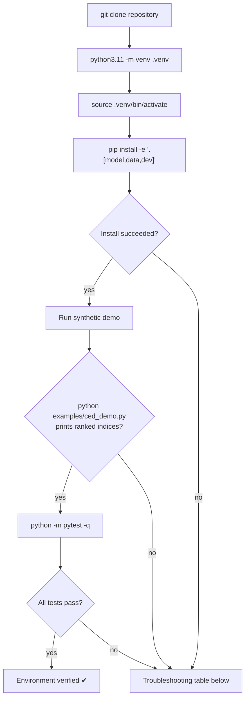
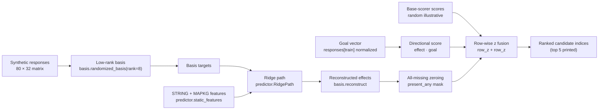

This page gets you from a fresh clone to a verified running VCDesign-CED environment in three commands. It covers prerequisites, environment installation, the bundled synthetic demo, and the protocol test suite — everything runs **without downloading biological data**. It does not cover paper-result reproduction or internal architecture; those follow in [Synthetic Demo Walkthrough](3-synthetic-demo-walkthrough) and [Architecture Overview](6-architecture-overview).


Sources: [README.md](/README.md#L84-L95)

## Prerequisites

The only hard requirement is **Python 3.11** — the package explicitly declares `requires-python = ">=3.11,<3.12"`, so Python 3.10 or 3.12 will fail at install time. All core functionality builds on a deliberately small dependency surface: NumPy for arrays, SciPy and PyTorch for the model layer, plus anndata/pandas/scikit-learn for the data layer.

The optional dependency groups (install extras) control what you pull in:

| Extra | What it installs | Needed for Quick Start? |
| :--- | :--- | :--- |
| `model` | scipy, torch 2.4 | Yes — demo and tests import torch-backed scoring |
| `data` | anndata, pandas, scikit-learn | Yes — data-contract modules are imported by the test suite |
| `dev` | pytest 8.x | Yes — protocol test suite |
| `figures` | matplotlib, scipy | No — plotting only |

Sources: [pyproject.toml](/pyproject.toml#L10-L18), [requirements.txt](/requirements.txt#L1-L8)

## Step 1 — Clone and Install

The complete setup is a five-command sequence run from your terminal:

```bash
git clone https://github.com/Boom5426/VCDesign-CED.git
cd VCDesign-CED
python3.11 -m venv .venv
source .venv/bin/activate
python -m pip install -e ".[model,data,dev]"
```

The `pip install -e .` **editable install** is what makes the `gene_open_inverse` package importable everywhere in the repo — the demo and tests never need `PYTHONPATH` tweaks, because setuptools discovers packages under `src/` and links them into your virtualenv in place.



Sources: [README.md](/README.md#L84-L92), [pyproject.toml](/pyproject.toml#L25-L29)

> [!TIP]
> On Linux, the plain `torch` dependency resolves to the multi-gigabyte CUDA build by default. If you only want the CPU smoke test, use the pinned alternative: install `requirements-cpu.txt` first (it routes pip through PyTorch's CPU wheel index and fixes `torch==2.4.1`), then `pip install -e . --no-deps` to link the package without touching torch.

Sources: [requirements-cpu.txt](/requirements-cpu.txt#L1-L6), [README.md](/README.md#L98-L107)

## Step 2 — Run the Synthetic Demo

```bash
python examples/ced_demo.py
```

This 49-line script is the fastest way to confirm the CED pipeline is wired correctly. It generates a small synthetic world — 80 candidates, 64 training rows, 32 genes — with random STRING-like and MAP-KG-like knowledge features, then executes the full scoring path end to end. Two candidates are deliberately marked as missing all knowledge modalities so the demo can prove the **all-missing score** convention fires correctly.

The demo mirrors the real CED architecture: historical responses are compressed into a low-rank **response basis**, a **ridge effect predictor** trained on knowledge features projects unseen candidates onto that basis, and predicted effects are aligned against a goal vector and **fused** with a base-scorer output before ranking.



Expected output looks like:

```text
synthetic demo only; ranked candidate indices: [42, 7, 13, 55, 29]
all-missing raw effect scores: [0.0, 0.0]
```

Where the demo's steps map to the real source modules:

| Demo step | Module exercised | Source file |
| :--- | :--- | :--- |
| Build knowledge features | `predictor.static_features` | `candidate_effect_distillation_v1/predictor.py` |
| Fit response basis | `basis.randomized_basis`, `.project`, `.reconstruct` | `candidate_effect_distillation_v1/basis.py` |
| Ridge prediction with penalty | `RidgePath(...).predict(penalty=1.0)` | `candidate_effect_distillation_v1/predictor.py` |
| All-missing handling | `features.present_any` mask → zero effect | `candidate_effect_distillation_v1/contract.py` |
| Score fusion + ranking | `row_z` + `lexsort` | `final_clean_model_v1/scoring.py` |

Sources: [examples/ced_demo.py](/examples/ced_demo.py#L31-L46), [README.md](/README.md#L94-L95), [README.md](/README.md#L115-L123)

> **Note**: the demo's scores are a *software smoke test*, not a biological result — it validates that the response-basis construction, ridge effect prediction, missing-knowledge handling, and score fusion all execute without error.

Sources: [README.md](/README.md#L94-L95)

## Step 3 — Verify with the Protocol Test Suite

```bash
python -m pytest -q
```

The test suite covers the protocol guarantees across `src/gene_open_inverse` — this path is pre-configured in `pyproject.toml` as `testpaths`, so run pytest from the repository root (not from `src/`) or the configuration won't be discovered. Notably, the protocol checks in `revision_v1`, `external_baselines_v1`, and `open_vocab_generalization_v1` *fail under pytest* when their guarantees do not hold, so a green run is a meaningful integrity signal, not just an import check.

Sources: [pyproject.toml](/pyproject.toml#L28-L29), [README.md](/README.md#L163-L165)

## Troubleshooting

| Symptom | Likely cause | Fix |
| :--- | :--- | :--- |
| `pip install` rejects the environment | Python version ≠ 3.11 (package pins `>=3.11,<3.12`) | Ensure `python3.11` is on PATH; recreate the venv with it |
| `ModuleNotFoundError: gene_open_inverse` | Package not installed editable, or running from wrong venv | Re-run `pip install -e ".[model,data,dev]"` inside `.venv` |
| Install hangs downloading multi-GB CUDA libraries | Linux default `torch` wheel is the CUDA build | Use the CPU variant: `requirements-cpu.txt` + `pip install -e . --no-deps` |
| `pytest` collects nothing | Invoked from `src/` or a subdirectory, missing root config | Run `python -m pytest -q` from the repository root |
| Demo prints all-zero rankings for *all* candidates (not just last two) | Modified script or wrong install shadowing the package | Re-clone or reinstall; the demo prints zero only for the 2 all-missing candidates |

Sources: [pyproject.toml](/pyproject.toml#L10-L18), [requirements-cpu.txt](/requirements-cpu.txt#L1-L6)

## Your Position and Next Steps

At this point you have: a pinned Python 3.11 environment, an editable `vcdesign-ced` install, a passing synthetic CED demo, and a green protocol test suite. Nothing biological has been downloaded — the frozen Hugging Face dataset, checkpoint verification, and training commands belong to the reproduction flow, not the smoke test.

| Where to go next | Why |
| :--- | :--- |
| [Synthetic Demo Walkthrough](3-synthetic-demo-walkthrough) | Understand the demo you just ran, line by line |
| [Reproducing Paper Results](4-reproducing-paper-results) | Download frozen artifacts, verify SHA-256, train the base scorer |
| [Data Sources and Provenance](5-data-sources-and-provenance) | Where the K562/RPE1/HepG2/Jurkat inputs come from |
| [Architecture Overview](6-architecture-overview) | How the `gene_open_inverse` modules fit together |

The repository's own entry-point map, for reference:

```text
src/gene_open_inverse/
├── candidate_effect_distillation_v1/  CED basis, predictor, fusion, evaluation
├── final_clean_model_v1/              final base scorer, selection, locked evaluation
├── four_context_v1/                   K562/RPE1/HepG2/Jurkat data contracts
├── external_baselines_v1/             comparator adapters and reporting
├── open_vocab_generalization_v1/      masking and open-vocabulary analyses
├── revision_v1/                       gene-grouped ridge penalty selection (the default)
└── model/                             frozen knowledge features and model components
configs/    portable asset paths and paper-run configuration
examples/   synthetic CED demonstration
tools/      processed-data SHA-256 verification
paper/      final manuscript PDF
```

Sources: [PROJECT_STRUCTURE.md](/PROJECT_STRUCTURE.md#L1-L15), [configs/paper_run_v1.json](/configs/paper_run_v1.json#L1-L44), [README.md](/README.md#L84-L92)

> [!TIP]
> The frozen run contract `configs/paper_run_v1.json` already records the selected checkpoint's SHA-256 and every input asset path — when you later move to [Reproducing Paper Results](4-reproducing-paper-results), this file is the single source of truth that `tools/verify_processed_data.py` checks every released byte against, so never edit it manually.