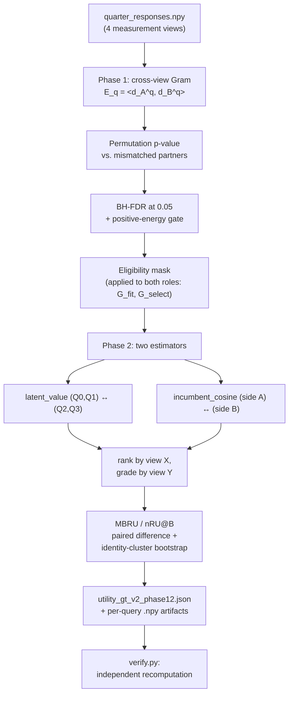
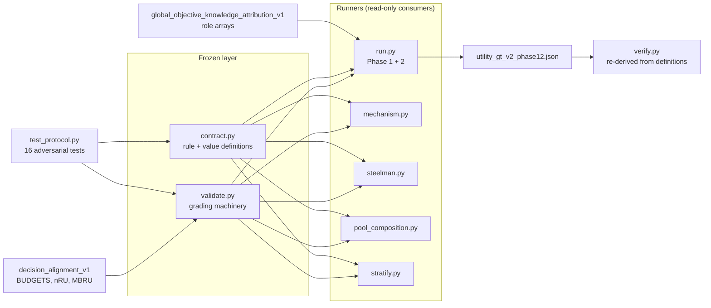

This page documents `src/gene_open_inverse/utility_gt_v2/` — the module that decides whether the project's new **latent candidate value** may serve as the utility ground truth. The question is deliberately narrow: not "is this definition better," but "can a candidate ordering produced by one measurement view be trusted when graded by a fully independent view, after the frozen eligibility rule has decided which queries are measurable at all." Nothing in this module trains a model, and nothing reads a model score — the module header states both invariants explicitly, and the run record asserts them as `trained_anything: False` and `read_G_check: False`.

Sources: [\_\_init\_\_.py](src/gene_open_inverse/utility_gt_v2/__init__.py#L1-L8), [run.py](src/gene_open_inverse/utility_gt_v2/run.py#L1-L11), [run.py](src/gene_open_inverse/utility_gt_v2/run.py#L226-L233)

## Two-Phase Architecture: Eligibility First, Verdict Second

The module splits its work into two frozen phases. **Phase 1** freezes which queries are measurable at all using a statistical rule fixed before any downstream score exists. **Phase 2** asks the only question that can promote the new value definition to ground truth: does a budget prefix ranked by one measurement view keep its experimental utility when graded by a fully independent view — computed identically for the latent value and for the incumbent cosine, on the same queries, candidates and cells.



The module decomposes into three layers: a frozen mathematical **contract** (`contract.py`), the **endpoint machinery** that turns orderings into graded decisions (`validate.py`), and a set of **runners** — the primary `run.py`, four diagnostics (`mechanism.py`, `steelman.py`, `pool_composition.py`, `stratify.py`), an adversarial test suite (`test_protocol.py`), and an independent verifier (`verify.py`). The runners share the contract and validator but never modify them; every threshold in this module is a constant, not a fitted parameter.



Sources: [\_\_init\_\_.py](src/gene_open_inverse/utility_gt_v2/__init__.py#L1-L8), [contract.py](src/gene_open_inverse/utility_gt_v2/contract.py#L1-L56), [validate.py](src/gene_open_inverse/utility_gt_v2/validate.py#L1-L19), [run.py](src/gene_open_inverse/utility_gt_v2/run.py#L25-L30)

## Phase 1: The Frozen Eligibility Rule

A query is only a question if its transition is measurable at all. The metric space is deliberately `W = I`; a noise-weighted `W` is absent from this module because it is a later sensitivity analysis that must not touch a primary verdict — a `W` chosen while looking at downstream scores would make the whole comparison circular. The eligibility statistic is the **shared latent transition energy** `E_q = <d_A^q, d_B^q>`, computed as the diagonal of the cross-view Gram `M[i, j] = <first_i, second_j>`. Because the two views are measured on disjoint batches, the noise cross term vanishes in expectation, so `E_q` is unbiased for `||d*_q||²` rather than inflated by measurement variance.

Sources: [contract.py](src/gene_open_inverse/utility_gt_v2/contract.py#L1-L23), [contract.py](src/gene_open_inverse/utility_gt_v2/contract.py#L97-L105), [contract.py](src/gene_open_inverse/utility_gt_v2/contract.py#L46-L48)

The null hypothesis needs no extra computation. Row `q` of the cross-view Gram already contains `<d_A^q, d_B^j>` for every mismatched partner `j` — the same statistic under the hypothesis that the identity pairing carries no signal. The one-sided empirical p-value is `(1 + b) / n` where `b` counts mismatched partners at least as large as the observed diagonal; the smallest attainable p-value is therefore `1/n`, which bounds how small an FDR level can ever be met. Holding `d_A^q` fixed makes the null conditional on that identity's own magnitude instead of pooling across identities of very different scale.

> [!TIP]
> The permutation null is free: it is the off-diagonal of the same Gram matrix you already computed for the energy. There is no resampling loop and no second pass over the data — the identifiability test costs exactly one matrix product.

Sources: [contract.py](src/gene_open_inverse/utility_gt_v2/contract.py#L108-L122), [contract.py](src/gene_open_inverse/utility_gt_v2/contract.py#L19-L23)

The decision combines two conditions: significance under Benjamini–Hochberg at the primary FDR level of 0.05 **and** a positive energy. The BH q-values are computed with a stable sort and a running minimum so monotonicity holds by construction. The rule is frozen governance, not calibration: `CALIBRATION_ROLE = "G_fit"` prescribes that the rule is developed on the calibration role and applied to `G_select` unchanged, and `GATE_SELECTED_FROM_G_SELECT = False` is a machine-checkable declaration that nothing in this module may read a `G_select` pass count, a model score, or a reproducibility number in order to set the level. Sensitivity is reported, not fitted — at FDR levels 0.01 and 0.10, and via a fixed p-value cutoff taken from `G_fit`'s BH rejection boundary and applied verbatim to `G_select`.

| Frozen constant | Value | Meaning |
|---|---|---|
| `METRIC_SPACE` | `"IDENTITY"` | Primary metric space is `W = I`; no noise weighting |
| `ELIGIBILITY_STATISTIC` | `SHARED_LATENT_TRANSITION_ENERGY` | `E_q = <d_A^q, d_B^q>` (cross-view diagonal) |
| `ELIGIBILITY_NULL` | `MISMATCHED_PARTNER_PERMUTATION_ONE_SIDED` | Off-diagonal Gram entries as the null distribution |
| `PRIMARY_FDR` | `0.05` | BH step-up level, prescribed not tuned |
| `SENSITIVITY_FDR` | `(0.01, 0.10)` | Reported only; never replaces the primary verdict |
| `REQUIRE_POSITIVE_ENERGY` | `True` | Significance alone is insufficient |
| `CALIBRATION_ROLE` / `GATE_SELECTED_FROM_G_SELECT` | `"G_fit"` / `False` | Rule frozen on the calibration role; auditable anti-circularity flag |

Sources: [contract.py](src/gene_open_inverse/utility_gt_v2/contract.py#L57-L70), [contract.py](src/gene_open_inverse/utility_gt_v2/contract.py#L125-L143), [contract.py](src/gene_open_inverse/utility_gt_v2/contract.py#L146-L160), [run.py](src/gene_open_inverse/utility_gt_v2/run.py#L196-L203)

Phase 1 produces a full audit trail per role: energy, p-value, and q-value distributions (including the fraction of p-values sitting at the `1/n` resolution floor), the BH p-cutoff, sensitivity counts, and an `Eligibility` dataclass carrying every array needed to reconstruct the decision. The `run()` driver applies the identical rule to both `G_fit` and `G_select`, writes per-role eligibility masks, and records the pool composition — nominal identities, four-way survivors, eligible identities, and any duplicate identity IDs.

Sources: [contract.py](src/gene_open_inverse/utility_gt_v2/contract.py#L73-L94), [run.py](src/gene_open_inverse/utility_gt_v2/run.py#L47-L84), [run.py](src/gene_open_inverse/utility_gt_v2/run.py#L205-L224)

## Phase 2: The Latent Candidate Value Without a Denominator

The candidate value is the reduction in squared endpoint distance that candidate `c` buys for query `q`:

```text
V_qc = 2 ⟨r*_c, d*_q⟩ − ||r*_c||²  =  ||d*_q||² − ||r*_c − d*_q||²
```

Implemented over the cross-view Gram `M = first @ second.T` as `V = M.T + M − diag(M)` — the four-way estimate `<r_c^first, d_q^second> + <r_c^second, d_q^first> − <r_c^first, r_c^second>` — with no division, no clipping, and no per-query rescaling. A structural sanity property falls out for free: the diagonal of `V` equals the transition energy `E_q` (a query "applied to itself" moves the state by the whole transition). Every term is a cross-view product, so the estimator is unbiased for the latent quantity rather than biased by `−features·σ²` the way a same-view form would be.

Sources: [contract.py](src/gene_open_inverse/utility_gt_v2/contract.py#L25-L33), [contract.py](src/gene_open_inverse/utility_gt_v2/contract.py#L163-L174), [contract.py](src/gene_open_inverse/utility_gt_v2/contract.py#L46-L48)

The formula's most consequential design decision is what it **omits**. The earlier definition divided each utility row by an estimate of `||d*_q||²` — a per-query constant that never changed a within-query ranking, but that flipped the sign of every utility in the row whenever the energy estimate came out non-positive, producing a catastrophic MBRU tail. Dropping the denominator removes that failure mode *by construction* rather than by filtering, and the change is metric-neutral because nRU is invariant to any positive affine transform of the utility row (a negative multiplier reverses the ordering — exactly what the old denominator did). The invariance is exact only while the nRU denominator stays above the contract's absolute floor of `1e-8`; the smallest denominators observed in Phase 2 were `0.038` for the cosine and `4.15` for the latent value, so the floor never bound. Both historical facts are pinned as executable tests (`test_04`, `test_05`), not just narrative.

Sources: [contract.py](src/gene_open_inverse/utility_gt_v2/contract.py#L34-L44), [test_protocol.py](src/gene_open_inverse/utility_gt_v2/test_protocol.py#L62-L79)

Because `V` estimates a squared-distance reduction, the estimator itself has a physical bound: `V > E_q` would imply a negative squared distance, which is impossible, so `physical_bound_violation` reads out estimator variance rather than identifying candidates that "overshoot the goal." Phase 2 records its frequency alongside the fraction of non-positive energy estimates per side — diagnostic channels for how noisy the quarter-view estimates are on the eligible pool.

Sources: [contract.py](src/gene_open_inverse/utility_gt_v2/contract.py#L186-L192), [run.py](src/gene_open_inverse/utility_gt_v2/run.py#L141-L152)

## The Endpoint in Decision Units: Rank by One View, Grade by the Other

The primary endpoint is explicitly **not** Top-B identity overlap. Overlap counts how many of the same candidates come back and is blind to what they are worth, so two orderings that disagree about which near-equal candidate sits at rank 7 are punished exactly as hard as orderings that disagree about a candidate worth ten times the median. The deployment question is the second one, so the endpoint is graded in decision units: rank every query's candidates by one measurement view, then report how much of the other view's own achievable value the budget prefix delivers, in nRU at budgets `B ∈ {10, 20, 50}` and their mean (MBRU) — the machinery imported from `decision_alignment_v1.contract`.

Sources: [validate.py](src/gene_open_inverse/utility_gt_v2/validate.py#L1-L19), [validate.py](src/gene_open_inverse/utility_gt_v2/validate.py#L41-L67)

The comparison is a strict A/B on identical cells. Each estimator contributes two instances; the incumbent cosine consumes side A for its first instance and side B for its second, while the latent value consumes the quarter pair `(Q0, Q1)` for its first instance and `(Q2, Q3)` for its second — the same cells, differently used. Both directions (`first_ranks_second_grades`, `second_ranks_first_grades`) are run and the paired `latent − cosine` difference is reported per direction and averaged, with identity-cluster bootstrap confidence intervals (cluster unit = query identity, fixed seed and replicate count from the decision-alignment contract) and per-budget nRU differences.

| Estimator | First instance (proposes) | Second instance (grades) | Cells consumed |
|---|---|---|---|
| `incumbent_cosine` | Side A | Side B | `base.transitions[0]`, `[1]` |
| `latent_value` | `(Q0, Q1)` | `(Q2, Q3)` | `quarter_responses[0..3]` |
| Directions | `first_ranks_second_grades` | `second_ranks_first_grades` | both, then averaged |

Sources: [run.py](src/gene_open_inverse/utility_gt_v2/run.py#L29-L30), [run.py](src/gene_open_inverse/utility_gt_v2/run.py#L86-L116), [validate.py](src/gene_open_inverse/utility_gt_v2/validate.py#L82-L99)

Ranking legality is enforced positionally. `legal_orders` produces a self-excluded descending order per query, where exclusion is by candidate-axis position — never by score — so a tie at the top can never smuggle the target intervention back into its own prefix; `grade` then consumes that ordering under the independent view, carrying the per-query nRU denominator alongside the score for auditability. Secondary channels quantify *how* the views disagree rather than only how much: `set_overlap` (against its chance level `B/pool_size`), `boundary_flip` (how often the independent view reverses the rank-B vs rank-B+1 pair that decides the budget — chance 0.5 by construction, requiring no noise model), and `spearman` over whole rows, which is marked auxiliary-only because the budget never uses it.

> [!TIP]
> Self-exclusion by position rather than score is what makes the whole A/B falsifiable. If exclusion were score-based, any estimator that ties with itself at rank 1 would grade its own target at the boundary — the test suite pins this with `test_10`, which places every diagonal at 100.0 and asserts no row's order contains its own index.

Sources: [validate.py](src/gene_open_inverse/utility_gt_v2/validate.py#L41-L50), [validate.py](src/gene_open_inverse/utility_gt_v2/validate.py#L101-L126), [validate.py](src/gene_open_inverse/utility_gt_v2/validate.py#L128-L146), [test_protocol.py](src/gene_open_inverse/utility_gt_v2/test_protocol.py#L133-L141)

## The Goal-Independent Control (Decision D-005)

The control that matters most for a proposed ground truth is not random — it is the **goal-independent prior**: rank every query by the candidate's mean value across queries, one shared ordering for the entire pool. If a value definition is more reproducible mainly because it carries a large query-independent component, a policy that ignores the goal entirely will reproduce most of its advantage; this control therefore upper-bounds the goal-conditioned content of any definition. Two details make it airtight: the column mean excludes each query's own diagonal entry (the largest value in its column by construction — leaving it in would let the self-similarity of 24% of the candidates leak into a policy that is supposed to carry no query information), and the ordering maximizes MBRU for a single shared permutation only as an unweighted mean, so the reported advantage is a *lower bound* on goal-blind performance and thus a conservative cap on goal-conditioned content.

Sources: [validate.py](src/gene_open_inverse/utility_gt_v2/validate.py#L161-L201), [run.py](src/gene_open_inverse/utility_gt_v2/run.py#L118-L138)

`test_11` pins the defining property — every row of the prior ordering is the same permutation (minus self-exclusions) — and `test_12` calibrates the grading scale itself: a perfect replicate must score MBRU exactly 1.0 and an unrelated ordering must land near zero. The `goal_conditioned_advantage_MBRU` recorded for each estimator in Phase 2 is the difference between the definition's own ordering and this prior, graded under the independent view.

Sources: [test_protocol.py](src/gene_open_inverse/utility_gt_v2/test_protocol.py#L143-L160), [run.py](src/gene_open_inverse/utility_gt_v2/run.py#L120-L138)

## The Diagnostic Battery: Four Steelman Scripts

Four scripts interrogate the Phase-2 verdict from independent angles. None of them changes a rule or a threshold; each writes its own schema-tagged JSON record and is runnable as `python -m gene_open_inverse.utility_gt_v2.<script>` from the repository root.

| Script | Question it answers | Method | Output schema |
|---|---|---|---|
| `mechanism.py` | What does the latent value's ordering actually rank by, given that it is nearly goal-independent? | Grades a policy ranking *purely* by the candidate-only term `−⟨r_c^Q0, r_c^Q1⟩` (the cross-view estimate of `−||r_c||²`); decomposes value variance into shared vs query-independent; correlates the prior with negative response energy; reports the response-energy percentile of selected prefixes at B ∈ {10, 20, 50} | `VCDESIGN_UTILITY_GT_V2_MECHANISM_V2` |
| `steelman.py` | Does the incumbent cosine's high-magnitude prefix actually move the state toward the goal? | Uses `V > 0 ⟺ ||r_c − d_q||² < ||d_q||²` (closer to goal than doing nothing) and grades each definition's prefix under the *other* definition's independent view; reports fraction-closer-than-no-op and value-relative-to-energy against a whole-pool reference | `VCDESIGN_UTILITY_GT_V2_STEELMAN_V1` |
| `pool_composition.py` | Is the latent value's goal-independent reproducibility an artifact of pool composition? | 76% of the 1081 candidates are identities whose own transition the frozen rule judges unmeasurable; reruns the comparison with the candidate vocabulary restricted to eligible identities only — a diagnostic, explicitly not a production filter | `VCDESIGN_UTILITY_GT_V2_POOL_COMPOSITION_V1` |
| `stratify.py` | What does the Phase-1 gate buy, in the same decision units? | Splits the four-way pool into `all_four_way_survivors`, `eligible`, and `rejected_by_the_gate`, and grades both estimators plus the goal-independent prior per stratum with bootstrapped advantage CIs | `VCDESIGN_UTILITY_GT_V2_GATE_STRATIFICATION_V1` |

Sources: [mechanism.py](src/gene_open_inverse/utility_gt_v2/mechanism.py#L1-L7), [mechanism.py](src/gene_open_inverse/utility_gt_v2/mechanism.py#L51-L63), [steelman.py](src/gene_open_inverse/utility_gt_v2/steelman.py#L1-L14), [steelman.py](src/gene_open_inverse/utility_gt_v2/steelman.py#L64-L85), [pool_composition.py](src/gene_open_inverse/utility_gt_v2/pool_composition.py#L1-L13), [pool_composition.py](src/gene_open_inverse/utility_gt_v2/pool_composition.py#L44-L77), [stratify.py](src/gene_open_inverse/utility_gt_v2/stratify.py#L1-L14), [stratify.py](src/gene_open_inverse/utility_gt_v2/stratify.py#L48-L71)

`steelman.py` exists because the goal-independent control alone cannot settle whether `−||r_c||²` is nuisance or signal: the cosine divides `||r_c||` out by construction and is therefore structurally favoured by any control that rewards removing the candidate main effect. The direct question — of the candidates each definition puts in the prefix, how many actually reduce the squared endpoint distance, and by how much — is answered with no shared measurement and no shared normalization by grading each definition's prefix under the other's independent view.

Sources: [steelman.py](src/gene_open_inverse/utility_gt_v2/steelman.py#L1-L14), [steelman.py](src/gene_open_inverse/utility_gt_v2/steelman.py#L55-L67)

## The Adversarial Test Protocol

`test_protocol.py` contains sixteen pytest targets, and its framing is stated in the first line: each test targets a specific way this phase could report a *valid-looking lie*. The suite is organized around the failure surfaces of the statistics above rather than around code coverage.

| Group | Tests | Lie they prevent |
|---|---|---|
| Estimator correctness | `test_01`–`test_03` | A same-view form silently biased by `−features·σ²`; `V` not equal to energy minus squared endpoint distance; diagonal of `V` not equal to `E_q` |
| Metric invariance | `test_04`, `test_05` | Claiming denominator removal changed the metric (positive-affine invariance holds to `1e-9`); forgetting that the retired normalization inverted rows under negative energy |
| Statistical machinery | `test_06`–`test_09` | Permutation p-values diverging from a brute-force loop; BH q-values diverging from a direct step-up reference; eligibility passing on significance without positive energy (or vice versa); BH cutoff disagreeing with the q-value decision |
| Protocol legality | `test_10`–`test_12` | Self-inclusion in prefixes via positional ties; the prior varying per query (it must be one shared ordering); a broken grading scale (perfect replicate ≠ 1.0, unrelated ≠ ~0) |
| Bootstrap & diagnostics | `test_13`–`test_15` | Cluster bootstrap failing to bracket a known shift of 0.30 or a centered null; boundary-flip rate not at 0.5 under pure-noise grading; `physical_bound_violation` deviating from its exact definition |
| Frozen governance | `test_16` | Any code change that flips `GATE_SELECTED_FROM_G_SELECT`, `CALIBRATION_ROLE`, `PRIMARY_FDR`, or `METRIC_SPACE` away from their frozen values |

Sources: [test_protocol.py](src/gene_open_inverse/utility_gt_v2/test_protocol.py#L1-L13), [test_protocol.py](src/gene_open_inverse/utility_gt_v2/test_protocol.py#L14-L38), [test_protocol.py](src/gene_open_inverse/utility_gt_v2/test_protocol.py#L80-L131), [test_protocol.py](src/gene_open_inverse/utility_gt_v2/test_protocol.py#L162-L209)

## Independent Verification: Lesson L3

`verify.py` is the module's external witness, and its docstring names the governing lesson: **a script must not be its own only witness (L3)**. Nothing in it imports the frozen metric module or the Phase-2 code it checks — ranked utility with logarithmic discounting, the random and oracle nRU references, the permutation p-value, and the BH step-up are all rewritten from their definitions, so agreement between the saved record and the verifier means two independent implementations agree.

Sources: [verify.py](src/gene_open_inverse/utility_gt_v2/verify.py#L1-L20)

The verifier recomputes the cross-view Gram from raw assets and checks the saved energy vector to `1e-9`, resamples 120 identities for permutation-p agreement, rebuilds eligibility from its own BH implementation, recounts candidate and query rows from `four_way_eligible`, spot-checks 400 sampled (query, candidate) pairs of the latent value against explicit dot products, confirms no self inner product enters the estimator, recomputes MBRU from scratch for 48 sampled queries under all four proposing/grading comparisons, and asserts the saved orderings exclude the query and that no identity appears twice on the candidate axis. A subtle correctness point lives in the gating logic: because a numeric check result is a dict, gating only on `is False` booleans would let every numeric check pass regardless of its error — each numeric check therefore carries an explicit tolerance and is gated separately (default `1e-10`, `1e-9` for the explicit-dot-product check), with the process exiting non-zero on any failure.

Sources: [verify.py](src/gene_open_inverse/utility_gt_v2/verify.py#L85-L150), [verify.py](src/gene_open_inverse/utility_gt_v2/verify.py#L206-L227)

## Running the Module and Its Artifacts

The primary entry point runs both phases in one pass and writes one record directory (`--asset`, `--config`, `--output`); `output.mkdir(..., exist_ok=False)` makes the long-running stage refuse to overwrite an existing result, mirroring the repository-wide reproduction convention. Every artifact is exported for audit:

| Artifact | Content |
|---|---|
| `utility_gt_v2_phase12.json` | Full Phase 1 + Phase 2 record, schema `VCDESIGN_UTILITY_GT_V2_PHASE12_V1`, with runtime stamp, Python/numpy versions, and config provenance |
| `G_select_{eligible,p_value,q_value,energy,ids}.npy` | Phase-1 decision arrays for the selection role (plus `G_fit_eligible.npy`, `G_fit_p_value.npy` for the calibration role) |
| `per_query__{estimator}__{direction}.npy` | Per-query MBRU for all four A/B comparisons |
| `per_query__order_first_{latent_value,incumbent_cosine}.npy` | The first-instance orderings themselves |
| `phase2_candidate_rows.npy`, `phase2_query_in_candidate.npy` | The exact candidate and query axes, recounted independently by the verifier |

Sources: [run.py](src/gene_open_inverse/utility_gt_v2/run.py#L226-L244), [REPRODUCE.md](REPRODUCE.md#L3-L4)

The full battery, run from the repository root:

```bash
python3 -m gene_open_inverse.utility_gt_v2.run         --asset ... --config ... --output results/utility_gt_v2
python3 -m gene_open_inverse.utility_gt_v2.mechanism   --asset ... --config ... --result results/utility_gt_v2 --output ...
python3 -m gene_open_inverse.utility_gt_v2.pool_composition --asset ... --config ... --result results/utility_gt_v2 --output ...
python3 -m gene_open_inverse.utility_gt_v2.steelman    --asset ... --config ... --result results/utility_gt_v2 --output ...
python3 -m gene_open_inverse.utility_gt_v2.stratify    --asset ... --config ... --result results/utility_gt_v2 --output ...
python3 -m pytest src/gene_open_inverse/utility_gt_v2/test_protocol.py -q
python3 -m gene_open_inverse.utility_gt_v2.verify      --asset ... --config ... --result results/utility_gt_v2 --output ...
```

Sources: [mechanism.py](src/gene_open_inverse/utility_gt_v2/mechanism.py#L1-L6), [pool_composition.py](src/gene_open_inverse/utility_gt_v2/pool_composition.py#L10-L13), [steelman.py](src/gene_open_inverse/utility_gt_v2/steelman.py#L10-L14), [stratify.py](src/gene_open_inverse/utility_gt_v2/stratify.py#L1-L8), [verify.py](src/gene_open_inverse/utility_gt_v2/verify.py#L219-L227)

## Position in the Documentation

This page sits inside the *Experiments and Baselines* section. The ranking vocabulary used throughout (nRU, MBRU, budgets `B ∈ {10, 20, 50}`) is defined in [Ranking Metrics: BU@B, MU@B, PHR@B](8-ranking-metrics-buatb-muatb-phratb); the decision route this validation gate protects is described in [Decision Routes: Retrieval versus Prediction](10-decision-routes-retrieval-versus-prediction); the `four_way_eligible` candidate pool consumed here is specified in [Four-Context Data Contracts](17-four-context-data-contracts). For the integrity machinery that surrounds this module, continue to [Protocol Test Suite](24-protocol-test-suite), [Artifact Verification and SHA-256 Manifests](23-artifact-verification-and-sha-256-manifests), and [Leakage Prevention and Identity-Level Cross-Validation](21-leakage-prevention-and-identity-level-cross-validation); the downstream consequences of the Phase-2 verdict are summarized in [Key Benchmark Findings](26-key-benchmark-findings).
