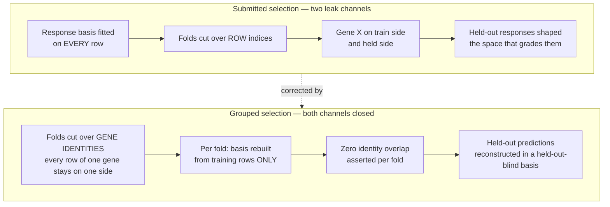
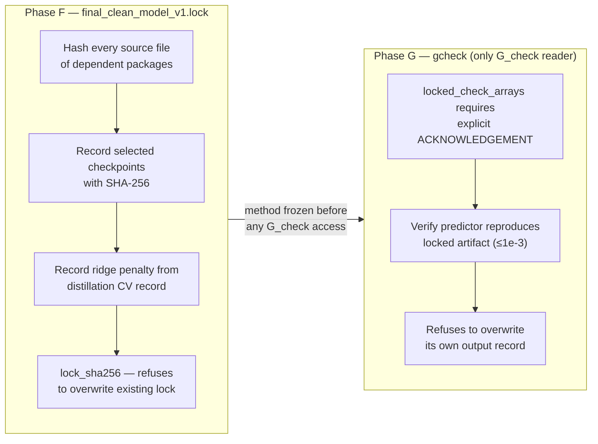

Leakage is the quiet way a ranking method fakes its own success: the same gene appears on both sides of a train/eval boundary, or a held-out response shapes the very object used to grade it. This page documents how VCDesign closes every one of those channels at four distinct levels: **gene-grouped cross-validation** inside the ridge effect predictor, **identity-based strata** at evaluation time, **controlled response masking** for the open-vocabulary experiments, and the **pre-`G_check` lock** that freezes the method of record. The core story centers on `revision_v1`, a module added during post-review correction, but the identity-discipline runs through the entire pipeline.

Sources: [PROJECT_STRUCTURE.md](PROJECT_STRUCTURE.md#L4-L14), [grouped_fit.py](src/gene_open_inverse/revision_v1/grouped_fit.py#L1-L21)

## Why "Identity" Is the Fold Unit, Not the Row

The ridge effect predictor maps static candidate knowledge (STRING + MAP-KG descriptors) to a gene-space effect. Every tunable choice — the basis rank, the ridge penalty grid, the fold seed — is fixed in a frozen contract, and the penalty is selected by five-fold cross-validation on `G_fit` only. The contract states the invariant directly: *a candidate never appears in both the training and validation side of a fold, and no `G_select` quantity is consulted at any point*.

Sources: [predictor.py](src/gene_open_inverse/candidate_effect_distillation_v1/predictor.py#L1-L10), [contract.py](src/gene_open_inverse/candidate_effect_distillation_v1/contract.py#L37-L44)

The subtlety is what "one candidate" means in a pooled multi-context atlas. Rows carry keys of the form `context|identity`, so a gene measured in three training contexts contributes **three rows but one identity**. Splitting rows randomly therefore splits genes — which is precisely the defect a reviewer found in the submitted implementation.

Sources: [grouped_fit.py](src/gene_open_inverse/revision_v1/grouped_fit.py#L26-L30), [predictors.py](src/gene_open_inverse/four_context_v1/predictors.py#L50-L56)

## The Leakage Defect Found During Review

External review identified two compounding leaks in the submitted `four_context_v1.predictors.fit`:

1. **Row-index folds split genes.** The penalty selection cut cross-validation folds over row indices. In a multi-context pool, rows of one gene could sit on both sides of a fold, so the "held-out" fold was not held out at the identity level.
2. **The basis was fitted before the folds were cut.** The frozen fit built the response basis from *every* row before fold assignment, so held-out responses shaped the basis in which their own predictions were reconstructed.

Sources: [grouped_fit.py](src/gene_open_inverse/revision_v1/grouped_fit.py#L3-L12)

Sources: [grouped_fit.py](src/gene_open_inverse/revision_v1/grouped_fit.py#L5-L12)

## Gene-Grouped Cross-Validation Mechanics

The corrected pipeline lives in `revision_v1.grouped_fit` and consists of three cooperating functions:

| Function | Responsibility | Key invariant |
| :--- | :--- | :--- |
| `row_identities` | Parses `context\|identity` keys down to the bare identity | One gene = one fold unit |
| `grouped_folds` | Assigns identities to blocks, then expands to row index blocks | Sort-then-permute: assignment depends only on the identity set + seed, never row order |
| `cross_validate_grouped` | Scores every penalty on gene-grouped folds | Raises `AssertionError` if any identity intersects train and held |

Sources: [grouped_fit.py](src/gene_open_inverse/revision_v1/grouped_fit.py#L26-L60)

Inside each fold the response basis is **rebuilt from that fold's training rows alone** (`bs.randomized_basis(responses[train])`), and the weighted ridge path is fitted on the fold's projected targets. The selection criterion remains the frozen one — mean held-out gene-space cosine between the reconstructed prediction and the row's consensus response — so the correction changes *where* the penalty is validated, not *what* the penalty optimizes.

Sources: [grouped_fit.py](src/gene_open_inverse/revision_v1/grouped_fit.py#L47-L79)

Critically, the **final deployed predictor is built exactly as the frozen one builds it**: basis on every row, the same weighted ridge path. When the grouped selection lands on the same penalty as the submitted one, the two predictors are mathematically identical, and the difference lives entirely in the selection record. This is what makes the correction auditable rather than a silent method change.

Sources: [grouped_fit.py](src/gene_open_inverse/revision_v1/grouped_fit.py#L83-L119)

> [!TIP]
> The sort-then-permute construction in `grouped_folds` is deliberate anti-fragility: because identities are sorted before permutation, fold membership is a pure function of `(identity set, seed)`. Row-order shuffles upstream of the fitter cannot change which genes are held out — and test 02 in the protocol suite proves it.

## The Selection Switch: Grouped versus Frozen

`four_context_v1.predictors.fit` exposes a `selection` argument so the corrected and submitted paths remain comparable byte-for-byte:

| Aspect | `selection="grouped"` (default, corrected) | `selection="frozen"` (as submitted) |
| :--- | :--- | :--- |
| Fold unit | Gene identity (`"gene identity"`) | Row index (`"row index (as submitted)"`) |
| Basis during CV | Refit on each fold's training rows | Fitted on every row before folds are cut |
| Purpose | Leakage-free penalty selection | Exact reproduction of submitted numbers |
| Fitted model | Identical whenever penalties coincide | Identical whenever penalties coincide |
| Record provenance | `"selection": "grouped"` | `"selection": "frozen"` |

Sources: [predictors.py](src/gene_open_inverse/four_context_v1/predictors.py#L115-L141)

The equivalence claim is not asserted in a comment — it is tested: at a fixed penalty, `grouped.basis` and `frozen.basis` must be bitwise identical (`max diff == 0.0`) and both paths must predict identically, otherwise a ranking change could be wrongly attributed to the corrected selection rather than a different fitted model.

Sources: [test_grouped_fit.py](src/gene_open_inverse/revision_v1/test_grouped_fit.py#L101-L126), [predictors.py](src/gene_open_inverse/four_context_v1/predictors.py#L143-L146)

## Protocol Tests That Name the Failure

`revision_v1.test_grouped_fit` documents four checks, each naming a failure that would otherwise look like a valid selection. Under pytest, any failing check raises and fails the suite; the standalone runner prints the pass/fail table.

| Check | What it asserts | Failure it guards against |
| :--- | :--- | :--- |
| `01_folds_never_split_a_gene` | Grouped fold overlap = 0, folds cover all rows, and submitted-style row folds **do** overlap (`leaky > 0`) | A "fixed" fold that still splits one gene across train/held |
| `02_folds_ignore_row_order` | Fold block per identity is identical before and after a row permutation | Order-dependent fold assignment |
| `03_fold_basis_sees_training_rows_only` | Fold-local basis differs from the whole-row basis (> 1e-8) and the record names `"refit on each fold's training rows"` | A basis fitted on every row, so held responses shape their own grading space |
| `04_selection_switch_changes_only_the_search` | Same basis (`0.0` diff), same path predictions, and record flags distinguish `grouped` from `frozen` | A selection switch that silently changes the fitted predictor, corrupting attribution |

Sources: [test_grouped_fit.py](src/gene_open_inverse/revision_v1/test_grouped_fit.py#L1-L8), [test_grouped_fit.py](src/gene_open_inverse/revision_v1/test_grouped_fit.py#L46-L126)

## Identity-Level Boundaries at Evaluation Time

Leakage prevention does not stop at the predictor. The evaluation contract enforces identity discipline in three more places, all keyed on the same parse-and-partition pattern:

**Self-exclusion in ranking.** Every scored row is ranked over the *self-excluded legal pool*: `row_metrics` takes `self_positions` (where the query's own identity sits in the candidate stratum, or `-1`), and both the stable ordering and the reference normalization drop that position before any budget is counted. The graded quantity literally cannot include the query's own measured response.

Sources: [metrics.py](src/gene_open_inverse/evaluation_contract_v1/metrics.py#L1-L11), [metrics.py](src/gene_open_inverse/evaluation_contract_v1/metrics.py#L18-L43)

**Strata by supervision history.** `four_context_v1.overlap` partitions each held context's candidate axis into `SEEN_CANDIDATE` (identity response-supervised in the training contexts — tests *context* transfer) and `UNSEEN_CANDIDATE` (identity no training context measured — tests *candidate mapping* transfer), plus `COMMON4` (measured in all four contexts). The module docstring's rule is explicit: these two generalizations are *never added together*, and **membership is a property of which identities were measured where — it never depends on a score**.

Sources: [overlap.py](src/gene_open_inverse/four_context_v1/overlap.py#L1-L11), [overlap.py](src/gene_open_inverse/four_context_v1/overlap.py#L17-L43)

**Fixed evaluation population per LOCO fold.** In leave-one-context-out runs, `SEEN` is defined against the *full* three-context training set rather than per-design, so a one-context design and the pooled design are graded on identical candidate sets — with each design additionally reporting what fraction of each stratum it actually supervised, a number that would otherwise hide inside a moving population. The fold record carries `"read_anchor_G_check": False` and `"context_feature_given_to_any_model": False` as machine-checkable non-leakage attestations.

Sources: [loco.py](src/gene_open_inverse/four_context_v1/loco.py#L1-L10), [loco.py](src/gene_open_inverse/four_context_v1/loco.py#L96-L101), [loco.py](src/gene_open_inverse/four_context_v1/loco.py#L46-L52)

## Controlled Response Masking: Making "Unseen" Surgical

Natural unseen candidates differ from seen ones in library membership and assay history. The masking phase manufactures the response-unseen condition instead: the candidate identity, its static knowledge, the evaluation pool, the queries, the base ranker, and the graded utility are all held fixed, and the only thing that changes is whether the identity's measured responses entered the effect predictor's fit.

Sources: [masking.py](src/gene_open_inverse/open_vocab_generalization_v1/masking.py#L4-L11)

Fold assignment is **outcome-independent by construction**: each candidate's masking fold is derived from a SHA-256 digest of `"{namespace}:{identity}"`, so nothing about a response, a feature value, or a result can influence it — and the same identity is masked in the same fold everywhere it appears. Removal in `masked_training_pool` is by identity across *every* named context at once, so a masked candidate has no response supervision anywhere in the atlas rather than in one context of it.

Sources: [masking.py](src/gene_open_inverse/open_vocab_generalization_v1/masking.py#L22-L35), [masking.py](src/gene_open_inverse/open_vocab_generalization_v1/masking.py#L38-L53)

The leakiest subtle channel is the response basis itself: a deployment in which the candidate was never measured is a deployment in which it never entered the basis either. Reusing the seen arm's basis would leak the masked responses *through the very object the protocol says must be rebuilt* — so the basis and ridge are rebuilt inside the masked pool, and a cross-fit homogeneity gate verifies the five fold predictors' intercept directions, selected penalties, and candidate-specific shrinkage shares before per-candidate columns may be mixed into one score row.

Sources: [masking.py](src/gene_open_inverse/open_vocab_generalization_v1/masking.py#L14-L17), [masking.py](src/gene_open_inverse/open_vocab_generalization_v1/masking.py#L79-L98)

> [!TIP]
> Two masking designs coexist and are deliberately not equivalent: `cross_context` (primary — neither arm has ever seen the held context's responses, so neither can memorize what it is graded on) versus `within_context` (its SEEN arm fits on the very response the utility is built from, making `SEEN − MASKED` a mechanically confounded upper bound reported as a reference, never as the estimate of record).

## The Pre-`G_check` Lock and Split-Semantics Discipline

The three-split contract is stated in the frozen final contract: training may read `G_fit` knowledge plus measured responses; a `G_select` candidate's own measured response is used for grading and **never as an input, in any view**; `G_check` is sealed. The ridge penalty recorded in the lock (`1e4`) was chosen by `G_fit` five-fold identity CV, and none of it is re-selected later.

Sources: [contract.py](src/gene_open_inverse/candidate_effect_distillation_v1/contract.py#L10-L21), [contract.py](src/gene_open_inverse/final_clean_model_v1/contract.py#L6-L12), [gcheck.py](src/gene_open_inverse/final_clean_model_v1/gcheck.py#L11-L16)

Sources: [lock.py](src/gene_open_inverse/final_clean_model_v1/lock.py#L1-L9), [lock.py](src/gene_open_inverse/final_clean_model_v1/lock.py#L23-L36), [gcheck.py](src/gene_open_inverse/final_clean_model_v1/gcheck.py#L1-L11), [gcheck.py](src/gene_open_inverse/final_clean_model_v1/gcheck.py#L69-L76)

The lock is honest about its limits rather than overstating them: the code digest exists because a commit hash alone does not identify the code (the authoring checkout carries uncommitted work), and the record embeds `G_check_never_used_to_select` flags alongside the note that *earlier phases of the wider programme did read `G_check`* — which is why the split is contractually named a **"locked final evaluation split"** and is forbidden from being called an "untouched blind test."

Sources: [lock.py](src/gene_open_inverse/final_clean_model_v1/lock.py#L26-L35), [lock.py](src/gene_open_inverse/final_clean_model_v1/lock.py#L82-L89), [contract.py](src/gene_open_inverse/final_clean_model_v1/contract.py#L41-L44)

Finally, `gcheck` closes the loop on the predictor identity: before scoring, `FrozenEffectPredictor.verify_against` re-derives the `G_select` predicted effects and compares them to the locked artifact — a reproduction error above `1e-3` raises, guaranteeing the evaluated predictor *is* the locked one, not a retrained look-alike.

Sources: [gcheck.py](src/gene_open_inverse/final_clean_model_v1/gcheck.py#L69-L76), [lock.py](src/gene_open_inverse/final_clean_model_v1/lock.py#L88-L96)

## Summary: Four Layers, One Invariant

| Layer | Module | Identity rule enforced |
| :--- | :--- | :--- |
| Penalty selection | `revision_v1.grouped_fit` | Folds cut over gene identities; per-fold basis refit; zero overlap asserted |
| Evaluation | `evaluation_contract_v1.metrics`, `four_context_v1.overlap` | Self-excluded pools; strata from measurement history, never from scores |
| Masking | `open_vocab_generalization_v1.masking` | Fold from SHA-256 of symbol; identity removed everywhere; basis must be rebuilt |
| Locked eval | `final_clean_model_v1.lock` / `gcheck` | Everything hashed before `G_check`; predictor verified against locked artifact |

The unified invariant: **whenever a boundary is cut — CV fold, eval stratum, masking fold, or final split — it is cut on the candidate identity, never on the row, and the object that grades held-out quantities is rebuilt without them.** For the full narrative of what external review found and how each defect was corrected, continue to [Post-Review Corrections](22-post-review-corrections); for the executable guarantees, see [Protocol Test Suite](24-protocol-test-suite) and [Artifact Verification and SHA-256 Manifests](23-artifact-verification-and-sha-256-manifests); for how the strata feed the held-out protocol, see [Held-Out Context Evaluation Protocol](9-held-out-context-evaluation-protocol) and [Ridge Effect Predictor](12-ridge-effect-predictor).
