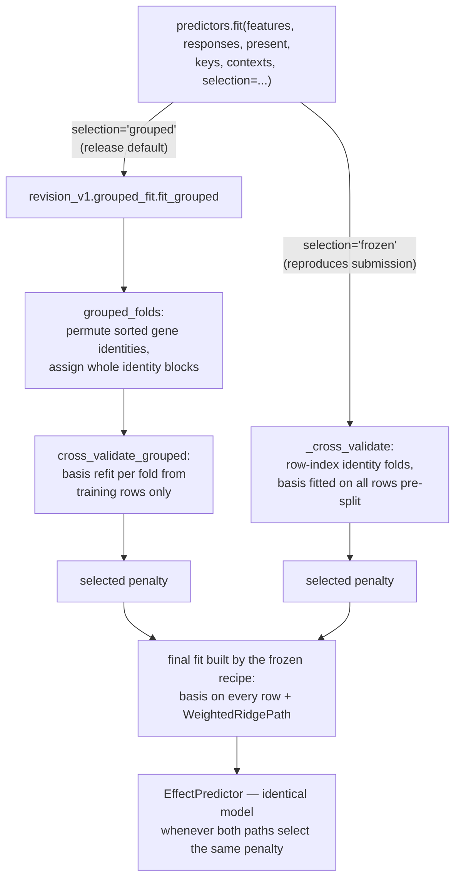

This page documents the exact differences between the current release of the code package (version `0.3.1`) and the version submitted alongside the paper. The corrections exist for one reason: external review identified weaknesses in how the ridge penalty for the Candidate Effect Distillation predictor was selected, and how the fusion normalization was specified. The release fixes the selection procedure as its default, documents the normalization semantics explicitly, and adds an option for subset-standardized fusion — while guaranteeing that the submitted numbers remain exactly reproducible through an explicit `selection="frozen"` switch. Corrections are deliberately quarantined in a dedicated module, `gene_open_inverse/revision_v1`, so reviewers can audit the delta between submitted and released behavior without reading the entire pipeline.

Sources: [CODE_PACKAGE_README.md](CODE_PACKAGE_README.md#L86-L94), [pyproject.toml](pyproject.toml#L6-L7), [__init__.py](src/gene_open_inverse/revision_v1/__init__.py#L1-L9)

## Design Principle: Corrections Quarantined From the Submitted Modules

The revision strategy follows a strict boundary: submitted code is never silently edited. The corrected ridge selection lives in `revision_v1.grouped_fit`, and the original `four_context_v1.predictors.fit` gains a single new keyword, `selection`, which defaults to `"grouped"` (the corrected path) and accepts `"frozen"` (the submitted path). The module docstring records the critical empirical claim: **on the published pools the selected penalty is unchanged** — meaning the correction tightens the *validity* of the selection procedure without altering reported results. Whenever both paths land on the same penalty, the fitted predictor is bit-for-bit identical, because the final fit is constructed the same way in both branches; only the cross-validation *record* differs (its fold unit, basis handling, and held-out cosines).

Sources: [predictors.py](src/gene_open_inverse/four_context_v1/predictors.py#L126-L165), [__init__.py](src/gene_open_inverse/revision_v1/__init__.py#L1-L9), [grouped_fit.py](src/gene_open_inverse/revision_v1/grouped_fit.py#L11-L16)



## Correction 1: Gene-Grouped Ridge Penalty Selection

### What the submitted selection did wrong

The submitted `four_context_v1.predictors.fit` selected its ridge penalty using `identity_folds` computed **over row indices**. In a multi-context pool this is structurally unsound: a gene owns one row per training context that measured it, so the rows of a single gene can sit on both sides of a fold — the model trains on context A's measurement of gene *g* while holding out context B's measurement of the same gene, and cross-validation overstates generalization. The second flaw compounded the first: the frozen fit built the response basis from **every row before the folds were cut**, so held-out responses shaped the very low-rank basis in which their own predictions were reconstructed. This is basis-level leakage, exactly the family of failures the leakage-prevention protocol is designed to eliminate.

Sources: [grouped_fit.py](src/gene_open_inverse/revision_v1/grouped_fit.py#L1-L9), [predictors.py](src/gene_open_inverse/four_context_v1/predictors.py#L98-L106)

### What the corrected selection does

`fit_grouped` changes **the selection only** — nothing about the final model recipe. Folds are cut over gene identities via `grouped_folds`, which sorts identities before permuting them (so fold assignment depends only on the identity set and the seed, never on row order), then assigns each whole identity to one of `RIDGE_FOLDS` blocks. Inside each fold, the response basis is rebuilt from that fold's training rows alone via `bs.randomized_basis(responses[train])`, and an explicit assertion raises if any identity appears on both sides of a fold. The selection criterion is unchanged from the frozen one: mean held-out cosine between the reconstructed prediction and each row's consensus response, maximized over the penalty grid. The final predictor is then built exactly as the frozen fit builds it — basis fitted on every row, the same `WeightedRidgePath` — so if the grouped search lands on the frozen penalty, the two predictors are identical objects.

Sources: [grouped_fit.py](src/gene_open_inverse/revision_v1/grouped_fit.py#L32-L48), [grouped_fit.py](src/gene_open_inverse/revision_v1/grouped_fit.py#L51-L97), [grouped_fit.py](src/gene_open_inverse/revision_v1/grouped_fit.py#L100-L119)

### Frozen versus grouped, side by side

| Dimension | `selection="frozen"` (as submitted) | `selection="grouped"` (release default) |
| :--- | :--- | :--- |
| Fold unit | Row indices | Gene identity (`context\|identity` → identity) |
| Can one gene straddle train/held? | Yes — structural in multi-context pools | No — asserted impossible at runtime |
| Basis fitted before split | On every row | Refit inside each fold, training rows only |
| Selection criterion | Held-out cosine (unchanged) | Held-out cosine (unchanged) |
| Final fit recipe | Basis on all rows + `WeightedRidgePath` | Identical |
| Cross-validation record | `"selection": "frozen"`, `"fold_unit": "row index (as submitted)"` | `"selection": "grouped"`, `"fold_unit": "gene identity"`, per-fold identity counts |
| Result on published pools | Reproduces submitted numbers exactly | Same selected penalty |

Sources: [grouped_fit.py](src/gene_open_inverse/revision_v1/grouped_fit.py#L83-L97), [predictors.py](src/gene_open_inverse/four_context_v1/predictors.py#L144-L165)

## Corrections 2 and 3: Fusion Normalization Semantics

### Correction 2 — the normalization is now stated, not implied

`four_context_v1.evaluate.fuse` performs z-score additive fusion at unit weight with no fitted coefficient: each branch (base scores and predicted-effect cosines) is standardized per query row with `row_z`. The correction here is documentation of scope: the function standardizes each branch **over every column of the matrix it is given**, and in the published runs that matrix is the whole scored pool — so fusion normalizes over the full pool, not over the evaluated candidate subset within it. The docstring now states this explicitly, eliminating ambiguity about whether normalization windows move with strata.

Sources: [evaluate.py](src/gene_open_inverse/four_context_v1/evaluate.py#L82-L96), [CODE_PACKAGE_README.md](CODE_PACKAGE_README.md#L91), [harness.py](src/gene_open_inverse/four_context_v1/harness.py#L157-L160)

### Correction 3 — `standardize_over` for subset-normalized fusion

A new optional parameter, `standardize_over`, accepts a boolean mask or an integer index array and standardizes both branches **over those columns only**, returning exactly `0.0` everywhere else. The rationale is causal hygiene: with subset standardization, a ranking of the selected columns cannot depend on what lies outside them, and columns outside the subset must not be graded (they carry no signal). Validation in `_columns` rejects malformed inputs — a boolean mask must have one entry per column, indices must lie in `[0, width)`, and an empty selection raises. With the default `None`, the function returns exactly what the pre-revision function returned.

Sources: [evaluate.py](src/gene_open_inverse/four_context_v1/evaluate.py#L63-L79), [evaluate.py](src/gene_open_inverse/four_context_v1/evaluate.py#L95-L104), [CODE_PACKAGE_README.md](CODE_PACKAGE_README.md#L92)

| Call | Standardization window | Columns outside window |
| :--- | :--- | :--- |
| `fuse(base, effect)` | Per query row, all columns given (whole scored pool in published runs) | N/A — all columns scored |
| `fuse(base, effect, beta)` | Same as above, at fusion weight `beta` | N/A |
| `fuse(base, effect, standardize_over=mask)` | Per query row, columns selected by boolean mask or index array only | Returned as `0.0`, must not be graded |

## Smaller Changes: Hardened Protocol Checks and Packaging

The protocol checks in `revision_v1`, `external_baselines_v1`, and `open_vocab_generalization_v1` now **fail their test under pytest** when a check does not hold; previously only their standalone runners reported failure, meaning `python -m pytest -q` could pass while a protocol check was silently violated. The mechanism is visible in `revision_v1.test_grouped_fit`: each `check()` records its result and raises `CheckFailed` (an `AssertionError` subclass) immediately, so pytest fails the test, while the standalone `main()` runner still collects and reports all results from the `RESULTS` list. Two packaging refinements complete the delta: `requirements-cpu.txt` pins `torch==2.4.1` against PyTorch's CPU wheel index so CPU verification does not pull several gigabytes of unused CUDA libraries, and the package version is recorded as `0.3.1`.

Sources: [test_grouped_fit.py](src/gene_open_inverse/revision_v1/test_grouped_fit.py#L26-L34), [CODE_PACKAGE_README.md](CODE_PACKAGE_README.md#L94), [requirements-cpu.txt](requirements-cpu.txt#L1-L6), [pyproject.toml](pyproject.toml#L6-L7)

## Verifying the Corrections in Practice

The revision ships with four protocol tests, each named after the specific failure it would catch. Two tests attack the selection directly: they verify that grouped folds never split a gene *while* demonstrating that the submitted-style row-index folds demonstrably do leak, and that fold assignment ignores row order. The third verifies the fold basis is materially different from the all-rows basis — i.e., the refit actually happened. The fourth is the reproducibility guard: at one penalty, the grouped and frozen paths must produce **identical basis matrices and identical path predictions** (both differences asserted to be exactly `0.0`), so no BU change can be blamed on the selection switch when the fitted model did not move.

| Test | Failure it names | Core assertion |
| :--- | :--- | :--- |
| `01_folds_never_split_a_gene` | Grouped folds still splitting one gene across train/held (leaking as submitted did) | Grouped overlap `== 0`, full coverage, submitted-style overlap `> 0` |
| `02_folds_ignore_row_order` | Fold assignment depending on row order | Identity→block mapping invariant under row permutation |
| `03_fold_basis_sees_training_rows_only` | Fold basis still fitted on every row | Fold basis differs from all-rows basis by `> 1e-8`; record names `"gene identity"` / refit |
| `04_selection_switch_changes_only_the_search` | Selection switch changing the fitted model, not just the search | Basis diff `== 0.0` and path diff `== 0.0`; record entries name the path |

Sources: [test_grouped_fit.py](src/gene_open_inverse/revision_v1/test_grouped_fit.py#L53-L122)

Run the checks from the repository root. The full suite (which embeds these protocol tests) is expected to report `169 passed` for this release:

```bash
python -m pytest -q                                    # full suite, includes revision_v1 tests
python -m gene_open_inverse.revision_v1.test_grouped_fit   # standalone runner with per-check output
```

Both paths fail on a violated check — the standalone runner exits non-zero and prints per-check PASS/FAIL lines; pytest raises through the same `check()` calls.

Sources: [test_grouped_fit.py](src/gene_open_inverse/revision_v1/test_grouped_fit.py#L125-L143), [CODE_PACKAGE_README.md](CODE_PACKAGE_README.md#L41-L45), [REPRODUCE.md](REPRODUCE.md#L21-L24)

## Where This Fits in the Documentation

These corrections sit at the intersection of two catalog themes. The leakage mechanics behind Correction 1 — why identity-level grouping matters and how held-out context evaluation is protected — are treated in depth in [Leakage Prevention and Identity-Level Cross-Validation](21-leakage-prevention-and-identity-level-cross-validation), and the multi-context pool that makes row-index folds dangerous is defined in [Four-Context Data Contracts](17-four-context-data-contracts). The fused-score contract that Corrections 2 and 3 refine is introduced in [Score Fusion and Beta Selection](14-score-fusion-and-beta-selection). To confirm that the corrected pipeline still reproduces the frozen checkpoint and its SHA-256-pinned artifacts, continue to [Reproducing Paper Results](4-reproducing-paper-results) and [Artifact Verification and SHA-256 Manifests](23-artifact-verification-and-sha-256-manifests).
