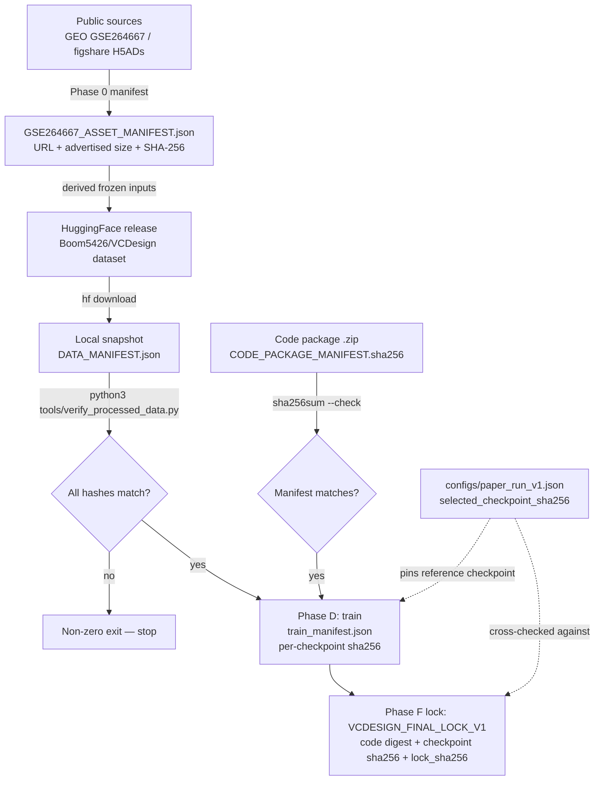
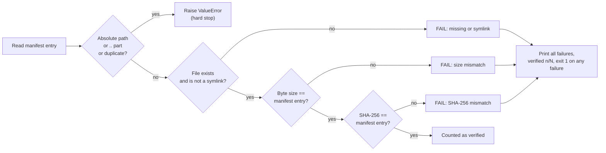

This page documents how VCDesign-CED guarantees that the bytes you execute and train on are exactly the bytes the paper's results were produced from. The repository implements a **layered SHA-256 verification chain**: every artifact class — raw downloads, the processed-data release, the portable code package, trained checkpoints, and the final evaluation lock — carries a manifest or pinned digest, and each layer ships with a verifier that refuses to proceed on any mismatch. The philosophy is explicit in the tools themselves: verification is a hard gate (non-zero exit codes), not a warning.

Sources: [verify_processed_data.py](tools/verify_processed_data.py#L1-L52), [build_code_package.py](tools/build_code_package.py#L1-L216), [REPRODUCE.md](REPRODUCE.md#L1-L47)

## The Verification Chain: Five Hash-Pinned Layers

The manifest system is not a single file but a chain of provenance records, each hashing its inputs and being hashed, in turn, by the next stage. The chain starts at the public data sources (Phase 0 asset manifest), flows through the frozen processed-data release (`DATA_MANIFEST.json`), reaches the code you run (`CODE_PACKAGE_MANIFEST.sha256`), and terminates in the pre-evaluation lock (`VCDESIGN_FINAL_LOCK_V1`) that self-hashes its own record.



Four distinct manifest artifacts cooperate here, each with its own schema, producer, and consumer:

| Manifest artifact | Schema / identifier | Produced by | Consumed by |
| :--- | :--- | :--- | :--- |
| `GSE264667_ASSET_MANIFEST.json` | `VCDESIGN_FOUR_CONTEXT_V1_ASSET_MANIFEST` | `four_context_v1.manifest` (Phase 0) | Downstream four-context build stages |
| `DATA_MANIFEST.json` | `VCDESIGN_PROCESSED_DATA_V1` | Processed-data release (HuggingFace) | `tools/verify_processed_data.py` |
| `CODE_PACKAGE_MANIFEST.sha256` + `CODE_PACKAGE_RELEASE.json` | `VCDESIGN_CODE_RELEASE_V1` | `tools/build_code_package.py` | `sha256sum --check` / built-in `verify()` |
| `train_manifest.json` → lock record | `VCDESIGN_FINAL_CLEAN_MODEL_V1_TRAIN` → `VCDESIGN_FINAL_LOCK_V1` | `final_clean_model_v1.train` (Phase D) → `final_clean_model_v1.lock` (Phase F) | Locked evaluation and reproduction audits |

Sources: [REPRODUCE.md](REPRODUCE.md#L8-L17), [DATA_SOURCES.md](DATA_SOURCES.md#L1-L5), [manifest.py](src/gene_open_inverse/four_context_v1/manifest.py#L40-L48), [lock.py](src/gene_open_inverse/final_clean_model_v1/lock.py#L57-L76)

## Verifying the Processed-Data Snapshot

The primary entry point for anyone reproducing the paper is `tools/verify_processed_data.py`. After downloading the frozen inputs from the HuggingFace dataset release (`inputs/`, `checkpoints/`, `records/`, and the top-level `DATA_MANIFEST.json`), you run the verifier against the snapshot root before touching anything else:

```bash
python3 tools/verify_processed_data.py --root .
```

The tool loads `DATA_MANIFEST.json`, rejects any unrecognized schema, then walks every entry in the manifest's `files` array. Each file is validated through a deliberately ordered pipeline — path safety first, then existence, then cheap size comparison, and only then the expensive full-content hash:



The checks in code, in order:

| # | Check | Condition | Failure behavior | Source lines |
| :--- | :--- | :--- | :--- | :--- |
| 1 | Manifest schema | `schema == "VCDESIGN_PROCESSED_DATA_V1"` | `ValueError` — unrecognized manifest | [verify_processed_data.py](tools/verify_processed_data.py#L25-L27) |
| 2 | Path safety | No absolute paths, no `..` components, no duplicates | `ValueError` — invalid or duplicate manifest path | [verify_processed_data.py](tools/verify_processed_data.py#L30-L34) |
| 3 | Regular file | Must exist and must **not** be a symlink | `FAIL missing or symlink` — collected, run continues | [verify_processed_data.py](tools/verify_processed_data.py#L36-L39) |
| 4 | Size gate | `stat().st_size == entry["bytes"]` | `FAIL size mismatch` — skips the hash for speed | [verify_processed_data.py](tools/verify_processed_data.py#L40-L42) |
| 5 | Content hash | Streamed SHA-256 in 16 MiB blocks | `FAIL SHA-256 mismatch` | [verify_processed_data.py](tools/verify_processed_data.py#L43-L44) |

The hashing routine streams the file in 16 MiB chunks rather than loading it into memory ([verify_processed_data.py](tools/verify_processed_data.py#L11-L16)), which matters because the raw Perturb-seq H5ADs in this pipeline are multi-gigabyte files. The exit protocol is equally deliberate: failures are collected and reported individually so you learn *every* corrupted file in one pass, the summary line reports `verified n/N`, and `SystemExit(bool(failures))` converts any failure into a non-zero exit code ([verify_processed_data.py](tools/verify_processed_data.py#L45-L52)) — safe to embed in shell scripts and CI.

> [!TIP]
> The manifest stores **release-relative paths** for records whose original compute-host paths were replaced during publication ([REPRODUCE.md](REPRODUCE.md#L16-L17)). This means the same manifest verifies correctly regardless of where you unpack the snapshot — the verifier resolves every entry against `--root`, never against the authoring machine's filesystem.

The frozen reference checkpoint is doubly pinned: `REPRODUCE.md` states that `checkpoints/final_clean_epoch_008.pt` has its SHA-256 recorded in **both** `configs/paper_run_v1.json` and the processed-data manifest ([REPRODUCE.md](REPRODUCE.md#L37-L39)). In the configuration this appears as `selected_checkpoint_sha256` alongside the `data_manifest` pointer ([paper_run_v1.json](configs/paper_run_v1.json#L41-L42)), so a config and a checkpoint can never silently drift apart.

Sources: [verify_processed_data.py](tools/verify_processed_data.py#L19-L52), [REPRODUCE.md](REPRODUCE.md#L8-L17), [CODE_PACKAGE_README.md](CODE_PACKAGE_README.md#L47-L62)

## Building and Verifying the Portable Code Package

The code package is a self-verifying ZIP archive produced by `tools/build_code_package.py`. Its manifest takes the classic `sha256sum` two-space format — one digest line per payload file, sorted by path ([build_code_package.py](tools/build_code_package.py#L112-L117)) — so it can be checked with the system toolchain:

```bash
sha256sum --check CODE_PACKAGE_MANIFEST.sha256
```

What makes this manifest trustworthy is that the **builder audits its own payload before hashing it**. The build collects whitelisted files only (fixed root files, `configs/`, `examples/`, `src/` Python trees, plus the data verifier tool itself), then runs `_audit_payloads`, which raises immediately if any rule is violated:

| Audit rule | Rationale |
| :--- | :--- |
| Whitelisted path set — `FORBIDDEN_PARTS` excludes `.git`, `checkpoints`, `inputs`, `outputs`, `records`, caches | No metadata, weights, data, or run outputs escape ([build_code_package.py](tools/build_code_package.py#L31-L42)) |
| `FORBIDDEN_SUFFIXES` — `.h5ad`, `.npy`, `.pt`, `.pyc`, etc. | No generated or data files in a code-only package ([build_code_package.py](tools/build_code_package.py#L31-L42)) |
| Seven `IDENTITY_PATTERNS` regexes over both **paths and file contents** — author identifiers, GitHub URLs, emails, `/home/...`, `/Users/...`, `C:\Users\...` machine paths | A double-blind release: the package must not leak identity or host-specific strings ([build_code_package.py](tools/build_code_package.py#L43-L53)) |
| Path traversal (`..`, absolute paths) and duplicate archive targets | Manifest paths must be safe to verify on any OS ([build_code_package.py](tools/build_code_package.py#L91-L109)) |

The build then injects two manifest files into the payload itself: `CODE_PACKAGE_RELEASE.json` (version `0.3.1`, release date, schema `VCDESIGN_CODE_RELEASE_V1`) and the SHA-256 manifest computed over *all* payloads including the release record ([build_code_package.py](tools/build_code_package.py#L138-L151)). Finally, `main()` calls `build()` followed immediately by `verify()` on the freshly written archive, prints the archive-level SHA-256, and prints the digest for release announcements ([build_code_package.py](tools/build_code_package.py#L206-L210)).

The built-in `verify()` function is stricter than `sha256sum --check`: it rejects archive comments and per-member extra fields or comments, duplicate paths, any path outside the `VCDesign_code_package/` root, and any symlink member; it then re-runs the identity audit on extracted payloads, requires the flattened `gene_open_inverse/` tree, forbids any surviving `src/` prefix, and finally recomputes the manifest from the payload and demands a byte-exact match with the stored one ([build_code_package.py](tools/build_code_package.py#L159-L190)).

> [!TIP]
> Every ZIP member gets a fixed `date_time` from `RELEASE_DATE`, `create_system = 3`, and mode `0644`, with payloads written in sorted order at `compresslevel=9` ([build_code_package.py](tools/build_code_package.py#L120-L128), [L152-L156](tools/build_code_package.py#L152-L156)). Rebuilding from the same tree therefore produces a **byte-identical archive** — so the printed archive-level SHA-256 is itself a reproducible release fingerprint, not just a one-off checksum.

Sources: [build_code_package.py](tools/build_code_package.py#L131-L190), [build_code_package.py](tools/build_code_package.py#L193-L216), [CODE_PACKAGE_README.md](CODE_PACKAGE_README.md#L100-L109)

## Manifests Generated Inside the Pipeline

Two pipeline stages write manifests that close the remaining provenance gaps: *which raw bytes entered the programme*, and *which code and checkpoints produced the locked evaluation*.

**Phase 0 — raw-download provenance.** `four_context_v1/manifest.py` records, for each public GEO H5AD, the original filename, source URL, accession, byte size, downloaded timestamp, and SHA-256 ([manifest.py](src/gene_open_inverse/four_context_v1/manifest.py#L40-L71)). Critically, it also compares each file's size against the size the server advertised (`EXPECTED_BYTES`, hard-coded per file) and exits non-zero if any mismatch — because a ranged parallel download that silently loses a chunk yields a file that still opens and reads, but is wrong in the middle ([manifest.py](src/gene_open_inverse/four_context_v1/manifest.py#L2-L12), [L74-L83](src/gene_open_inverse/four_context_v1/manifest.py#L74-L83)). This manifest is explicitly described as the **provenance root**: everything downstream is a deterministic function of these bytes plus frozen code.

**Phase D — training manifest.** Every branch checkpoint saved during training is hashed immediately after `torch.save`, and the run writes `train_manifest.json` containing the full recipe (seed, LR, weight decay, clip norm, batch size, epoch schedule — imported from the incumbent module, not reimplemented), parameter count, per-epoch history, and a `checkpoints` map of `epoch → {path, sha256}` ([train.py](src/gene_open_inverse/final_clean_model_v1/train.py#L78-L108)).

**Phase F — the pre-evaluation lock.** `final_clean_model_v1/lock.py` aggregates everything the locked evaluation will use *before* the held-out split is touched: the git commit (or an explicit `UNAVAILABLE` marker on non-git mirrors), a **code digest** that hashes every `.py` file in the four evaluation-relevant packages — per-file SHA-256s plus a rolling combined digest, because a commit hash alone cannot identify uncommitted work — the selected checkpoints with their SHA-256s and selection metrics, the distillation predictor penalty and the SHA-256 of the predicted-effect artifact, and the full asset provenance from the frozen config ([lock.py](src/gene_open_inverse/final_clean_model_v1/lock.py#L30-L54), [L95-L119](src/gene_open_inverse/final_clean_model_v1/lock.py#L95-L119)). The record then **self-hashes**: `lock_sha256` is computed over the serialized record and appended before writing ([lock.py](src/gene_open_inverse/final_clean_model_v1/lock.py#L136-L139)), and the lock, like the verifier, refuses to overwrite an existing record ([lock.py](src/gene_open_inverse/final_clean_model_v1/lock.py#L59-L60)).

The design principles are consistent across all layers:

| Principle | Implementation |
| :--- | :--- |
| Verification is a gate, not a warning | Non-zero exit codes on any failure, everywhere ([verify_processed_data.py](tools/verify_processed_data.py#L48-L52), [manifest.py](src/gene_open_inverse/four_context_v1/manifest.py#L83)) |
| Immutable outputs | Verifier, builder, lock, and training all refuse to overwrite existing targets ([build_code_package.py](tools/build_code_package.py#L132-L133), [lock.py](src/gene_open_inverse/final_clean_model_v1/lock.py#L59-L60), [train.py](src/gene_open_inverse/final_clean_model_v1/train.py#L44-L45)) |
| No symlinks, relative paths only | Checked in both data and archive verifiers ([verify_processed_data.py](tools/verify_processed_data.py#L32-L39), [build_code_package.py](tools/build_code_package.py#L171-L179)) |
| Hash before trust | Size gates short-circuit expensive hashing; hashes are the final authority ([verify_processed_data.py](tools/verify_processed_data.py#L40-L44)) |

Sources: [manifest.py](src/gene_open_inverse/four_context_v1/manifest.py#L1-L88), [lock.py](src/gene_open_inverse/final_clean_model_v1/lock.py#L57-L140), [train.py](src/gene_open_inverse/final_clean_model_v1/train.py#L67-L109)

## Troubleshooting Verification Failures

Intermediate users hitting a failed verification can map the reported message directly to a cause and remedy:

| Failure message / symptom | Meaning | Typical cause | Remedy |
| :--- | :--- | :--- | :--- |
| `unrecognized processed-data manifest schema` | Manifest is not `VCDESIGN_PROCESSED_DATA_V1` | Wrong or older `DATA_MANIFEST.json` alongside the snapshot | Re-download the release manifest with `hf download` per [REPRODUCE.md](REPRODUCE.md#L8-L14) |
| `invalid or duplicate manifest path` | Manifest entry is absolute, contains `..`, or repeats | Tampered or hand-edited manifest | Regenerate/replace the manifest; never edit it manually |
| `missing or symlink: <path>` | File absent, or a symlink stands in its place | Partial download; archive extraction created links | Re-run `hf download` for the missing subtree |
| `size mismatch: <path>` | Byte count differs from manifest | Truncated transfer | Re-download that file; the size gate avoids a pointless full hash |
| `SHA-256 mismatch: <path>` | Content corrupted despite matching size | Bit-flip or storage corruption, chunk lost in ranged download | Re-download; compare against the Phase 0 asset manifest for raw H5ADs |
| `archive manifest does not match its payload` (package) | Extracted contents differ from `CODE_PACKAGE_MANIFEST.sha256` | Modified files inside the package | Re-extract from the pristine archive; confirm archive-level SHA-256 against the release announcement |
| Exit code `1` with `verified n/N` line | At least one entry failed | Any of the above | Fix each listed file, then re-run the verifier before any training stage |

Sources: [verify_processed_data.py](tools/verify_processed_data.py#L25-L52), [build_code_package.py](tools/build_code_package.py#L159-L190), [manifest.py](src/gene_open_inverse/four_context_v1/manifest.py#L8-L12)

## Suggested Reading Progression

This page sits in the *Reproducibility and Integrity* track. A natural path: understand *why* hashes are pinned before evaluation in [Leakage Prevention and Identity-Level Cross-Validation](21-leakage-prevention-and-identity-level-cross-validation), see how the lock record is produced during training in [Training Pipeline and Frozen Configuration](16-training-pipeline-and-frozen-configuration), then run the automated gates yourself in [Protocol Test Suite](24-protocol-test-suite). If you are starting fresh, begin with the hands-on sequence in [Reproducing Paper Results](4-reproducing-paper-results) and the upstream data lineage in [Data Sources and Provenance](5-data-sources-and-provenance).