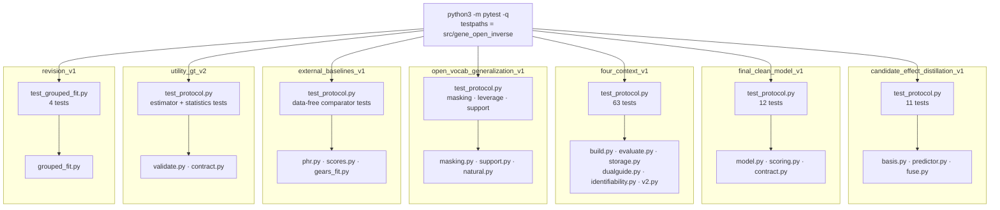

The VCDesign-CED repository ships no standalone `tests/` directory. Instead, every analysis phase under `src/gene_open_inverse/` carries its own `test_protocol.py` — a co-located, pytest-discoverable suite whose stated mission is adversarial rather than descriptive: each test names a specific defect that would otherwise look like a valid result. This page documents how the suite is organized, what each module guards, and the unusual enforcement mechanisms (source-inspection firewalls, witness corruption helpers, brute-force differential tests) that make it a verification instrument rather than a smoke test.

Sources: [pyproject.toml](/pyproject.toml#L18), [REPRODUCE.md](/REPRODUCE.md#L21-L26)

## Design Philosophy: Every Test Names a Valid-Looking Lie

Every module opens with the same mission statement in a different dialect. The four-context suite declares that "each test targets a defect that would otherwise look like a valid result: a split that is not a refinement, a weighted solver that quietly disagrees with the frozen one, a self-exclusion that deletes the wrong candidate, a stratum whose two halves overlap, a fusion that reorders a row it should not." The utility ground-truth module compresses it to one line: "Each test targets a specific way this phase could report a valid-looking lie." The open-vocabulary module goes further and enumerates its defect classes up front — a masked candidate whose rows survive training, a leverage that silently drops its null-space term, a cached effect cosine that is not the cosine it claims to be.

Sources: [test_protocol.py](/src/gene_open_inverse/four_context_v1/test_protocol.py#L1-L7), [test_protocol.py](/src/gene_open_inverse/utility_gt_v2/test_protocol.py#L1-L2), [test_protocol.py](/src/gene_open_inverse/open_vocab_generalization_v1/test_protocol.py#L4-L13), [test_protocol.py](/src/gene_open_inverse/revision_v1/test_grouped_fit.py#L3-L7)

This philosophy has three concrete consequences visible in the code. First, test names are full sentences describing the failure mode, e.g. `test_05_self_exclusion_never_deletes_the_last_candidate_when_the_query_is_absent` — the name itself documents the guarded invariant. Second, all fixtures are synthetic and data-free, seeded through explicit `np.random.default_rng(seed)` calls, so the suite runs deterministically without the Hugging Face data snapshot. Third, many tests assert *failures*: they verify that the code raises (`pytest.raises(ValueError)`, `PermissionError`, `RuntimeError`) when handed malformed inputs, because a validator that never rejects anything is a formality.

Sources: [test_protocol.py](/src/gene_open_inverse/four_context_v1/test_protocol.py#L58-L69), [test_protocol.py](/src/gene_open_inverse/four_context_v1/test_protocol.py#L13), [test_protocol.py](/src/gene_open_inverse/external_baselines_v1/test_protocol.py#L1-L3)

## Layout and Entry Points

Pytest is the single entry point. The `[tool.pytest.ini_options]` section of `pyproject.toml` sets `testpaths = ["src/gene_open_inverse"]`, so `python3 -m pytest -q` executed from the repository root discovers every `test_protocol.py` in place, with no path configuration needed. The reproduction guide installs pytest through the `dev` extra (`pip install -e ".[model,data,dev]"`) and places the software checks — the demo script followed by the test suite — immediately after data-snapshot verification and before any training run.

Sources: [pyproject.toml](/pyproject.toml#L28-L29), [pyproject.toml](/pyproject.toml#L14-L18), [REPRODUCE.md](/REPRODUCE.md#L21-L26)

The suite is distributed across seven modules with sharply different scopes. Four modules use plain pytest test functions; three add a dual runner that also executes standalone (see [The Dual Runner Pattern](#the-dual-runner-pattern) below).

| Test module | Size | Tests | Guarded code | Runner style |
|---|---|---|---|---|
| `four_context_v1/test_protocol.py` | 979 lines | 63 | splits, storage contract, dual-guide gate, identifiability control, fusion | pytest only |
| `open_vocab_generalization_v1/test_protocol.py` | 526 lines | 14+ sections | masking, leverage, support, stratification | dual (pytest + standalone) |
| `external_baselines_v1/test_protocol.py` | 251 lines | 7+ | PHR reconstruction gate, GEARS/CellNavi scoring | dual (pytest + standalone) |
| `utility_gt_v2/test_protocol.py` | 209 lines | 16+ | latent-value estimator, nRU, BH procedure | pytest only |
| `candidate_effect_distillation_v1/test_protocol.py` | 169 lines | 11 | basis, ridge predictor, fusion, cross-validation | pytest only |
| `final_clean_model_v1/test_protocol.py` | 142 lines | 12 | locked model pair, G_check gate, frozen fusion | pytest only |
| `revision_v1/test_grouped_fit.py` | 144 lines | 4 | grouped cross-validation correction | dual (pytest + standalone) |

Sources: [test_protocol.py](/src/gene_open_inverse/four_context_v1/test_protocol.py#L1-L979), [test_protocol.py](/src/gene_open_inverse/open_vocab_generalization_v1/test_protocol.py#L1-L526), [test_protocol.py](/src/gene_open_inverse/external_baselines_v1/test_protocol.py#L1-L251), [test_protocol.py](/src/gene_open_inverse/utility_gt_v2/test_protocol.py#L1-L209), [test_protocol.py](/src/gene_open_inverse/candidate_effect_distillation_v1/test_protocol.py#L1-L169), [test_protocol.py](/src/gene_open_inverse/final_clean_model_v1/test_protocol.py#L1-L142), [test_grouped_fit.py](/src/gene_open_inverse/revision_v1/test_grouped_fit.py#L1-L144)

## Module Map: Tests Co-Located with the Code They Guard

The architectural decision to place tests inside each phase package (rather than in a central directory) keeps the guarding relationship local and explicit — each `test_protocol.py` imports directly from its sibling modules, so a renamed function or changed constant fails at import or assertion time, not silently.

Sources: [pyproject.toml](/pyproject.toml#L28-L29)

## What Each Module Guards

**The distillation pipeline suite (11 tests)** protects the response-basis and ridge-predictor chain. Its centerpiece is `test_05_out_of_fold_predictions_are_not_in_sample`, which documents the economic reason for the check in its docstring: "An in-sample effect would make beta be chosen for a model that does not exist." The test computes both the honest held-out effect and the in-sample path on the same fixture and asserts the in-sample cosine is strictly *higher* — proving the optimism being guarded against is real, not hypothetical. Companion tests pin the frozen constants (`BASIS_RANK == 256`, `RIDGE_FOLDS == 5`, `ALL_MISSING_SCORE == 0.0`) and verify identity folds partition exactly with no overlap.

Sources: [test_protocol.py](/src/gene_open_inverse/candidate_effect_distillation_v1/test_protocol.py#L78-L100), [test_protocol.py](/src/gene_open_inverse/candidate_effect_distillation_v1/test_protocol.py#L149-L158), [test_protocol.py](/src/gene_open_inverse/candidate_effect_distillation_v1/test_protocol.py#L55-L68)

**The final clean model suite (12 tests)** guards the locked model pair: no learnable unknown token, all-missing candidates scoring exactly the declared neutral value, a G_check gate that cannot be reached without an explicit acknowledgement constant, and a fusion (`z_score_additive`, `FINAL_BETA == 1.0`) that must equal `row_z(base) + row_z(effect)` to within 1e-12. Notably, `test_06` also asserts the *contract strings*: the fusion must carry `FINAL_FUSION_SELECTION_REASON` containing "Not selected on performance", and the evaluation split must be named "locked final evaluation split" while `EVALUATION_SPLIT_MUST_NOT_BE_CALLED` records what it must never be called. The suite tests its own honesty vocabulary.

Sources: [test_protocol.py](/src/gene_open_inverse/final_clean_model_v1/test_protocol.py#L46-L105)

**The four-context suite (63 tests)** is the largest module and is organized into labeled sections: split determinism and refinement (tests 01–02), solver equivalence and stratum metrics (03–21), the frozen response-asset storage contract (22–27), the dual-sgRNA identity gate (28–45), and the V2 identifiability positive control (46–60), closing with the fusion standardization-subset semantics (61–63). Each section guards one pipeline stage against a named defect class — for example `test_30` ensures a cross-gene guide pair is never relabelled as one of its genes, because that "would put TP53's response into BRCA1's distillation target and every downstream number would inherit it."

Sources: [test_protocol.py](/src/gene_open_inverse/four_context_v1/test_protocol.py#L20-L49), [test_protocol.py](/src/gene_open_inverse/four_context_v1/test_protocol.py#L357-L443), [test_protocol.py](/src/gene_open_inverse/four_context_v1/test_protocol.py#L376-L390)

**The utility ground-truth suite (16+ tests)** validates the estimator mathematics itself: `test_01` runs a Monte-Carlo comparison showing the cross-view latent-value estimator is unbiased while the naive same-view form carries a systematic `-features × σ²` bias, and `test_04`/`test_05` pin exactly why a retired no-op normalization was removed — it silently inverted entire ranking rows whenever per-query energy came out negative. Statistics implementations (permutation p-values, Benjamini–Hochberg) are each checked against a brute-force reference loop on the same inputs.

Sources: [test_protocol.py](/src/gene_open_inverse/utility_gt_v2/test_protocol.py#L12-L33), [test_protocol.py](/src/gene_open_inverse/utility_gt_v2/test_protocol.py#L47-L99)

**The external-baselines suite** is explicitly labeled "Data-free tests": each guards a failure that would otherwise look like a valid external comparison, using a synthetic build directory whose four views are exact count-weighted quarter means — so `test_01` can corrupt one quarter by 0.01 and prove the PHR reconstruction gate fires. `test_03` additionally proves a GEARS split can never contain a masked identity and that the validation bucket is invariant to input ordering.

Sources: [test_protocol.py](/src/gene_open_inverse/external_baselines_v1/test_protocol.py#L1-L3), [test_protocol.py](/src/gene_open_inverse/external_baselines_v1/test_protocol.py#L74-L125)

## Firewalls Enforced by Source Inspection

The suite's most distinctive mechanism is three tests that read the *source code* of other modules rather than their behavior. `test_37_no_module_reads_the_raw_anchor_response_cache_directly` globs every `.py` file in its package (excluding itself) and fails if any module references `responses_ab.npy` or `eligible_ids.npy` by path — because the sealed G_check rows live inside that file alongside the readable ones, and a module that opens the file directly has bypassed the loader that drops them. `test_56_the_hindsight_sweep_never_enters_the_verdict` uses `inspect.getsource` on the identifiability pass rule and asserts the tokens `hindsight`, `sweep`, and `lambda_sweep` never appear: if the penalty sweep leaked into the PASS rule, "the control would be selecting on the answer."

Sources: [test_protocol.py](/src/gene_open_inverse/four_context_v1/test_protocol.py#L445-L489), [test_protocol.py](/src/gene_open_inverse/four_context_v1/test_protocol.py#L801-L831), [test_protocol.py](/src/gene_open_inverse/final_clean_model_v1/test_protocol.py#L46-L70)

The G_check gate is enforced the same way at the model layer: `test_04` proves `locked_check_arrays` raises `PermissionError` for the empty string, "yes", and even a lowercase copy of the acknowledgement constant, and `test_05` inspects the frozen loader's source to confirm it still refuses G_check for every caller outside the `("G_fit", "G_select")` roles. These tests turn architectural boundaries into CI failures rather than documentation statements.

> [!TIP]
> Source-inspection tests enforce *architecture*, not behavior: deleting the firewall fails the suite even if every computed number stays identical. When porting this pattern, exclude the test module itself from the scan (as `test_37` does) or the suite will detect its own reference to the forbidden path.

Sources: [test_protocol.py](/src/gene_open_inverse/final_clean_model_v1/test_protocol.py#L46-L70), [test_protocol.py](/src/gene_open_inverse/four_context_v1/test_protocol.py#L445-L489)

## The Storage Tolerance Contract: Verification, Not Formality

The response-asset verifier is guarded by a six-test block that treats numerical tolerance as a claim to be tested, not a constant to be trusted. The declared bound is pinned verbatim — `TOLERANCE_ULPS == 2.0` and `TOLERANCE_EXPRESSION == "abs(stored - expected32) <= 2 * eps32 * max(abs(expected32), 1)"` — and `test_27` walks both sides of the boundary to show exactly-on-bound passes and just-over fails. The counterpart mechanism is `corrupt_for_witness`, a helper that injects a known 1e-3 magnitude error so `test_23` can prove the comparator actually rejects a realistic corruption ("This is the test that makes the tolerance a verification rather than a formality," per its comment).

Sources: [test_protocol.py](/src/gene_open_inverse/four_context_v1/test_protocol.py#L291-L354)

The tolerance design itself is stress-tested at its mathematical edges: `test_24` shows the `max(·, 1)` floor survives subtractive cancellation near zero (where the ULP distance exceeds 1000 but nothing is wrong, because a response is a difference of order-one quantities), `test_25` pins ULP-distance monotonicity across signed zero, and `test_26` refuses non-finite values instead of silently comparing them.

| Behavior under test | Test | Pinned property |
|---|---|---|
| 1-ULP float32 storage round-trip | `test_22` | `nextafter` difference passes; ULP distance ≤ 1 |
| Realistic magnitude corruption | `test_23` | 1e-3 injected error fails with exactly 1 violation |
| Cancellation near zero | `test_24` | tiny results with large ULP distance still pass |
| ULP distance symmetry | `test_25` | 0 ULP across ±0.0; ±1 at one step; 2 across subnormal zero |
| Non-finite refusal | `test_26` | NaN fails the comparison outright |
| Bound is the declared expression | `test_27` | string constant matches; boundary exact on both sides |
| Corruption helper on non-contiguous blocks | `test_38` | fancy-indexed slice actually modified |
| Corruption helper refuses no-ops | `test_39` | sub-spacing magnitude raises `RuntimeError` |

Sources: [test_protocol.py](/src/gene_open_inverse/four_context_v1/test_protocol.py#L291-L354), [test_protocol.py](/src/gene_open_inverse/four_context_v1/test_protocol.py#L490-L513)

## Differential Testing: Fast Paths Checked Against Brute Force

Several fast implementations exist only to make expensive computations affordable, and the suite validates each against a naive reference on identical inputs. `test_16` expands the closed-form V2 interaction cosine term-by-term in a double loop and requires agreement within 1e-9, noting that "if it drifted from the definition every V2 number would be wrong in a way no downstream check could see." `test_17` checks the limit behavior — V2 must degenerate to V1 as the penalty grows — while `test_03` proves the weighted ridge solver reduces to the frozen `RidgePath` at equal weights, with the residual bounded at float64 round-off magnitude.

Sources: [test_protocol.py](/src/gene_open_inverse/four_context_v1/test_protocol.py#L188-L227), [test_protocol.py](/src/gene_open_inverse/four_context_v1/test_protocol.py#L38-L49)

The same pattern repeats across modules: `utility_gt_v2` compares its vectorized permutation p-value against a per-row loop and its Benjamini–Hochberg against a direct step-up reference at four levels; `open_vocab_generalization_v1` validates ridge leverage against the explicit `(XᵀX + λI)⁻¹` form — including the case with more features than rows, asserting the null-space term is retained — and `four_context_v1` verifies the ridge effect predictor recovers a planted linear map at median cosine > 0.9.

Sources: [test_protocol.py](/src/gene_open_inverse/utility_gt_v2/test_protocol.py#L68-L99), [test_protocol.py](/src/gene_open_inverse/open_vocab_generalization_v1/test_protocol.py#L82-L114), [test_protocol.py](/src/gene_open_inverse/four_context_v1/test_protocol.py#L189-L228)

## Regression Tests as Institutional Memory

A recurring convention: when a real defect caused a wrong number in the past, the fix ships with a test whose comment records the incident. `test_38` is "the regression test for the round-four witness failure" — the corruption helper silently returned non-contiguous fancy-indexed slices unchanged, so the fixture itself asserts `C_CONTIGUOUS` is false before testing the repair. `test_40` records the first HepG2 audit, where the GSE264667 pair separator `|` lost to the `"_+_"` substring occurring *inside* guide names, shredding the dataset into unparsed labels that looked like a disqualified context. `test_52` and `test_53` both pin the same slip from the first positive-control run, which stacked an already two-view array into four dimensions.

Sources: [test_protocol.py](/src/gene_open_inverse/four_context_v1/test_protocol.py#L490-L543), [test_protocol.py](/src/gene_open_inverse/four_context_v1/test_protocol.py#L718-L799)

The `revision_v1` module is an entire test file of this kind: it guards the post-review correction that re-keyed cross-validation folds from row index to gene identity. `test_folds_never_split_a_gene` is constructed as a differential assertion — it computes the overlap of the *old* row-index folds and requires it to be positive while the grouped folds' overlap is zero, so removing the correction or reintroducing leaky folds both fail. Its docstring names the leak precisely: "A fold that still splits one gene across train and held, so the 'fixed' selection leaks exactly as the submitted one did."

Sources: [test_grouped_fit.py](/src/gene_open_inverse/revision_v1/test_grouped_fit.py#L1-L68), [test_protocol.py](/src/gene_open_inverse/utility_gt_v2/test_protocol.py#L47-L67)

## The Dual Runner Pattern

Three modules (`open_vocab_generalization_v1`, `external_baselines_v1`, `revision_v1`) implement a runner dualism: instead of bare `assert`, each check goes through a `check(name, condition, detail)` helper that appends to a module-level `RESULTS` list *and* raises a `CheckFailed(AssertionError)` for pytest. Under pytest the exception fails the test normally; executed standalone (`python3 -m gene_open_inverse.revision_v1.test_grouped_fit`), the `main()` loop catches each failure, records it, prints a PASS/FAIL line per check, and exits with code 1 if any failed. Two details are deliberate: a crash inside a test is recorded as a failure rather than a skip ("a crash is a failure, not a skip"), and every detail string carries numeric context for the failing case.

Sources: [test_protocol.py](/src/gene_open_inverse/open_vocab_generalization_v1/test_protocol.py#L24-L37), [test_protocol.py](/src/gene_open_inverse/external_baselines_v1/test_protocol.py#L27-L41), [test_grouped_fit.py](/src/gene_open_inverse/revision_v1/test_grouped_fit.py#L36-L41), [test_grouped_fit.py](/src/gene_open_inverse/revision_v1/test_grouped_fit.py#L117-L144)

> [!TIP]
> The dual pattern costs nothing under pytest but makes each protocol module independently executable — useful when a phase is being iterated on in isolation and the full pytest discovery sweep is unnecessary. If you add a module, follow `revision_v1`'s shape: exception classes, `check()`, numbered check names, and a `main()` returning a process exit code.

Sources: [test_grouped_fit.py](/src/gene_open_inverse/revision_v1/test_grouped_fit.py#L110-L144)

## Conventions for Extending the Suite

The suite's conventions are consistent enough to serve as a checklist for anyone adding a phase or a test:

| Convention | Example from the code |
|---|---|
| Sentence-style test names naming the failure mode | `test_05_self_exclusion_never_deletes_the_last_candidate_when_the_query_is_absent` |
| Docstring or comment states *why* the defect would look valid | "An in-sample effect would make beta be chosen for a model that does not exist." |
| Fixed seeds via `np.random.default_rng(seed)` for reproducibility | seeds 7, 11, 23, 101, 103, 107 across the four-context module |
| Data-free synthetic fixtures; no dataset download required | `external_baselines_v1` docstring: "Data-free tests" |
| Prove the trap exists before guarding it | oracle vs. constant ranker; leaky-fold vs. grouped-fold overlap |
| New defect ⇒ new regression test recording the incident | `test_38`, `test_40`, `test_52`–`test_53` |
| Frozen constants asserted literally, including contract strings | `fc.PRIMARY_MODALITIES == ("STRING", "MAPKG")`, split naming strings |

Sources: [test_protocol.py](/src/gene_open_inverse/four_context_v1/test_protocol.py#L58-L69), [test_protocol.py](/src/gene_open_inverse/candidate_effect_distillation_v1/test_protocol.py#L79-L80), [test_protocol.py](/src/gene_open_inverse/final_clean_model_v1/test_protocol.py#L91-L105), [test_protocol.py](/src/gene_open_inverse/four_context_v1/test_protocol.py#L273-L289)

## How This Page Fits the Documentation

The Protocol Test Suite is the executable layer beneath the repository's integrity story. The data-side counterpart — hash manifests and the release verifier — is covered in [Artifact Verification and SHA-256 Manifests](23-artifact-verification-and-sha-256-manifests); the specific leakage mechanisms several tests guard (identity-level folds, G_check exclusion, masked identities) are analyzed in [Leakage Prevention and Identity-Level Cross-Validation](21-leakage-prevention-and-identity-level-cross-validation). The correction that `revision_v1/test_grouped_fit.py` protects is described in [Post-Review Corrections](22-post-review-corrections). To see where the suite sits in the end-to-end reproduction order, follow [Reproducing Paper Results](4-reproducing-paper-results), which runs it as step 2 before any training begins.