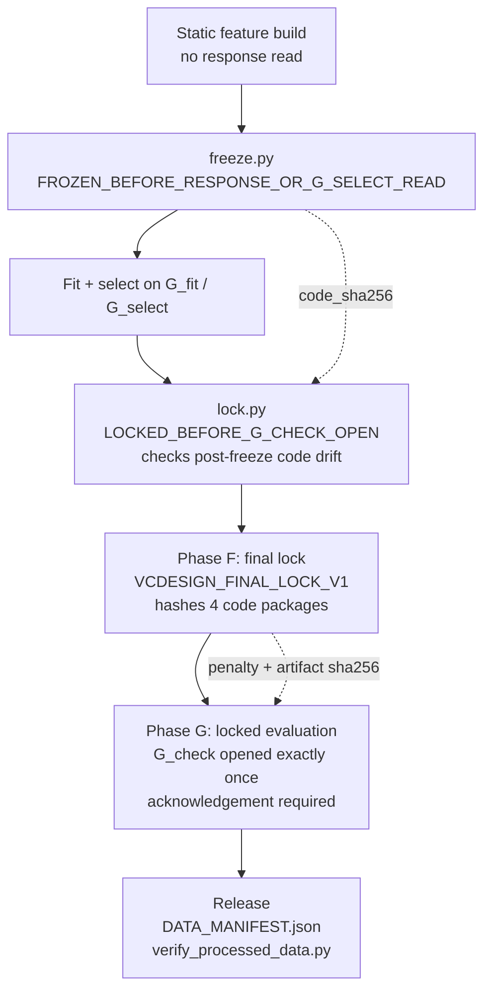

This page is the reference catalog of every frozen model component in VCDesign-CED: the base scorer architecture, the checkpoint registry, the effect predictor, the fusion rule, and the freeze/lock records that bind them. A component is "frozen" here in a precise, mechanically enforced sense — its inputs, code, and hyperparameters are hashed before any evaluation split is touched, and the locked evaluation refuses to run against anything that does not reproduce those hashes byte-for-byte. If you have followed the pipeline pages through [Score Fusion and Beta Selection](14-score-fusion-and-beta-selection) and [Training Pipeline and Frozen Configuration](16-training-pipeline-and-frozen-configuration), this page is where those contracts terminate in concrete, verifiable artifacts.

## What "Frozen" Means: The Governance Chain

Freezing in this repository is not a convention — it is a chain of records that each assert, with hash evidence, what was and was not read at the time of their creation. The lifecycle runs through three mechanisms: **freeze manifests** (written before response-dependent work), **locks** (written after selection but before the evaluation split opens), and **runtime self-verification** (every consumer re-checks the frozen artifact before using it). The final evaluation split, `G_check`, is deliberately never called a blind test — the contract renames it to "locked final evaluation split" precisely because earlier phases of the wider program did read it, and the assertion that matters is only that this phase's method was selected without it ([contract.py](src/gene_open_inverse/final_clean_model_v1/contract.py#L58-L60)).



Two structural guarantees make this chain tamper-evident rather than merely documented. First, the lock scripts refuse to overwrite an existing record — `lock.py` raises `RuntimeError` if the output exists, and `gcheck.py` applies the same rule to its evaluation record, so an adjusted second run cannot silently replace the first ([lock.py](src/gene_open_inverse/final_clean_model_v1/lock.py#L41-L44), [gcheck.py](src/gene_open_inverse/final_clean_model_v1/gcheck.py#L51-L53)). Second, the sub-library lock verifies that the code files hashed at freeze time have not drifted: it re-hashes every name in the freeze's `code_sha256` map and fails on mismatch with the explicit message `"post-freeze code drift"` ([lock.py](src/gene_open_inverse/model/candidate_knowledge_v1/lock.py#L29-L30)).

Sources: [contract.py](src/gene_open_inverse/final_clean_model_v1/contract.py#L1-L61), [lock.py](src/gene_open_inverse/final_clean_model_v1/lock.py#L1-L45), [lock.py](src/gene_open_inverse/model/candidate_knowledge_v1/lock.py#L1-L42)

## Frozen Component Inventory

The library divides into four tiers: the architecture (code-level), the parameters (checkpoint-level), the transfer map (predictor-level), and the binding records (manifest-level). Each entry lists where the component is defined, what freezes it, and what hash anchors it.

| Component | Definition / artifact | Frozen binding | Hash anchor |
| :--- | :--- | :--- | :--- |
| `CleanAttributionModel` / `CleanCapabilityEncoder` | [model.py](src/gene_open_inverse/final_clean_model_v1/model.py#L25-L53) | Inherited from incumbent; unknown token deleted | `code_sha256` in Phase F lock |
| Base scorer checkpoint | `checkpoints/final_clean_epoch_008.pt`, epoch 8 | Selected per-arm on `G_select` only | `58da13d2…9484` in run config |
| Comparator checkpoints | `m_pair_epoch_010.pt`, `m_set_epoch_010.pt`, epoch 10 | "frozen GOKA final config endpoint" | `DATA_MANIFEST.json` |
| Effect predictor | rank-256 basis, ridge penalty 1e4, consensus target | Hyperparameters kept from distillation, never re-selected | `predicted_effect_G_select.npy` sha256 in lock |
| Fusion rule | `z_score_additive`, β = 1 | No fitted coefficient; selected before `G_check` | Recorded in lock `fusion` block |
| All-missing rule | `ALL_MISSING_CONTRIBUTION = 0.0` | Non-learnable; identical in both arms | Contract constant [contract.py](src/gene_open_inverse/final_clean_model_v1/contract.py#L47-L52) |
| Modality set | `PRIMARY_MODALITIES = ("STRING", "MAPKG")` | TEXT excluded by `GENE_INFORMATION_POLICY_v1` | Contract constant [contract.py](src/gene_open_inverse/final_clean_model_v1/contract.py#L43-L45) |
| Query gate | `QUERY_ELIGIBILITY_V1`, FDR 0.05 | Applied unchanged to whichever role is evaluated | Recorded in lock `query_gate` block |
| Cached comparator scores | `inputs/comparators/*.npy` | Pre-computed under frozen configs | `DATA_MANIFEST.json` |

The checkpoint registry that binds all of these into one portable file is [configs/paper_run_v1.json](configs/paper_run_v1.json#L1-L44), whose `selected_checkpoint_sha256` field pins the reference epoch-8 checkpoint, and whose `data_manifest` field points at the release-wide `DATA_MANIFEST.json` for full-tree verification.

Sources: [configs/paper_run_v1.json](configs/paper_run_v1.json#L1-L44), [contract.py](src/gene_open_inverse/final_clean_model_v1/contract.py#L34-L52), [lock.py](src/gene_open_inverse/final_clean_model_v1/lock.py#L96-L140), [README.md](README.md#L150-L166)

## The Base Scorer Architecture: One Deletion From the Incumbent

The frozen scorer is not a new design — it is the incumbent `GlobalObjectiveKnowledgeAttributionModel` with exactly one intentional modification: the learnable shared unknown token is deleted. `CleanCapabilityEncoder` calls `del self.unknown_token` in its constructor, then implements masked pooling where the denominator is clamped to at least one present modality, and finally zeroes the embedding of any candidate with no evidence at all. Because scoring is an inner product against this embedding, an all-missing candidate scores exactly the neutral value against every query — zero, which is a cosine's own indifference point, not a value chosen by inspecting `G_select` ([model.py](src/gene_open_inverse/final_clean_model_v1/model.py#L25-L45)). The docstring explains the motivation bluntly: the incumbent's learned token had been measured sitting at the top of every goal-blind ordering, with 100% of its goal-blind Top-10 being information-free genes ([model.py](src/gene_open_inverse/final_clean_model_v1/model.py#L1-L10), [contract.py](src/gene_open_inverse/final_clean_model_v1/contract.py#L23-L30)).

Everything else is inherited literally, which is itself a freezing decision: by minimizing the architectural diff against the incumbent, the phase isolates the one variable it intends to test. Two modality-restricted methods (`encode_modality_embeddings`, `encode_modality_candidates`) are replaced with `NotImplementedError` stubs, encoding the constraint that modality banks are undefined without an unknown token ([model.py](src/gene_open_inverse/final_clean_model_v1/model.py#L46-L67)). The companion helper `all_missing_mask` reconstructs the all-missing candidate set from the strict-legal present flags so downstream prefix metrics can report how much of each top-B prefix is information-free.

Sources: [model.py](src/gene_open_inverse/final_clean_model_v1/model.py#L1-L67), [contract.py](src/gene_open_inverse/final_clean_model_v1/contract.py#L23-L30)

## The Frozen Effect Predictor: Rebuild, Then Verify

The most distinctive pattern in the library is that the effect predictor is **never loaded** — it is rebuilt deterministically from `G_fit` at evaluation time and then checked against the saved artifact. `FrozenEffectPredictor` reconstructs the consensus response, the rank-256 randomized basis, and the ridge path from the frozen contract constants, then `verify_against` compares its re-prediction against the distillation phase's `predicted_effect_G_select.npy` with a maximum absolute difference threshold of 1e-3; exceeding it aborts with "the rebuilt effect predictor does not reproduce the frozen artifact" ([scoring.py](src/gene_open_inverse/final_clean_model_v1/scoring.py#L73-L92), [select.py](src/gene_open_inverse/final_clean_model_v1/select.py#L59-L65)). Both the selection phase (Phase E) and the locked evaluation (Phase G) run this check before anything else touches the predictor, and Phase G additionally reads its ridge penalty **from the lock record itself**, so a tampered distillation output cannot substitute a different penalty ([gcheck.py](src/gene_open_inverse/final_clean_model_v1/gcheck.py#L87-L97)).

> [!TIP]
> The rebuild-then-verify pattern makes the locked evaluation self-contained: no serialization format, no `weights_only` pitfalls, no version-skew risk on the predictor object — only integer/float contract constants and the raw `.npy` artifact as ground truth. When porting this library, preserve the constants in [contract.py](src/gene_open_inverse/final_clean_model_v1/contract.py#L34-L45) and the distillation record together; one without the other breaks reproduction.

Sources: [scoring.py](src/gene_open_inverse/final_clean_model_v1/scoring.py#L1-L11), [scoring.py](src/gene_open_inverse/final_clean_model_v1/scoring.py#L73-L109), [select.py](src/gene_open_inverse/final_clean_model_v1/select.py#L56-L65), [gcheck.py](src/gene_open_inverse/final_clean_model_v1/gcheck.py#L87-L97)

## The Frozen Fusion and Score Assembly

Scoring assembles from three frozen pieces: `base_scores` produces the encoder's inner-product matrix per view, `effect_scores` produces `cos(d_q, r̂_c)` and overwrites all-missing candidate columns with `ALL_MISSING_CONTRIBUTION` (exactly 0.0), and `fuse` combines them as per-row z-scores with `FINAL_BETA = 1.0` ([scoring.py](src/gene_open_inverse/final_clean_model_v1/scoring.py#L99-L139)). The fusion's frozen status is unusual among hyperparameters: it was selected for having **no fitted coefficient at all**, meaning no `G_select` or `G_check` quantity could enter it — the contract states explicitly that it was "not selected on performance" and that the alternative family members (rank-average, β = 0.25) are not being re-compared ([contract.py](src/gene_open_inverse/final_clean_model_v1/contract.py#L12-L16, L38-L41)). The lock records this as `FINAL_FUSION_SELECTED_BEFORE_G_CHECK: True` with the selection reason inline ([lock.py](src/gene_open_inverse/final_clean_model_v1/lock.py#L127-L132)).

A second frozen input-boundary rule lives in `strict_legal_role`: the frozen asset loader admits STRING or STRING+MAPKG+TEXT configurations, so rather than editing anything frozen, the restriction happens downstream — the loader is used exactly as frozen, and `strict_legal_role` drops TEXT before any model or tensor can see it, raising if TEXT survives the restriction ([scoring.py](src/gene_open_inverse/final_clean_model_v1/scoring.py#L28-L51)). This is the code-level enforcement of `TEXT_STATUS = "EXCLUDED_FROM_FINAL_PRIMARY_TRACK"` under the `GENE_INFORMATION_POLICY_v1` literature-leakage bar ([contract.py](src/gene_open_inverse/final_clean_model_v1/contract.py#L43-L45)).

Sources: [scoring.py](src/gene_open_inverse/final_clean_model_v1/scoring.py#L99-L139), [contract.py](src/gene_open_inverse/final_clean_model_v1/contract.py#L12-L45), [lock.py](src/gene_open_inverse/final_clean_model_v1/lock.py#L127-L133)

## The Phase F Lock and the G_check Seal

Phase F (`lock.py`) is the pivot of the library: everything the locked evaluation will use is hashed here, before `G_check` is touched. Its `code_digest` walks four code packages (`final_clean_model_v1`, `candidate_effect_distillation_v1`, `utility_gt_v2`, `action_conditioned_utility_v1`), hashing every source file — because the authoring checkout had uncommitted work, a commit hash alone does not identify the producing code, so the per-file SHA-256 map does ([lock.py](src/gene_open_inverse/final_clean_model_v1/lock.py#L1-L39)). The record then enumerates the full frozen surface: method of record, the effect predictor with its artifact path and sha256, the architecture class and parameters from the training manifest, the training recipe, the fusion rule, per-arm selected checkpoints with epoch and sha256, and the evaluation spec including its statistic ("paired identity-cluster bootstrap, 10000 replicates, seed 20260916") and the fixed row policy list from RANDOM to MEASURED_RESPONSE_ORACLE ([lock.py](src/gene_open_inverse/final_clean_model_v1/lock.py#L66-L143)). Finally, the record hashes itself: `lock_sha256` is computed over the serialized payload and appended ([lock.py](src/gene_open_inverse/final_clean_model_v1/lock.py#L144-L148)).

Access to `G_check` is then sealed behind a single function. `locked_check_arrays` in [scoring.py](src/gene_open_inverse/final_clean_model_v1/scoring.py#L54-L70) is the only path in the repository to that split, and it refuses to run unless the caller passes the exact string `I_AM_PERFORMING_THE_ONE_LOCKED_FINAL_EVALUATION` — there is no default argument that can reach it accidentally, and it additionally validates the source/goal delta invariant before returning. Phase G's docstring is explicit that this is an *awkwardness* guardrail, not cryptography: the goal is that the evaluation cannot be reached by accident or convenience ([scoring.py](src/gene_open_inverse/final_clean_model_v1/scoring.py#L1-L10), [gcheck.py](src/gene_open_inverse/final_clean_model_v1/gcheck.py#L1-L14)). The evaluation then applies the frozen query gate unchanged, reads the penalty from the lock, and refuses to overwrite its own output record ([gcheck.py](src/gene_open_inverse/final_clean_model_v1/gcheck.py#L51-L97)).

> [!TIP]
> When auditing a downstream fork, check three things in order: does the lock record exist and self-hash correctly, do the `code_sha256` entries match the current tree, and does the `G_check` accessor still demand the acknowledgement string? A fork that relaxes any of the three has silently converted the locked evaluation split into a tunable one.

Sources: [lock.py](src/gene_open_inverse/final_clean_model_v1/lock.py#L1-L162), [scoring.py](src/gene_open_inverse/final_clean_model_v1/scoring.py#L54-L70), [gcheck.py](src/gene_open_inverse/final_clean_model_v1/gcheck.py#L1-L100)

## Sub-Library Freeze Records for Knowledge Features

Two feature-construction libraries carry their own freeze/lock pairs, predating the Phase F lock. `candidate_knowledge_v1/freeze.py` writes a `CANDIDATE_KNOWLEDGE_V1_PROSPECTIVE_FREEZE` record asserting `STATIC_FEATURES_COMPLETE_NO_RESPONSE_READ` and hashing the complete prospective surface: config, design, split, features, feature manifest, and each static asset (STRING, sequence, Reactome GMT zip, NCBI gene info, plus a whole text-encoder tree digest), alongside per-file code hashes and the exact environment (Python/NumPy/SciPy/scikit-learn/torch versions and device) ([freeze.py](src/gene_open_inverse/model/candidate_knowledge_v1/freeze.py#L1-L56)). Its lock then demands the freeze status, demands the selection record prove `SELECTED_ON_G_SELECT_ONLY` with `G_check_response_or_relevance_opened` false, and re-verifies all frozen code hashes for post-freeze drift before writing `LOCKED_BEFORE_G_CHECK_OPEN` ([lock.py](src/gene_open_inverse/model/candidate_knowledge_v1/lock.py#L13-L30)). The MAP-KG adjudication library mirrors this with `MAPKG_CANDIDATE_ADJUDICATION_V1_FREEZE`, binding its own feature build, provenance, checkpoint, and ten code files before response fit ([freeze.py](src/gene_open_inverse/model/mapkg_candidate_adjudication_v1/freeze.py#L1-L20)).

The shared governance vocabulary across all freeze records is worth noting for integrators: each asserts the same triple — `response_or_relevance_read_before_freeze: False`, `official_DEV_TEST_response_or_relevance_opened: False`, `benchmark_modified: False` — so feature libraries can be composed without re-negotiating what "frozen" means ([freeze.py](src/gene_open_inverse/model/candidate_knowledge_v1/freeze.py#L20-L25), [freeze.py](src/gene_open_inverse/model/mapkg_candidate_adjudication_v1/freeze.py#L8-L11)).

Sources: [freeze.py](src/gene_open_inverse/model/candidate_knowledge_v1/freeze.py#L1-L56), [lock.py](src/gene_open_inverse/model/candidate_knowledge_v1/lock.py#L1-L42), [freeze.py](src/gene_open_inverse/model/mapkg_candidate_adjudication_v1/freeze.py#L1-L20)

## Release Artifacts and Verification

The repository ships source, configuration, demo, and manuscript; the frozen artifacts themselves live in the companion Hugging Face release under four directories — `inputs/` (frozen response, STRING, MAP-KG, candidate-knowledge, and comparator arrays), `checkpoints/` (the selected epoch-8 reference checkpoint), `records/` (training, selection, evaluation, external-baseline, and verification records), and a top-level `DATA_MANIFEST.json` with byte sizes and SHA-256 digests for every released file ([README.md](README.md#L150-L166)). Verification is a single command against the manifest: `tools/verify_processed_data.py` loads the `VCDESIGN_PROCESSED_DATA_V1` schema manifest, rejects absolute paths, path traversal, duplicates, and symlinks, checks byte size before hashing to fail fast, and exits nonzero on any mismatch ([verify_processed_data.py](tools/verify_processed_data.py#L1-L53)).

```bash
hf download Boom5426/VCDesign --repo-type dataset --local-dir . \
  --include 'inputs/**' 'checkpoints/**' 'records/**' 'DATA_MANIFEST.json'
python tools/verify_processed_data.py --root .
```

| Verification layer | What it proves | Failure mode |
| :--- | :--- | :--- |
| `DATA_MANIFEST.json` + verifier | Every released byte matches the published digest | `SHA-256 mismatch` / `size mismatch` per file |
| `selected_checkpoint_sha256` in run config | The reference checkpoint is the one evaluated | Config/asset divergence |
| Phase F `code_digest` | The evaluation code is the code that produced the lock | Post-freeze code drift |
| `FrozenEffectPredictor.verify_against` | The live predictor equals the saved artifact (≤1e-3) | `not the locked one` abort |
| Phase F/G output-existence checks | No second, adjusted run replaces the first | `refuses to overwrite` |

Together these layers close the loop the other pages describe analytically — [Artifact Verification and SHA-256 Manifests](23-artifact-verification-and-sha-256-manifests) covers the manifest tooling, [Protocol Test Suite](24-protocol-test-suite) covers the behavioral assertions, and this page supplies the artifacts both operate on.

Sources: [README.md](README.md#L150-L188), [configs/paper_run_v1.json](configs/paper_run_v1.json#L1-L44), [tools/verify_processed_data.py](tools/verify_processed_data.py#L1-L53)

## Consuming the Library

For a downstream consumer, the minimal correct usage sequence is: verify the release tree, load [configs/paper_run_v1.json](configs/paper_run_v1.json#L1-L44) to resolve every asset path, construct the model over `strict_legal_dims` and load the pinned checkpoint state dict strictly, rebuild the predictor from the lock's `ridge_penalty`, and score with `base_scores` + `FrozenEffectPredictor.effect` + `fuse`. Retraining from scratch is also supported — the training entry point refuses to overwrite an existing output directory, and the frozen reference checkpoint `checkpoints/final_clean_epoch_008.pt` remains the comparison target ([README.md](README.md#L167-L188)).

This page closes the reproduction chain: components ([Final Clean Base Scorer](15-final-clean-base-scorer)), training and selection ([Training Pipeline and Frozen Configuration](16-training-pipeline-and-frozen-configuration)), integrity tooling ([Artifact Verification and SHA-256 Manifests](23-artifact-verification-and-sha-256-manifests)), and the benchmark outcomes these frozen artifacts produce ([Key Benchmark Findings](26-key-benchmark-findings)).
