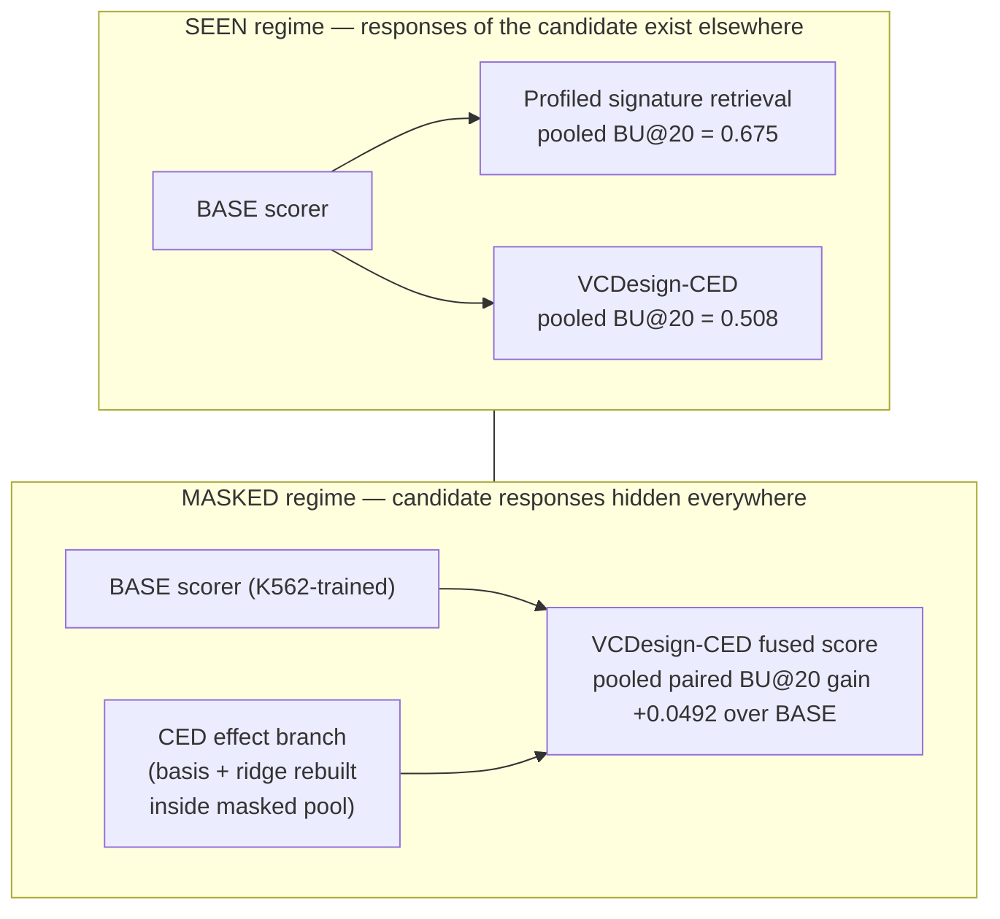

This page is the capstone of the catalog: it collects the benchmark results the VCDesign-CED repository was built to produce and explains, in plain language, what each number means and how much trust it deserves. Everything here is read directly from the frozen contracts, the reporting code, and the manuscript summary in the README — no numbers are invented. If you have followed the earlier pages, this is where the whole evaluation story pays off.

## How to Read the Numbers: the Metric Glossary

Before looking at any result, you need the vocabulary. Every benchmark in this project grades a ranked list of candidate interventions for a query, over a self-excluded legal pool, and scores the top-$B$ prefix (with budgets frozen at 10, 20 and 50). The primary metric is **BU@20** — the normalized realized utility of the top-20 picks — and every companion metric answers a different practical question about that same list.

| Metric | Plain-language meaning | Frozen definition |
| :--- | :--- | :--- |
| **BU@B** | How much usable value the top-$B$ list captures, as a fraction of the best possible list | Frozen `nRU@B` (normalized ranked utility) |
| **MU@B** | The average utility of the $B$ candidates actually picked | Mean of the picked utilities |
| **HvHit@B** | How many of the $B$ picks are "high-value" (top-5% of the legal pool) | Count of picks ≥ the frozen quantile threshold |
| **PHR@B** | Fraction of picks with a *realized positive effect* under an independent readout | Mean of realized $J > 0$ over the picks; four-way sub-pool only |
| **QWR@20** | On what fraction of queries a method beats the comparator | `paper` form = wins over all rows vs BASE; `gate` form = wins over decided rows |

Two details matter for interpreting every finding below. First, HvHit@20 is where the README's "1.11 more top-5% candidates" comes from — it is a *count*, not a rate. Second, the PHR metric is only computed on a specially constructed four-way sub-pool (candidates in the C-016 stratum whose queries meet a minimum-cell rule in all four batch quarters), and is reported as `PHR_UNAVAILABLE_DUE_TO_PACK_LIMITATION` where that pool cannot be built — so a missing PHR value is a protocol statement, not an error.

Sources: [metrics.py](/src/gene_open_inverse/evaluation_contract_v1/metrics.py#L1-L8), [metrics.py](/src/gene_open_inverse/evaluation_contract_v1/metrics.py#L37-L49), [contract.py](/src/gene_open_inverse/external_baselines_v1/contract.py#L58-L70), [metrics.py](/src/gene_open_inverse/evaluation_contract_v1/metrics.py#L64-L69)

## Where the Evidence Comes From: Two Frozen Regimes

All headline numbers are reported under one of exactly two regimes, and every method's score is only meaningful inside the regime where it is legal. **SEEN** evaluates candidates whose measured responses exist in the training contexts (leave-one-context-out). **MASKED** is the decisive condition: each candidate identity is assigned to one of five SHA-256 folds derived purely from its gene symbol, and every row of that identity is removed from *all* training contexts at once — the response basis and ridge predictor are then rebuilt inside the reduced pool, so the graded quantity can never have been memorized.

> [!TIP]
> The masking fold comes from a hash of the gene symbol alone (`fold_assignment`), so a candidate is masked in the same fold in every context and nothing about any response, feature or outcome can influence which candidates were hidden — this is what makes the +0.0492 gain a *controlled* result rather than an observational one.

Sources: [contract.py](/src/gene_open_inverse/external_baselines_v1/contract.py#L10-L14), [masking.py](/src/gene_open_inverse/open_vocab_generalization_v1/masking.py#L1-L25), [masking.py](/src/gene_open_inverse/open_vocab_generalization_v1/masking.py#L40-L50), [contract.py](/src/gene_open_inverse/open_vocab_generalization_v1/contract.py#L96-L103)

## Finding 1: Distillation Beats Its Own Base When Responses Are Hidden

The paper's central positive result is a paired contrast, not an absolute score. In the three held-out cellular contexts (RPE1, HepG2, Jurkat), adding the CED effect branch on top of the same base scorer — under the MASKED regime, where the candidate's measured responses were removed from the atlas — yields a **pooled paired BU@20 gain of +0.0492**, and among the 20 selections delivers **1.11 more top-5% candidates on average** (the HvHit@20 companion). Because the contrast is paired per query and pooled over the three held-out contexts, this says: *the same scorer, on the same queries and pools, ranks better when the effect branch is added.*

Three protocol facts tell you how much to trust that gain. The comparison excludes self (a query never ranks itself), the candidate-level pairing is exact, and the primary exposure quantity is deliberately *size-controlled*: removing a candidate's rows also shrinks the atlas, so the protocol separates "this candidate was never measured" from "the atlas got a fifth smaller" by using the *next* fold's predictor as the size-control arm — no extra fit, fixed by hash, never re-chosen after seeing numbers.

| Quantity | Formula | What it isolates |
| :--- | :--- | :--- |
| `exposure_value` | SEEN − MASKED | Upper bound of response exposure, *including* atlas shrinkage |
| `exposure_value_size_controlled` | SIZE_CONTROL − MASKED | The candidate-specific effect alone (**primary**) |
| `atlas_shrinkage_cost` | SEEN − SIZE_CONTROL | What losing one fifth of the atlas costs |

Sources: [README.md](/README.md#L79-L92), [contract.py](/src/gene_open_inverse/open_vocab_generalization_v1/contract.py#L125-L140), [contract.py](/src/gene_open_inverse/external_baselines_v1/contract.py#L58-L64)

## Finding 2: Measured Responses Still Beat Distillation — the Retrieval Ceiling

The honest counterpart to Finding 1: when candidate responses *have* been measured in other contexts, directly retrieving the measured profile scores higher than predicting it. In the SEEN regime, **profiled signature retrieval reaches pooled BU@20 0.675 versus VCDesign-CED's 0.508**. This is not a contradiction of Finding 1 — it is the boundary of the method. Distillation buys performance exactly where measurements are missing; where measurements exist, using them directly is better. This pairing is precisely why the project exposes two decision routes, and you should read them side by side on the [Decision Routes: Retrieval versus Prediction](10-decision-routes-retrieval-versus-prediction) page.

The paper-table generator encodes this reading directly: `PROFILED_SIGNATURE_RETRIEVAL` is a *companion* row (not a main-table competitor), and its legality annotation marks it as reading the candidate's measured training-context responses — information a deployment candidate would not have.

Sources: [README.md](/README.md#L79-L92), [contract.py](/src/gene_open_inverse/external_baselines_v1/contract.py#L29), [contract.py](/src/gene_open_inverse/external_baselines_v1/contract.py#L42-L52), [tables.py](/src/gene_open_inverse/external_baselines_v1/tables.py#L15-L18)

## Finding 3: The Baseline Roster — Who Was Compared, Under Which Rules

Every method in the benchmark is registered in a frozen contract with a taxonomy family (A–F) and a *legality* statement — what information it was allowed to read. This is what makes the comparison fair to audit: a method's score can only be interpreted inside its legal regime. Note that the two strongest "published" baselines (CellNavi variants) are **SEEN-only**: they require the candidate's measured cells in a training context, so they simply cannot run in the MASKED regime.

| Arm | Family | Legality | Regime |
| :--- | :--- | :--- | :--- |
| `RANDOM` | A. random | no information | both |
| `GOAL_BLIND_PRIOR` | B. goal-blind prior | strict legal, goal blind | both |
| `BASE` | C. direct inverse | strict legal | both |
| `CELLNAVI` (design-compatible) | C. direct inverse, published | needs candidate's measured training cells | **SEEN only** |
| `CELLNAVI_NATIVE` | C. direct inverse, published | native class scale (Deviation 5) | **SEEN only** |
| `GEARS` (forward-enumerate) | D. forward-enumerate | strict legal in both regimes | both (companion) |
| `INTERNAL_FTM` | D. forward-then-match, internal | strict legal | both |
| `VCDesign` (BASE + RIDGE_UNIT) | E. VCDesign | strict legal | both |
| `MEASURED_RESPONSE_ORACLE` | F. oracle | reads the held-context response — **not deployable** | analysis only |

One quiet but important rule for beginners: any candidate a method cannot represent receives a zero predicted effect, which the frozen effect-cosine scores as 0. So a method that simply cannot express many candidates is *penalized* by the protocol rather than silently excused.

Sources: [contract.py](/src/gene_open_inverse/external_baselines_v1/contract.py#L18-L29), [contract.py](/src/gene_open_inverse/external_baselines_v1/contract.py#L30-L52), [contract.py](/src/gene_open_inverse/external_baselines_v1/contract.py#L53-L56)

## Finding 4: GEARS Could Not Be Reproduced — and Its Fits Collapsed

The benchmark's most sobering external result is recorded as a frozen verdict string: `GEARS_OFFICIAL_REPRODUCTION_FAILED`. Following the official tutorial notebook, the split composition came out 9/43/19/36 against the published 9/52/18/37, and the headline top-20 DE MSE was 0.2456 versus the published 0.2540 — outside the declared tolerance. On the VCDesign task itself, the diagnosis is harsher: every GEARS fit predicts a single perturbation-independent shift (recorded in `GEARS_COLLAPSE_DIAGNOSTIC.json`), meaning its ranking reduces to the tie rule — a degenerate ordering, not a competitor.

The protocol therefore handles GEARS with explicit honesty rather than deletion: it is labelled a **companion row outside the main table** (Deviation 4), paired with an information-matched internal companion (`RIDGE_UNIT_K562_ATLAS` — the same K562-only atlas GEARS sees, scored by the VCDesign ridge recipe), and every companion table prints the verdict and placement in its header comment. For comparison depth beyond the headline budget, companion tables also report BU@10 and BU@50 for all arms.

| Reproduction check | Reproduced | Published | Verdict |
| :--- | :--- | :--- | :--- |
| Split composition (seen0/seen1/seen2/unseen) | 9/43/19/36 | 9/52/18/37 | mismatch |
| Top-20 DE MSE | 0.2456 | 0.2540 | outside tolerance 0.05 |
| Fit behavior on task | one context-independent shift per fit | — | `DEGENERATE` |

Sources: [contract.py](/src/gene_open_inverse/external_baselines_v1/contract.py#L72-L93), [tables.py](/src/gene_open_inverse/external_baselines_v1/tables.py#L53-L57), [tables.py](/src/gene_open_inverse/external_baselines_v1/tables.py#L48-L52)

## Finding 5: CellNavi Was Run Twice — at Two Different Class Scales

CellNavi is the strongest published inverse baseline, and the benchmark runs it in two deliberately distinct configurations. The **design-compatible** variant uses every identity the held context's training fit may use as classes; the **native-scale** variant restricts classes to the held context's C-016 SEEN stratum — the actual candidate library the task ranks (registered as "Deviation 5"). Both are SEEN-only by legality, both use the official recipe (pinned commit, pre-trained checkpoint MD5s, frozen training hyperparameters), and both are scored identically to every other arm: the mean over query-view cells of the log-softmax at each candidate's class.

The adapter's own fidelity was anchored first: the official reproduction target (accuracy 0.510, weighted F1 0.498, 3158 cells, 70 classes) had to be hit within a 0.005 tolerance before its scores could enter the benchmark — the same reproduce-before-compare discipline applied to GEARS, just with a passing outcome.

Sources: [contract.py](/src/gene_open_inverse/external_baselines_v1/contract.py#L96-L113), [contract.py](/src/gene_open_inverse/external_baselines_v1/contract.py#L24-L25)

## Finding 6: The Masking Protocol Was Audited Before the Numbers Existed

Several benchmark findings are about the *protocol itself*, fixed in a contract written before any masked result existed. The pool-size plan is a good example: at the pre-registered five folds, masked pools came out K562 286, RPE1 254, Jurkat 290 and HepG2 152 candidates. Rather than quietly re-picking the fold count to chase the 300 target (which would have made the fold itself a post-hoc choice), the protocol fixed a primary-inclusion floor of 200 — so **HepG2 folds are diagnostic-only** in the per-fold contrast while still entering the pooled full-pool contrast (pool of 764).

Cross-fitting five fold predictors into one score row also requires proof they are mixable. The frozen gate demands minimum pairwise intercept cosine ≥ 0.99, an identical selected ridge penalty, and a candidate-specific-share ratio ≤ 1.05 — and the code documents why the direction test alone can never fail (five pools sharing four fifths of their rows always agree on the penalty-free target mean). Finally, the protocol discovered and *recorded* an inherited defect in the frozen cluster bootstrap (it resamples query *views*, not query *identities*, making published intervals narrower than the stated cluster unit); rather than silently patching it — which would break comparability with earlier runs — the correct query-identity interval is computed and reported **beside** every headline contrast.

> [!TIP]
> This "record the defect, report the corrected interval beside it" pattern appears twice (the bootstrap and the row-index ridge fold cut). When you reproduce results, check both intervals: a conclusion that survives only under the narrower frozen interval is flagged, not hidden.

The whole controlled-masking design exists because the earlier *natural* experiment could not settle the question: on the K562 fold, unseen candidates showed delta MBRU **−0.0103** (6,255 candidates) while seen candidates showed **+0.0095** (1,570) — but those sets differed by screen library, so candidate novelty was entangled with context novelty, leaving two incompatible explanations (poor knowledge support vs. no possible extrapolation). The controlled masking exists to separate them.

Sources: [contract.py](/src/gene_open_inverse/open_vocab_generalization_v1/contract.py#L15-L20), [contract.py](/src/gene_open_inverse/open_vocab_generalization_v1/contract.py#L45-L57), [contract.py](/src/gene_open_inverse/open_vocab_generalization_v1/contract.py#L110-L124), [masking.py](/src/gene_open_inverse/open_vocab_generalization_v1/masking.py#L134-L160)

## Finding 7: The Frozen Design Choice Behind VCDesign's Score

The `VCDesign` arm is not tuned during the benchmark — the contract states it is frozen as `RIDGE_UNIT` (mission C-018, arm A1: unit-target cosine), read from C-018's saved effects and never refitted. C-018 asked whether the pipeline loses candidate-specific directional predictability by unit-normalizing the predicted effect, comparing four scoring arms (A0–A3) under frozen outcome rules; the README confirms the unit-direction held-context configuration was selected on the same evaluation pools and fixed **before** external baselines were run. C-018's own decision statistic also previews the project's statistical style: 1,333 pooled query rows collapse to 976 gene identities, and the 95% interval uses the *gene* as the cluster, carrying both batch-disjoint views and every context together.

| Element | Frozen choice | Consequence for the benchmark |
| :--- | :--- | :--- |
| Scoring core | `RIDGE_UNIT` (C-018 A1) | No baseline-era tuning; single frozen comparator target |
| Decision statistic | pooled paired MBRU median, gene-level clusters | Intervals reflect 976 genes, not 1,333 rows |
| Selection timing | fixed before baselines ran | No winner's-curse in the baseline comparison |

Sources: [contract.py](/src/gene_open_inverse/external_baselines_v1/contract.py#L1-L6), [contract.py](/src/gene_open_inverse/decision_consistent_effect_v1/contract.py#L17-L30), [contract.py](/src/gene_open_inverse/decision_consistent_effect_v1/contract.py#L54-L63), [README.md](/README.md#L79-L92)

## Scope and Caveats Every Reader Should Keep

The README states the boundary plainly: these are **retrospective results for transcriptomic directional prioritization**, not prospective evidence of improved biological endpoints. Two further caveats keep Finding 1 honest. The response masking applies to the *CED atlas only* — the fixed base scorer was itself trained on 68% of the masked candidate identities, so the manuscript additionally reports a base-scorer-unseen subset and a locked K562 identity test. And K562 is excluded from the primary masked contexts for a structural reason: the base ranker was trained on K562 responses, so a K562-masked candidate could retain exposure through the base branch even after losing it in the effect branch.

| Caveat | What it limits | Mitigation in the records |
| :--- | :--- | :--- |
| Retrospective design | No prospective biological claim | Stated in the manuscript scope |
| Base saw 68% of masked identities | Masked gain partly via base exposure | Base-scorer-unseen subset + locked K562 test |
| K562 not in primary masked set | No fully-exposure-free K562 masked claim | K562 designated a secondary context |
| Frozen bootstrap interval | Published intervals narrower than gene-level | Corrected interval reported beside each contrast |

Every number on this page is regenerable: the frozen inputs, checkpoints, run records and SHA-256 manifest live in the companion dataset, and the reproduction sequence from verification through table generation is documented step by step in [Reproducing Paper Results](4-reproducing-paper-results).

Sources: [README.md](/README.md#L79-L92), [contract.py](/src/gene_open_inverse/open_vocab_generalization_v1/contract.py#L96-L102), [REPRODUCE.md](/REPRODUCE.md#L35-L40)

## What to Explore Next

This page summarized outcomes; the following pages explain the machinery that produced them, in a recommended order:

| You want to understand... | Read |
| :--- | :--- |
| Exactly how BU@20, MU@20, HvHit@20, PHR@20 are computed | [Ranking Metrics: BU@B, MU@B, PHR@B](8-ranking-metrics-buatb-muatb-phratb) |
| Why retrieval (0.675) and prediction (0.508) are both offered | [Decision Routes: Retrieval versus Prediction](10-decision-routes-retrieval-versus-prediction) |
| How the masking and open-vocabulary analyses work | [Response Masking and Open-Vocabulary Analyses](18-response-masking-and-open-vocabulary-analyses) |
| How GEARS and CellNavi adapters were built and anchored | [External Baselines: GEARS, CellNavi, PHR](19-external-baselines-gears-cellnavi-phr) |
| Why the utility cosine is a fair grading target | [Utility Ground Truth Validation](20-utility-ground-truth-validation) |
| The two recorded defects and their corrections | [Post-Review Corrections](22-post-review-corrections) |
