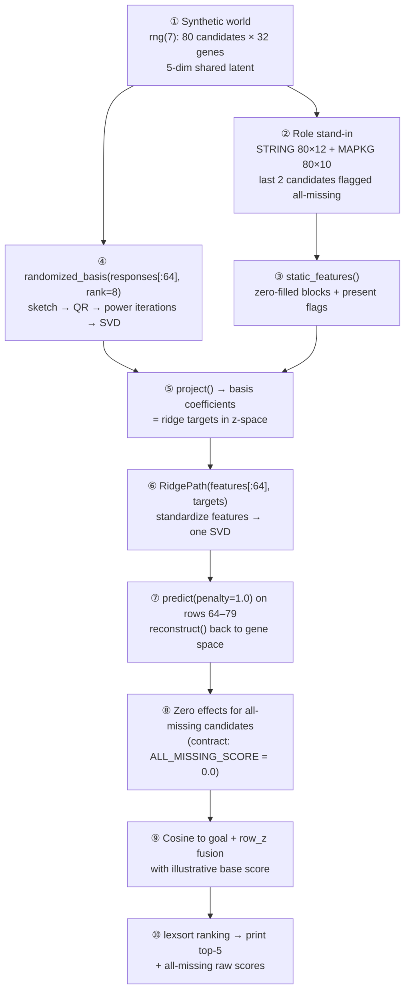

This page walks you, step by step, through `examples/ced_demo.py` — the bundled synthetic smoke test for VCDesign-CED. The demo exercises the full Candidate Effect Distillation (CED) deployment path using nothing but random NumPy data: no downloads, no GPU, no biological inputs, and no biological conclusions. If the demo runs and prints its two expected lines, the core scoring machinery is wired correctly on your machine.


Sources: [ced_demo.py](examples/ced_demo.py#L1-L2), [README.md](README.md#L94-L95)

## What the Demo Is — and What It Is Not

The demo's own docstring sets the scope: it is a *"small synthetic VCDesign-CED smoke example; no biological result is reported."* The repository README is equally explicit — the demo *"checks response-basis construction, ridge effect prediction, missing-knowledge handling, and score fusion. Its scores are a software smoke test, not a biological result."* In the reproduction guide it sits at step 2, "Run software checks," immediately before `pytest`. Treat its printed ranking the way you treat a unit test assertion: evidence that code executes correctly, not evidence about cells.

Sources: [ced_demo.py](examples/ced_demo.py#L2), [README.md](README.md#L82-L95), [REPRODUCE.md](REPRODUCE.md#L19-L24)

## Prerequisites and How to Run It

The only hard requirement is **Python 3.11** — the package pins `requires-python = ">=3.11,<3.12"` and depends on `numpy>=1.26,<2`, which is all the demo itself needs. The recommended quick start installs the editable package with the `model`, `data`, and `dev` extras, then runs the demo and the test suite:

```bash
git clone https://github.com/Boom5426/VCDesign-CED.git
cd VCDesign-CED
python3.11 -m venv .venv
source .venv/bin/activate
python -m pip install -e ".[model,data,dev]"
python examples/ced_demo.py
python -m pytest -q
```

| Requirement | Detail | Verified in |
| :--- | :--- | :--- |
| Python version | 3.11 only (`>=3.11,<3.12`) | [pyproject.toml](pyproject.toml#L10) |
| Core dependency | `numpy>=1.26,<2` (demo needs nothing else) | [pyproject.toml](pyproject.toml#L11) |
| Install command | `pip install -e ".[model,data,dev]"` | [README.md](README.md#L84-L92) |
| Run command | `python examples/ced_demo.py` | [README.md](README.md#L84-L92), [REPRODUCE.md](REPRODUCE.md#L22-L24) |
| CPU-only alternative | `pip install -r requirements-cpu.txt` then `pip install -e . --no-deps` | [README.md](README.md#L100-L105) |

If something goes wrong, the usual suspects are version drift and a missing editable install:

| Symptom | Likely cause | Fix |
| :--- | :--- | :--- |
| `ModuleNotFoundError: gene_open_inverse` | Package not installed in editable mode | Re-run `python -m pip install -e ".[model,data,dev]"` from the repo root |
| NumPy 2.x API errors | Environment resolved NumPy outside the pin | Recreate the venv with Python 3.11 and reinstall |
| Syntax errors on `dict[str, np.ndarray]` hints | Python < 3.11 despite `from __future__ import annotations` extras | Install Python 3.11; the project refuses other versions |

Sources: [pyproject.toml](pyproject.toml#L10-L18), [README.md](README.md#L80-L109), [REPRODUCE.md](REPRODUCE.md#L19-L24)

## The Pipeline at a Glance

The demo is 49 lines, and every line maps to one stage of the production CED pipeline. Here is the complete flow before we dissect each stage:



Sources: [ced_demo.py](examples/ced_demo.py#L17-L44)

## Step 1–2: Building the Synthetic World

The demo constructs a miniature universe in which the knowledge→effect signal is guaranteed to exist. A seeded generator (`np.random.default_rng(7)`) draws a 5-dimensional latent vector for each of 80 candidates. Responses (80 × 32 genes) and both knowledge modalities — STRING (80 × 12 features) and MAPKG (80 × 10 features) — are generated as *linear maps of the same latent*. This is the crucial design decision: because candidate knowledge and candidate responses share a latent cause, a linear map from knowledge to effect **must** be learnable, which makes the demo a positive control for the ridge stage rather than a random-noise sanity check.

The `Role` class is a minimal stand-in for the production role-array objects: it carries exactly the two dictionaries that `predictor.static_features` expects — `capabilities` (feature matrices per modality) and `capability_present` (boolean flags). Two candidates — the last two rows — get their knowledge flags set to `False` in every modality, creating the all-missing case the contract explicitly legislates for.

Sources: [ced_demo.py](examples/ced_demo.py#L11-L28), [scoring.py](src/gene_open_inverse/final_clean_model_v1/scoring.py#L73-L92)

## Step 3: Static Feature Assembly

`predictor.static_features(role, contract.PRIMARY_MODALITIES)` converts the role into a single modeling matrix. For each modality named in the contract (`PRIMARY_MODALITIES = ("STRING", "MAPKG")`), it takes the descriptor block, **zeroes out every row whose knowledge is not present**, and appends a 0/1 present-flag column per modality. The returned `StaticFeatures` carries three things: `values` (the concatenated matrix), `present_any` (at least one modality available per candidate), and `names`. This zero-fill-plus-flag encoding is exactly how the production pipeline feeds knowledge to both the ridge and the base scorer — the demo is not a simplification here.

Sources: [predictor.py](src/gene_open_inverse/candidate_effect_distillation_v1/predictor.py#L33-L43), [contract.py](src/gene_open_inverse/candidate_effect_distillation_v1/contract.py#L41)

## Step 4: Response Basis Construction

`basis.randomized_basis(responses[:train_count], rank=8)` computes the response basis `B` from the 64 training responses only. The function sketches the response matrix with `rank + 32` random projections (the +32 is `BASIS_OVERSAMPLE`), QR-factorizes the sketch, runs 4 power iterations (`BASIS_POWER_ITERATIONS`), and finally takes the top-`rank` right singular vectors of the reduced matrix. The result is a frozen `ResponseBasis` dataclass holding `basis`, `singular_values`, and `total_energy`, with an `.explained` property reporting the fraction of response energy captured.

Two protocol details survive into the demo unchanged: the basis is computed **uncentered** — the module docstring explains that `B` spans the response space itself, not deviations from the mean, so `r_hat = B z_hat` is a complete reconstruction rather than an offset — and the seed defaults to the frozen production constant `BASIS_SEED = 20260918`. Only the rank is shrunk (8 here versus `BASIS_RANK = 256` in production, where genes number 8,248 rather than 32).

Sources: [basis.py](src/gene_open_inverse/candidate_effect_distillation_v1/basis.py#L58-L75), [basis.py](src/gene_open_inverse/candidate_effect_distillation_v1/basis.py#L1-L9), [contract.py](src/gene_open_inverse/candidate_effect_distillation_v1/contract.py#L50-L55)

## Step 5–7: Ridge Prediction and Reconstruction

The next four lines are the heart of CED. First, `fitted_basis.project(responses[:64])` maps each training response into basis coordinates — these coefficients are the ridge's regression targets in "z-space." Second, `RidgePath(features.values[:64], targets)` is constructed: it standardizes the features (per-column mean and standard deviation, with a 1e-8 floor), centers the targets, and takes **one SVD** — the class docstring calls this "One SVD, every penalty for free," because any ridge penalty's weights can be recovered from the stored SVD without refitting.

Third, `path.predict(features.values[train_count:], penalty=1.0)` predicts basis coefficients for the 16 held-out candidates, and `fitted_basis.reconstruct(...)` maps those coefficients back to full 32-gene effects. Fourth — and this is the missing-knowledge contract in action — `effect[~features.present_any[train_count:]] = 0.0` sets the predicted effect of any candidate with no knowledge modality to exactly zero. The contract is unambiguous about why: *"A candidate with no static modality present has no predicted effect. It is given an exactly neutral score rather than a learned one... Neutral means zero: a cosine's own indifference point, fixed here and not tuned."*

> [!TIP]
> The demo sequence — project → fit `RidgePath` on fit rows → predict → reconstruct → zero missing rows — is a line-for-line miniature of `FrozenEffectPredictor` in `final_clean_model_v1/scoring.py`, the object that produces the paper's actual effect predictions. Learn the demo and you have learned the real deployment path end to end.

Sources: [ced_demo.py](examples/ced_demo.py#L31-L35), [predictor.py](src/gene_open_inverse/candidate_effect_distillation_v1/predictor.py#L46-L63), [contract.py](src/gene_open_inverse/candidate_effect_distillation_v1/contract.py#L30-L36), [scoring.py](src/gene_open_inverse/final_clean_model_v1/scoring.py#L73-L89)

## Step 8–9: Scoring, Fusion, and Ranking

Scoring works in the gene space where effects live. The demo takes the first scored candidate's response as the "goal," normalizes it, and computes an **effect score** for every candidate: the cosine between the candidate's predicted effect and the goal direction (norms floored at 1e-30 to protect the zeroed all-missing rows). This mirrors `SCORE_NAME = "PREDICTED_EFFECT_COSINE"` from the frozen contract.

A **base score** is then drawn from a random normal distribution — explicitly commented as an *"illustrative scorer output"* — standing in for the trained neural base scorer used in production. Fusion is the same per-row standardization the manuscript uses: `row_z(base_score) + row_z(effect_score)`, where `row_z` subtracts the row mean and divides by the row standard deviation (floored at 1e-12). The README's post-review correction notes confirm this semantic — *"the two branches are standardized per query row over every column they are given."* Finally, `np.lexsort` ranks candidates by descending fused score, with the original index as a deterministic tie-breaker, and prints the top five.

Sources: [ced_demo.py](examples/ced_demo.py#L37-L43), [scoring.py](src/gene_open_inverse/final_clean_model_v1/scoring.py#L112-L115), [contract.py](src/gene_open_inverse/candidate_effect_distillation_v1/contract.py#L70-L76), [README.md](README.md#L125-L132)

## Reading the Output

The demo prints exactly two lines, and each is a pass/fail signal:

```text
synthetic demo only; ranked candidate indices: [ ... ]   # top-5 by fused score
all-missing raw effect scores: [0.0, 0.0]                # the missing-knowledge contract held
```

The second line is the one that matters for protocol integrity: candidates 78 and 79 were flagged as missing all knowledge, their effects were zeroed, and their raw cosine scores must therefore be exactly `0.0` — the frozen `ALL_MISSING_SCORE`. If you ever see non-zero values there, the missing-knowledge path has regressed.

Sources: [ced_demo.py](examples/ced_demo.py#L26-L28), [ced_demo.py](examples/ced_demo.py#L35), [ced_demo.py](examples/ced_demo.py#L43-L44), [contract.py](src/gene_open_inverse/candidate_effect_distillation_v1/contract.py#L71)

## Demo versus Production: a Precise Comparison

The demo compresses the production pipeline deliberately. This table tells you exactly which simplifications to unlearn before reading the deep-dive pages:

| Aspect | Synthetic demo | Production pipeline |
| :--- | :--- | :--- |
| Data | 80 × 32 synthetic latent-linear responses | Real CRISPRi Perturb-seq, 8,248 genes, four contexts |
| Basis rank | 8 (passed explicitly) | `BASIS_RANK = 256`, frozen in advance |
| Basis seed | Default → `BASIS_SEED = 20260918` (same) | Same frozen constant |
| Data split | First 64 rows fit, last 16 scored (row split, for brevity) | Identity-level cross-validation; queries disjoint from supervision |
| Penalty | Fixed at 1.0 | Chosen from `RIDGE_PENALTIES` by 5-fold identity CV on held-out cosine |
| Base score | `rng.normal` placeholder | Trained neural base scorer (`final_clean_model_v1`) |
| Goal vector | One held-out candidate's response | Query-defined source-to-target transition `d_q` |
| Fusion call | Manual `row_z(a) + row_z(b)` | `four_context_v1.evaluate.fuse` with `standardize_over` masks |
| Output meaning | Smoke test only | Reported BU@B / MU@B / PHR@B benchmark numbers |

> [!TIP]
> The synthetic world is engineered so knowledge and responses share a latent cause — that is why the linear ridge *succeeds* in the demo. In production, whether a linear knowledge→effect map carries enough signal is precisely the empirical question the paper answers, so do not extrapolate the demo's clean result to real-data expectations.

Sources: [ced_demo.py](examples/ced_demo.py#L18-L42), [contract.py](src/gene_open_inverse/candidate_effect_distillation_v1/contract.py#L50-L68), [predictor.py](src/gene_open_inverse/candidate_effect_distillation_v1/predictor.py#L66-L110), [scoring.py](src/gene_open_inverse/final_clean_model_v1/scoring.py#L73-L109), [README.md](README.md#L128-L132)

## Where You Are in the Codebase

Only these four source files participate in the demo; everything else in `src/gene_open_inverse/` belongs to training, evaluation, or baseline stages you will meet later:

```text
examples/
└── ced_demo.py                          ← the walkthrough subject
src/gene_open_inverse/
├── candidate_effect_distillation_v1/
│   ├── basis.py                         ← randomized_basis, ResponseBasis
│   ├── predictor.py                     ← static_features, RidgePath
│   └── contract.py                      ← PRIMARY_MODALITIES, frozen constants
└── final_clean_model_v1/
    └── scoring.py                       ← row_z, FrozenEffectPredictor (production twin)
```

Sources: [ced_demo.py](examples/ced_demo.py#L7-L8), [PROJECT_STRUCTURE.md](PROJECT_STRUCTURE.md)

## Where to Go Next

You have now traced the complete CED deployment path in miniature. The natural progression from here:

- Run the real thing next: [Reproducing Paper Results](4-reproducing-paper-results) covers frozen-data download, SHA-256 verification, and the training command.
- Going backwards for context: [Overview](1-overview) frames the finite-budget ranking problem, and [Quick Start](2-quick-start) is the condensed version of the setup shown here.
- Deep dives on the three stages you just saw: [Response Basis Construction](11-response-basis-construction) for the uncentered randomized SVD, [Ridge Effect Predictor](12-ridge-effect-predictor) for identity-level cross-validation and penalty selection, and [Score Fusion and Beta Selection](14-score-fusion-and-beta-selection) for how `row_z` fusion extends into the evaluated protocol.
