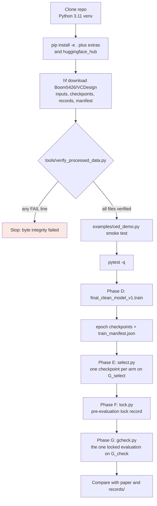

This page is the operational counterpart to the manuscript: it walks through the canonical command sequence that turns a fresh clone into a verified, paper-faithful result. Reproduction here has two tiers. **Tier one** is byte-level verification of the frozen release — you download the processed inputs, checkpoints, and run records from the companion Hugging Face dataset and prove every byte matches its SHA-256 manifest. **Tier two** is re-execution — you retrain the primary base scorer under the frozen recipe and compare against the released records. Every command runs from the repository root, and the long-running stages refuse to overwrite an existing output directory by design.

Sources: [REPRODUCE.md](REPRODUCE.md#L1-L4), [README.md](README.md#L166-L186)


## The Full Reproduction Sequence at a Glance

The workflow is a strictly ordered chain where each stage gates the next: integrity is proven before any code executes, software sanity is checked before any GPU time is spent, and a configuration lock is written before the evaluation split is touched. The following flowchart shows both the commands you run and the phase modules they invoke:



The **verify-first ordering** is not stylistic: the verifier's exit code is 1 whenever any file fails, so a corrupt or partial download fails loudly before training begins.

Sources: [REPRODUCE.md](REPRODUCE.md#L3-L13), [tools/verify_processed_data.py](tools/verify_processed_data.py#L45-L52)

## Step 1 — Set Up the Environment

The package pins **Python 3.11 exactly** (`requires-python = ">=3.11,<3.12"`) and is installed in editable mode with three extras: `model` (scipy and torch), `data` (anndata, pandas, scikit-learn), and `dev` (pytest). The reproduction guide additionally pins `huggingface_hub>=0.35` for the `hf` download CLI used in step 2.

Sources: [pyproject.toml](pyproject.toml#L10-L18), [REPRODUCE.md](REPRODUCE.md#L8-L12), [README.md](README.md#L82)

Two ready-made dependency files serve different hardware targets, and choosing between them is the first real decision of the run:

| Install path | Contents | Intended use |
| :--- | :--- | :--- |
| `pip install -e ".[model,data,dev]"` | Range-pinned extras; torch ≥2.4,<2.5 | GPU training run |
| `requirements.txt` | Exact pins: numpy 1.26.4, scipy 1.15.1, anndata 0.11.3, pandas 1.5.3, scikit-learn 1.5.2, matplotlib 3.9.2, pytest 8.3.5 | Pinned stack (no torch) |
| `requirements-cpu.txt` | `requirements.txt` + torch 2.4.1 from the PyTorch CPU wheel index | CPU verification without gigabytes of CUDA libraries |

Sources: [pyproject.toml](pyproject.toml#L14-L18), [requirements.txt](requirements.txt#L1-L7), [requirements-cpu.txt](requirements-cpu.txt#L1-L5)

For a GPU training run, install the PyTorch 2.4 build appropriate for your local CUDA system, then the remaining pins from `requirements.txt`. For CPU-only verification, `requirements-cpu.txt` points pip at the CPU wheel index explicitly, because without it pip on Linux installs the CUDA build and several gigabytes of GPU libraries the CPU verification never uses.

Sources: [README.md](README.md#L100-L108), [requirements-cpu.txt](requirements-cpu.txt#L2-L5)

## Step 2 — Download and Verify the Frozen Snapshot

GitHub hosts only source, configuration, the synthetic demo, and the manuscript. The large processed artifacts live in the companion dataset `Boom5426/VCDesign` on Hugging Face and are pulled selectively into the repository root:

```bash
hf download Boom5426/VCDesign --repo-type dataset --local-dir . \
  --include 'inputs/**' 'checkpoints/**' 'records/**' 'DATA_MANIFEST.json'
```

Sources: [REPRODUCE.md](REPRODUCE.md#L10-L13), [README.md](README.md#L214-L215)

Each downloaded directory plays a distinct role in the reproduction story:

| Released artifact | Contents |
| :--- | :--- |
| `inputs/` | Frozen response, STRING, MAP-KG, candidate-knowledge, and comparator arrays |
| `checkpoints/` | The selected epoch-8 reference checkpoint |
| `records/` | Training, selection, evaluation, external-baseline, and verification records |
| `DATA_MANIFEST.json` | Byte sizes and SHA-256 digests for release verification |

Sources: [README.md](README.md#L157-L162)

Verification is a single command: `python3 tools/verify_processed_data.py --root .`. The tool is deliberately strict, and its checks are worth understanding because each failure mode maps to a different root cause. It first validates the manifest itself — schema must be `VCDESIGN_PROCESSED_DATA_V1`, and every path must be relative, non-traversing, and unique. It then walks every entry, rejecting symlinks, checking the byte size, and finally hashing each file with a streaming 16 MiB-block SHA-256.

Sources: [tools/verify_processed_data.py](tools/verify_processed_data.py#L26-L44), [REPRODUCE.md](REPRODUCE.md#L16-L17)

The manifest covers records whose compute-host paths were replaced by relative release paths, so what you verify is exactly what the paper's runs consumed. A clean run prints `verified N/N processed-data files` and exits 0; any failure prints a `FAIL` line per problem and exits 1.

> [!TIP]
> The verifier's rejection of symlinks and absolute paths is a supply-chain guard, not a convenience: it guarantees that the tree you hash is a plain, self-contained snapshot rather than a view onto other storage that could change underneath the digest.

Sources: [REPRODUCE.md](REPRODUCE.md#L16-L17), [tools/verify_processed_data.py](tools/verify_processed_data.py#L33-L44)

## Step 3 — Software Sanity Checks

Two commands establish that the installed code is healthy before any expensive stage runs. First, `python3 examples/ced_demo.py` executes a small synthetic end-to-end smoke example — randomized response basis, ridge effect prediction, missing-knowledge handling, and score fusion — built entirely from `numpy` random data with no biological inputs. Its docstring is explicit that no biological result is reported; the printed ranked indices are a software check only. Second, `python3 -m pytest -q` runs the protocol test suite, which pytest discovers under `src/gene_open_inverse` as configured in `pyproject.toml`.

Sources: [examples/ced_demo.py](examples/ced_demo.py#L1-L2), [examples/ced_demo.py](examples/ced_demo.py#L17-L44), [pyproject.toml](pyproject.toml#L28-L29), [REPRODUCE.md](REPRODUCE.md#L19-L24)

## Step 4 — Retrain the Primary Base Scorer (Phase D)

The one documented re-execution command is:

```bash
python3 -m gene_open_inverse.final_clean_model_v1.train \
  --config configs/paper_run_v1.json \
  --output outputs/final_clean_train \
  --device cuda
```

It requires a CUDA device and an **empty output path** — `run()` calls `mkdir(parents=True, exist_ok=False)`, so an existing directory aborts immediately. This refusal is a deliberate audit property: a second, adjusted run cannot quietly replace the first.

Sources: [REPRODUCE.md](REPRODUCE.md#L28-L35), [train.py](src/gene_open_inverse/final_clean_model_v1/train.py#L44-L45)

> [!TIP]
> The training recipe is *imported, not reimplemented*: `_epoch`, `_role_tensors`, `_seed`, `capture_branch_state`, and every constant (seed, learning rate, weight decay, clip norm, batch size, objective schedule) come directly from the incumbent training module `global_objective_knowledge_attribution_v1.train_factorial`. Optimizer, scheduler, loss, sampler, and seeds are therefore identical to the paper's recipe by construction rather than by inspection — the only two deltas are the strict-legal modality set without TEXT and the removal of the learnable unknown token.

Sources: [train.py](src/gene_open_inverse/final_clean_model_v1/train.py#L2-L19), [train.py](src/gene_open_inverse/final_clean_model_v1/train.py#L54-L65)

Internally, the run enforces its legality contract twice: the frozen loader loads STRING+MAPKG+TEXT exactly as frozen and then drops TEXT before any tensor exists, raising if TEXT ever reaches a training tensor; and the model must not carry a parameter ending in `unknown_token`. Epochs alternate PAIR-then-SET objectives, and from the branch phase onward every epoch checkpoint is saved with its own SHA-256.

Sources: [train.py](src/gene_open_inverse/final_clean_model_v1/train.py#L47-L61), [train.py](src/gene_open_inverse/final_clean_model_v1/train.py#L69-L86)

The run writes per-epoch checkpoints plus `train_manifest.json`, a self-describing record containing the recipe (with its source module), modality dimensions, parameter count, full loss history, checkpoint digests, and a runtime block capturing timestamp, Python version, and torch version. This is what lets a retrained run be compared field-by-field against the released record in `records/`.

Sources: [train.py](src/gene_open_inverse/final_clean_model_v1/train.py#L88-L109), [REPRODUCE.md](REPRODUCE.md#L37-L39)

## Step 5 — Selection, Lock, and the Locked Evaluation (Phases E–G)

Training alone does not produce the paper numbers. The remaining chain is a three-phase discipline encoded in `final_clean_model_v1`, and its shape matters for anyone auditing the result:

| Phase | Module | Decides | Reads `G_check`? | Writes |
| :--- | :--- | :--- | :--- | :--- |
| E — Select | `select.py` | One checkpoint per arm, on `G_select` only | No | Selection record |
| F — Lock | `lock.py` | Nothing — freezes everything hashed | No | `VCDESIGN_FINAL_LOCK_V1` + `lock_sha256` |
| G — Evaluate | `gcheck.py` | Nothing — the one locked final evaluation | Yes, via acknowledgement-gated loader | Locked evaluation record |

Sources: [select.py](src/gene_open_inverse/final_clean_model_v1/select.py#L2-L8), [lock.py](src/gene_open_inverse/final_clean_model_v1/lock.py#L2-L8), [gcheck.py](src/gene_open_inverse/final_clean_model_v1/gcheck.py#L2-L17)

Phase F hashes not only artifacts but **the code itself**: every `.py` file in the four evaluation-relevant packages is digested, because a commit hash alone could not identify the code that produced the lock. After the lock exists, no configuration change is permitted, and the evaluation module reads its checkpoints and predictor penalty from that record.

Sources: [lock.py](src/gene_open_inverse/final_clean_model_v1/lock.py#L30-L46), [lock.py](src/gene_open_inverse/final_clean_model_v1/lock.py#L57-L65)

Every phase that touches the effect predictor verifies it against the frozen artifact first: the rebuilt `FrozenEffectPredictor` must reproduce the released `predicted_effect_G_select.npy` within a max absolute difference of 1e-3, or the phase aborts. The locked evaluation itself refuses to overwrite its own output, and `gcheck.py` is the only module in the repository that reaches the `G_check` split — through `locked_check_arrays`, which refuses to run without an explicit acknowledgement string.

Sources: [select.py](src/gene_open_inverse/final_clean_model_v1/select.py#L57-L67), [gcheck.py](src/gene_open_inverse/final_clean_model_v1/gcheck.py#L59-L61), [gcheck.py](src/gene_open_inverse/final_clean_model_v1/gcheck.py#L79-L86)

The evaluation scores seven rows under declared legality labels — `RANDOM`, `STRICT_LEGAL_CANDIDATE_PRIOR`, `EFFECT_BRANCH_ONLY`, `LEGACY_M_SET` (context only, not the paired comparator), `CLEAN_BASE`, `CLEAN_EFFECT`, and the diagnostic `MEASURED_RESPONSE_ORACLE` — then reports paired bootstrap comparisons, with `CLEAN_EFFECT minus CLEAN_BASE` as the primary causal contrast. For most reproduction purposes you will not re-run Phases E–G: the released `records/` already contain the selection, lock, and evaluation records, and their digests are covered by the manifest you verified in step 2.

Sources: [gcheck.py](src/gene_open_inverse/final_clean_model_v1/gcheck.py#L47-L55), [gcheck.py](src/gene_open_inverse/final_clean_model_v1/gcheck.py#L172-L180), [README.md](README.md#L157-L162)

## Step 6 — Compare Against the Manuscript

The frozen run contract is `configs/paper_run_v1.json` (schema `VCDESIGN_PAPER_RUN_V1`). It is the single anchor point binding the paper to bytes on disk, and three fields matter most when checking your retrained output against the release:

| Config field | Value | Meaning |
| :--- | :--- | :--- |
| `checkpoints.FINAL_CLEAN_EPOCH_008` | `checkpoints/final_clean_epoch_008.pt`, epoch 8 | Selected for CLEAN_BASE and CLEAN_EFFECT |
| `checkpoints.M_PAIR` / `M_SET` | `inputs/comparators/*_epoch_010.pt` | Frozen GOKA final-config endpoints at epoch 10 |
| `selected_checkpoint_sha256` | `58da13d252faf9bcaa74c53345c0afc380882bdd5f410a77cfa5044f9a6e9484` | SHA-256 of the frozen reference checkpoint |
| `cached_scores` | Five comparator score arrays | Frozen retrieval and comparator scores |
| `data_manifest` | `DATA_MANIFEST.json` | The verified release manifest |

Sources: [configs/paper_run_v1.json](configs/paper_run_v1.json#L17-L42), [REPRODUCE.md](REPRODUCE.md#L37-L39)

The paper itself — [paper/VCDesign.pdf](paper/VCDesign.pdf) — defines the candidate pools, evaluation protocol, comparator settings, and reported results, and raw H5AD matrices can be obtained from the public sources catalogued in [DATA_SOURCES.md](DATA_SOURCES.md). As a spot-check of a successful re-run, the headline expectations are: a pooled paired BU@20 gain of `+0.0492` over the same base scorer under response masking, `1.11` more top-5% candidates among 20 selections on average, and direct profile retrieval scoring higher than VCDesign-CED when candidate responses exist in other contexts (pooled BU@20 `0.675` vs `0.508`). Full metric definitions and interpretation belong on the dedicated pages.

Sources: [REPRODUCE.md](REPRODUCE.md#L41-L46), [README.md](README.md#L72-L74)

## Troubleshooting

Each strictness rule in the pipeline produces a specific, diagnosable failure message:

| Symptom | Root cause | Fix |
| :--- | :--- | :--- |
| `unrecognized processed-data manifest schema` | `DATA_MANIFEST.json` is not the expected `VCDESIGN_PROCESSED_DATA_V1` | Re-download the snapshot; do not hand-edit the manifest |
| `size mismatch` / `SHA-256 mismatch: <path>` | Partial or corrupted download | Delete affected files, re-run `hf download`, re-verify |
| `missing or symlink: <path>` | Incomplete download, or a symlinked file | Re-download; the verifier rejects symlinks outright |
| `invalid or duplicate manifest path` | Tampered or wrong-version manifest | Restore the released `DATA_MANIFEST.json` |
| `FileExistsError` at training start | `--output` directory already exists | Supply a new, empty output path (by design, no overwrite) |
| `TEXT reached a training tensor` / strict-modality `RuntimeError` | Modified config or tampered module | Use `configs/paper_run_v1.json` unmodified |
| `the effect predictor is not the locked one` (or the Phase E equivalent, `> 1e-3`) | Distillation inputs differ from release | Re-verify the snapshot; check the penalty in `candidate_effect_distillation.json` |
| `refuses to overwrite` (lock or evaluation) | Re-running Phase F/G into the same output | Use a fresh output path; the refusal is the audit mechanism |

Sources: [tools/verify_processed_data.py](tools/verify_processed_data.py#L26-L44), [train.py](src/gene_open_inverse/final_clean_model_v1/train.py#L44-L58), [select.py](src/gene_open_inverse/final_clean_model_v1/select.py#L63-L67), [lock.py](src/gene_open_inverse/final_clean_model_v1/lock.py#L57-L60), [gcheck.py](src/gene_open_inverse/final_clean_model_v1/gcheck.py#L59-L61), [gcheck.py](src/gene_open_inverse/final_clean_model_v1/gcheck.py#L83-L86)

## Where to Go Next

A natural progression from here: if you want the synthetic pipeline mechanics without any data download, work through [Synthetic Demo Walkthrough](3-synthetic-demo-walkthrough); for the upstream provenance of every raw matrix behind `DATA_SOURCES.md`, see [Data Sources and Provenance](5-data-sources-and-provenance). To go deeper on the machinery referenced above, [Artifact Verification and SHA-256 Manifests](23-artifact-verification-and-sha-256-manifests) expands on step 2, [Training Pipeline and Frozen Configuration](16-training-pipeline-and-frozen-configuration) expands on steps 4–5, and [Protocol Test Suite](24-protocol-test-suite) details what `pytest -q` actually checks. Finally, to interpret the numbers you reproduced, continue to [Key Benchmark Findings](26-key-benchmark-findings).
