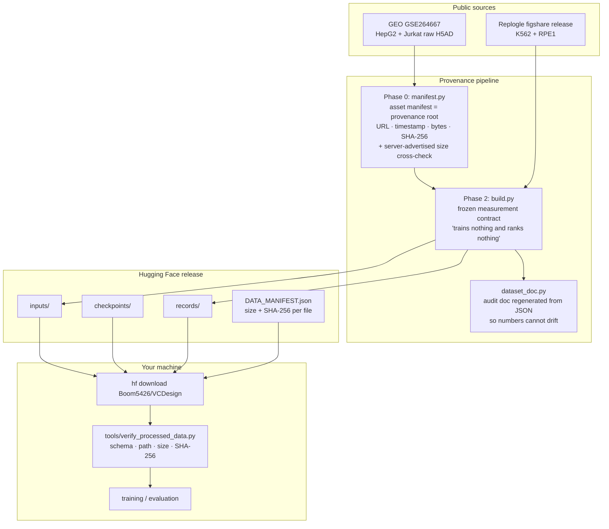

Every number a VCDesign-CED experiment produces is ultimately a deterministic function of a small set of *public* biological datasets plus frozen code. This page explains exactly which public resources the project is built from, how the project records *which bytes* of those resources it used, and how you can verify — byte by byte — that the processed snapshot on your machine is identical to the one used for the paper. If you have followed [Reproducing Paper Results](4-reproducing-paper-results), this page explains the "why" behind the `hf download` and verification commands you already ran.

Sources: [DATA_SOURCES.md](DATA_SOURCES.md#L1-L18), [CODE_PACKAGE_README.md](CODE_PACKAGE_README.md#L82-L84)

## Two Layers of Data in This Project

VCDesign-CED deliberately separates *code* from *data*. The repository you are browsing contains the Python source tree, the frozen paper-run configuration, a synthetic smoke-test demo, and verification tooling — but explicitly **no raw H5AD matrices, no large processed inputs, no checkpoints, and no cached run records**. Those heavyweight artifacts live in a companion processed-data release on Hugging Face (`Boom5426/VCDesign`), which you download alongside the code.

Sources: [CODE_PACKAGE_README.md](CODE_PACKAGE_README.md#L11-L30), [README.md](README.md#L149-L162)


The released artifact set has exactly four top-level entries, each with a defined role:

| Released artifact | Contents |
| :--- | :--- |
| `inputs/` | Frozen response matrices, STRING features, MAP-KG features, candidate-knowledge arrays, and comparator score arrays |
| `checkpoints/` | The selected epoch-8 reference checkpoint (`final_clean_epoch_008.pt`) |
| `records/` | Training, selection, evaluation, external-baseline, and verification run records |
| `DATA_MANIFEST.json` | Byte sizes and SHA-256 digests for every released file |

Sources: [README.md](README.md#L149-L162)

## The Public Data Sources

The processed release is derived from six public resources, each feeding a specific part of the pipeline. The two single-cell perturbation datasets provide the measured gene-expression responses; the remaining four provide *knowledge features* — static biological information about genes that the effect predictor consumes (this is explored in [Knowledge Features: STRING and MAP-KG](13-knowledge-features-string-and-map-kg)).

| Resource | Use in VCDesign-CED |
| :--- | :--- |
| Replogle et al. Perturb-seq release (figshare) | K562 genome-scale and RPE1 essential CRISPRi screens |
| GEO GSE264667 | HepG2 and Jurkat CRISPRi screens |
| STRING v12.0 | Static protein interaction features |
| MAP and MAP-KG | Frozen knowledge-graph gene representation |
| ESM-2 | Protein sequence representation |
| Reactome release 97 + NCBI human Gene Info | Pathway and gene-description feature variants |

Sources: [DATA_SOURCES.md](DATA_SOURCES.md#L1-L18)

The four single-cell datasets map onto the four evaluation *cellular contexts*, each with a distinct role in the benchmark. All four share the same perturbation setting: gene-level CRISPRi knockdown, dual-sgRNA, day 7, measured on the 10x 3' v3 platform — this uniformity is what makes cross-context comparison meaningful.

| Context | Role |
| :--- | :--- |
| K562 | Primary genome-scale setting (the "anchor" context) |
| RPE1 | Cross-context evaluation |
| HepG2 | External cellular context |
| Jurkat | External cellular context |

Sources: [README.md](README.md#L138-L147), [contract.py](src/gene_open_inverse/four_context_v1/contract.py#L56-L65)

## Why the Right K562 Screen Matters

A single subtlety worth flagging for beginners: the Replogle release contains *two* K562 datasets — a **genome-scale** screen and an **essentialome** screen. VCDesign-CED uses the **K562 genome-scale** screen only, because it is the genome-scale screen that defines the candidate universe for the primary setup. Downloading the wrong K562 file would silently give you a different (smaller) candidate pool and numbers that do not match the paper. The canonical URLs in `DATA_SOURCES.md` are the authoritative reference.

Sources: [DATA_SOURCES.md](DATA_SOURCES.md#L15-L18)

## The Provenance Chain: From Raw Bytes to Verified Release

Provenance in this project is not a README paragraph — it is a *pipeline stage*. The raw GEO H5AD files are the only external inputs the four-context mission takes, and everything downstream is a deterministic function of those bytes plus frozen code. The workflow below shows how public bytes become verified artifacts on your machine:



Sources: [manifest.py](src/gene_open_inverse/four_context_v1/manifest.py#L2-L9), [build.py](src/gene_open_inverse/four_context_v1/build.py#L1-L12)

## Inside the Phase 0 Asset Manifest

The manifest is called the **provenance root** because it is the first record created and everything downstream can be traced back to it. For each downloaded H5AD, Phase 0 records the original filename, the GEO accession, the exact source URL, the download timestamp, the byte size, and the SHA-256 digest — and it notes explicitly that no FASTQ reprocessing was performed ("the public H5ADs opened and read, so nothing was reprocessed").

Sources: [manifest.py](src/gene_open_inverse/four_context_v1/manifest.py#L22-L45)

One check here is easy to overlook but important to understand. The manifest also compares the file size against the size the server *advertised*:

| Field | Purpose |
| :--- | :--- |
| `bytes` | Actual size on disk |
| `bytes_advertised_by_server` | Size the server reported |
| `size_matches_server` | `true` only when both agree |
| `download_method` | "eight ranged HTTPS workers, reassembled in order" |
| `downloaded_at` | UTC timestamp of the file on disk |

The build exits with a failure code if any size mismatch is detected, so an incomplete download cannot silently advance to the processing stages.

Sources: [manifest.py](src/gene_open_inverse/four_context_v1/manifest.py#L14-L18), [manifest.py](src/gene_open_inverse/four_context_v1/manifest.py#L46-L52)

> [!TIP]
> A ranged parallel download that loses a chunk produces a file that *opens and reads normally* but is simply wrong in the middle. That is precisely why the code cross-checks disk size against server-advertised size in addition to computing the SHA-256 — two independent failure detectors for one failure mode.

## Verifying Your Downloaded Snapshot

Once the release is on disk, a single command verifies every released byte against `DATA_MANIFEST.json`:

```bash
python3 tools/verify_processed_data.py --root .
```

The verifier is strict by design. It walks every entry in the manifest and applies five checks; any failure is printed and the process exits non-zero:

| Check | What it catches |
| :--- | :--- |
| Manifest schema must be `VCDESIGN_PROCESSED_DATA_V1` | Wrong or tampered manifest version |
| Paths must be relative, no `..`, no duplicates | Path traversal / duplicate entries |
| File must exist and **not be a symlink** | Missing files, symlink substitution |
| Byte size must match the manifest | Truncated or padded downloads |
| Streaming SHA-256 must match the manifest | Any content change, even one byte |

Sources: [tools/verify_processed_data.py](tools/verify_processed_data.py#L21-L46), [tools/verify_processed_data.py](tools/verify_processed_data.py#L8-L14)

The frozen reference checkpoint `checkpoints/final_clean_epoch_008.pt` has its SHA-256 (`58da13d2…9484`) recorded in **two independent places** — the run configuration and the processed-data manifest — so a mismatch at either layer exposes a substituted or corrupted checkpoint before it can affect a training run.

Sources: [REPRODUCE.md](REPRODUCE.md#L28-L31), [configs/paper_run_v1.json](configs/paper_run_v1.json#L41-L43)

## How Provenance Stays Honest During Processing

Verification does not stop at the raw bytes. The four-context processing pipeline follows two design principles worth internalizing. First, the measurement contract (normalization, batch splitting, eligibility gates) was **frozen before any new-context number existed**, and Phase 2 applies it unchanged — "the anchor's recipe applied to a different dataset, not a recipe chosen for that dataset." Second, the dataset audit document is *regenerated from the JSON artifacts on disk rather than transcribed*, so every number in the audit cannot drift from the run that produced it.

Sources: [contract.py](src/gene_open_inverse/four_context_v1/contract.py#L15-L21), [build.py](src/gene_open_inverse/four_context_v1/build.py#L1-L12), [dataset_doc.py](src/gene_open_inverse/four_context_v1/dataset_doc.py#L2-L5)

The audit document then renders the provenance table (accession, bytes, server-size match, SHA-256 prefix, download time per file) and an independent verification section in which every context must pass under a frozen verifier contract — with a deliberately corrupted "witness" asset included, so that *a run whose witness does not fail is itself a failure*. This chain — asset manifest → deterministic build → regenerated audit → independent verification — is what makes the claim "these results came from those bytes" auditable end to end.

Sources: [dataset_doc.py](src/gene_open_inverse/four_context_v1/dataset_doc.py#L18-L33), [dataset_doc.py](src/gene_open_inverse/four_context_v1/dataset_doc.py#L49-L60)

## Where to Go Next

You now know where the data comes from and how its integrity is enforced. For the commands that put this into practice, return to [Reproducing Paper Results](4-reproducing-paper-results). To understand what the frozen `inputs/` assets actually contain and how the four-context measurement contract is defined, continue to [Four-Context Data Contracts](17-four-context-data-contracts). For a deeper treatment of the manifest and hash-verification machinery itself, see [Artifact Verification and SHA-256 Manifests](23-artifact-verification-and-sha-256-manifests), and for the broader system context, [Architecture Overview](6-architecture-overview).
