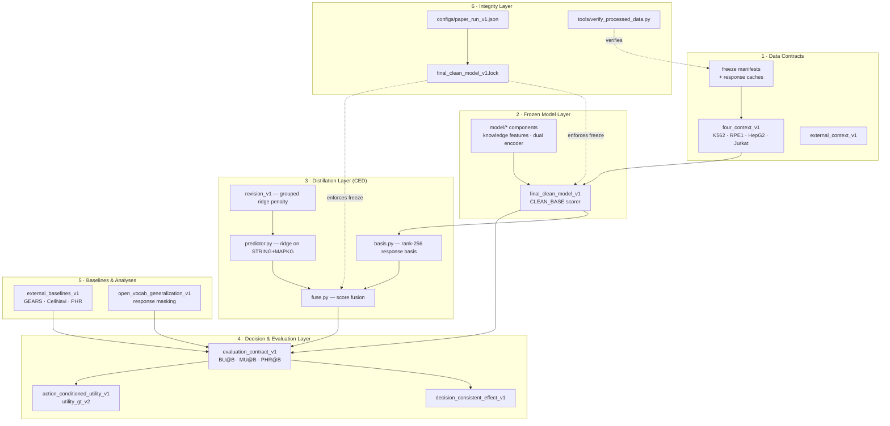
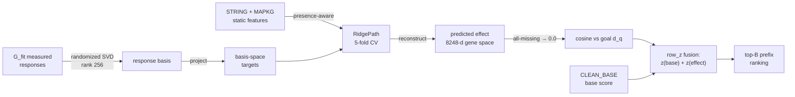

VCDesign-CED is organized around a single architectural conviction: **every scientifically meaningful number is frozen in code before it is computed**. The repository implements finite-budget intervention design for virtual cells — ranking feasible CRISPRi interventions for a source-to-target transition and grading only the executable top-B prefix against independently measured held-out outcomes ([README.md](README.md#L32), [README.md](README.md#L42-L59)). Rather than a research-code sprawl, this is a *contract-driven pipeline*: 18 versioned packages under `src/gene_open_inverse/`, each owning one stage, each carrying a `contract.py` that pre-registers its hypothesis, its legality rules, and every constant that could otherwise be tuned after seeing results. This page maps the whole system; the per-stage mechanics live in the Deep Dive pages that follow.


Sources: [README.md](README.md#L32-L38), [PROJECT_STRUCTURE.md](PROJECT_STRUCTURE.md#L1-L17)

## Architectural Philosophy: Frozen Contracts

The load-bearing pattern in this codebase is the `contract.py` file, present in every stage package. A contract is not configuration; it is a **pre-registration artifact**. The CED contract opens with the directive "Frozen before the first number," states the scientific hypothesis (distillation removes the burden of learning *how to compare* candidates so the ranker only learns *what a candidate does*), and then enumerates what each evaluation phase may legally read ([contract.py](src/gene_open_inverse/candidate_effect_distillation_v1/contract.py#L1-L19)). Three information tiers govern every module: **G_fit** identities may be read for training, **G_select** candidates' measured responses may be used only for grading and never as inputs, and **G_check** is sealed entirely ([contract.py](src/gene_open_inverse/candidate_effect_distillation_v1/contract.py#L16-L19)). Constants — basis rank, ridge folds, penalty grids, seeds — are declared inline with their justification, e.g. `BASIS_RANK = 256  # one value, fixed in advance, no grid` ([contract.py](src/gene_open_inverse/candidate_effect_distillation_v1/contract.py#L50-L55)). Even the scoring rule is contractual: a candidate with no static knowledge modality receives the exactly-neutral score `ALL_MISSING_SCORE = 0.0`, described as "a cosine's own indifference point, fixed here and not tuned" ([contract.py](src/gene_open_inverse/candidate_effect_distillation_v1/contract.py#L30-L36), [contract.py](src/gene_open_inverse/candidate_effect_distillation_v1/contract.py#L71-L72)).

The same discipline extends system-wide. The four-context data contract is frozen "before any HepG2 or Jurkat number exists," pre-registers three scientific questions, and forbids changing any pre-registered number after seeing a held-context result ([contract.py](src/gene_open_inverse/four_context_v1/contract.py#L1-L13), [contract.py](src/gene_open_inverse/four_context_v1/contract.py#L45-L50)). The evaluation contract carries an explicit freeze date `FROZEN = "2026-09-18"` and even lists metrics retired from the paper, so a reader can audit what was de-scoped ([contract.py](src/gene_open_inverse/evaluation_contract_v1/contract.py#L4-L13)).

Sources: [contract.py](src/gene_open_inverse/candidate_effect_distillation_v1/contract.py#L1-L77), [contract.py](src/gene_open_inverse/four_context_v1/contract.py#L1-L50), [contract.py](src/gene_open_inverse/evaluation_contract_v1/contract.py#L1-L32)

## Layered System Architecture

The packages compose into six layers with strictly downward dependencies: data contracts feed a frozen base model, whose outputs feed distillation, whose scores feed the evaluation contract, with baselines and analyses attached at the same evaluation interface, and an integrity layer enforcing the freeze across all of it.



Sources: [PROJECT_STRUCTURE.md](PROJECT_STRUCTURE.md#L3-L17), [lock.py](src/gene_open_inverse/final_clean_model_v1/lock.py#L20-L27)

The boundary between Layer 2 and Layer 3 is the paper's central claim made structural. When candidate responses have been measured in other contexts, **direct retrieval** from the base scorer is the recommended route; when they have not, **VCDesign-CED predicted-effect scoring** takes over — but both routes expose the identical downstream interface (candidate pool, budget, outcome-based evaluation), which is why baseline modules can attach at a single point ([README.md](README.md#L61-L68)). The base scorer is deliberately context-agnostic in cross-context experiments: it is "never retrained, never adapted and never told which context it is looking at," an asymmetry the four-context contract declares rather than corrects ([contract.py](src/gene_open_inverse/four_context_v1/contract.py#L34-L43)).

Sources: [README.md](README.md#L61-L68), [contract.py](src/gene_open_inverse/four_context_v1/contract.py#L34-L43)

## Module Inventory

Each `_v1`/`_v2` suffix encodes that the package's contract is versioned and frozen; `model/` is the exception — a library of frozen components rather than a pipeline stage.

| Package | Role in the pipeline | Representative surface |
| :--- | :--- | :--- |
| `four_context_v1` | K562/RPE1/HepG2/Jurkat data contracts, build, audits, LOCO folds | `build`, `contexts`, `loco`, `manifest` |
| `final_clean_model_v1` | Final base scorer: training, selection, scoring, pre-evaluation lock | `train`, `select`, `scoring`, `lock` |
| `candidate_effect_distillation_v1` | CED: response basis, ridge effect predictor, fusion, protocol test | `basis`, `predictor`, `fuse`, `run`, `test_protocol` |
| `revision_v1` | Gene-grouped ridge penalty selection (the corrected default) | `grouped_fit`, `test_grouped_fit` |
| `evaluation_contract_v1` | Frozen metric families, budgets, bootstrap statistics, adoption gates | `metrics`, `adoption`, `contract` |
| `decision_consistent_effect_v1` | Decision-consistent effect arms and statistics | `arms`, `stats` |
| `action_conditioned_utility_v1` / `utility_gt_v2` | Utility ground truth: mechanism, stratification, steelman validation | `mechanism`, `steelman`, `validate` |
| `external_baselines_v1` | GEARS, CellNavi, PHR comparator adapters and reporting tables | `gears_fit`, `cellnavi_fit`, `phr`, `tables` |
| `open_vocab_generalization_v1` | Response masking, pool-size, mixture and support analyses | `masking`, `poolsize`, `verify_masking` |
| `external_context_v1` | External corpora: joint build, transfer, zero-shot | `build`, `transfer`, `zeroshot` |
| `measurement_v2_quad` / `rwed_v1` / `evidence_v1` / `ppm_v1` | Quad splitting, RWED estimator, evidence runs, PPM model+decide | `split`, `estimator`, `run` |
| `model/` | Frozen components: knowledge features, dual encoder, decision alignment, GOKA attribution | 10 versioned sub-packages |

Sources: [PROJECT_STRUCTURE.md](PROJECT_STRUCTURE.md#L3-L17), [get_repo_structure](src/gene_open_inverse)

## The CED Pipeline Dataflow

Candidate Effect Distillation is the mechanism that transfers ranking ability to candidates whose responses were never measured. The verified dataflow, exactly as exercised in the synthetic demo, is a five-step chain: (1) historical measured responses from G_fit are decomposed by a randomized SVD into a **rank-256 response basis**; (2) G_fit targets are **projected** into that basis; (3) a ridge path fitted on presence-aware STRING+MAPKG static features **predicts basis coordinates** for deployment candidates; (4) predictions are **reconstructed** back into 8248-gene space and zeroed for all-missing candidates; (5) the predicted effect is scored by **cosine against the goal direction** and fused with the base score via per-row z-standardization ([ced_demo.py](examples/ced_demo.py#L29-L43)).



Sources: [ced_demo.py](examples/ced_demo.py#L29-L43), [contract.py](src/gene_open_inverse/candidate_effect_distillation_v1/contract.py#L50-L72)

Two contract decisions inside this chain deserve architectural attention because they encode scientific intent, not just defaults. The ridge penalty is selected by `held_out_mean_cosine_in_gene_space` rather than squared error, "because the deployment use is a direction comparison and squared error would spend the penalty on magnitude" ([contract.py](src/gene_open_inverse/candidate_effect_distillation_v1/contract.py#L62-L68)). And the pipeline's most consequential legality rule is stated as a constant with a name: `PREDICTED_EFFECT_IS_NOT_AN_INFERENCE_INPUT` — the predicted effect is a function of static knowledge alone, so no measured response of the scored candidate ever leaks into its own score ([contract.py](src/gene_open_inverse/candidate_effect_distillation_v1/contract.py#L73-L76)).

> [!TIP]
> The demo imports `row_z` from `final_clean_model_v1.scoring` ([ced_demo.py](examples/ced_demo.py#L7-L8)) — evidence that fusion normalization is a shared primitive owned by the base-scorer package, not re-implemented per stage. One primitive, one definition, everywhere.

Sources: [ced_demo.py](examples/ced_demo.py#L7-L8), [contract.py](src/gene_open_inverse/candidate_effect_distillation_v1/contract.py#L62-L76)

## The Evaluation Contract

Evaluation is itself a frozen module, not an ad-hoc notebook. The contract pins the budget family `(10, 20, 50)` with `BU@20` as primary, assigns roles across five metric families (BU primary, MU secondary, HvHit experimental efficiency, PHR validity guardrail, QWR consistency), and fixes the inferential machinery: median of paired per-row differences, 10,000 bootstrap replicates, clustering by query gene ([contract.py](src/gene_open_inverse/evaluation_contract_v1/contract.py#L7-L20)). Critically, the contract also encodes the **decision rule** — the K562 locked `G_check` serves as a sealed anchor, three held-out contexts (RPE1, HepG2, Jurkat) run under the `MASKED` decision regime, and adoption is gated by `MIN_WORTHWHILE_GAIN = 0.005`, a context-majority of 2, and a QWR gate of 0.5, yielding explicit `ADOPT_NEW_METHOD` / `KEEP_INCUMBENT` verdicts ([contract.py](src/gene_open_inverse/evaluation_contract_v1/contract.py#L21-L32)).

| Contract element | Frozen value | Function |
| :--- | :--- | :--- |
| Budgets | `(10, 20, 50)`; primary 20 | Finite-budget prefixes actually executed |
| Metric families | BU, MU, HvHit, PHR, QWR | Primary / secondary / efficiency / guardrail / consistency roles |
| Statistic | Median paired difference + mean beside it | Robust within-query comparison |
| Bootstrap | 10,000 replicates, seed `20260916`, cluster = query gene | Pre-registered uncertainty |
| Decision regime | `MASKED` on RPE1, HepG2, Jurkat; K562 `G_check` sealed | Response masking at decision time |
| Adoption gates | `gain ≥ 0.005`, 2-of-3 contexts, QWR ≥ 0.5 | Mechanical accept/reject, no judgment call |

Sources: [contract.py](src/gene_open_inverse/evaluation_contract_v1/contract.py#L7-L32)

## Integrity Architecture: Locks, Manifests, and Verification

The freeze is enforced by machinery, not by convention. **Phase F (`lock.py`)** runs *before* `G_check` is touched: it hashes every source file of the four packages the locked evaluation depends on (a combined SHA-256 over per-file digests, chosen because "a commit hash alone does not identify the code that produced this lock" in an authoring checkout with uncommitted work), records the git commit and platform, hashes checkpoints, and **refuses to overwrite an existing lock record** — so a second, adjusted run cannot quietly replace the first ([lock.py](src/gene_open_inverse/final_clean_model_v1/lock.py#L1-L9), [lock.py](src/gene_open_inverse/final_clean_model_v1/lock.py#L30-L60)). The evaluation module then reads its checkpoints and predictor penalty *from this record* rather than from any tunable source. Downstream, `configs/paper_run_v1.json` pins every asset path and carries `selected_checkpoint_sha256` for the frozen `FINAL_CLEAN_EPOCH_008` checkpoint selected by rule ([paper_run_v1.json](configs/paper_run_v1.json#L17-L43)). `tools/verify_processed_data.py` closes the loop by verifying processed data against SHA-256 manifests, and `evidence_v1` provides the run-evidence layer ([PROJECT_STRUCTURE.md](PROJECT_STRUCTURE.md#L13-L16)).

> [!TIP]
> The lock's file-hashing strategy reveals a subtle design trade-off: because the authoring checkout had uncommitted work, identity was established by *content* (SHA-256 of every `.py` in `CODE_PACKAGES`) rather than by *history* (git HEAD). This means the published results are reproducible from file bytes alone — which is precisely what `tools/verify_processed_data.py` audits downstream.

Sources: [lock.py](src/gene_open_inverse/final_clean_model_v1/lock.py#L1-L60), [paper_run_v1.json](configs/paper_run_v1.json#L17-L43), [PROJECT_STRUCTURE.md](PROJECT_STRUCTURE.md#L13-L16)

## Entry Points and Execution Model

Execution is uniformly module-level — no driver script orchestrates the pipeline. Each stage is invoked as `python3 -m gene_open_inverse.<package>.<entry>`, which keeps stages independently runnable and auditable in isolation. The six canonical entry points ([PROJECT_STRUCTURE.md](PROJECT_STRUCTURE.md#L19-L28)):

| Task | Entry point |
| :--- | :--- |
| Synthetic end-to-end check | `python3 examples/ced_demo.py` |
| Protocol tests | `python3 -m pytest -q` |
| Train the final base scorer | `python3 -m gene_open_inverse.final_clean_model_v1.train` |
| Candidate Effect Distillation | `python3 -m gene_open_inverse.candidate_effect_distillation_v1.run` |
| Four-context processing | `python3 -m gene_open_inverse.four_context_v1.build` |
| External-baseline reports | `python3 -m gene_open_inverse.external_baselines_v1.tables` |

Sources: [PROJECT_STRUCTURE.md](PROJECT_STRUCTURE.md#L19-L31)

Note the architectural role of `pytest -q`: protocol modules such as `candidate_effect_distillation_v1.test_protocol`, `external_baselines_v1.test_protocol`, and `open_vocab_generalization_v1.test_protocol` are executable contracts — after the post-review corrections, these checks now **fail the test suite** when their legality invariants do not hold, rather than only reporting failure in standalone runners ([README.md](README.md#L125-L134)). The full command sequence for reproducing paper numbers lives in REPRODUCE.md, which is the operational counterpart to this page ([PROJECT_STRUCTURE.md](PROJECT_STRUCTURE.md#L30-L31)).

Sources: [README.md](README.md#L125-L134), [PROJECT_STRUCTURE.md](PROJECT_STRUCTURE.md#L30-L31)

## Visual Project Structure

```text
VCDesign-CED/
├── src/gene_open_inverse/          18 versioned packages + model/ component library
│   ├── four_context_v1/            ── Layer 1: data contracts (4 cell contexts)
│   ├── final_clean_model_v1/       ── Layer 2: base scorer + lock
│   ├── model/                      ── Layer 2: frozen components (10 sub-packages)
│   ├── candidate_effect_distillation_v1/   ── Layer 3: CED core
│   ├── revision_v1/                ── Layer 3: grouped ridge penalty
│   ├── evaluation_contract_v1/     ── Layer 4: frozen metrics + adoption gates
│   ├── decision_consistent_effect_v1/ · action_conditioned_utility_v1/ · utility_gt_v2/
│   ├── external_baselines_v1/ · open_vocab_generalization_v1/ · external_context_v1/
│   └── measurement_v2_quad/ · rwed_v1/ · evidence_v1/ · ppm_v1/
├── configs/paper_run_v1.json       asset paths + pinned checkpoint SHA-256
├── examples/ced_demo.py            synthetic smoke demo of the CED chain
├── tools/                          processed-data SHA-256 verification
├── paper/VCDesign.pdf              final manuscript
└── REPRODUCE.md                    complete command sequence
```

Sources: [PROJECT_STRUCTURE.md](PROJECT_STRUCTURE.md#L1-L17)

## Where to Go Next

This page gave you the map. The natural progression through the catalog, ordered by architectural dependency: first solidify the formal problem in [Problem Formulation: Finite-Budget Ranking](7-problem-formulation-finite-budget-ranking), then understand how decisions are graded in [Ranking Metrics: BU@B, MU@B, PHR@B](8-ranking-metrics-buatb-muatb-phratb) and the two scoring routes in [Decision Routes: Retrieval versus Prediction](10-decision-routes-retrieval-versus-prediction). From there, descend into the distillation layer in execution order — [Response Basis Construction](11-response-basis-construction), [Ridge Effect Predictor](12-ridge-effect-predictor), [Score Fusion and Beta Selection](14-score-fusion-and-beta-selection) — and study the frozen base scorer in [Final Clean Base Scorer](15-final-clean-base-scorer) and [Training Pipeline and Frozen Configuration](16-training-pipeline-and-frozen-configuration). If your concern is trust rather than mechanics, go directly to [Leakage Prevention and Identity-Level Cross-Validation](21-leakage-prevention-and-identity-level-cross-validation) and [Artifact Verification and SHA-256 Manifests](23-artifact-verification-and-sha-256-manifests); for the frozen `model/` library surfaced in Layer 2, see [Frozen Model Components Library](25-frozen-model-components-library).