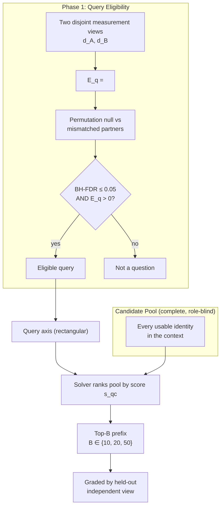
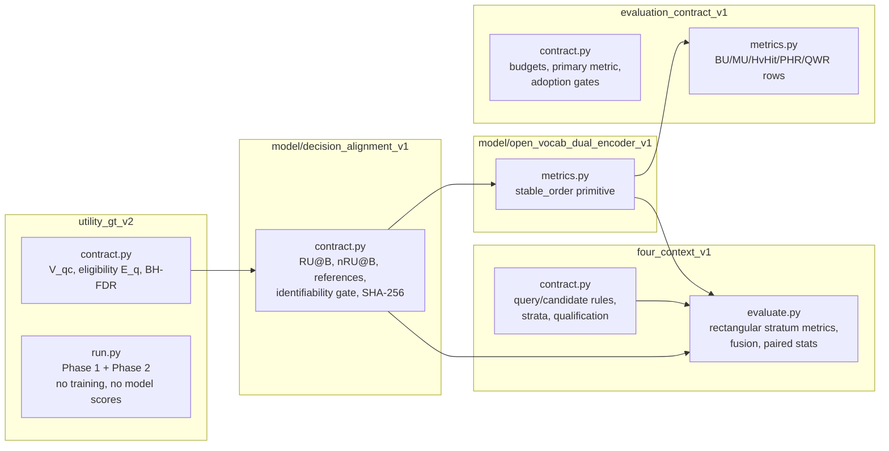

This page defines the formal problem that every module in `gene_open_inverse` exists to solve: cellular intervention design as **finite-budget ranking over a variable candidate set**. A solver ranks feasible interventions for a requested source-to-target transition, and evaluation scores only the executable top-$B$ prefix using independently measured held-out outcomes. The formulation is deliberately decision-shaped rather than prediction-shaped — the deliverable is an ordered shortlist, not a forecast — and everything downstream (metrics, protocols, distillation) inherits its constraints from the definitions on this page.

Sources: [README.md](README.md#L40-L46)

## From First Principles: What Makes This a Ranking Problem

The design task starts from a question an experimentalist can actually afford to answer: *given a desired cellular transition, which perturbations should we run next, and only the next $B$ of them?* Three properties distinguish this from a standard regression or classification setup. First, the output is an **ordering** — the solver must arrange candidates by expected usefulness, because the experiment consumes a prefix of the list, not a point estimate. Second, the candidate set is **variable**: the legal pool's size and membership change with the cellular context and the candidate stratum being scored, so the formulation never fixes a vocabulary at training time. Third, the score of a decision is computed from **independently measured held-out outcomes**, never from the model's own predictions — the ranking is graded against reality, not against itself.

Sources: [README.md](README.md#L40-L46), [four_context_v1/contract.py](src/gene_open_inverse/four_context_v1/contract.py#L87-L97)

This decision-shaped framing shows up directly in the metric machinery: the contract computes exact coefficients for how much a two-element swap in the ranking changes the primary aggregate, and explicitly assigns **zero decision value to pairs that sit entirely outside every actionable budget** — a candidate ranked 60th when the budget ends at 50 is not part of the problem.

Sources: [decision_alignment_v1/contract.py](src/gene_open_inverse/model/decision_alignment_v1/contract.py#L156-L176)

## The Entities: Query, Candidate Pool, Budget

The formulation fixes three objects that all evaluation code treats as first-class.

**Query.** A query is a perturbed identity $q$ with a measured source-to-target transition. Not every measured identity is a valid query: Phase 1 of the utility contract first decides whether the transition is *measurable at all*, using a shared latent transition energy $E_q = \langle d_A^q, d_B^q\rangle$ tested against a mismatched-partner permutation null with Benjamini–Hochberg FDR control at 0.05 plus a positivity requirement. The design rationale is stated plainly in the code: "A query is only a question if its transition is measurable at all."

Sources: [utility_gt_v2/contract.py](src/gene_open_inverse/utility_gt_v2/contract.py#L17-L28), [utility_gt_v2/contract.py](src/gene_open_inverse/utility_gt_v2/contract.py#L8-L16)

**Candidate pool.** The candidate axis is context-defined and role-blind: "every usable identity in the context, whatever its training role." Crucially, queries are a subset of candidates, and the production candidate vocabulary stays *complete* — a diagnostic module exists solely to confirm that restricting the pool to eligible identities would change conclusions, and it explicitly notes that "the production candidate vocabulary stays complete; nothing here filters candidates by response reliability."

Sources: [four_context_v1/contract.py](src/gene_open_inverse/four_context_v1/contract.py#L84-L86), [utility_gt_v2/pool_composition.py](src/gene_open_inverse/utility_gt_v2/pool_composition.py#L1-L11)

**Budget.** The deployment budgets are frozen at $B \in \{10, 20, 50\}$ with $B = 20$ as the primary, fixed before any model comparison. A query's legal pool must be larger than the largest budget, or the evaluation stops rather than reports.

Sources: [evaluation_contract_v1/contract.py](src/gene_open_inverse/evaluation_contract_v1/contract.py#L7-L9), [decision_alignment_v1/contract.py](src/gene_open_inverse/model/decision_alignment_v1/contract.py#L19-L23)

Because queries are a strict subset of candidates, the score and utility matrices are **rectangular** ($[\text{queries}] \times [\text{candidates in stratum}]$): the query axis stays fixed while the pool it ranks shrinks. This is what separates candidate generalization from context generalization — two questions the protocol refuses to collapse into one number.

Sources: [four_context_v1/evaluate.py](src/gene_open_inverse/four_context_v1/evaluate.py#L1-L17), [four_context_v1/contract.py](src/gene_open_inverse/four_context_v1/contract.py#L103-L107)

## The Ground-Truth Utility: Distance Reduction Without a Denominator

The quantity a ranking is ultimately graded against is the **reduction in squared endpoint distance** a candidate buys for a query:

$$V_{qc} = \|d^*_q\|^2 - \|r^*_c - d^*_q\|^2 = 2\langle r^*_c, d^*_q\rangle - \|r^*_c\|^2$$

where $d^*_q$ is the query's latent desired direction and $r^*_c$ the candidate's latent response. The implementation realizes this as a four-way cross-view estimate: with $M = \text{first} \cdot \text{second}^\top$, the value is $M[c,q] + M[q,c] - M[c,c]$ — "no division, no clipping, no per-query rescaling."

Sources: [utility_gt_v2/contract.py](src/gene_open_inverse/utility_gt_v2/contract.py#L29-L45), [utility_gt_v2/contract.py](src/gene_open_inverse/utility_gt_v2/contract.py#L135-L150)

The missing denominator is a deliberate architectural decision with a documented failure history. An earlier formulation divided by an estimate of $\|d^*_q\|^2$; since that is a per-query constant it never changed a within-query ranking, but whenever the estimate came out non-positive it **flipped the sign of every utility in the row** and produced a catastrophic metric tail. Dropping it "removes that failure mode by construction rather than by filtering" — the ranking metric family is invariant to positive per-query affine rescaling, so the removal is exactly neutral for the decision layer.

Sources: [utility_gt_v2/contract.py](src/gene_open_inverse/utility_gt_v2/contract.py#L31-L43)

> [!TIP]
> The contract also exposes `physical_bound_violation`, which flags $V_{qc} > E_q$ — algebraically an impossible negative squared distance. The code's comment is precise about interpretation: this reads out **estimator variance**, not a candidate "overshooting" the goal, so it is a measurement-quality diagnostic, not a candidate filter.

Sources: [utility_gt_v2/contract.py](src/gene_open_inverse/utility_gt_v2/contract.py#L182-L192)

## Why the Estimates Are Unbiased: The Two-View Measurement Discipline

Every quantity in the formulation is built from **two independent measurement views**, so no term is ever a self inner product of one noisy vector — this is what makes the estimators unbiased for the latent quantity rather than inflated by measurement variance. The query-side energy $E_q$ is unbiased for $\|d^*_q\|^2$ precisely because the two views are measured on disjoint batches, so the noise cross-term vanishes in expectation. Phase 2 then exploits the same structure for the decision itself: it asks whether a budget prefix ranked by one measurement view keeps its experimental utility when graded under the *independent* view, in both directions ("first ranks, second grades" and vice versa) — and the runner states its scope explicitly: "Nothing here trains, and nothing here reads a model score."

Sources: [utility_gt_v2/contract.py](src/gene_open_inverse/utility_gt_v2/contract.py#L8-L16), [utility_gt_v2/run.py](src/gene_open_inverse/utility_gt_v2/run.py#L1-L13), [utility_gt_v2/run.py](src/gene_open_inverse/utility_gt_v2/run.py#L18-L22)

This cross-view grading discipline is the foundation of the held-out evaluation protocol (covered in detail in [Held-Out Context Evaluation Protocol](9-held-out-context-evaluation-protocol)), but it is worth noting here that it is inherited, not reinvented: the four-context contract reuses the frozen A/B batch hash, quarter refinement, minimum cell threshold, and the `QUERY_ELIGIBILITY_V1` gate from the K562 lock, applying them unchanged to each new context.

Sources: [four_context_v1/contract.py](src/gene_open_inverse/four_context_v1/contract.py#L25-L48)

## Legality of an Ordering: Self-Exclusion and Frozen Tie-Breaking

Ranking is only well-defined once the ordering rule is frozen, and the formulation delegates this to a single primitive, `stable_order`: **descending score, ties broken by ascending candidate-ID string, the query's own entry masked to $-\infty$ and then removed**, with an optional static coverage mask for open-vocabulary settings. The contract's rationale is blunt about why the tie rule matters: "a method that emits a constant score gets a deterministic ordering and not a favorable one." Every downstream metric — from the primary BU@B to the high-value count — calls this same primitive rather than re-implementing sort logic.

Sources: [open_vocab_dual_encoder_v1/metrics.py](src/gene_open_inverse/model/open_vocab_dual_encoder_v1/metrics.py#L18-L28), [decision_alignment_v1/contract.py](src/gene_open_inverse/model/decision_alignment_v1/contract.py#L1-L11)

Self-exclusion also has to survive pool restriction, and the four-context evaluator documents a real hazard: when a query is *not* in the stratum's pool, the excluded index must be `None` rather than `-1`, because `stable_order` would read `-1` as the last candidate "and silently delete a real one." The excluded index semantics are therefore part of the formulation's interface contract, not an implementation detail.

Sources: [four_context_v1/evaluate.py](src/gene_open_inverse/four_context_v1/evaluate.py#L8-L17), [evaluation_contract_v1/metrics.py](src/gene_open_inverse/evaluation_contract_v1/metrics.py#L17-L33)

## Grading the Prefix: Outcome-Based References (Sketch)

The primary statistic of the formulation — detailed fully in [Ranking Metrics: BU@B, MU@B, PHR@B](8-ranking-metrics-buatb-muatb-phratb) — normalizes each query's discounted utility at the chosen budget against two references computed from the *measured utility row itself*: a random reference (the plain mean over the legal pool; under a uniform permutation the discount cancels, so no Monte Carlo is needed) and an oracle reference (the utility row ranking the pool). The normalized score is **not clipped** — worse than random is negative — and a degenerate-denominator identifiability gate halts comparison rather than reporting ratios with no scale.

Sources: [decision_alignment_v1/contract.py](src/gene_open_inverse/model/decision_alignment_v1/contract.py#L101-L118), [decision_alignment_v1/contract.py](src/gene_open_inverse/decision_alignment_v1/contract.py#L157-L165), [decision_alignment_v1/contract.py](src/gene_open_inverse/model/decision_alignment_v1/contract.py#L199-L215)

| Object | Definition | Role in the formulation |
| :--- | :--- | :--- |
| Legal pool | All candidates in the stratum, minus the query itself | The ranked universe per query |
| Random reference | Mean utility over the legal pool | Zero-skill baseline; discount cancels |
| Oracle reference | Discounted utility of the utility-true ordering | Ceiling for normalization |
| Denominator floor | $10^{-8}$ absolute | Guards degenerate normalizations; observed minima were 0.038 and 4.15 |
| Identifiability gate | ≤ 1% of queries may have degenerate denominators | Stops the comparison instead of fabricating scale |

Sources: [decision_alignment_v1/contract.py](src/gene_open_inverse/model/decision_alignment_v1/contract.py#L16-L23), [utility_gt_v2/contract.py](src/gene_open_inverse/utility_gt_v2/contract.py#L40-L43)

## One Decision Interface, Two Information Regimes

The formulation's most consequential property is that the downstream decision interface — *candidate pool, experimental budget, outcome-based evaluation* — is identical regardless of what information the solver holds about candidates. Two regimes share it:

| Property | Direct response retrieval | VCDesign-CED predicted-effect scoring |
| :--- | :--- | :--- |
| Candidate information at decision time | Measured candidate responses available | Candidate responses unavailable (masked / unmeasured) |
| Solver output | Same ranked pool interface | Same ranked pool interface |
| Evaluation | Same outcome-based grading | Same outcome-based grading |
| Hard constraint | — | Deployment candidate's measured response is never an input |

Sources: [README.md](README.md#L50-L59)

The "never an input" constraint is enforced structurally, not by convention: it appears in the four-context qualification checklist as `no_candidate_response_in_inference_features`, and candidates missing all supported knowledge modalities receive a frozen all-missing score defined by the protocol rather than an ad-hoc fallback.

Sources: [four_context_v1/contract.py](src/gene_open_inverse/four_context_v1/contract.py#L87-L97), [README.md](README.md#L92-L104)

## What Varies, What Is Frozen

The formulation draws a sharp boundary between the parts of the problem that vary per evaluation and the parts that are fixed before any result exists.

| Frozen (before any model result) | Varies per evaluation |
| :--- | :--- |
| Budgets $\{10, 20, 50\}$, primary $B=20$ | The candidate pool (context and stratum) |
| Stable ordering rule and self-exclusion semantics | Which queries are eligible (context's query rule) |
| High-value quantile (0.95), bootstrap seed (20260916), replicate count (10000) | The measurement views consumed for ranking vs grading |
| Alignment contract SHA-256 (runs stop on hash mismatch) | Stratum selection: `ALL`, `SEEN_CANDIDATE`, `UNSEEN_CANDIDATE`, `COMMON4` |

Sources: [evaluation_contract_v1/contract.py](src/gene_open_inverse/evaluation_contract_v1/contract.py#L7-L18), [four_context_v1/contract.py](src/gene_open_inverse/four_context_v1/contract.py#L103-L107), [decision_alignment_v1/contract.py](src/gene_open_inverse/model/decision_alignment_v1/contract.py#L29-L34)

One consequence deserves emphasis: restricting the pool to a stratum **moves the per-query random and oracle references**, because within a stratum "the achievable ceiling is the stratum's own ceiling." Absolute numbers from one stratum are therefore not comparable to another's — only paired differences between methods inside one stratum are. This is why cross-stratum comparisons in later pages are always paired.

Sources: [four_context_v1/evaluate.py](src/gene_open_inverse/four_context_v1/evaluate.py#L4-L8)

> [!TIP]
> The evaluation contract hard-codes its adoption semantics alongside the metric definitions — `MIN_WORTHWHILE_GAIN = 0.005`, `CONTEXT_MAJORITY = 2`, and `QWR_GATE = 0.5` sit in the same file as the budget list. Reading that one module gives you the complete decision-theoretic envelope of the benchmark: what is measured, at what scale a difference counts, and how many contexts must agree before `ADOPT_NEW_METHOD` beats `KEEP_INCUMBENT`.

Sources: [evaluation_contract_v1/contract.py](src/gene_open_inverse/evaluation_contract_v1/contract.py#L24-L32)

## How the Pieces Connect

The module graph below shows how the formulation decomposes into code: the utility contract owns what "good" means, the alignment contract owns how orderings are scored, the four-context contracts own who may be a query and what the pool is, and the evaluation contract owns the frozen decision semantics.

Sources: [utility_gt_v2/run.py](src/gene_open_inverse/utility_gt_v2/run.py#L1-L13), [four_context_v1/evaluate.py](src/gene_open_inverse/four_context_v1/evaluate.py#L36-L84), [evaluation_contract_v1/metrics.py](src/gene_open_inverse/evaluation_contract_v1/metrics.py#L1-L16)

For a minimal executable sketch of the decision half of this interface — features to predicted effect to goal alignment to a fused ranked prefix — the synthetic demo in `examples/ced_demo.py` exercises the full path on random data and prints the top-5 prefix, making it the fastest way to see the formulation as live code.

Sources: [examples/ced_demo.py](examples/ced_demo.py#L1-L49)

## Where the Formulation Leads

Everything downstream of this page refines one of its four objects. The scoring layer is formalized in [Ranking Metrics: BU@B, MU@B, PHR@B](8-ranking-metrics-buatb-muatb-phratb); the measurement-side discipline that makes grading trustworthy continues in [Held-Out Context Evaluation Protocol](9-held-out-context-evaluation-protocol); the two information regimes are compared empirically in [Decision Routes: Retrieval versus Prediction](10-decision-routes-retrieval-versus-prediction); and the context-level rules for who queries what are unpacked in [Four-Context Data Contracts](17-four-context-data-contracts). The leakage implications of the query/candidate role split — why the anchor context is queried on `G_select` identities only — are treated in [Leakage Prevention and Identity-Level Cross-Validation](21-leakage-prevention-and-identity-level-cross-validation).
