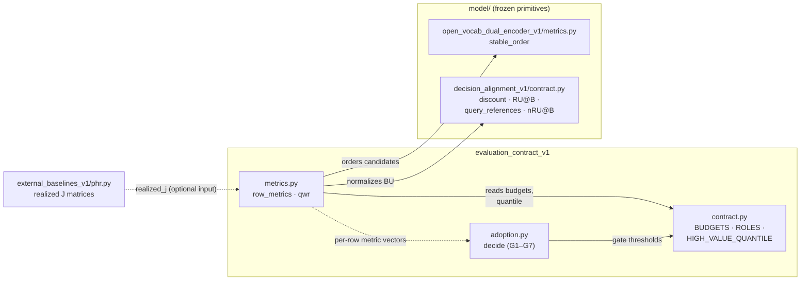
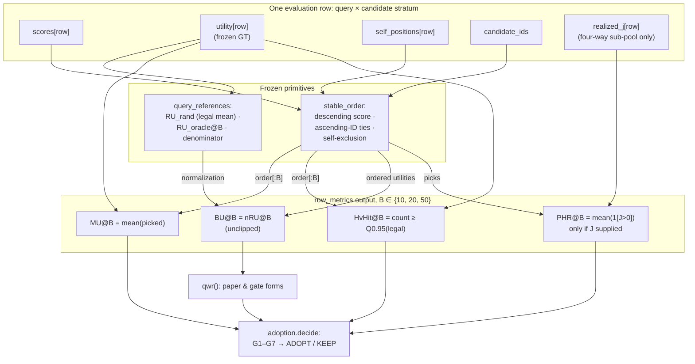

This page explains the ranking metrics that grade every candidate-ranking decision in VCDesign: **BU@B** (Budgeted Utility), **MU@B** (Mean Utility), **HvHit@B** (High-Value Hit count), and **PHR@B** (Perturbation Hit Rate), plus the paired **QWR** (Quadrant Win Rate) forms derived from BU vectors. All four families are computed per evaluation row by a single function, `row_metrics`, under a frozen evaluation contract that fixes the budgets, the tie-breaking rule, and the statistic used to pool them. The implementations live in `evaluation_contract_v1/metrics.py`, and every primitive they rely on — the ordering rule and the normalization — is imported from frozen modules under `src/gene_open_inverse/model/` rather than re-implemented locally.

This page sits in the *Evaluation Framework* cluster: it assumes you know what a candidate pool and a finite budget are from [Problem Formulation: Finite-Budget Ranking](7-problem-formulation-finite-budget-ranking), and it precedes the protocol-level details in [Held-Out Context Evaluation Protocol](9-held-out-context-evaluation-protocol).

## The Frozen Metric Family

The evaluation contract V1 declares the metric families, their roles, and the deployment budgets as module-level constants, so no run can silently change what is being measured. Budgets are frozen at `B = (10, 20, 50)` with **BU@20 as the primary metric**; the family tuple is `("BU", "MU", "HvHit", "PHR", "QWR")`, where QWR is a derived consistency metric rather than an independently computed ranking score. Three older metrics — `MBRU`, `Best@B`, and `J RU@B` — are explicitly retired from the paper, which is why BU@20 rather than a multi-budget aggregate anchors the headline results.

Sources: [contract.py](src/gene_open_inverse/evaluation_contract_v1/contract.py#L7-L14)

Each family carries a distinct decision role declared in the contract: BU is the **primary** ranking-quality signal, MU is the **secondary** check that guards against discounted-gain artifacts, HvHit measures **experimental efficiency** (how often picks land in the top-utility tail), PHR is the **validity guardrail** (whether picks have any realized, independently graded benefit), and QWR measures **consistency** between paired methods. The pooling statistic is also frozen here: the *median of paired per-row differences, mean reported beside it*, estimated by 10,000-replicate bootstrap with seed `20260916`, clustered by query gene.

| Family | Role in contract | Per-row definition | Requires |
| :--- | :--- | :--- | :--- |
| BU@B | Primary | Normalized discounted Ranked Utility (`nRU@B`) | scores, utility |
| MU@B | Secondary | Plain mean of the utilities of the top-B picks | scores, utility |
| HvHit@B | Experimental efficiency | Count of picks ≥ 95th percentile of the legal pool | scores, utility |
| PHR@B | Validity guardrail | Fraction of picks with realized `J > 0` | scores, utility, **realized J** |
| QWR | Consistency | Win rate of one method's BU vector against another | two BU vectors |

Sources: [contract.py](src/gene_open_inverse/evaluation_contract_v1/contract.py#L10-L12), [contract.py](src/gene_open_inverse/evaluation_contract_v1/contract.py#L16-L19)

The `row_metrics` docstring records a deliberate design decision: BU@B is defined as the frozen `nRU@B`, MU@B as the frozen `Mean@B`, and HvHit@B as the frozen `HighValueCount@B`, and the test suite **asserts these identities against the existing evaluator rather than assuming them**. This means the contract-page naming and the per-row computation cannot drift apart without a test failing.

Sources: [metrics.py](src/gene_open_inverse/evaluation_contract_v1/metrics.py#L1-L7)

## How One Row Is Ranked: Self-Exclusion and the Stable Tie Order

Every row is one query in one view, ranked over the **self-excluded legal pool** of one candidate stratum in a frozen stable tie order (`metrics.py`, module docstring). Concretely, `row_metrics` takes four aligned arrays — `scores`, `utility`, `candidate_ids`, and `self_positions` — where `self_positions[i]` is where row `i`'s query identity sits in the stratum, or `-1` if it is absent. When the position is non-negative, the ranking order is produced with that index excluded, and then the excluded slot is removed from the order array so the picked prefix contains only legal candidates.

Sources: [metrics.py](src/gene_open_inverse/evaluation_contract_v1/metrics.py#L17-L23), [metrics.py](src/gene_open_inverse/evaluation_contract_v1/metrics.py#L34-L39)

The ordering primitive itself, `stable_order`, is borrowed from the dual-encoder model package and never re-implemented per metric. It sets the excluded (and any masked) candidate scores to `-inf`, then applies `np.lexsort((candidate_ids_as_strings, -rank))`: **descending by score, ties broken by ascending candidate ID**. The tie rule is a correctness guarantee, not a convenience — the alignment contract notes that a method emitting a constant score gets a deterministic ordering and not a favorable one, which closes the loophole where ties could be arranged to flatter a comparator.

Sources: [metrics.py](src/gene_open_inverse/model/open_vocab_dual_encoder_v1/metrics.py#L17-L27), [contract.py](src/gene_open_inverse/model/decision_alignment_v1/contract.py#L8-L11)

The module interaction structure is deliberately shallow — one metrics function, two frozen primitive modules, and one optional realized-J producer:

Sources: [metrics.py](src/gene_open_inverse/evaluation_contract_v1/metrics.py#L12-L14), [adoption.py](src/gene_open_inverse/evaluation_contract_v1/adoption.py#L7-L13)

## BU@B: Normalized Discounted Ranked Utility

BU@B is a DCG-style discounted gain, normalized so that a query's score is interpretable **relative to two references computed from the frozen ground-truth utility itself**. The discount is `d_r = 1 / log₂(r + 1)` for ranks `r = 1..B`, fixed and never tuned, and `RU@B` is the discount-weighted mean of the utilities placed in predicted rank order: `RU@B = Σ d_r · U_(r) / Z_B`, where `Z_B = Σ d_r`.

Sources: [contract.py](src/gene_open_inverse/model/decision_alignment_v1/contract.py#L43-L48), [contract.py](src/gene_open_inverse/model/decision_alignment_v1/contract.py#L66-L72)

Normalization is performed by `query_references` and `normalized_ranked_utility`. For each query, the references are computed over the *self-excluded legal pool ordered by true utility*: the random reference `RU_rand` and the oracle `RU_oracle@B`, whose difference forms the denominator. The final score is `nRU@B = (RU@B − RU_rand) / (RU_oracle@B − RU_rand)` — so **1.0 means oracle-quality ranking and 0.0 means random**.

Sources: [contract.py](src/gene_open_inverse/model/decision_alignment_v1/contract.py#L85-L103), [contract.py](src/gene_open_inverse/model/decision_alignment_v1/contract.py#L121-L128)

Two implementation details matter for interpreting published BU numbers. First, the random reference needs **no Monte Carlo sampling**: under a uniform permutation the expected utility is the same at every rank, so the discount weights cancel and the reference is simply the plain mean over the legal pool — a closed-form identity, not an estimate. Second, the normalized score is deliberately **not clipped**: a ranking worse than random returns a negative BU@B, and a degenerate denominator (oracle indistinguishable from random for that query) is floored at `1e-8` and policed by a separate identifiability gate that halts comparison rather than reporting a ratio with no scale.

Sources: [contract.py](src/gene_open_inverse/model/decision_alignment_v1/contract.py#L86-L91), [contract.py](src/gene_open_inverse/model/decision_alignment_v1/contract.py#L121-L128), [contract.py](src/gene_open_inverse/model/decision_alignment_v1/contract.py#L191-L197)

The whole BU pipeline is under hash-lock: the alignment contract file that defines Ranked Utility, nRU, and MBRU carries a recorded SHA-256, `verify_contract` recomputes it at run time, and **the run stops rather than reporting numbers under a contract that no longer says what it said**.

Sources: [contract.py](src/gene_open_inverse/model/decision_alignment_v1/contract.py#L1-L7), [contract.py](src/gene_open_inverse/model/decision_alignment_v1/contract.py#L29-L40)

## MU@B and HvHit@B: The Undiscounted Complements

Inside the same per-row budget loop, `row_metrics` slices the utilities of the top-B picks (`picked = utility[row, order[:budget]]`) and computes the two simpler families directly on that prefix. **MU@B is the plain arithmetic mean** of the picked utilities — no discounting, no normalization — which makes it a robust sanity check on BU: a method cannot score well on BU@B while systematically picking mediocre candidates, and the adoption gate explicitly requires that MU@20 is never reversed relative to the incumbent. **HvHit@B is a count**, not a rate: the number of picks whose utility is at least the 95th-percentile threshold of the legal pool, where the threshold is computed with `np.quantile` on the legal utilities after self-exclusion.

Sources: [metrics.py](src/gene_open_inverse/evaluation_contract_v1/metrics.py#L42-L48), [contract.py](src/gene_open_inverse/evaluation_contract_v1/contract.py#L14)

The three utility-based families answer deliberately different questions, which is why all three appear in the same output dictionary keyed `"<family>@<budget>"`:

| Property | BU@B | MU@B | HvHit@B |
| :--- | :--- | :--- | :--- |
| Discounts by rank | Yes (`1/log₂(r+1)`) | No | No |
| Normalized per query | Yes (oracle vs. random) | No | No |
| Scale | Unitless, ~0 (random) to 1 (oracle) | Raw utility units | Integer count |
| Sensitive to | Top-heavy ordering quality | Average pick quality | Tail (top-5%) retrieval |
| Paired statistic | Median of per-row differences | Median of per-row differences | Median of per-row differences |

Sources: [metrics.py](src/gene_open_inverse/evaluation_contract_v1/metrics.py#L31-L48), [contract.py](src/gene_open_inverse/evaluation_contract_v1/contract.py#L16-L17)

## PHR@B: Realized Validity, Never Approximated

PHR@B asks a question the other three cannot: of the B candidates actually selected, **what fraction had a realized, independently measured benefit** — encoded in a realized matrix `J` where a positive entry means the pick produced a positive graded response gain. `row_metrics` computes it as the mean of the indicator `J[row, order[:budget]] > 0` across the picked prefix, and the function signature enforces honesty about data availability: **PHR is returned only when a realized `J` matrix is supplied; it is never approximated**. When `realized_j` is absent, the output dictionary simply contains no PHR keys, and downstream consumers must treat PHR as unavailable rather than imputed.

Sources: [metrics.py](src/gene_open_inverse/evaluation_contract_v1/metrics.py#L21-L23), [metrics.py](src/gene_open_inverse/evaluation_contract_v1/metrics.py#L49-L50)

The realized `J` matrices for the external contexts are produced by `external_baselines_v1/phr.py` under a strict quarter-gate construction. The four-way data build splits each context into quarters (Q0–Q3) that pair into two disjoint views, and `J` **exists only on the four-way sub-pool** — identities with cell counts above the minimum in all four quarters. For a view-v row, the action is chosen on side v's quarter pair (the same quarters that built the row's query), while `J` is realized on side 1−v's pair, "which nothing else touched" — a proposer/grader split that prevents the selection side from leaking into the grading side.

Sources: [phr.py](src/gene_open_inverse/external_baselines_v1/phr.py#L8-L12), [phr.py](src/gene_open_inverse/external_baselines_v1/phr.py#L63-L84)

Before any PHR number is reported, a reconstruction gate proves the quarter decomposition is faithful: for every four-way identity, the cell-count-weighted mean of Q0 and Q1 must equal view A's response and the weighted mean of Q2 and Q3 must equal view B's, within a frozen tolerance, and the evaluation pack's responses must byte-match the build's side responses (`pack_error == 0.0`). This is why the contract labels PHR a **validity guardrail** — it certifies that selections are backed by real outcomes, and the adoption gate rejects a method whose PHR@20 state is negative.

Sources: [phr.py](src/gene_open_inverse/external_baselines_v1/phr.py#L34-L60), [adoption.py](src/gene_open_inverse/evaluation_contract_v1/adoption.py#L21-L22)

## QWR: Two Forms of the Same Win Count

`qwr` is the smallest function in the module and the only one that operates on **pooled vectors rather than raw scores**: given two per-row BU@B vectors (a method and a comparator), it counts wins, losses, and ties per row. It returns two win rates that answer different questions, and the docstring is explicit about which is which: **`paper` = wins over all rows** (the paper-facing form, comparator BASE) and **`gate` = wins over decided rows** (the adoption form, comparator the incumbent). The gate form drops ties from the denominator, so a comparator that ties on most rows cannot inflate the consistency signal; `tie_fraction` is reported alongside so the severity of the tie mass is always visible.

| Attribute | `paper` form | `gate` form |
| :--- | :--- | :--- |
| Numerator | Rows where method > comparator | Same wins |
| Denominator | All rows | Wins + losses only (ties excluded) |
| Comparator | BASE | Incumbent |
| Consumer | Paper tables | Adoption gate `G7` (`QWR_gate20 > 0.5`) |
| Tie handling | Counted in denominator | Removed from denominator, reported as `tie_fraction` |

Sources: [metrics.py](src/gene_open_inverse/evaluation_contract_v1/metrics.py#L54-L68), [contract.py](src/gene_open_inverse/evaluation_contract_v1/contract.py#L28)

## From Per-Row Vectors to the Adoption Gate

The metric vectors are consumed by `adoption.decide`, a pure function of pooled numbers, through seven checks (G1–G7). The pooled inputs are MASKED paired contrasts — the contract freezes the decision regime as `DECISION_REGIME = "MASKED"` on the primary contexts RPE1, HepG2, and Jurkat — and each check reads a different slice of the metric system: BU@20's sign state and effect size, per-context medians and confidence intervals, the MU@20/HvHit@20/PHR@20 states, and the gate-form QWR. Note how each metric family's contract role maps onto exactly one gate check, which is the practical payoff of declaring `ROLES` as frozen constants.

| Gate | Check | Metric consumed | Threshold |
| :--- | :--- | :--- | :--- |
| G1 | BU@20 state positive | BU@B | `POSITIVE` |
| G2 | BU@20 at least worthwhile | BU@B | median ≥ `0.005` |
| G3 | Context majority positive | BU@B per context | ≥ 2 of 3 contexts |
| G4 | No context wholly negative | BU@B per context | upper CI ≥ 0 everywhere |
| G5 | MU@20 not reversed | MU@B | state ≠ `NEGATIVE` |
| G6 | HvHit@20 and PHR@20 not worse | HvHit@B, PHR@B | states ≠ `NEGATIVE` |
| G7 | QWR gate above half | QWR (gate form) | `> 0.5` |

Sources: [adoption.py](src/gene_open_inverse/evaluation_contract_v1/adoption.py#L14-L27), [contract.py](src/gene_open_inverse/evaluation_contract_v1/contract.py#L22-L28)

The full data flow from a scored pool to an adoption verdict is a single acyclic pass — the concept relationship below is the reference map for this entire page:

Sources: [metrics.py](src/gene_open_inverse/evaluation_contract_v1/metrics.py#L17-L51), [adoption.py](src/gene_open_inverse/evaluation_contract_v1/adoption.py#L7-L28)

> [!TIP]
> The two identities most worth internalizing when reading published tables: (1) a BU@B of exactly `0.0` means the method ranked no better than random *for that query*, because the random reference is the closed-form legal-pool mean — discount weights cancel under uniform permutation; (2) a missing PHR@B column is **not** an approximation or a zero — the function refuses to emit PHR without a realized `J` matrix, so absence certifies the row is outside the four-way sub-pool.

> [!TIP]
> If you ever see constant scores feeding these metrics, the ordering is still fair: `stable_order` breaks ties by ascending candidate-ID string via `lexsort`, so a degenerate scorer gets a deterministic, identity-based order rather than one that could be arranged to flatter it — this is asserted in the alignment contract, not just documented.

## Where to Go Next

With the metric definitions in hand, the natural reading order is: [Held-Out Context Evaluation Protocol](9-held-out-context-evaluation-protocol) for how rows and pools are constructed before `row_metrics` ever runs, then [Decision Routes: Retrieval versus Prediction](10-decision-routes-retrieval-versus-prediction) for how the two scoring routes produce the `scores` input. If you want to see where BU@20 numbers come from in practice, [Score Fusion and Beta Selection](14-score-fusion-and-beta-selection) covers the CED scoring branch, and the headline pooled contrasts are summarized in [Key Benchmark Findings](26-key-benchmark-findings). For the guarantees that keep these metrics honest across identities, continue to [Leakage Prevention and Identity-Level Cross-Validation](21-leakage-prevention-and-identity-level-cross-validation).
