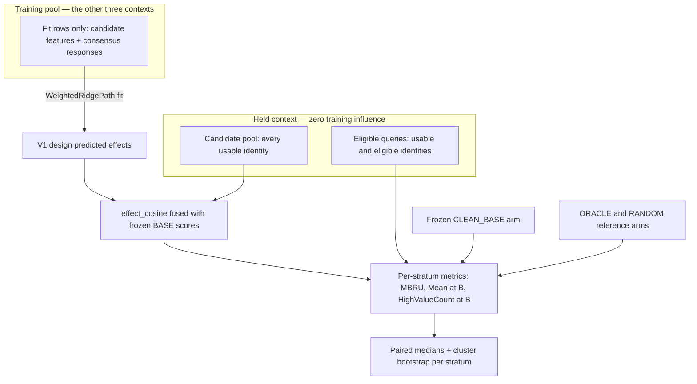
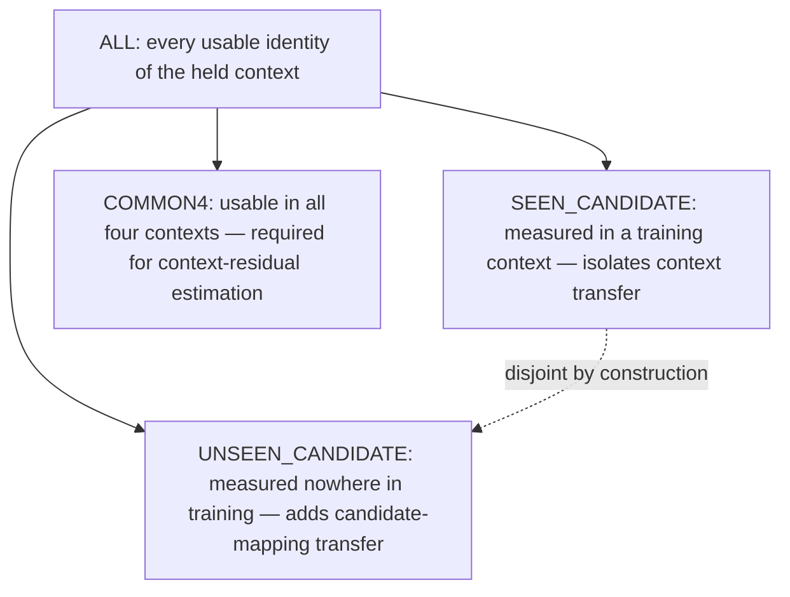
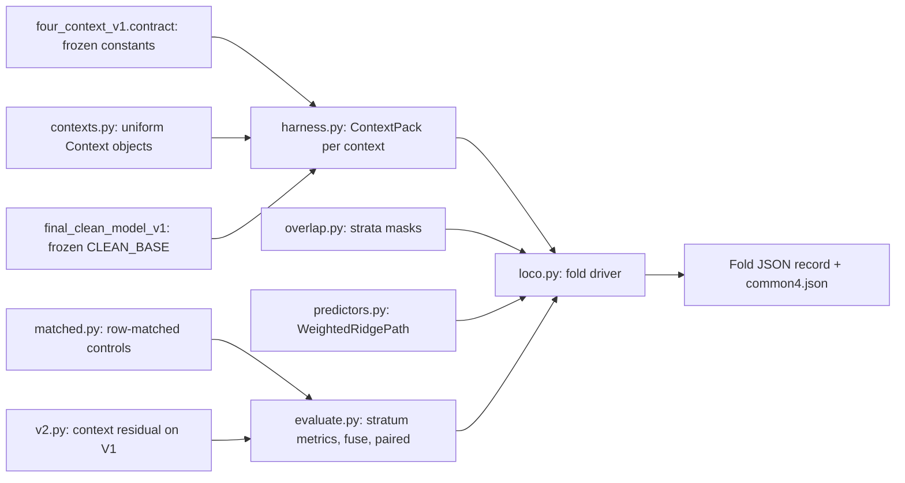

This page specifies how VCDesign grades generalization to a **cell context that contributed no training data**. The protocol is implemented in `src/gene_open_inverse/four_context_v1/`: a leave-one-context-out (LOCO) harness in which one of the four measured cell lines (K562, RPE1, HepG2, Jurkat) is withheld entirely, an effect predictor is fitted only on the other three, and the held context is then graded on a fixed candidate population with a frozen base ranker as the reference arm. The page covers fold construction, per-context train/query roles, candidate strata, the grading mechanics on rectangular candidate subsets, the paired-difference statistics, and the guardrails that make a held-context number interpretable rather than leaked.

Sources: [loco.py](src/gene_open_inverse/four_context_v1/loco.py#L1-L17), [contract.py](src/gene_open_inverse/four_context_v1/contract.py#L1-L12)

## The LOCO Fold: Withholding an Entire Cell Context

The defining move of this protocol is the unit of held-out data. Identity-level cross-validation withholds rows; the LOCO fold withholds a *context*: in each of four folds, the held context's responses are invisible to every predictor because the training pool is built only from the other three contexts. Inside the held context there is deliberately **no hash split** — the held context contributes no training row at all, so nothing it is graded on could ever have fitted the predictor, and splitting it further would only discard half of its queries. Outside the anchor, every usable identity of a non-anchor context is both a potential training row (in folds where it trains) and a query (in its own fold).

Sources: [contexts.py](src/gene_open_inverse/four_context_v1/contexts.py#L8-L16), [contract.py](src/gene_open_inverse/four_context_v1/contract.py#L76-L95)

Each fold is not a single comparison but a scaling experiment. The `designs` function enumerates **seven atlas designs** per fold — the three single training contexts, the three pairs, and the pooled triple — all fitted under one unchanged recipe with no context feature anywhere. Crucially, the evaluation population is fixed per fold: `SEEN_CANDIDATE` is defined against the *full* three-context training set rather than against each design, so a one-context design and a three-context design are graded on exactly the same candidates; each design additionally records the fraction of each stratum it actually supervised, which is the number that would otherwise hide inside a moving population.

Sources: [loco.py](src/gene_open_inverse/four_context_v1/loco.py#L4-L14), [loco.py](src/gene_open_inverse/four_context_v1/loco.py#L44-L49)

A design whose training pool cannot support the frozen basis rank is **recorded, not raised**: it is skipped with a machine-readable reason (`usable_rows`, `basis_rank`), because a design that cannot support the frozen rank is a fact about the atlas, and silently lowering the rank would turn it into a different method and void the comparison.

Sources: [loco.py](src/gene_open_inverse/four_context_v1/loco.py#L110-L121)

## Who May Train on What: Per-Context Roles and the Sealed Anchor

The one asymmetry in the protocol is the **anchor**, K562, because the frozen `CLEAN_BASE` ranker used as the reference arm in *every* fold was trained on K562's `G_fit` identities. The anchor therefore keeps an internal role structure — train on `G_fit`, query on `G_select` — so the base is never evaluated in-sample, while the three new contexts keep the undivided rule. `G_select` is a selection split and not a blind one, so K562 absolute numbers are optimistic for the base; the protocol responds by reporting K562 only through **paired differences under that same base**, and by excluding the anchor's `G_fit` identities from its evaluation population.

| Context | Training rows (`TRAIN_RULE`) | Evaluation queries (`QUERY_RULE`) | Protocol consequence |
| :--- | :--- | :--- | :--- |
| **K562** (anchor) | usable identities in the anchor `G_fit` role | usable, `QUERY_ELIGIBILITY_V1`-eligible identities in the `G_select` role | `G_check` sealed and dropped; base trained here, so only paired deltas are meaningful |
| **RPE1** | every usable identity | every usable and eligible identity | no internal split; queried in its own fold |
| **HepG2** | every usable identity | every usable and eligible identity | no internal split; queried in its own fold |
| **Jurkat** | every usable identity | every usable and eligible identity | no internal split; queried in its own fold |

Sources: [contract.py](src/gene_open_inverse/four_context_v1/contract.py#L76-L95), [contexts.py](src/gene_open_inverse/four_context_v1/contexts.py#L27-L29)

The anchor is loaded from frozen assets, never rebuilt — the anchor lock forbids it. `load_anchor` enforces the seal mechanically: it raises `RuntimeError` if any `G_check` identity would become reachable through the train or query role indices, and `G_check` rows are then physically dropped from every array the programme can touch. A protocol test pins the rule down: only the anchor may restrict which identities may train or be queried, and any future edit that reintroduces a split for RPE1, HepG2 or Jurkat will fail pytest and thus be forced to be a deliberate contract change.

Sources: [contexts.py](src/gene_open_inverse/four_context_v1/contexts.py#L88-L135), [test_protocol.py](src/gene_open_inverse/four_context_v1/test_protocol.py#L34-L42)

The gene axis is frozen once, before any model runs: `G_4`, the sorted intersection of the four measured axes. The historical K562 result keeps its own 8248-gene axis and is not recomputed — the four-context programme is a separate experiment on `G_4`.

Sources: [contexts.py](src/gene_open_inverse/four_context_v1/contexts.py#L137-L142), [contract.py](src/gene_open_inverse/four_context_v1/contract.py#L28-L32)

## Candidate Strata: Context Transfer versus Candidate Transfer

The protocol insists that two things called "generalization" are **never collapsed into one number**. A candidate whose response was measured in some training context had its own effect supervised, so evaluating it in the held context isolates whether the *context* mapping transfers. A candidate no training context ever measured additionally tests whether the *candidate* mapping transfers. Stratum membership is a property of **which identities were measured where** — it never depends on a score, so the partition cannot be gamed by a model's own behaviour.

| Stratum | Membership rule | Question it isolates |
| :--- | :--- | :--- |
| `ALL` | every usable identity of the held context | overall held-context performance |
| `SEEN_CANDIDATE` | response measured in at least one training context | context transfer only |
| `UNSEEN_CANDIDATE` | measured in no training context | context transfer + candidate-mapping transfer |
| `COMMON4` | usable in all four contexts | the only population on which a context residual can be estimated at all |

Sources: [overlap.py](src/gene_open_inverse/four_context_v1/overlap.py#L1-L13), [overlap.py](src/gene_open_inverse/four_context_v1/overlap.py#L35-L40)

The masks are computed from data alone by `fold_strata`, alongside a recorded overlap matrix (pairwise Jaccard, and how many identities are measured in exactly *k* contexts) that documents how much supervised material each fold actually shares.

Sources: [overlap.py](src/gene_open_inverse/four_context_v1/overlap.py#L21-L32), [overlap.py](src/gene_open_inverse/four_context_v1/overlap.py#L43-L58), [overlap.py](src/gene_open_inverse/four_context_v1/overlap.py#L73-L80)

## Grading Mechanics on a Held Context

Everything a fold reads is assembled **once per context**, not per arm: the frozen base scores, the graded utility, the candidate knowledge features and the response arrays live in a `ContextPack`. The rationale is experimental control — if base scores or utility were rebuilt per arm, a difference between two arms could come from a rebuild rather than from the arm itself.

Sources: [harness.py](src/gene_open_inverse/four_context_v1/harness.py#L1-L8), [harness.py](src/gene_open_inverse/four_context_v1/harness.py#L28-L45)

Two conventions in the pack deserve attention. First, utility is graded **cross-view**: a query scored under view *v* is graded by the responses of the batch-disjoint view *1−v*, so even in-context grading uses independently measured outcomes (the A/B batch-disjoint views are inherited verbatim from the frozen measurement lock). Second, the pack asserts every evaluation query sits inside its own context's candidate pool and records its `self_positions` index, which is what makes self-exclusion possible during ranking.

Sources: [evaluate.py](src/gene_open_inverse/four_context_v1/evaluate.py#L41-L46), [harness.py](src/gene_open_inverse/four_context_v1/harness.py#L82-L124), [split.py](src/gene_open_inverse/measurement_v2_quad/split.py#L34-L44)

The evaluator then restricts to a stratum, which makes the score and utility matrices **rectangular**: the query axis stays the held context's eligible queries while the candidate axis shrinks to the stratum. This is the mechanism that separates candidate generalization from context generalization. The consequence is deliberate and important: restricting the pool also moves the per-query random and oracle references, because within a stratum the achievable ceiling is that stratum's own ceiling — so an absolute number from one stratum is not comparable to another's, and **only paired differences between arms inside one stratum** are interpreted. A stratum holding no more candidates than the largest frozen budget is skipped outright rather than graded.

Sources: [evaluate.py](src/gene_open_inverse/four_context_v1/evaluate.py#L1-L17), [evaluate.py](src/gene_open_inverse/four_context_v1/evaluate.py#L148-L174)

> [!TIP]
> Self-exclusion must survive the restriction: when a stratum does not contain its own query, the excluded index passed to the frozen `stable_order` is `None`, never `-1` — the frozen sorter would read `-1` as "the last candidate" and silently delete a real, possibly top-utility, candidate from every ordering. `test_05` exists precisely because this defect looks like a valid result.

Sources: [evaluate.py](src/gene_open_inverse/four_context_v1/evaluate.py#L12-L17), [evaluate.py](src/gene_open_inverse/four_context_v1/evaluate.py#L105-L133), [test_protocol.py](src/gene_open_inverse/four_context_v1/test_protocol.py#L66-L78)

Candidate effects are scored as `cos(d_q, r_hat_c)` — cosine between the query's measured view-response direction and the predicted effect, with candidates that received no prediction (e.g. all knowledge modalities missing) scored at exactly zero — and then fused with the base arm by the frozen additive rule: per-query-row z-scores at unit weight, standardized over **the whole scored pool** by default (the published runs' convention). An explicit `standardize_over` option exists for subpool-fair fusion, returning 0.0 outside the subset so a subset ranking can never depend on what lies outside it.

Sources: [evaluate.py](src/gene_open_inverse/four_context_v1/evaluate.py#L47-L54), [evaluate.py](src/gene_open_inverse/four_context_v1/evaluate.py#L81-L102), [harness.py](src/gene_open_inverse/four_context_v1/harness.py#L140-L143)

## Reference Arms and the Paired-Difference Statistic

Every fold grades the same four kinds of arm on every stratum. The frozen evaluation contract fixes the statistic: the **median of paired per-row differences** (mean reported beside it), with cluster bootstrap over the query gene — 10,000 replicates at seed 20260916 — and budgets of 10/20/50 with BU@20 as the primary headline metric.

| Arm | Score construction | Role in the protocol |
| :--- | :--- | :--- |
| `BASE` | frozen K562 `CLEAN_BASE` scorer, run unchanged on `G_4` values embedded on the anchor axis | fixed reference for every context and every fold; never retrained, never adapted, never told which context it sees |
| `RANDOM` | per-fold seeded Gaussian scores | diagnostic only, never a comparison of record; `BASE − RANDOM` reveals whether the base transfers to an unseen context at all |
| `ORACLE` | the graded utility itself | per-stratum ceiling; `test_06` verifies its MBRU equals 1.0 |
| `V1[design]` | frozen fusion of `BASE` with the effect cosine of a ridge predictor trained on one atlas design | the comparison of record; `delta_MBRU_effect_minus_base` is the pre-registered scaling quantity |
| `V2` | `V1` plus a low-rank context residual fitted on training-context source states only | primary `V2` vs `V1` comparison; degenerates to `V1` when context carries nothing |

Sources: [evaluation_contract_v1/contract.py](src/gene_open_inverse/evaluation_contract_v1/contract.py#L7-L18), [contract.py](src/gene_open_inverse/four_context_v1/contract.py#L42-L52), [contract.py](src/gene_open_inverse/four_context_v1/contract.py#L116-L125), [loco.py](src/gene_open_inverse/four_context_v1/loco.py#L100-L107)

One naming nuance matters for cross-reading the codebase: the paper-level contract designates `BU@20` as primary and retires `MBRU` from headline tables, yet the four-context protocol's pre-registered scaling quantity is `delta_MBRU_effect_minus_base`, and the sealed anchor is reported on its pre-registered MBRU only. These are consistent levels of the protocol: MBRU is the per-row paired vehicle inside the four-context scaling analysis, while BU@B-style budgets carry the paper's primary claims — the metric families themselves are covered in [Ranking Metrics: BU@B, MU@B, PHR@B](8-ranking-metrics-buatb-muatb-phratb).

Sources: [evaluation_contract_v1/contract.py](src/gene_open_inverse/evaluation_contract_v1/contract.py#L10-L24), [contract.py](src/gene_open_inverse/four_context_v1/contract.py#L116-L119)

The fold record computes three paired families per stratum: each arm against `BASE`, `BASE` against `RANDOM` (the base-transfer diagnostic), and the pooled-triple design against each smaller design (the atlas-scaling delta). Each paired entry is the median difference plus the cluster bootstrap and the fraction of queries improved. Because both measurement views are pooled per query, query counts in a stratum block are double the eligible-query count.

Sources: [evaluate.py](src/gene_open_inverse/four_context_v1/evaluate.py#L140-L145), [loco.py](src/gene_open_inverse/four_context_v1/loco.py#L141-L156)

## The Deployment Firewall: What a Held-Context Run May Never See

The protocol separates what a held-context number *means* from what the run may *consume* via an explicit deployment firewall: the only legal inputs are candidate static knowledge and the source/control state; forbidden inputs are the candidate perturbed state, the target perturbation outcome, and — the one that matters on this page — the **held-context candidate response**. The fold record self-documents its compliance with two boolean flags written into the JSON output itself: `read_anchor_G_check: False` and `context_feature_given_to_any_model: False`.

| Guardrail | Enforcement mechanism |
| :--- | :--- |
| Held-context responses never enter inference features | `FORBIDDEN_INPUTS` list; predictors consume only static knowledge features + training-context responses |
| Anchor `G_check` sealed | `ANCHOR_G_CHECK_IS_SEALED`; `load_anchor` raises if a sealed identity becomes reachable; rows dropped from all arrays |
| No context identity leaked to V1 | `context_feature_given_to_any_model: False` recorded in the fold JSON |
| Base ranker frozen | loaded read-only from the lock checkpoint in `load_base_model`; no training code path exists in the harness |
| Symmetric embedding | every context, anchor included, is embedded onto the anchor's 8248-gene axis with zeros elsewhere, so the base sees the same number of informative coordinates everywhere |

Sources: [contract.py](src/gene_open_inverse/four_context_v1/contract.py#L158-L165), [loco.py](src/gene_open_inverse/four_context_v1/loco.py#L78-L91), [harness.py](src/gene_open_inverse/four_context_v1/harness.py#L59-L79)

The embedding symmetry is worth pausing on: leaving K562 on its full 8248 genes while the new contexts carry only the `G_4` intersection would make the base stronger in one context for a reason unrelated to the question being asked, so the protocol embeds every context identically and declares the residual asymmetry — the base was *trained* on K562 — rather than correcting it, which makes the K562 fold's effect-minus-base delta harder, not easier.

Sources: [harness.py](src/gene_open_inverse/four_context_v1/harness.py#L59-L69), [contract.py](src/gene_open_inverse/four_context_v1/contract.py#L34-L43)

For the context-conditioned V2 arm, the firewall holds too: the context representation `P_ctx` is fitted on **training-context source states only** — control pseudobulks, no perturbed cell — and the penalty for the residual's single linear map is selected by leave-one-training-context-out *inside the three training contexts*, so the held context is absent from every fitting step.

Sources: [v2.py](src/gene_open_inverse/four_context_v1/v2.py#L2-L30), [contract.py](src/gene_open_inverse/four_context_v1/contract.py#L127-L146)

## Attribution Controls Inside the Fold

Because the pooled triple has both more rows and more contexts, a pooled win is uninterpretable on its own — this is stated as the reason the mission exists (Q2). Inside the same protocol the row-budget rule is pre-registered: each arm trains on exactly the largest budget every comparable single-context design can meet, computed from row counts alone and never from a model result, with rows split evenly across a design's contexts; five match seeds are fixed in the contract and are never raised after seeing a result. A design too small for the frozen rank is recorded as skipped rather than silently re-ranked.

Sources: [contract.py](src/gene_open_inverse/four_context_v1/contract.py#L4-L13), [contract.py](src/gene_open_inverse/four_context_v1/contract.py#L116-L125), [matched.py](src/gene_open_inverse/four_context_v1/matched.py#L1-L21), [matched.py](src/gene_open_inverse/four_context_v1/matched.py#L43-L59)

## Protocol Verification and Positive Controls

The protocol test suite targets defects that would otherwise masquerade as results: a quarter assignment that is not a refinement of the frozen A/B split, a weighted ridge that quietly disagrees with the frozen solver, a self-exclusion that deletes the wrong candidate, strata whose halves overlap (`SEEN ∪ UNSEEN = ALL`, empty intersection, `COMMON4 ⊆ ALL`), and a fusion step that reorders a row it should not. The full suite is described in [Protocol Test Suite](24-protocol-test-suite).

Sources: [test_protocol.py](src/gene_open_inverse/four_context_v1/test_protocol.py#L1-L9), [test_protocol.py](src/gene_open_inverse/four_context_v1/test_protocol.py#L92-L97)

Complementing the negative tests, `identifiability.py` runs a **positive control** on the protocol itself: if a held-context residual of exactly the pre-registered V2 form were planted in synthetic data, could this training, regularization and selection pipeline recover it from three training contexts? Without that answer, a real `V2 − V1 ≤ 0` would be ambiguous between "context carries nothing" and "three contexts cannot identify the model" — and the share curve (0, 0.10, 0.25, 0.50) is an identifiability curve, not a search.

Sources: [identifiability.py](src/gene_open_inverse/four_context_v1/identifiability.py#L1-L31)

## Where This Fits in the Catalog

The protocol page sits between the metric definitions and their interpretation. Read [Ranking Metrics: BU@B, MU@B, PHR@B](8-ranking-metrics-buatb-muatb-phratb) for the graded quantities this harness consumes, then [Decision Routes: Retrieval versus Prediction](10-decision-routes-retrieval-versus-prediction) for how held-context arms translate into deployment choices; [Four-Context Data Contracts](17-four-context-data-contracts) documents how each context is built to satisfy the qualification gate before any fold runs, [Leakage Prevention and Identity-Level Cross-Validation](21-leakage-prevention-and-identity-level-cross-validation) covers the identity-level regime that LOCO deliberately replaces at the context level, and [Key Benchmark Findings](26-key-benchmark-findings) reports the numbers this protocol produced.
