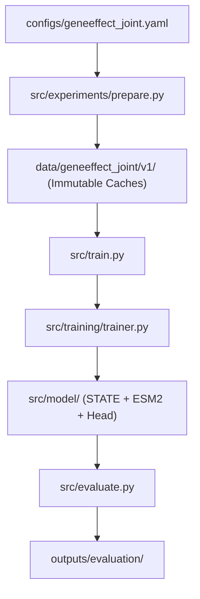

# Overview

<details>
<summary>Relevant source files</summary>

The following files were used as context for generating this wiki page:

- [.claude/skills/research-vault/SKILL.md](.claude/skills/research-vault/SKILL.md)
- [.gitignore](.gitignore)
- [AGENTS.md](AGENTS.md)
- [CLAUDE.md](CLAUDE.md)
- [README.md](README.md)
- [docs/01-blueprint.md](docs/01-blueprint.md)
- [docs/02-literature-review.md](docs/02-literature-review.md)
- [docs/data/cell-line-geneeffect-226.md](docs/data/cell-line-geneeffect-226.md)
- [docs/specs/2026-08-17-exp13-geneeffect-residual-protocol.md](docs/specs/2026-08-17-exp13-geneeffect-residual-protocol.md)
- [figures/geneeffect_architecture.drawio](figures/geneeffect_architecture.drawio)
- [figures/geneeffect_architecture.pdf](figures/geneeffect_architecture.pdf)
- [figures/geneeffect_architecture.png](figures/geneeffect_architecture.png)
- [figures/geneeffect_architecture.svg](figures/geneeffect_architecture.svg)

</details>


The purpose of this wiki page is to provide a high-level technical overview of the `gene-perturbation-prediction` codebase. The repository investigates context-conditioned single-gene dependency prediction (`GeneEffect`) and synthetic-lethality (SL) ranking in held-out cancer cell lines [README.md:3-5](). 

For deep technical details, configuration specifications, and experimental protocols, refer to the child pages:
- [Getting Started and Environment](#1.1) — uv/pyproject setup, dependencies (`torch`, `arc-state`, `scanpy`), running tests, and HPC `run.sh` entrypoints.
- [Research Contract and Documentation Vault](#1.2) — `docs/` hierarchy: blueprint authority, specs, protocols, results; agent instruction files (`CLAUDE.md`, `AGENTS.md`).
- [Scientific Protocols and Benchmarks](#1.3) — GeneEffect residual protocol, SL ranking protocol, 226-cell-line split, DepMap 26Q1 and perturb-seq datasets.

---

## 1. Research Goal and Core Framing

The central research question is whether a virtual cell model trained on single-cell perturbation responses can predict how a gene's fitness cost (GeneEffect) shifts across distinct cellular contexts, enabling robust synthetic-lethal ranking in cell lines excluded from all fitting steps [README.md:27-31]().

Key architectural and scientific boundaries include:
- **Generalization Axis**: Generalization targets **held-out cell lines**, not held-out genes [docs/01-blueprint.md:10-15]().
- **No External Graphs**: No synthetic-lethality graph or interaction network enters the feature extraction or prediction path [docs/01-blueprint.md:15-16]().
- **Internal Baselines**: Models must outperform context-blind gene means, null baselines, and context-ablated heads before any biological context claim is considered [README.md:31-32]().

```mermaid
graph TD
    sub-natural["Natural Language Space"]
    "ResearchGoal" --> "ContextConditionedGeneEffect"
    "ResearchGoal" --> "SyntheticLethalityRanking"
    
    sub-code["Code Entity Space"]
    "ContextConditionedGeneEffect" --> src_experiments_geneeffect["src/experiments/geneeffect.py"]
    "SyntheticLethalityRanking" --> src_baselines["src/baselines/"]
    src_experiments_geneeffect --> src_training_trainer["src/training/trainer.py"]
    src_training_trainer --> src_model["src/model/"]
```

**Sources:** [README.md:1-49](), [docs/01-blueprint.md:1-33]()

---

## 2. Repository Layout and Module Architecture

The repository separates input caching, neural network modules, optimization loops, evaluation, and experiment orchestration into dedicated subpackages under `src/` [CLAUDE.md:52-55]().

| Directory | Role and Modules |
| --- | --- |
| `src/data/` | Data loaders, dataset definitions, split verification (`src/data/splits.py`), and raw ingestion builders (`src/data/prepare/`) [CLAUDE.md:52-67](). |
| `src/model/` | Neural network components: STATE adapters (`src/model/state.py`), ESM2 perturbation adapters (`src/model/adapter.py`), and the five-block residual head (`src/model/head.py`) [CLAUDE.md:56-59](). |
| `src/training/` | Optimization loops (`src/training/trainer.py`), Huber loss, response replay sampling (`src/training/sampling.py`), and checkpointing [CLAUDE.md:56-59](). |
| `src/eval/` | Evaluation scripts and metric calculators for GeneEffect and response distributions (`src/eval/geneeffect.py`, `src/eval/response.py`) [CLAUDE.md:60-62](). |
| `src/baselines/` | Baseline control implementations (gene-mean, copy-prior, nearest-line, context-PCA-ridge) [CLAUDE.md:62](). |
| `src/experiments/` | End-to-end command-line wiring for preparation, training, and baselines (`src/experiments/prepare.py`, `src/experiments/geneeffect.py`) [CLAUDE.md:53-56](). |
| `configs/` | YAML configuration files (`configs/geneeffect_joint.yaml`) and benchmark split manifests (`configs/benchmarks/`) [CLAUDE.md:68-71](). |
| `hpc/` | High-performance computing execution scripts (`hpc/run.sh`) and multi-GPU orchestration [CLAUDE.md:30-36](). |



**Sources:** [CLAUDE.md:50-72](), [AGENTS.md:10-18]()

---

## 3. The Prepare → Train → Evaluate Lifecycle

The execution lifecycle is strictly sequential and governed by a single YAML configuration [CLAUDE.md:51-61]():

1. **Preparation (`src/experiments/prepare.py`)**: Builds immutable input caches under `prepared_root` (`data/geneeffect_joint/v1`), including Tx1 basal-embedding caches, q_sc caches, ESM2 protein feature tables, and response bags. **Training opens these caches and never rebuilds them** [CLAUDE.md:53-55]().
2. **Training (`src/train.py` / `src/training/trainer.py`)**: Executes joint optimization. Every training update minimizes GeneEffect Huber loss, while every fourth update replays response reconstruction across four anchor cell lines [CLAUDE.md:56-59](). Early stopping and checkpoint selection (`best.pt`) rely **exclusively** on validation GeneEffect loss (`val_geneeffect_loss`) [CLAUDE.md:58-59]().
3. **Evaluation (`src/evaluate.py`)**: Restores fitted preprocessing from the checkpoint and exports performance metrics, predictions (`predictions.parquet`), and per-gene/per-line breakdowns [CLAUDE.md:60-62]().

**Sources:** [CLAUDE.md:51-62](), [docs/01-blueprint.md:75-99]()

---

## Links to Child Pages

- For setup, dependencies, and HPC execution, see [Getting Started and Environment](#1.1).
- For research documentation structure and vault discipline, see [Research Contract and Documentation Vault](#1.2).
- For benchmark splitting and residual protocols, see [Scientific Protocols and Benchmarks](#1.3).

---